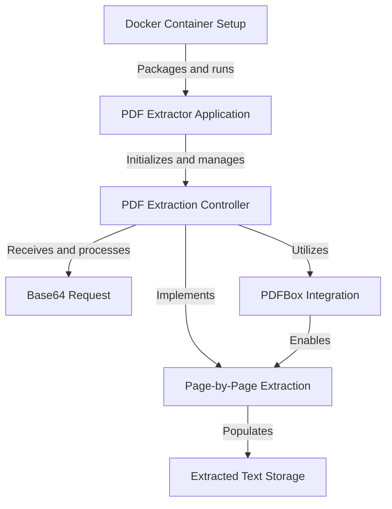
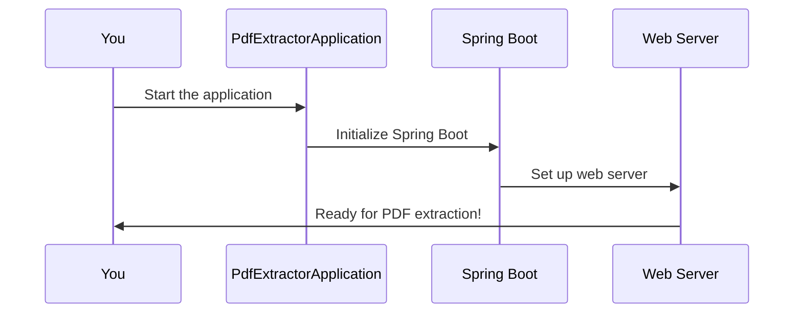
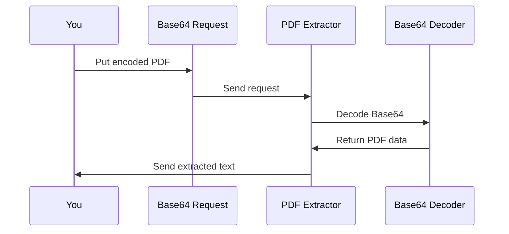
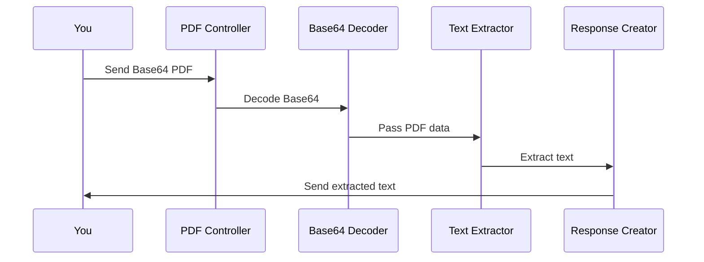
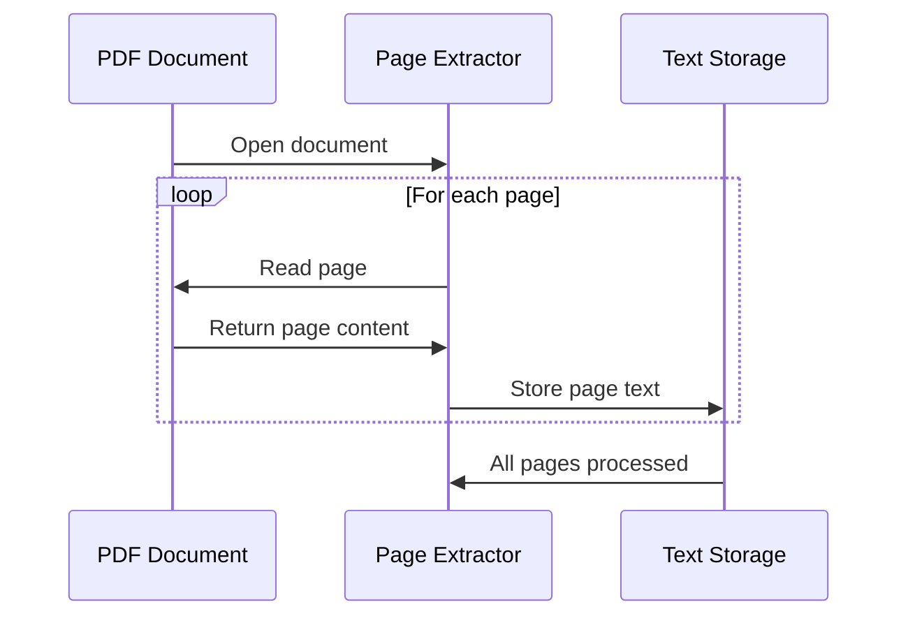
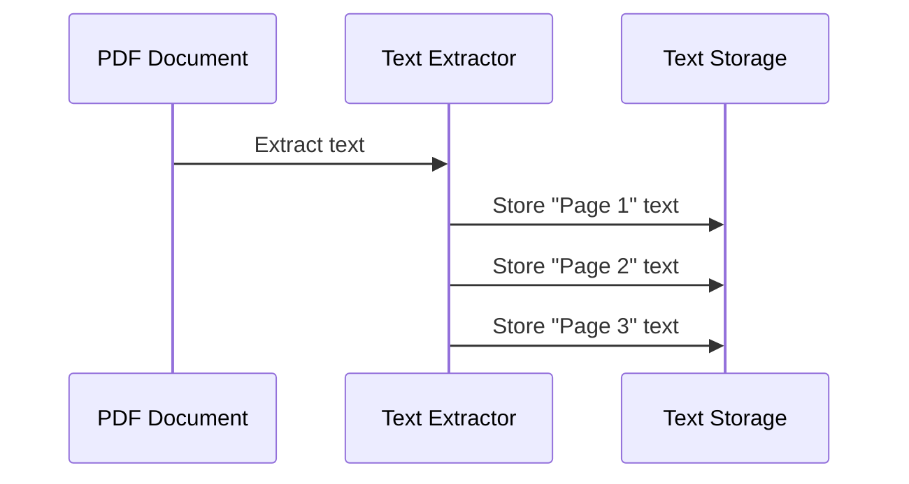
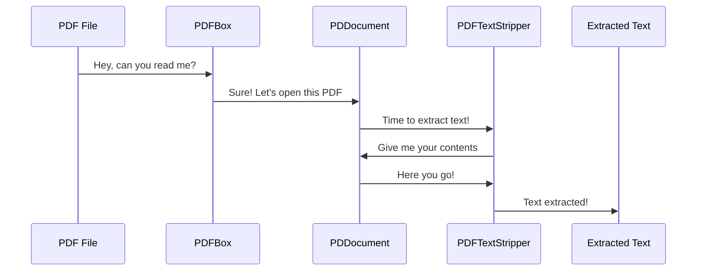
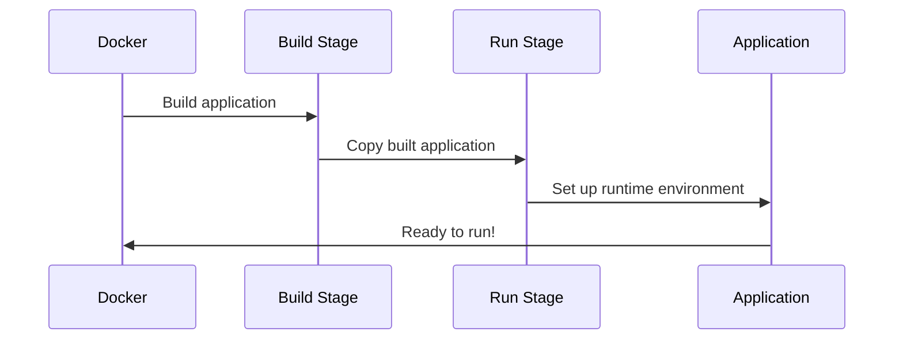

# pdf-extractor Tutorial


# Tutorial: pdf-extractor

This project is a **PDF text extraction** application that allows users to extract text from PDF documents *page by page*. It's built using **Spring Boot** and runs in a **Docker container** for easy deployment. The application receives a PDF file as a **Base64-encoded string**, processes it using the **PDFBox library**, and returns the extracted text organized by page numbers. This tool is particularly useful for *analyzing and processing PDF content* in a structured manner.


**Source Repository:** [https://github.com/dygavieta/pdf-extractor](https://github.com/dygavieta/pdf-extractor)



## Chapters

1. [PDF Extractor Application
](01_pdf_extractor_application_.md)
2. [Base64 Request
](02_base64_request_.md)
3. [PDF Extraction Controller
](03_pdf_extraction_controller_.md)
4. [Page-by-Page Extraction
](04_page_by_page_extraction_.md)
5. [Extracted Text Storage
](05_extracted_text_storage_.md)
6. [PDFBox Integration
](06_pdfbox_integration_.md)
7. [Docker Container Setup
](07_docker_container_setup_.md)


---

Generated by [AI Codebase Knowledge Builder](https://github.com/The-Pocket/Tutorial-Codebase-Knowledge)

---


## 01_pdf_extractor_application_


# Chapter 1: PDF Extractor Application

Welcome to the exciting world of PDF extraction! In this chapter, we'll dive into the heart of our project: the PDF Extractor Application. Think of this as the command center for our PDF adventure – it's where everything begins!

## The Problem We're Solving

Imagine you have a bunch of PDF documents filled with important information, but you need that information in a format you can easily work with, like plain text. How do you get it out? That's where our PDF Extractor Application comes in!

## Our Main Character: PdfExtractorApplication

Let's meet the star of our show:

```java
@SpringBootApplication
public class PdfExtractorApplication {

    public static void main(String[] args) {
        SpringApplication.run(PdfExtractorApplication.class, args);
    }

}
```

This small but mighty piece of code is like the "on" switch for our entire application. Let's break it down:

1. `@SpringBootApplication`: This is a special label that tells our app, "Hey, you're a Spring Boot application!"
2. `public static void main(String[] args)`: This is the starting point of our application.
3. `SpringApplication.run(...)`: This line actually starts up our application.

## What Happens When We Start?

When we run this application, a whole series of events unfolds. Let's visualize it:



1. You start the application.
2. Our `PdfExtractorApplication` kicks into gear.
3. Spring Boot does its magic, setting up all the necessary components.
4. A web server is started, ready to receive your PDF extraction requests.

## Under the Hood

While our `PdfExtractorApplication` class looks simple, it's actually doing a lot behind the scenes:

1. It scans all our other code to find important components.
2. It sets up a web server so we can send requests to our application.
3. It prepares our application to handle [PDF extraction requests](03_pdf_extraction_controller_.md).
4. It gets everything ready for [storing extracted text](05_extracted_text_storage_.md).

## Conclusion

And there you have it! Our `PdfExtractorApplication` is the launchpad for our PDF extraction journey. It might seem small, but it's mighty in what it enables us to do. In the next chapter, we'll explore how we actually send PDFs to our application for extraction. Get ready to dive into [Base64 Request](02_base64_request_.md)!

---

Generated by [AI Codebase Knowledge Builder](https://github.com/The-Pocket/Tutorial-Codebase-Knowledge)

## 02_base64_request_


# Chapter 2: Base64 Request

Welcome back, PDF explorers! In our [previous chapter](01_pdf_extractor_application_.md), we set up our PDF Extractor Application. Now, let's dive into how we actually send PDFs to our application. Enter the star of this chapter: the Base64 Request!

## The Problem We're Solving

Imagine you want to send a PDF file over the internet to our extraction service. But wait! The internet doesn't really like binary files (like PDFs) being sent directly. It's like trying to send a physical book through email - it just doesn't work that way. So, how do we solve this?

## Enter Base64 Request

Think of Base64 Request as a magical envelope for our PDF. It takes our PDF and turns it into a long string of text that can be easily sent over the internet. Let's break it down:

1. **Base64 Encoding**: This is like a secret code that turns our PDF into a string of letters, numbers, and a few symbols.
2. **Request**: This is the container that holds our encoded PDF, ready to be sent to our application.

## How to Use Base64 Request

Let's say you have a PDF file called "myDocument.pdf". Here's how you might use Base64 Request:

1. First, you'd encode your PDF into Base64. (Don't worry, there are tools for this!)
2. Then, you'd create a Base64 Request object with this encoded string.

Here's what our Base64 Request class looks like:

```java
class Base64Request {
    private String pdfBase64;

    public String getPdfBase64() {
        return pdfBase64;
    }

    public void setPdfBase64(String pdfBase64) {
        this.pdfBase64 = pdfBase64;
    }
}
```

This class is like a special envelope. The `pdfBase64` string is where we put our encoded PDF.

## Under the Hood

When you send a Base64 Request to our application, here's what happens:



1. You create a Base64 Request with your encoded PDF.
2. You send this request to our [PDF Extraction Controller](03_pdf_extraction_controller_.md).
3. The controller takes the Base64 string and decodes it back into a PDF.
4. The PDF is then processed for text extraction.

Here's a simplified look at how our controller handles the Base64 Request:

```java
@PostMapping
public Map<String, Object> extractPDFPerPage(@RequestBody Base64Request request) {
    String cleanBase64 = request.getPdfBase64().replaceAll("\\s+", "").trim();
    byte[] pdfBytes = Base64.getDecoder().decode(cleanBase64);
    // Process PDF bytes...
}
```

This code takes the Base64 string from our request, cleans it up, and then decodes it back into PDF data.

## Conclusion

And there you have it! Base64 Request is our secret weapon for sending PDFs over the internet. It's like a magical envelope that turns our PDFs into text for easy transport, and then back into PDFs for processing. 

In our next chapter, we'll explore how our [PDF Extraction Controller](03_pdf_extraction_controller_.md) takes this encoded PDF and works its extraction magic. Get ready for some text extraction excitement!

---

Generated by [AI Codebase Knowledge Builder](https://github.com/The-Pocket/Tutorial-Codebase-Knowledge)

## 03_pdf_extraction_controller_


# Chapter 3: PDF Extraction Controller

Welcome back, PDF adventurers! In our [previous chapter](02_base64_request_.md), we learned how to package our PDFs for their internet journey. Now, let's meet the superstar that handles these packages when they arrive: the PDF Extraction Controller!

## The Problem We're Solving

Imagine you're running a busy post office for PDFs. PDFs are arriving constantly, and you need to make sure each one gets opened, read, and its contents sent back to the sender. How do you manage all this traffic efficiently? That's where our PDF Extraction Controller comes in!

## Meet the PDF Extraction Controller

Think of the PDF Extraction Controller as the head postmaster of our PDF post office. It's responsible for:

1. Receiving incoming PDF packages (our Base64 requests)
2. Opening these packages (decoding the Base64)
3. Reading the contents (extracting text from the PDF)
4. Sending the contents back to the sender

Let's take a look at our controller:

```java
@RestController
@RequestMapping("/extract")
public class PDFExtractorController {
    @PostMapping
    public Map<String, Object> extractPDFPerPage(@RequestBody Base64Request request) {
        // Magic happens here!
    }
}
```

This small piece of code is the gateway for all our PDF extraction requests. It's like the front desk of our PDF post office.

## How It Works

When a PDF arrives for extraction, here's what happens:



1. You send a Base64-encoded PDF to the controller.
2. The controller decodes the Base64 back into PDF data.
3. It passes this data to a text extractor.
4. The extracted text is packaged into a response.
5. The response is sent back to you.

## Under the Hood

Let's peek inside our `extractPDFPerPage` method:

```java
public Map<String, Object> extractPDFPerPage(@RequestBody Base64Request request) {
    Map<String, Object> pageTextMap = new HashMap<>();
    String cleanBase64 = request.getPdfBase64().replaceAll("\\s+", "").trim();
    byte[] pdfBytes = Base64.getDecoder().decode(cleanBase64);
    // Extract text from pdfBytes...
    return pageTextMap;
}
```

This method does several important things:
1. It creates a `pageTextMap` to store our results.
2. It cleans up the Base64 string we received.
3. It decodes the Base64 into PDF data.
4. It extracts text from the PDF (we'll see how in the [Page-by-Page Extraction](04_page_by_page_extraction_.md) chapter).
5. Finally, it returns the extracted text.

## Conclusion

And there you have it! Our PDF Extraction Controller is the traffic director for all our PDF extraction needs. It receives PDFs, manages their processing, and ensures the extracted text gets back to where it needs to go.

In our next chapter, we'll dive deeper into how we actually extract text from these PDFs, [Page-by-Page Extraction](04_page_by_page_extraction_.md). Get ready to unlock the secrets hidden in your PDFs!

---

Generated by [AI Codebase Knowledge Builder](https://github.com/The-Pocket/Tutorial-Codebase-Knowledge)

## 04_page_by_page_extraction_


# Chapter 4: Page-by-Page Extraction

Welcome back, PDF explorers! In our [previous chapter](03_pdf_extraction_controller_.md), we learned how our PDF Extraction Controller manages incoming PDF requests. Now, let's dive into the heart of our extraction process: Page-by-Page Extraction!

## The Problem We're Solving

Imagine you have a big book of recipes, and you want to copy each recipe onto a separate index card. You wouldn't just dump all the text onto one giant card, right? That's exactly the problem we're solving with our PDFs!

## Meet the Page-by-Page Extractor

Think of our Page-by-Page Extractor as a super-efficient librarian. This librarian goes through your PDF, one page at a time, carefully copying the text from each page onto a separate "card" (in our case, a separate entry in our results).

Let's see how this works in action:

```java
for (int i = 1; i <= totalPages; i++) {
    pdfStripper.setStartPage(i);
    pdfStripper.setEndPage(i);
    String pageText = pdfStripper.getText(document).trim();
    // Store pageText...
}
```

This code is like our librarian flipping through the book, page by page. For each page:
1. We tell our librarian which page to look at (`setStartPage(i)` and `setEndPage(i)`).
2. We ask them to copy the text from that page (`getText(document)`).
3. We store that text separately for each page.

## How It Works

When we extract text from a PDF, here's what happens:



1. We open the PDF document.
2. For each page in the document:
   - We read the text from that page.
   - We store the text separately.
3. Once all pages are processed, we're done!

## Under the Hood

Let's take a closer look at how we process each page:

```java
List<String> lines = Arrays.stream(pageText.split("\n"))
    .map(String::trim)
    .filter(line -> !line.isEmpty())
    .collect(Collectors.toList());

pageTextMap.put("page" + i, lines);
```

This code does a few important things:
1. It splits the page text into separate lines.
2. It trims each line to remove extra spaces.
3. It removes any empty lines.
4. Finally, it stores all the lines for this page in our `pageTextMap`.

Think of it like our librarian neatly writing each line of the recipe on the index card, skipping any blank lines, and making sure there's no wasted space.

## Conclusion

And there you have it! Our Page-by-Page Extraction process ensures that we capture the content of each PDF page separately, maintaining the structure of the original document. It's like having a meticulous librarian who carefully copies each page of your book onto separate index cards.

In our next chapter, we'll explore how we store all this extracted text. Get ready to dive into [Extracted Text Storage](05_extracted_text_storage_.md) and see how we keep all our extracted information organized!

---

Generated by [AI Codebase Knowledge Builder](https://github.com/The-Pocket/Tutorial-Codebase-Knowledge)

## 05_extracted_text_storage_


# Chapter 5: Extracted Text Storage

Welcome back, PDF explorers! In our [previous chapter](04_page_by_page_extraction_.md), we learned how to extract text from PDFs page by page. Now, let's dive into how we organize and store all that extracted text!

## The Problem We're Solving

Imagine you've just finished reading a massive cookbook and you've copied each recipe onto separate index cards. Now, you need a way to organize these cards so you can easily find any recipe when you need it. That's exactly what we're doing with our extracted PDF text!

## Meet the Extracted Text Storage

Think of our Extracted Text Storage as a magical filing cabinet. Each drawer in this cabinet represents a page from our PDF, and inside each drawer are neatly organized notes (our extracted text lines). 

Here's how we create our magical filing cabinet:

```java
Map<String, List<String>> pageTextMap = new HashMap<>();
```

This line creates our filing cabinet (Map) where we can store text from each page.

## How It Works

When we store our extracted text, here's what happens:



1. We extract text from a page of the PDF.
2. We create a label for this page (like "Page 1", "Page 2", etc.).
3. We store the text under this label in our filing cabinet.

## Under the Hood

Let's take a closer look at how we store text for each page:

```java
List<String> lines = Arrays.stream(pageText.split("\n"))
    .map(String::trim)
    .filter(line -> !line.isEmpty())
    .collect(Collectors.toList());

pageTextMap.put("page" + i, lines);
```

This code does a few important things:
1. It splits the page text into separate lines.
2. It cleans up each line, removing extra spaces.
3. It removes any empty lines.
4. Finally, it stores all the lines for this page in our filing cabinet (pageTextMap).

It's like writing each line of a recipe on a separate note and putting all these notes in the drawer labeled with the page number.

## Accessing Stored Text

Once we've stored our text, we can easily access it:

```java
List<String> page1Text = pageTextMap.get("page1");
```

This line retrieves all the text from the first page of our PDF. It's like opening the "Page 1" drawer of our filing cabinet and taking out all the notes.

## Conclusion

And there you have it! Our Extracted Text Storage system helps us keep all the text we've extracted from our PDF organized and easy to access. It's like having a perfectly organized filing cabinet for all our PDF content.

In our next chapter, we'll explore how we actually extract the text from PDFs using [PDFBox Integration](06_pdfbox_integration_.md). Get ready to unlock the power of PDF processing!

---

Generated by [AI Codebase Knowledge Builder](https://github.com/The-Pocket/Tutorial-Codebase-Knowledge)

## 06_pdfbox_integration_


# Chapter 6: PDFBox Integration

Welcome back, PDF enthusiasts! In our [previous chapter](05_extracted_text_storage_.md), we learned how to store our extracted text. Now, let's dive into the magic behind actually extracting that text: PDFBox Integration!

## The Problem We're Solving

Imagine you have a treasure chest (your PDF) full of valuable information, but you can't open it with your bare hands. You need a special key to unlock it and retrieve the treasure inside. That's where PDFBox comes in!

## Meet PDFBox: Your PDF Swiss Army Knife

PDFBox is like a magical Swiss Army knife for PDFs. It's a powerful tool that helps us open, read, and extract content from PDF files. Let's see how we use it in our project:

```java
import org.apache.pdfbox.pdmodel.PDDocument;
import org.apache.pdfbox.text.PDFTextStripper;

PDDocument document = PDDocument.load(pdfInputStream);
PDFTextStripper pdfStripper = new PDFTextStripper();
String text = pdfStripper.getText(document);
```

This small piece of code is doing a lot:
1. We're opening our PDF treasure chest (`PDDocument.load`)
2. We're creating a magical text extractor (`PDFTextStripper`)
3. We're using this extractor to get all the text from our PDF (`getText`)

## How It Works

When we use PDFBox to extract text from a PDF, here's what happens:



1. We give PDFBox our PDF file.
2. PDFBox opens the PDF and creates a `PDDocument` object.
3. We create a `PDFTextStripper` to extract text.
4. The stripper reads through the document and extracts all the text.
5. We get back the extracted text!

## Under the Hood

Let's take a closer look at how we use PDFBox in our [PDF Extraction Controller](03_pdf_extraction_controller_.md):

```java
try (PDDocument document = PDDocument.load(new ByteArrayInputStream(pdfBytes))) {
    PDFTextStripper pdfStripper = new PDFTextStripper();
    for (int i = 1; i <= document.getNumberOfPages(); i++) {
        pdfStripper.setStartPage(i);
        pdfStripper.setEndPage(i);
        String pageText = pdfStripper.getText(document);
        // Store pageText...
    }
}
```

This code is doing several important things:
1. It opens our PDF document from a byte array.
2. It creates a PDFTextStripper to extract text.
3. For each page in the document:
   - It tells the stripper which page to look at.
   - It extracts the text from that page.
   - It stores the extracted text (as we learned in [Extracted Text Storage](05_extracted_text_storage_.md)).

## Conclusion

And there you have it! PDFBox is our magical key to unlocking the treasures hidden in PDF files. It allows us to open PDFs, navigate through their pages, and extract all the valuable text inside.

In our next chapter, we'll explore how we package all of this PDF magic into a [Docker Container Setup](07_docker_container_setup_.md). Get ready to learn how we can easily share and deploy our PDF extraction superpowers!

---

Generated by [AI Codebase Knowledge Builder](https://github.com/The-Pocket/Tutorial-Codebase-Knowledge)

## 07_docker_container_setup_


# Chapter 7: Docker Container Setup

Welcome back, PDF adventurers! In our [previous chapter](06_pdfbox_integration_.md), we learned how to extract text from PDFs using PDFBox. Now, let's package our entire PDF extraction application into a neat, portable container using Docker!

## The Problem We're Solving

Imagine you've built an amazing LEGO robot, but every time you want to show it to a friend, you have to disassemble it, pack all the pieces, and rebuild it at their house. Wouldn't it be great if you could just put your whole robot in a box and take it anywhere? That's exactly what Docker does for our PDF Extractor application!

## Meet Docker: Your Application's Suitcase

Docker is like a magical suitcase for your application. It packs up your PDF Extractor, along with everything it needs to run, into a single, portable package called a container. This container can then be easily moved and run on any computer that has Docker installed.

Let's take a look at our Dockerfile, which is like the packing instructions for our suitcase:

```dockerfile
FROM maven:3.9-amazoncorretto-21 AS build
WORKDIR /app
COPY pom.xml .
COPY src ./src
RUN mvn clean package -DskipTests
```

This part of the Dockerfile is like packing the first compartment of our suitcase. It sets up a temporary area where we build our application using Maven.

## How It Works

When we create our Docker container, here's what happens:



1. Docker starts with a base image that includes Java and Maven.
2. It copies our application code and builds it.
3. It then sets up a lightweight environment to run our application.
4. Finally, our application is ready to run in its portable container!

## Under the Hood

Let's take a closer look at the second part of our Dockerfile:

```dockerfile
FROM amazoncorretto:21-alpine-jdk
WORKDIR /app
COPY --from=build /app/target/*.jar app.jar
ENTRYPOINT ["java",  "-jar", "app.jar"]
```

This code is doing several important things:
1. It starts with a lightweight Java runtime environment.
2. It sets up a working directory in our container.
3. It copies our built application from the previous stage.
4. It specifies how to run our application when the container starts.

Think of it like packing the essentials in a small, efficient suitcase, ready for a quick trip!

## Running Our Containerized Application

Once our application is containerized, running it is as simple as:

```bash
docker run -p 8080:8080 pdf-extractor
```

This command tells Docker to start our PDF Extractor application and make it accessible on port 8080. It's like plugging in and turning on our LEGO robot - it's ready to go right out of the box!

## Conclusion

And there you have it! Docker Container Setup allows us to package our entire PDF Extractor application, including all its dependencies and runtime environment, into a portable, easy-to-run container. It's like having a magic suitcase that carries not just your LEGO robot, but the entire workbench you used to build it.

With this, we've reached the end of our PDF Extractor journey. You now have a powerful, portable tool for extracting text from PDFs. Remember, whether you're running it on your local machine or deploying it to the cloud, your PDF Extractor is always just a Docker container away!

---

Generated by [AI Codebase Knowledge Builder](https://github.com/The-Pocket/Tutorial-Codebase-Knowledge)