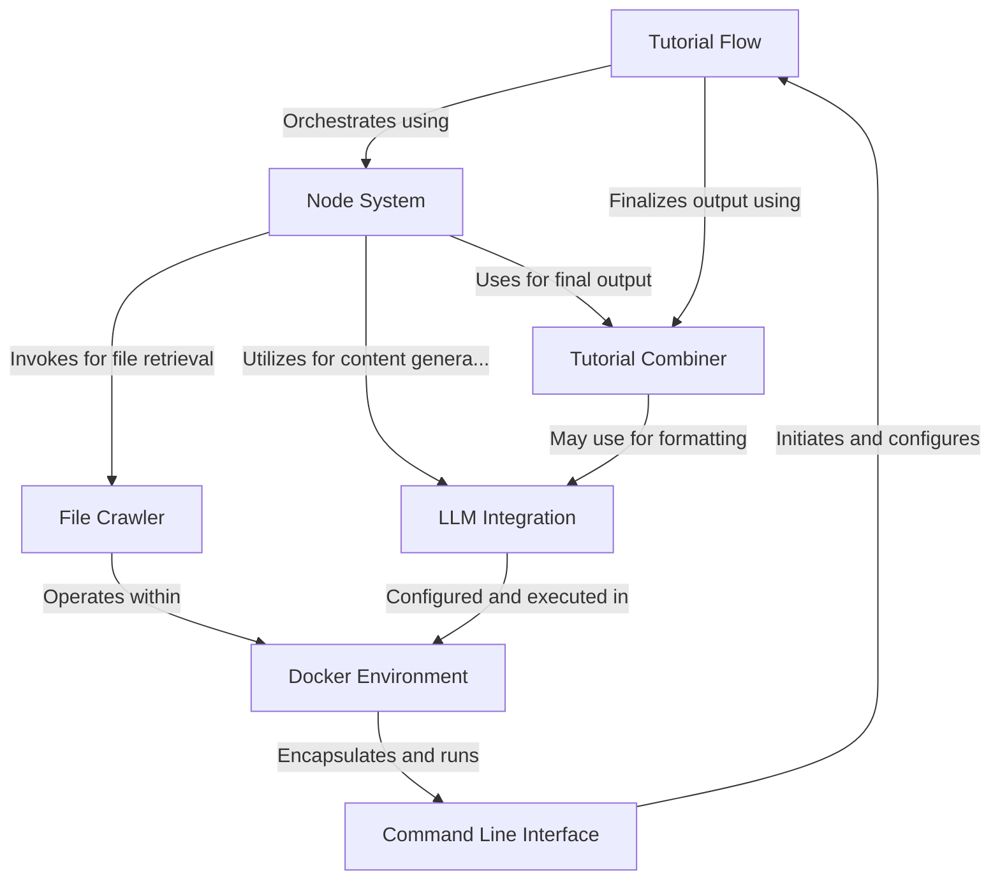
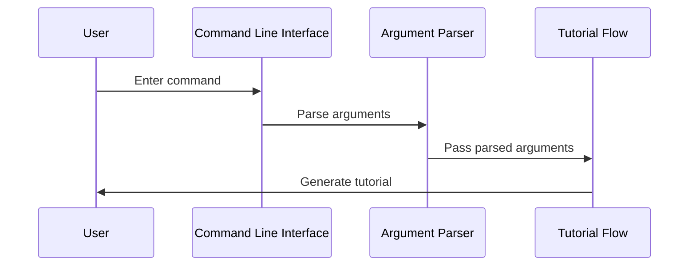
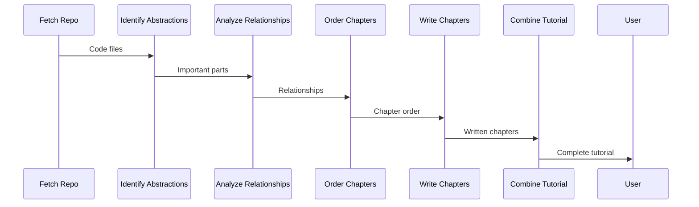
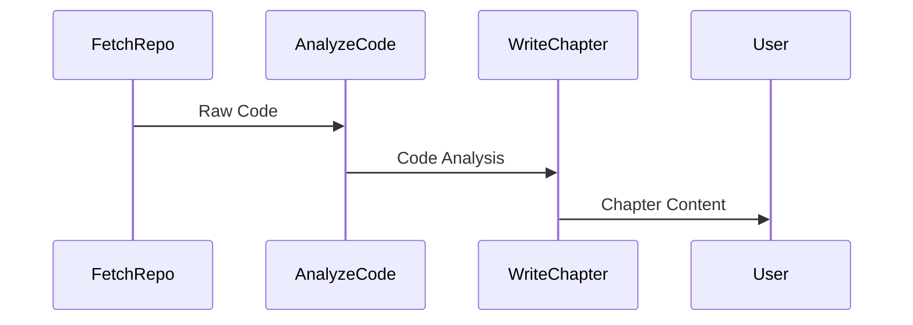
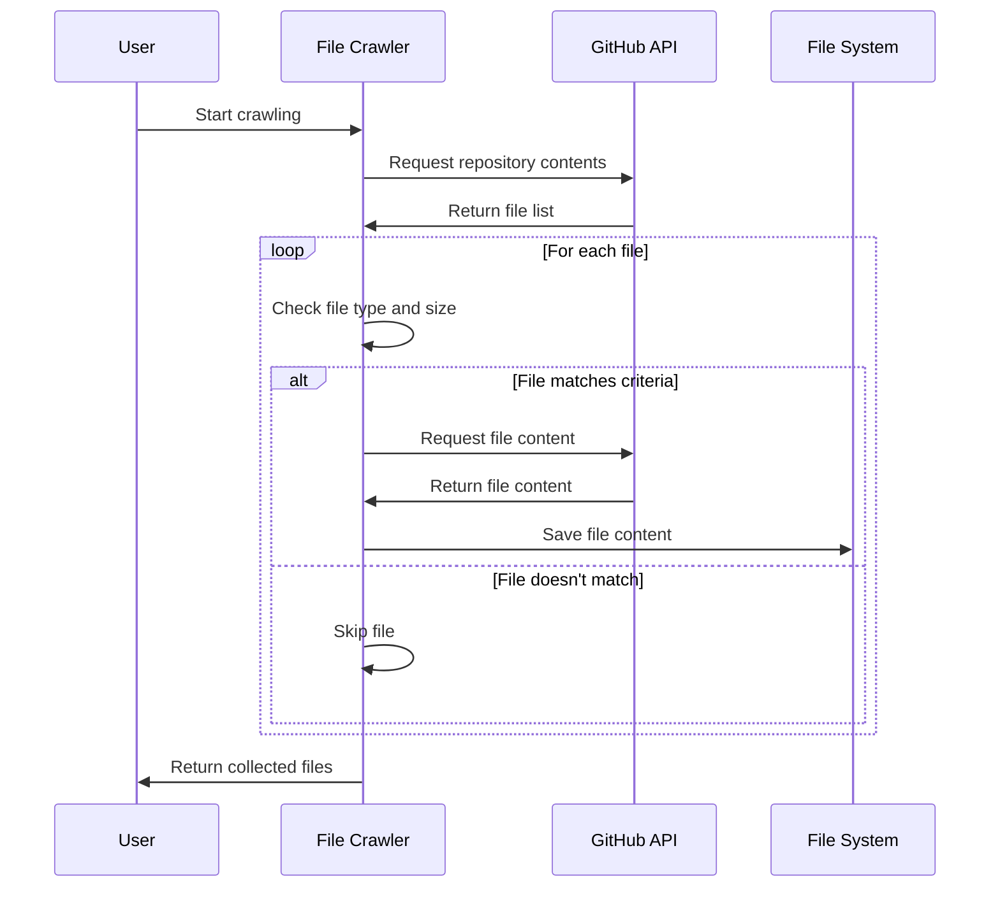
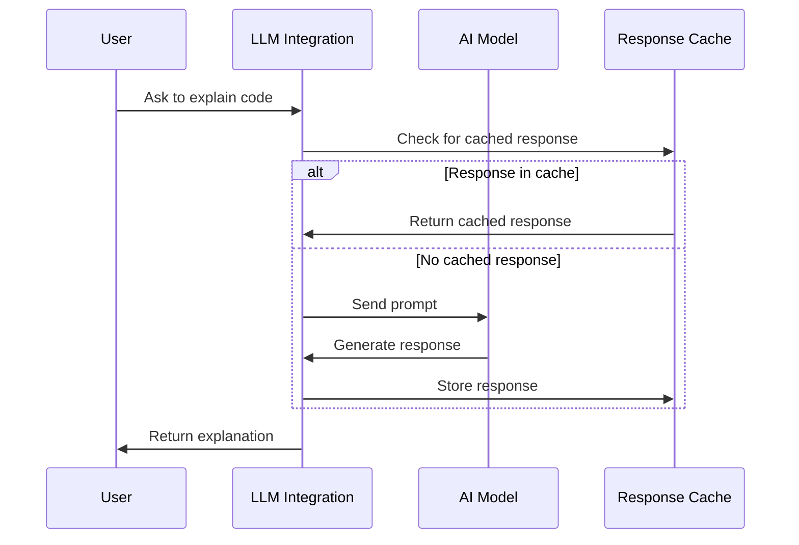
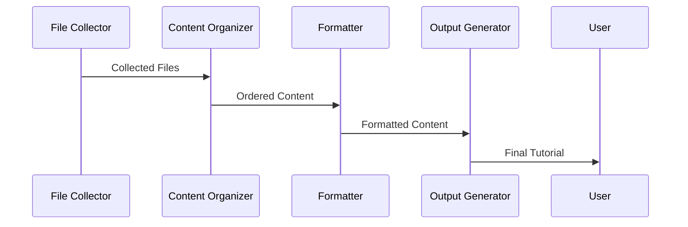
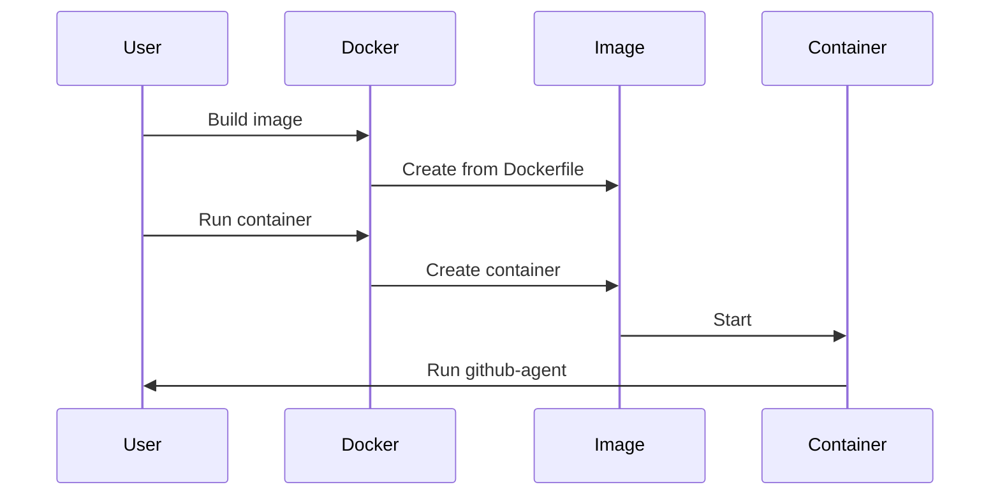

# github-agent Tutorial


# Tutorial: github-agent

The **github-agent** project is an automated tool for generating **comprehensive tutorials** from GitHub repositories or local directories. It uses **AI-powered analysis** to identify key abstractions in codebases, explain their relationships, and create detailed, beginner-friendly documentation. The system employs a **modular architecture** with a *Node System* for processing, *LLM Integration* for content generation, and supports multiple output formats and upload options. This tool aims to make complex codebases more accessible and understandable for developers of all skill levels.


**Source Repository:** [https://github.com/dygavieta/github-agent](https://github.com/dygavieta/github-agent)



## Chapters

1. [Command Line Interface
](01_command_line_interface_.md)
2. [Tutorial Flow
](02_tutorial_flow_.md)
3. [Node System
](03_node_system_.md)
4. [File Crawler
](04_file_crawler_.md)
5. [LLM Integration
](05_llm_integration_.md)
6. [Tutorial Combiner
](06_tutorial_combiner_.md)
7. [Docker Environment
](07_docker_environment_.md)


---


## 01_command_line_interface_


# Chapter 1: Command Line Interface

Welcome to the first chapter of our tutorial on the `github-agent` project! We're going to start by exploring the Command Line Interface (CLI), which is your main way of interacting with this powerful tool.

Imagine you're about to embark on a road trip. Before you start driving, you need to input your destination, choose your route, and set up your preferences. The CLI for `github-agent` works in a similar way - it's like the dashboard of your car, allowing you to set up everything before your tutorial generation journey begins.

Let's say you want to generate a tutorial for a GitHub project called "awesome-app". Here's how you might use the CLI:

```bash
python main.py --repo https://github.com/username/awesome-app --language english
```

This simple command tells `github-agent` to create a tutorial for the "awesome-app" repository in English. But there's so much more you can do! Let's break down the key concepts of our CLI.

## Key Concepts

1. **Source Selection**: You can choose between a GitHub repository or a local directory as your source.
2. **Output Customization**: Decide where and how your tutorial should be saved.
3. **File Filtering**: Select which files to include or exclude in your tutorial.
4. **Language Selection**: Choose the language for your generated tutorial.
5. **Caching**: Enable or disable caching of language model responses.

Let's look at these in more detail.

### Source Selection

You have two options for your tutorial source:

```bash
python main.py --repo https://github.com/username/awesome-app
```
or
```bash
python main.py --dir /path/to/local/project
```

The `--repo` option is for GitHub repositories, while `--dir` is for local directories. Choose the one that fits your needs!

### Output Customization

By default, your tutorial will be saved in an `output` directory. But you can change this:

```bash
python main.py --repo https://github.com/username/awesome-app --output my_tutorials
```

This will save your tutorial in a directory called `my_tutorials`.

### File Filtering

You can specify which files to include or exclude:

```bash
python main.py --repo https://github.com/username/awesome-app --include "*.py" "*.js" --exclude "tests/*"
```

This will include Python and JavaScript files, but exclude anything in the `tests` directory.

### Language Selection

Choose the language for your tutorial:

```bash
python main.py --repo https://github.com/username/awesome-app --language spanish
```

This will generate the tutorial in Spanish.

### Caching

By default, caching is enabled to speed up tutorial generation. You can disable it if needed:

```bash
python main.py --repo https://github.com/username/awesome-app --no-cache
```

## Under the Hood

When you run a command, here's what happens behind the scenes:



1. You enter a command.
2. The CLI processes your input.
3. The argument parser interprets your options.
4. These options are passed to the tutorial flow, which generates your tutorial.

Let's look at a simplified version of how this works in code:

```python
def main():
    parser = argparse.ArgumentParser()
    parser.add_argument("--repo", help="GitHub repository URL")
    # ... other arguments ...
    args = parser.parse_args()

    shared = {
        "repo_url": args.repo,
        # ... other options ...
    }

    tutorial_flow = create_tutorial_flow()
    tutorial_flow.run(shared)
```

This code sets up the argument parser, creates a dictionary of shared options, and then runs the tutorial flow with these options.

## Conclusion

The Command Line Interface is your control center for `github-agent`. It allows you to customize your tutorial generation process, making it flexible and powerful. 

In the next chapter, we'll dive into the [Tutorial Flow](02_tutorial_flow_.md) to see how your CLI inputs are transformed into a comprehensive tutorial. Get ready to explore the magic behind the scenes!


## 02_tutorial_flow_


# Chapter 2: Tutorial Flow

Welcome back! In our [previous chapter](01_command_line_interface_.md), we learned how to interact with `github-agent` using the Command Line Interface. Now, let's dive into the heart of our tutorial generation process: the Tutorial Flow.

Imagine you're following a cooking recipe. You start by gathering ingredients, then prepare them, mix them together, and finally cook your dish. The Tutorial Flow works in a similar way, but instead of creating a meal, it's creating a tutorial for your codebase!

Let's say you want to create a tutorial for your awesome new app. Here's how the Tutorial Flow helps you do that:

1. It fetches your code (like gathering ingredients)
2. It identifies the important parts of your code (like preparing ingredients)
3. It figures out how these parts work together (like understanding how ingredients mix)
4. It decides the best order to explain things (like planning the cooking steps)
5. It writes the tutorial chapters (like cooking the dish)
6. It combines everything into a complete tutorial (like plating the meal)

Let's break this down and see how it works!

## Key Concepts

### 1. Fetching the Repository

This is like going to the grocery store. The Tutorial Flow starts by getting all your code from GitHub or your local directory.

```python
fetch_repo = FetchRepo()
```

This simple line sets up the "fetching" step. It's like saying "I'm ready to go shopping!"

### 2. Identifying Abstractions

Next, the flow looks at your code and figures out the important parts. It's like sorting through your groceries and deciding what's essential for your recipe.

```python
identify_abstractions = IdentifyAbstractions(max_retries=5, wait=20)
```

This step might take a few tries (that's what `max_retries=5` means), just like you might need to double-check your ingredients.

### 3. Analyzing Relationships

Now, the flow figures out how different parts of your code work together. It's like understanding how flavors combine in cooking.

```python
analyze_relationships = AnalyzeRelationships(max_retries=5, wait=20)
```

### 4. Ordering Chapters

The flow decides the best order to explain your code. It's like planning the steps of your recipe.

```python
order_chapters = OrderChapters(max_retries=5, wait=20)
```

### 5. Writing Chapters

This is where the magic happens! The flow writes each chapter of your tutorial, explaining your code bit by bit.

```python
write_chapters = WriteChapters(max_retries=5, wait=20)
```

### 6. Combining the Tutorial

Finally, all the chapters are put together into one complete tutorial. It's like serving your finished dish!

```python
combine_tutorial = CombineTutorial()
combine_files = CombineTutorialFiles()
```

## How It All Works Together

Let's see how these steps flow together:



This diagram shows how information flows from one step to the next, eventually resulting in your complete tutorial!

## Under the Hood

Let's peek at how this flow is set up in the code:

```python
def create_tutorial_flow():
    fetch_repo = FetchRepo()
    identify_abstractions = IdentifyAbstractions(max_retries=5, wait=20)
    analyze_relationships = AnalyzeRelationships(max_retries=5, wait=20)
    order_chapters = OrderChapters(max_retries=5, wait=20)
    write_chapters = WriteChapters(max_retries=5, wait=20)
    combine_tutorial = CombineTutorial()
    
    # Connect the steps
    fetch_repo >> identify_abstractions >> analyze_relationships >> order_chapters >> write_chapters >> combine_tutorial
    
    return Flow(start=fetch_repo)
```

This code sets up each step and connects them in order, like laying out the steps of a recipe.

The `>>` symbol is used to connect steps, showing which step comes next. It's like drawing arrows between steps in your recipe.

## Conclusion

The Tutorial Flow is the engine that drives `github-agent`. It takes your code, understands it, and transforms it into a clear, step-by-step tutorial. By breaking down the process into manageable steps, it ensures that your tutorial is comprehensive and well-structured.

In our next chapter, we'll dive into the [Node System](03_node_system_.md), which powers each step of our Tutorial Flow. Get ready to explore the building blocks that make this magic possible!


## 03_node_system_


# Chapter 3: Node System

Welcome back to our journey through the `github-agent` project! In the [previous chapter](02_tutorial_flow_.md), we explored the Tutorial Flow, which guides the overall process of creating tutorials. Now, let's dive into the engine that powers this flow: the Node System.

## What is the Node System?

Imagine you're building a toy car on an assembly line. Each station on the line has a specific job: one attaches the wheels, another paints the body, and so on. The Node System in `github-agent` works similarly, but instead of building a toy car, we're crafting a tutorial!

The Node System is like our assembly line, where each "station" (called a node) performs a specific task on our tutorial "product". Let's see how this works in practice.

## Key Concepts

### 1. Nodes

A node is like a worker on our assembly line. Each node has a specific job to do. For example, we might have nodes for:

- Fetching code from GitHub
- Analyzing the code structure
- Writing individual chapters

### 2. Input and Output

Each node takes some input (like raw code), processes it, and produces an output (like a chapter summary). This output can then become the input for the next node.

### 3. Flow

The nodes are connected in a specific order, creating a flow of information. This is like how our toy car moves from one station to the next on the assembly line.

## How to Use the Node System

Let's look at a simple example of how we might set up a basic node system:

```python
fetch_node = FetchRepo()
analyze_node = AnalyzeCode()
write_node = WriteChapter()

fetch_node >> analyze_node >> write_node
```

In this example:
1. `FetchRepo` fetches the code
2. `AnalyzeCode` examines the fetched code
3. `WriteChapter` uses the analysis to write a chapter

The `>>` symbol connects the nodes, showing the order of operations.

## Under the Hood

Let's peek at how a node might work internally:

```python
class AnalyzeCode(Node):
    def exec(self, code):
        # Analyze the code
        important_parts = find_important_parts(code)
        return important_parts

    def post(self, shared, prep_res, exec_res):
        shared['analysis'] = exec_res
```

Here's what's happening:
1. The `exec` method does the main work (analyzing code).
2. The `post` method saves the result for other nodes to use.

## The Node System in Action

Let's visualize how data flows through our node system:



1. `FetchRepo` gets the code and passes it to `AnalyzeCode`.
2. `AnalyzeCode` examines the code and sends its findings to `WriteChapter`.
3. `WriteChapter` uses this analysis to create the final chapter content.

## Why Use the Node System?

The Node System offers several benefits:

1. **Modularity**: We can easily add, remove, or rearrange nodes.
2. **Flexibility**: Each node can be customized or replaced without affecting others.
3. **Clarity**: The flow of data is clear and easy to understand.
4. **Reusability**: Nodes can be reused in different flows or projects.

## Conclusion

The Node System is the backbone of `github-agent`, allowing us to break down the complex task of tutorial generation into manageable, modular steps. By understanding this system, you're now equipped to grasp how `github-agent` transforms code into comprehensive tutorials.

In our [next chapter](04_file_crawler_.md), we'll explore the File Crawler, which helps us navigate through the codebase. Get ready to discover how `github-agent` finds its way through the maze of project files!


## 04_file_crawler_


# Chapter 4: File Crawler

Welcome back to our journey through the `github-agent` project! In our [previous chapter](03_node_system_.md), we explored the Node System, which forms the backbone of our tutorial generation process. Now, let's dive into an exciting component that helps us navigate through the vast sea of code: the File Crawler.

Imagine you're a detective investigating a huge library. Your mission is to find specific books that contain important clues. That's exactly what our File Crawler does, but instead of a physical library, it searches through digital repositories or local directories to find the right files for our tutorial.

Let's say we want to create a tutorial for a Python project. Here's how the File Crawler helps us:

1. It goes through all the files in the project.
2. It picks out only the Python files (ignoring things like images or configuration files).
3. It skips over files that are too big or not relevant to our tutorial.
4. It collects the content of the files we need.

## Key Concepts

### 1. Repository Navigation

The File Crawler can work with both GitHub repositories and local directories. It's like having a map of our code library.

```python
repo_url = "https://github.com/username/awesome-project"
local_dir = "/path/to/my/project"
```

### 2. File Filtering

We can tell the File Crawler which files to include or exclude. It's like giving our detective specific instructions on which books to look for.

```python
include_patterns = {"*.py", "*.md"}
exclude_patterns = {"tests/*", "*.pyc"}
```

### 3. Size Limits

We can set a maximum file size to avoid processing huge files that might slow us down.

```python
max_file_size = 1 * 1024 * 1024  # 1 MB
```

## Using the File Crawler

Let's see how we might use the File Crawler to get Python files from a GitHub repository:

```python
from utils.crawl_github_files import crawl_github_files

result = crawl_github_files(
    repo_url,
    include_patterns={"*.py"},
    max_file_size=1 * 1024 * 1024
)
```

This code will:
1. Go to the specified GitHub repository
2. Look for all Python files (`.py`)
3. Skip any files larger than 1 MB
4. Return a dictionary with the file contents

## Under the Hood

Let's peek at how the File Crawler works its magic:



1. The user starts the crawling process.
2. The File Crawler asks GitHub for a list of files.
3. For each file, it checks if it matches our criteria (type, size, etc.).
4. If a file matches, it fetches and saves the content.
5. If a file doesn't match, it skips it.
6. Finally, it returns all the collected files to the user.

Let's look at a simplified version of the code that does this:

```python
def crawl_github_files(repo_url, include_patterns, max_file_size):
    files = {}
    for file in get_repo_files(repo_url):
        if file_matches_pattern(file, include_patterns) and file_size_ok(file, max_file_size):
            content = fetch_file_content(file)
            files[file.path] = content
    return files
```

This function goes through each file in the repository, checks if it matches our criteria, and if so, fetches its content and adds it to our `files` dictionary.

## Conclusion

The File Crawler is our trusty detective, sifting through the vast world of code to find exactly what we need for our tutorial. By understanding how it works, we can efficiently gather the right files to create comprehensive and focused tutorials.

In our [next chapter](05_llm_integration_.md), we'll explore how we integrate Language Models to transform these collected files into coherent tutorial content. Get ready to see how we turn code into clear, beginner-friendly explanations!


## 05_llm_integration_


# Chapter 5: LLM Integration

Welcome back to our journey through the `github-agent` project! In our [previous chapter](04_file_crawler_.md), we explored how the File Crawler helps us navigate through codebases. Now, let's dive into the exciting world of LLM Integration - the AI brain of our project!

Imagine you have a super-smart friend who can read code and explain it in simple terms. That's exactly what LLM Integration does for `github-agent`! It's like having an AI tutor that turns complex code into easy-to-understand tutorials.

Let's say we want to explain a piece of Python code to a beginner. Here's how LLM Integration helps us:

1. It reads the code we give it.
2. It understands what the code does.
3. It creates a beginner-friendly explanation.
4. It can even answer questions about the code!

## Key Concepts

### 1. Language Model Communication

LLM Integration talks to AI models like GPT. It's like having a conversation with a very smart computer!

### 2. Prompt Creation

We create special messages (called prompts) to ask the AI for help. It's like knowing the right questions to ask our smart friend.

### 3. Response Processing

We take the AI's answer and make it fit perfectly into our tutorial. It's like taking notes from our smart friend's explanation.

## Using LLM Integration

Let's see how we might use LLM Integration to explain a simple Python function:

```python
def greet(name):
    return f"Hello, {name}!"

response = call_llm(f"Explain this code: {greet}")
print(response)
```

This code will:
1. Send our `greet` function to the AI.
2. Ask the AI to explain it.
3. Print the AI's explanation.

The output might look something like this:

```
This code defines a function called 'greet' that takes one parameter 'name'.
It returns a greeting message that includes the provided name.
For example, if you call greet("Alice"), it will return "Hello, Alice!".
```

## Under the Hood

Let's peek at how LLM Integration works its magic:



1. The user asks LLM Integration to explain some code.
2. LLM Integration checks if it has explained this before (using a cache).
3. If it's in the cache, it returns the stored explanation.
4. If not, it asks the AI model for help.
5. The AI generates an explanation.
6. LLM Integration stores this new explanation for future use.
7. Finally, it returns the explanation to the user.

Let's look at a simplified version of the code that does this:

```python
def call_llm(prompt: str, use_cache: bool = True) -> str:
    if use_cache and prompt in cache:
        return cache[prompt]
    
    response = ai_model.generate(prompt)
    
    if use_cache:
        cache[prompt] = response
    
    return response
```

This function checks the cache, calls the AI if needed, and stores the result for future use.

## Conclusion

LLM Integration is like having a brilliant coding tutor at our fingertips. It helps `github-agent` transform complex code into clear, beginner-friendly explanations. By understanding how it works, we can create tutorials that make even the trickiest concepts easy to grasp.

In our [next chapter](06_tutorial_combiner_.md), we'll explore how we combine all these AI-generated explanations into a complete, coherent tutorial. Get ready to see how we put all the pieces together to create amazing learning resources!


## 06_tutorial_combiner_


# Chapter 6: Tutorial Combiner

Welcome back to our journey through the `github-agent` project! In our [previous chapter](05_llm_integration_.md), we explored how we use AI to transform code into clear explanations. Now, let's dive into the final stage of our tutorial creation process: the Tutorial Combiner.

Imagine you've just finished writing several chapters of a book, but they're all in separate files. The Tutorial Combiner is like your book editor, who takes all these separate chapters and puts them together into one complete, polished book. It's the magic that turns our individual tutorial pieces into a cohesive, ready-to-read guide!

Let's say we've generated several markdown files explaining different parts of a Python project. Here's how the Tutorial Combiner helps us:

1. It gathers all our markdown files.
2. It puts them in the right order.
3. It adds a table of contents.
4. It formats everything consistently.
5. It creates a final document in your chosen format (like PDF or Markdown).

## Key Concepts

### 1. File Collection

The Tutorial Combiner first needs to find all our tutorial files. It's like gathering all the pages of our book.

```python
md_files = glob.glob(os.path.join(output_dir, "**/*.md"), recursive=True)
```

This line finds all markdown files in our output directory.

### 2. Content Ordering

Next, we need to put our content in the right order. It's like making sure chapter 1 comes before chapter 2!

```python
for md_file in sorted(md_files):
    # Process each file in order
```

### 3. Formatting

The Tutorial Combiner ensures everything looks consistent. It's like making sure all pages in our book have the same font and style.

```python
# Add a title
combined_content.append(f"# {project_name} Tutorial\n\n")

# Add each chapter
for md_file in md_files:
    combined_content.append(f"\n## {get_chapter_title(md_file)}\n\n")
    combined_content.append(get_file_content(md_file))
```

### 4. Output Generation

Finally, we create our finished tutorial in the desired format. It's like printing our book!

```python
if output_format == "pdf":
    create_pdf(combined_content)
else:
    create_markdown(combined_content)
```

## How It Works

Let's visualize how the Tutorial Combiner works:



1. The File Collector gathers all our markdown files.
2. The Content Organizer puts them in the right order.
3. The Formatter ensures consistent styling.
4. The Output Generator creates our final tutorial document.

## Under the Hood

Let's peek at a simplified version of how the Tutorial Combiner works:

```python
def combine_tutorials(output_dir, output_format):
    # Collect files
    md_files = get_markdown_files(output_dir)
    
    # Combine content
    combined_content = []
    for md_file in sorted(md_files):
        content = read_file(md_file)
        combined_content.append(content)
    
    # Generate output
    if output_format == "pdf":
        return create_pdf(combined_content)
    else:
        return create_markdown(combined_content)
```

This function collects all markdown files, combines their content in order, and then creates either a PDF or a markdown file depending on what we choose.

## Conclusion

The Tutorial Combiner is the final piece of the puzzle in our tutorial creation process. It takes all the hard work done by the other components and turns it into a polished, ready-to-use tutorial. By understanding how it works, we can appreciate how `github-agent` transforms code into comprehensive learning resources.

In our [next chapter](07_docker_environment_.md), we'll explore the Docker Environment, which helps ensure our entire tutorial generation process runs smoothly across different systems. Get ready to learn how we package all these amazing components into a portable, easy-to-use container!


## 07_docker_environment_


# Chapter 7: Docker Environment

Welcome back to our journey through the `github-agent` project! In our [previous chapter](06_tutorial_combiner_.md), we explored how the Tutorial Combiner puts all our tutorial pieces together. Now, let's dive into the Docker Environment, which is like a magical suitcase that carries our entire project wherever we go!

Imagine you're going on a trip and you want to bring your entire kitchen with you. Sounds impossible, right? Well, that's exactly what Docker does for our `github-agent` project! It packs up everything our project needs - all the tools, settings, and code - into a neat, portable package called a container.

Let's say you want to run `github-agent` on your friend's computer. Here's how the Docker Environment helps:

1. It includes all the necessary tools (like Python and Git).
2. It sets up the right environment (like installing required libraries).
3. It packages our code neatly.
4. It runs the same way on any computer, avoiding the dreaded "but it works on my machine!" problem.

## Key Concepts

### 1. Docker Image

Think of a Docker image as a recipe for our project. It contains instructions on how to set up everything we need.

### 2. Docker Container

A container is like a mini-computer created from our image. It's where our project actually runs.

### 3. Dockerfile

This is the recipe book that tells Docker how to create our image. Let's take a look at a simplified version:

```dockerfile
FROM python:3.10-slim
WORKDIR /app
COPY requirements.txt .
RUN pip install -r requirements.txt
COPY . .
ENTRYPOINT ["python", "main.py"]
```

This Dockerfile does the following:
1. Starts with a slim Python 3.10 image
2. Sets up a working directory
3. Copies and installs our requirements
4. Copies our project files
5. Sets up the command to run our project

## Using the Docker Environment

To use our Docker environment, you'd typically follow these steps:

1. Build the Docker image:
   ```
   docker build -t github-agent .
   ```

2. Run the container:
   ```
   docker run github-agent --repo https://github.com/user/project
   ```

This is like packing your suitcase and then opening it at your destination!

## Under the Hood

Let's peek at how Docker works its magic:



1. The user asks Docker to build an image.
2. Docker creates the image based on our Dockerfile.
3. The user asks to run a container.
4. Docker creates a container from the image.
5. The container starts and runs our `github-agent`.

## Conclusion

The Docker Environment is like a magical suitcase that lets us carry our entire `github-agent` project anywhere we go. It ensures that our tutorial generator runs consistently, regardless of where it's being used. This makes it easier for anyone to use `github-agent`, whether they're on a Windows PC, a Mac, or a Linux server!

By understanding how Docker works, we can appreciate how `github-agent` maintains its portability and consistency across different systems. This wraps up our journey through the core components of `github-agent`. You now have a comprehensive understanding of how this powerful tool transforms code into beginner-friendly tutorials!


## jira_branches


# Jira Branches


## SCRUM-4

**Description:** Task created and added to SCRUM sprint.


No branches found for this issue.

---


## SCRUM-3

**Description:** Task created for FRIDAY


No branches found for this issue.

---


## SCRUM-2

**Description:** you close the web


No branches found for this issue.

---


## SCRUM-1

**Description:** *Lorem Ipsum* is simply dummy text of the printing and typesetting industry. Lorem Ipsum has been the industry's standard dummy text ever since the 1500s, when an unknown printer took a galley of type and scrambled it to make a type specimen book. It has survived not only five centuries, but also the leap into electronic typesetting, remaining essentially unchanged. It was popularised in the 1960s with the release of Letraset sheets containing Lorem Ipsum passages, and more recently with desktop publishing software like Aldus PageMaker including versions of Lorem Ipsum.


**Branches:**

- `SCRUM-1-THURSDAY-v1`
- `SCRUM-1-THURSDAY`

---
