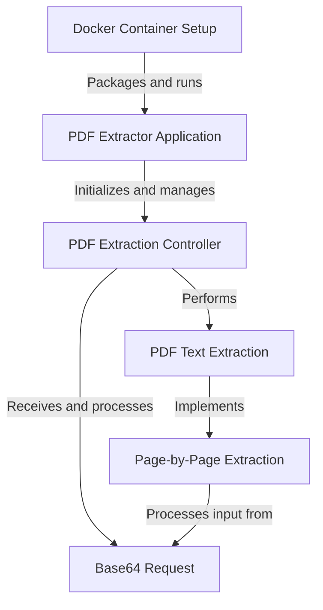
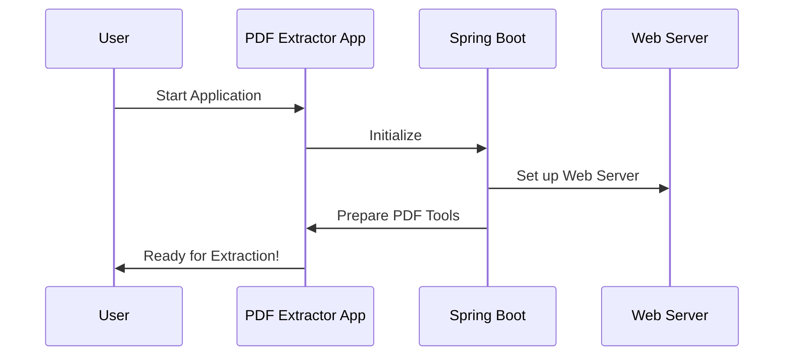
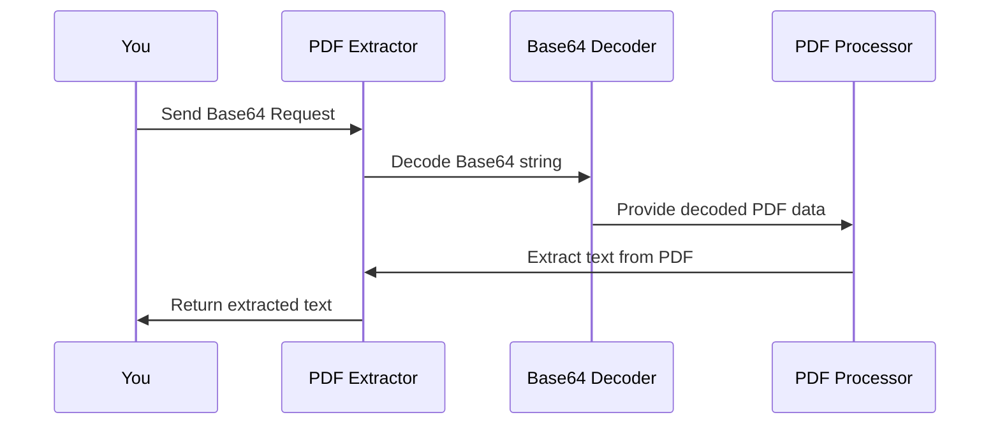
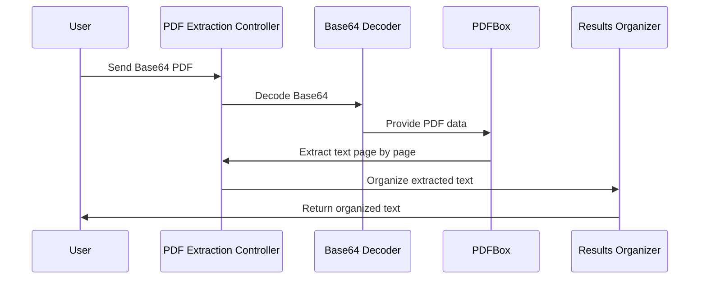
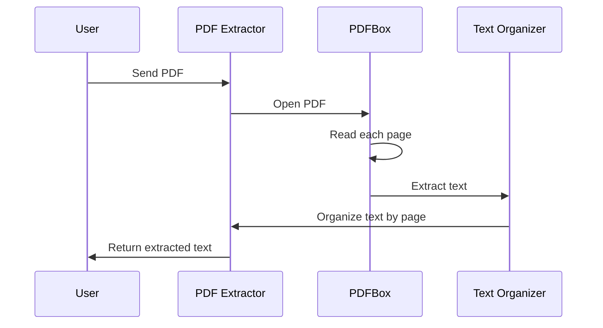
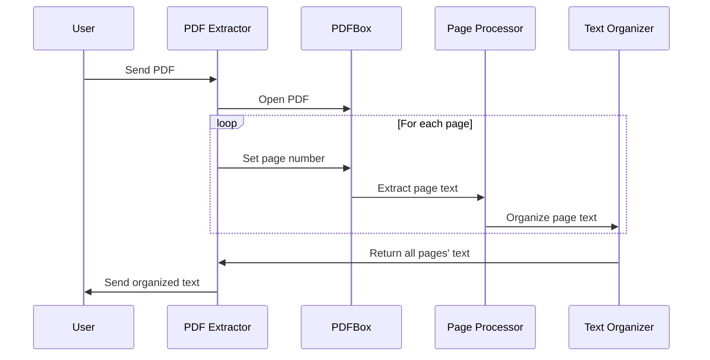
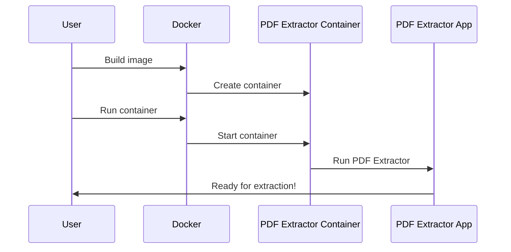

# PDF-EXTRACTOR DOCUMENTATION


# Documentation: pdf-extractor

This project is a **PDF text extraction** application built with Spring Boot. It allows users to upload **Base64-encoded PDF files** and receive the extracted text *page by page*. The application uses **PDFBox** for text extraction and can be easily deployed using **Docker**. It's designed to handle PDF processing efficiently, making it useful for tasks like document analysis or content indexing.


**Source Repository:** [https://github.com/dygavieta/pdf-extractor](https://github.com/dygavieta/pdf-extractor)



## Chapters

1. [PDF Extractor Application
](01_pdf_extractor_application_.md)
2. [Base64 Request
](02_base64_request_.md)
3. [PDF Extraction Controller
](03_pdf_extraction_controller_.md)
4. [PDF Text Extraction
](04_pdf_text_extraction_.md)
5. [Page-by-Page Extraction
](05_page_by_page_extraction_.md)
6. [Docker Container Setup
](06_docker_container_setup_.md)


---


## 01_pdf_extractor_application_


# Chapter 1: PDF Extractor Application

Welcome to the world of PDF Extractor! Imagine you have a digital library full of PDF documents, but you need to quickly find specific information within them. That's where our PDF Extractor Application comes in handy. It's like having a super-smart assistant who can read through all your PDFs and pull out the exact text you need.

## What Does It Do?

Our PDF Extractor Application is the starting point of our project. Think of it as the control center of a space station. When you turn it on, it gets everything ready for your PDF extraction mission.

## How Does It Work?

Let's break it down into simple steps:

1. You start the application.
2. It sets up a web server (like opening a shop for business).
3. It prepares all the tools needed for extracting text from PDFs.
4. It waits for your commands to start extracting text.

## The Magic Starts Here

Here's the main code that kicks everything off:

```java
@SpringBootApplication
public class PdfExtractorApplication {
    public static void main(String[] args) {
        SpringApplication.run(PdfExtractorApplication.class, args);
    }
}
```

This small piece of code is like pressing the "ON" button for our PDF Extractor. It tells Spring Boot (a helpful tool for Java applications) to set up everything we need.

## What's Happening Behind the Scenes?

When you run this application, a lot happens automatically:



1. You start the application.
2. Our PDF Extractor App asks Spring Boot to set things up.
3. Spring Boot creates a web server so you can interact with the app.
4. It also gets all the PDF tools ready for use.
5. Finally, it tells you it's ready to extract text from PDFs!

## Why Is This Important?

This application is the foundation of our PDF Extractor project. It's like the roots of a tree – you don't see them, but they support everything else. By using Spring Boot, we get a lot of complex setup done automatically, so we can focus on the fun part – extracting text from PDFs!

## What's Next?

Now that we have our application up and running, we're ready to start accepting PDF files for text extraction. In the next chapter, we'll look at how we receive these files in a special format called Base64.

[Base64 Request](02_base64_request_.md)

Remember, every great journey begins with a single step, and you've just taken your first step into the world of PDF text extraction!


## 02_base64_request_


# Chapter 2: Base64 Request

Now that we've got our [PDF Extractor Application](01_pdf_extractor_application_.md) up and running, let's talk about how we actually send PDF files to it. Imagine you want to send a letter to a friend, but instead of using a regular envelope, you need to use a special, digital envelope. That's where our Base64 Request comes in!

## What is a Base64 Request?

A Base64 Request is like a magical envelope for our PDF files. It takes our PDF, which is usually a bunch of 1s and 0s that computers understand, and turns it into a long string of letters and numbers that can be safely sent over the internet. It's like translating our PDF into a secret code that our application can understand and decode.

## Why Do We Need It?

When you send information over the internet, sometimes bits and pieces can get lost or mixed up. Base64 encoding helps prevent this by turning our PDF into a format that's safer to send. It's like wrapping our PDF in a protective bubble!

## How Does It Work?

Let's break it down into simple steps:

1. You have a PDF file on your computer.
2. Before sending it to our PDF Extractor, you (or your program) encode it into Base64.
3. You send this encoded string to our application.
4. Our application receives the Base64 string and decodes it back into a PDF.

Here's what our Base64 Request looks like in code:

```java
class Base64Request {
    private String pdfBase64;

    public String getPdfBase64() {
        return pdfBase64;
    }

    public void setPdfBase64(String pdfBase64) {
        this.pdfBase64 = pdfBase64;
    }
}
```

This simple class is like our special envelope. It has one job: to hold our encoded PDF data (pdfBase64).

## Using Base64 Request

Let's say you want to extract text from a PDF. Here's how you might use our Base64 Request:

1. Encode your PDF to Base64 (your program would do this).
2. Create a new Base64Request and set the encoded string.
3. Send this request to our PDF Extractor.

Here's a simple example of what this might look like:

```java
String encodedPDF = "JVBERi0xLjMKJcTl8uXrp/Og0MTGCjQgMCBvY..."; // Your encoded PDF
Base64Request request = new Base64Request();
request.setPdfBase64(encodedPDF);
// Now you can send this request to the extractor
```

## What Happens Behind the Scenes?

When our PDF Extractor receives your Base64 Request, it goes through a process to extract the text. Let's visualize it:



1. You send the Base64 Request to our application.
2. Our application decodes the Base64 string back into PDF data.
3. It then uses a tool called PDFBox to process the PDF and extract text.
4. Finally, it sends the extracted text back to you!

## Conclusion

Base64 Request is our special way of safely transporting PDFs to our PDF Extractor. It's like a digital envelope that keeps our PDFs safe and sound as they travel through the internet. By using Base64 encoding, we ensure that our PDFs arrive intact and ready for text extraction.

Now that we know how to send PDFs to our application, let's see how we handle these requests and extract text from them in the next chapter: [PDF Extraction Controller](03_pdf_extraction_controller_.md).


## 03_pdf_extraction_controller_


# Chapter 3: PDF Extraction Controller

In our previous chapter, we learned about [Base64 Request](02_base64_request_.md) and how we send PDFs to our application. Now, let's explore the heart of our PDF Extractor: the PDF Extraction Controller!

Imagine you're a librarian with a magical book scanner. People bring you books (PDFs), and your job is to scan them and return the text on each page. That's exactly what our PDF Extraction Controller does!

## What Does the PDF Extraction Controller Do?

The PDF Extraction Controller is like a skilled librarian who:
1. Receives the encoded PDF (remember our Base64 "envelope"?)
2. Opens the PDF
3. Reads each page
4. Organizes the text from each page
5. Returns all this information neatly packaged

Let's see how it works with a simple example:

```java
@RestController
@RequestMapping("/extract")
public class PDFExtractorController {
    @PostMapping
    public Map<String, Object> extractPDFPerPage(@RequestBody Base64Request request) {
        // Magic happens here!
    }
}
```

This small piece of code is the entry point of our controller. It's like the front desk of our library where people drop off their PDFs.

## How Does It Work?

Let's break down the process:

1. **Receive the PDF**: The controller gets a Base64-encoded PDF.
2. **Decode the PDF**: It turns the Base64 string back into a PDF file.
3. **Open the PDF**: It uses a tool called PDFBox to open the PDF.
4. **Read Each Page**: It goes through the PDF page by page, extracting text.
5. **Organize the Results**: It puts the text from each page into a neat package.
6. **Return the Results**: It sends back all the extracted text, organized by page.

Let's visualize this process:



## The Magic Behind the Scenes

Now, let's peek at some of the code that makes this happen:

```java
byte[] pdfBytes = Base64.getDecoder().decode(cleanBase64);
PDDocument document = PDDocument.load(new ByteArrayInputStream(pdfBytes));
```

This code takes our Base64 "envelope", opens it, and turns it back into a PDF document.

```java
PDFTextStripper pdfStripper = new PDFTextStripper();
for (int i = 1; i <= totalPages; i++) {
    pdfStripper.setStartPage(i);
    pdfStripper.setEndPage(i);
    String pageText = pdfStripper.getText(document).trim();
    // Store pageText...
}
```

This part is like our librarian reading each page of the book. It goes through the PDF, page by page, and extracts the text.

## What Do We Get Back?

After all this work, what do we receive? A neat package that looks something like this:

```json
{
  "page1": ["Line 1 of page 1", "Line 2 of page 1", ...],
  "page2": ["Line 1 of page 2", "Line 2 of page 2", ...],
  "totalPages": 2
}
```

Each page's text is stored as a list of lines, making it easy to work with the extracted content.

## Conclusion

The PDF Extraction Controller is the backbone of our PDF Extractor. It takes in Base64-encoded PDFs, extracts text from each page, and returns it in a user-friendly format. It's like having a super-fast, tireless librarian who can read and organize books in the blink of an eye!

Now that we understand how our controller manages the extraction process, let's dive deeper into how we actually pull text out of PDFs in our next chapter: [PDF Text Extraction](04_pdf_text_extraction_.md).


## 04_pdf_text_extraction_


# Chapter 4: PDF Text Extraction

Welcome back! In our [previous chapter](03_pdf_extraction_controller_.md), we learned how our PDF Extraction Controller manages the process of handling PDF requests. Now, let's dive into the heart of our project: PDF Text Extraction!

Imagine you have a magic pair of glasses that can look at any PDF and instantly read all the text inside. That's exactly what our PDF Text Extraction does! It's like having a super-smart assistant who can quickly read through any PDF document and tell you what's written inside.

## Why Do We Need PDF Text Extraction?

Let's say you have a big PDF book about dinosaurs, and you want to find all the parts that talk about T-Rex. Instead of reading through the whole book yourself, our PDF Text Extraction can quickly scan through it and pull out all the T-Rex information for you!

## How Does It Work?

Our PDF Text Extraction uses a special tool called PDFBox. Think of PDFBox as our magic glasses. Here's how it works:

1. Open the PDF: We use PDFBox to open the PDF file.
2. Read Each Page: PDFBox looks at each page of the PDF.
3. Extract Text: It reads all the text on each page and writes it down for us.
4. Organize the Text: We put all this text into a neat package, organized by page.

Let's see a simple example of how we use PDFBox:

```java
PDDocument document = PDDocument.load(pdfFile);
PDFTextStripper textStripper = new PDFTextStripper();
String text = textStripper.getText(document);
```

This code opens our PDF, creates a "text stripper" (our magic glasses), and then reads all the text from the document.

## Breaking It Down Step by Step

Let's look at what happens when we extract text from a PDF:



1. You send a PDF to our PDF Extractor.
2. Our app uses PDFBox to open the PDF.
3. PDFBox reads through each page of the PDF.
4. As it reads, it extracts all the text it finds.
5. We organize this text by page.
6. Finally, we send the organized text back to you!

## The Magic Behind the Scenes

Now, let's peek at some of the code that makes this happen:

```java
PDFTextStripper pdfStripper = new PDFTextStripper();
pdfStripper.setStartPage(pageNumber);
pdfStripper.setEndPage(pageNumber);
String pageText = pdfStripper.getText(document);
```

This code is like telling our magic glasses (PDFTextStripper) to look at a specific page of the PDF and tell us what it sees. We do this for each page of the PDF.

## What Do We Get?

After all this work, what do we receive? A neatly organized package of text that looks something like this:

```json
{
  "page1": ["Once upon a time", "there was a big T-Rex"],
  "page2": ["The T-Rex was very hungry", "It looked for food"],
  "totalPages": 2
}
```

Each page's text is stored as a list of lines, making it easy for you to find the information you need.

## Conclusion

PDF Text Extraction is like having a super-fast, tireless reader who can go through any PDF and tell you exactly what's written inside. It's the core of our PDF Extractor project, allowing us to turn any PDF into easily searchable text.

Now that we understand how we extract text from PDFs, let's see how we can do this page by page in our next chapter: [Page-by-Page Extraction](05_page_by_page_extraction_.md).


## 05_page_by_page_extraction_


# Chapter 5: Page-by-Page Extraction

In our [previous chapter](04_pdf_text_extraction_.md), we learned how to extract text from an entire PDF. Now, let's zoom in and explore how we can extract text page by page!

Imagine you're a detective investigating a large book. Instead of reading the whole book at once, you might want to examine each page carefully, one at a time. That's exactly what Page-by-Page Extraction does for PDFs!

## Why Do We Need Page-by-Page Extraction?

Let's say you have a 100-page PDF report about different animals. You're specifically interested in information about elephants, but you don't know which pages mention them. Page-by-Page Extraction allows you to look at each page separately, making it easier to find and organize the information you need.

## How Does It Work?

Our Page-by-Page Extraction uses our trusty tool, PDFBox, but in a more focused way. Here's how it works:

1. Open the PDF: We use PDFBox to open the PDF file.
2. Set Page Range: We tell PDFBox to look at just one page at a time.
3. Extract Text: It reads all the text on that specific page.
4. Organize the Text: We put the text from each page into its own neat package.
5. Repeat: We do this for every page in the PDF.

Let's see a simple example of how we do this:

```java
PDFTextStripper pdfStripper = new PDFTextStripper();
pdfStripper.setStartPage(pageNumber);
pdfStripper.setEndPage(pageNumber);
String pageText = pdfStripper.getText(document);
```

This code tells our PDFBox "text stripper" to look at just one specific page and extract its text.

## Breaking It Down Step by Step

Let's visualize what happens when we extract text page by page:



1. You send a PDF to our PDF Extractor.
2. Our app uses PDFBox to open the PDF.
3. For each page in the PDF:
   - We tell PDFBox which page to look at.
   - PDFBox extracts the text from that page.
   - We organize the text from that page.
4. We collect all the organized text from each page.
5. Finally, we send the organized text back to you!

## The Magic Behind the Scenes

Now, let's look at some of the code that makes this happen:

```java
for (int i = 1; i <= totalPages; i++) {
    pdfStripper.setStartPage(i);
    pdfStripper.setEndPage(i);
    String pageText = pdfStripper.getText(document);
    pageTextMap.put("page" + i, Arrays.asList(pageText.split("\n")));
}
```

This code is like telling our detective (PDFTextStripper) to look at each page of the book one by one. For each page, we extract the text and store it separately.

## What Do We Get?

After all this work, what do we receive? A neatly organized package of text that looks something like this:

```json
{
  "page1": ["The elephant is a large mammal", "It is known for its long trunk"],
  "page2": ["Elephants are found in Africa and Asia", "They are herbivores"],
  "totalPages": 2
}
```

Each page's text is stored separately, making it easy for you to find information on specific pages.

## Conclusion

Page-by-Page Extraction is like having a super-efficient assistant who can go through a PDF, carefully examining each page and organizing the information for you. It allows us to handle PDFs with more precision and flexibility, making it easier to find and use the information we need.

Now that we understand how to extract text page by page, let's see how we can set up our PDF Extractor to run in a [Docker Container](06_docker_container_setup_.md). This will make it easy to use our tool on different computers!


## 06_docker_container_setup_


# Chapter 6: Docker Container Setup

In our [previous chapter](05_page_by_page_extraction_.md), we learned how to extract text from PDFs page by page. Now, let's explore how we can package our entire PDF Extractor application into a portable container using Docker!

Imagine you've built an amazing treehouse. Wouldn't it be great if you could easily move that treehouse to any backyard in the world? That's exactly what Docker does for our PDF Extractor application!

## What is Docker and Why Do We Need It?

Docker is like a magical box that can hold our entire application, including all the tools it needs to run. This box (called a container) can be easily moved to any computer, and our application will work exactly the same way, no matter where it goes.

Here's why this is awesome:
1. Easy Setup: Anyone can run our PDF Extractor without installing lots of stuff.
2. Consistency: It works the same way on every computer.
3. Isolation: It doesn't interfere with other applications.

## How Does Docker Container Setup Work?

Let's break it down into simple steps:

1. Create a Dockerfile: This is like a recipe for our magical box.
2. Build the Docker Image: We use the recipe to create our box.
3. Run the Docker Container: We start up our application inside the box.

Let's look at a simplified version of our Dockerfile:

```dockerfile
FROM amazoncorretto:21-alpine-jdk
WORKDIR /app
COPY target/*.jar app.jar
ENTRYPOINT ["java", "-jar", "app.jar"]
```

This Dockerfile is like telling Docker:
1. Start with a box that has Java installed (amazoncorretto:21-alpine-jdk).
2. Create a workspace in the box called "/app".
3. Copy our application (app.jar) into the box.
4. When the box starts, run our application.

## Building and Running Our Docker Container

Now, let's see how we use this Dockerfile to create and run our container:

```bash
# Build the Docker image
docker build -t pdf-extractor .

# Run the Docker container
docker run -p 8080:8080 pdf-extractor
```

These commands are like:
1. Building our magical treehouse based on our blueprint (Dockerfile).
2. Setting up our treehouse in a new backyard and opening the door (port 8080).

## What Happens Behind the Scenes?

Let's visualize what happens when we set up our Docker container:



1. You tell Docker to build an image based on your Dockerfile.
2. Docker creates a container from this image.
3. You tell Docker to run the container.
4. The container starts up and runs our PDF Extractor application.
5. The application is now ready to extract text from PDFs!

## Conclusion

Docker Container Setup is like creating a magical, portable treehouse for our PDF Extractor. It allows us to package our entire application, with all its tools and dependencies, into a single, easy-to-use container. This makes it super simple for anyone to use our PDF Extractor on any computer, without worrying about complex setups or compatibility issues.

By using Docker, we've made our PDF Extractor not just powerful, but also incredibly portable and easy to use. Now, anyone can easily set up and start extracting text from PDFs with just a couple of commands!

This concludes our journey through the PDF Extractor project. We've learned how to build a PDF text extraction tool, process PDFs page by page, and even package it all up in a portable Docker container. Happy extracting!


## jira_branches


# Jira Branches


## SCRUM-4

**Description:** Task created and added to SCRUM sprint.


No branches found for this issue.

---


## SCRUM-3

**Description:** Task created for FRIDAY


No branches found for this issue.

---


## SCRUM-2

**Description:** you close the web


No branches found for this issue.

---


## SCRUM-1

**Description:** *Lorem Ipsum* is simply dummy text of the printing and typesetting industry. Lorem Ipsum has been the industry's standard dummy text ever since the 1500s, when an unknown printer took a galley of type and scrambled it to make a type specimen book. It has survived not only five centuries, but also the leap into electronic typesetting, remaining essentially unchanged. It was popularised in the 1960s with the release of Letraset sheets containing Lorem Ipsum passages, and more recently with desktop publishing software like Aldus PageMaker including versions of Lorem Ipsum.


**Branches:**

- `SCRUM-1-THURSDAY-v1`
- `SCRUM-1-THURSDAY`

---
