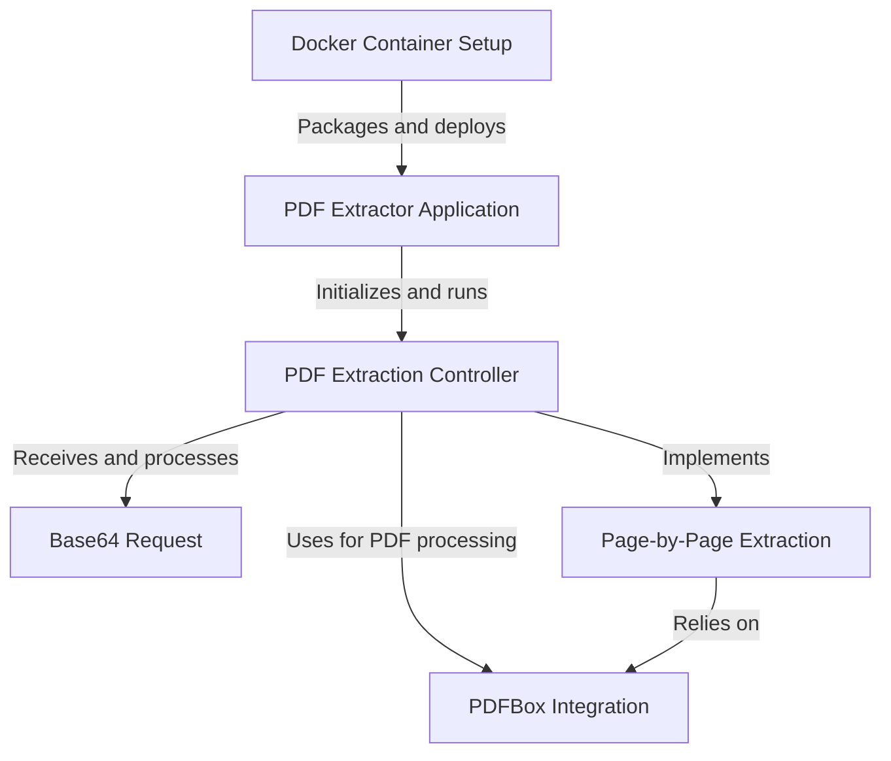
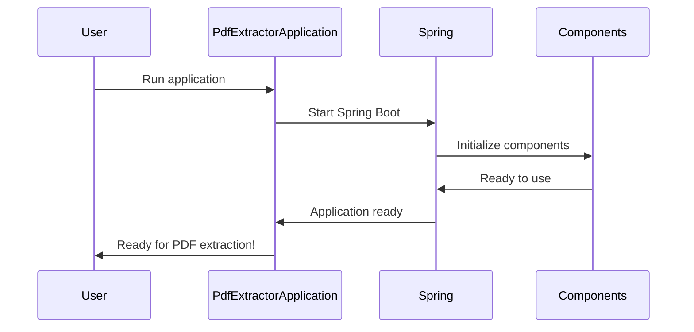
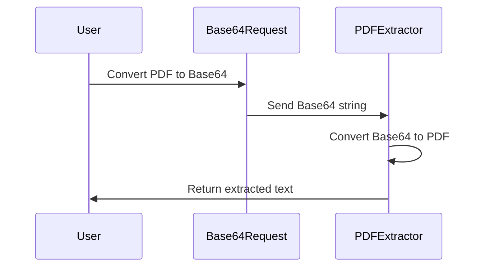
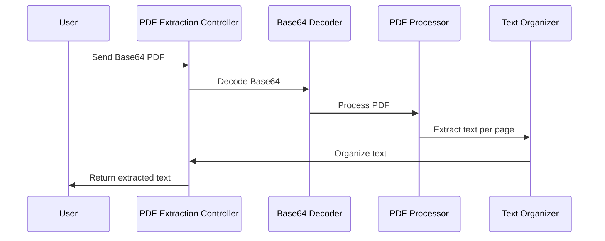
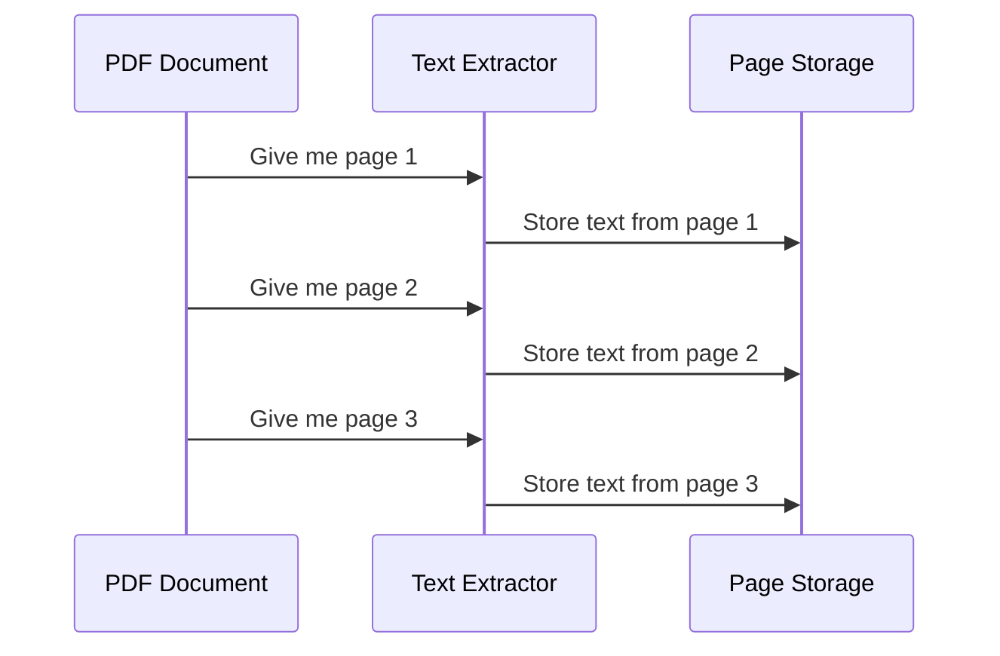
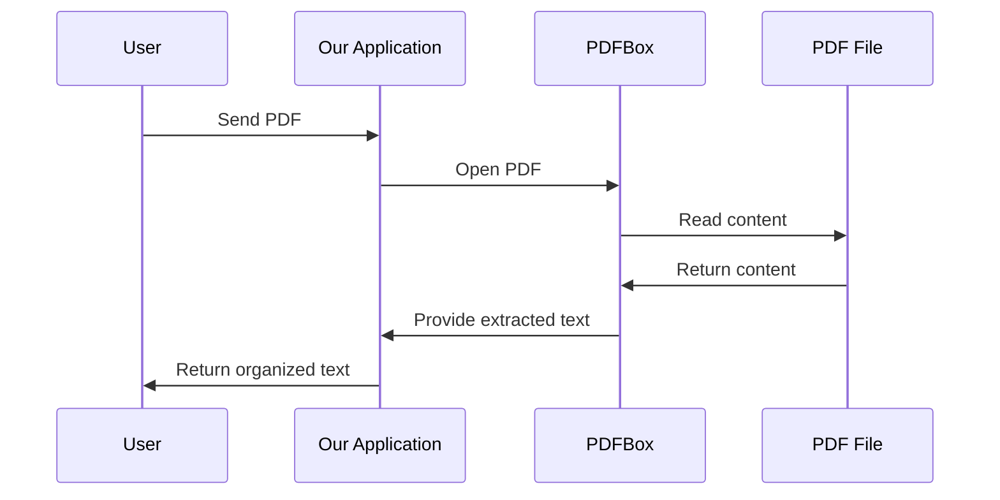
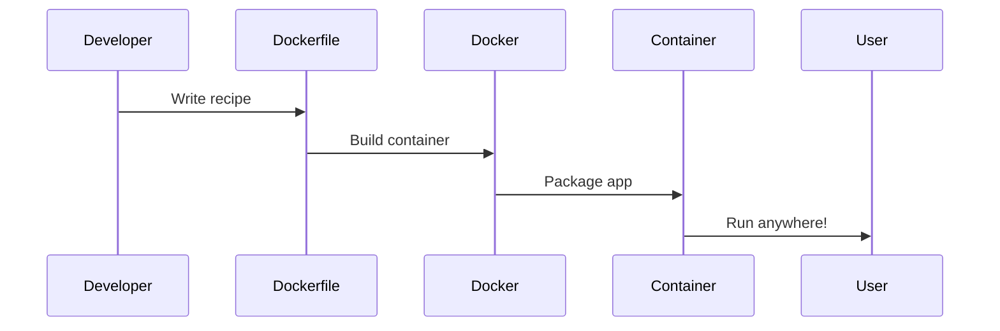

# pdf-extractor Tutorial


# Tutorial: pdf-extractor

This project is a **PDF Extractor Application** that allows users to extract text from PDF documents. It uses *Spring Boot* to create a web service that accepts **Base64-encoded PDF data** and returns the extracted text **page by page**. The application leverages the **PDFBox library** for PDF processing and can be easily deployed using **Docker**. It's designed to be a simple yet powerful tool for developers who need to integrate PDF text extraction into their applications.


**Source Repository:** [https://github.com/dygavieta/pdf-extractor](https://github.com/dygavieta/pdf-extractor)



## Chapters

1. [PDF Extractor Application
](01_pdf_extractor_application_.md)
2. [Base64 Request
](02_base64_request_.md)
3. [PDF Extraction Controller
](03_pdf_extraction_controller_.md)
4. [Page-by-Page Extraction
](04_page_by_page_extraction_.md)
5. [PDFBox Integration
](05_pdfbox_integration_.md)
6. [Docker Container Setup
](06_docker_container_setup_.md)


---


## 01_pdf_extractor_application_


# Chapter 1: PDF Extractor Application

Welcome to the exciting world of PDF extraction! In this chapter, we'll explore the heart of our project: the PDF Extractor Application. Imagine you have a treasure chest (your PDF) full of valuable information, but you can't quite get it open. Our PDF Extractor is like a magical key that unlocks this chest, allowing you to easily access and use the contents inside.

## The Problem We're Solving

Have you ever needed to copy text from a PDF but found it frustratingly difficult? Or perhaps you wanted to extract specific pages from a long document? That's where our PDF Extractor Application comes in handy!

## Understanding the PDF Extractor Application

At its core, the PDF Extractor Application is like the control center of a space station. It's responsible for:

1. Starting up all the necessary systems
2. Coordinating different parts of the application
3. Ensuring everything runs smoothly

Let's take a look at the main file that makes this happen:

```java
package com.example.pdf_extractor;

import org.springframework.boot.SpringApplication;
import org.springframework.boot.autoconfigure.SpringBootApplication;

@SpringBootApplication
public class PdfExtractorApplication {

	public static void main(String[] args) {
		SpringApplication.run(PdfExtractorApplication.class, args);
	}
}
```

This small but powerful piece of code is the launchpad for our entire application. Let's break it down:

- `@SpringBootApplication`: This magical annotation tells our application, "Hey, you're a Spring Boot app!"
- `public class PdfExtractorApplication`: This is our main class, like the captain of our space station.
- `public static void main(String[] args)`: This is the entry point of our application, like the ignition button for our rocket.
- `SpringApplication.run(PdfExtractorApplication.class, args)`: This line actually starts our application, like lifting off from the launchpad.

## What Happens When We Launch?

When we run this application, a whole series of events unfolds behind the scenes. Let's visualize it:



1. You (the user) start the application.
2. The `PdfExtractorApplication` tells Spring Boot to start up.
3. Spring Boot initializes all the necessary components (we'll learn about these in later chapters).
4. Once everything is ready, the application is prepared to handle PDF extraction requests.

## Why Spring Boot?

You might wonder, "Why are we using Spring Boot?" Well, think of Spring Boot as a super-helpful robot assistant. It takes care of a lot of complex setup and configuration automatically, so we can focus on the fun part: extracting PDF content!

## What's Next?

Now that we have our application up and running, we're ready to start accepting PDF extraction requests. In the next chapter, we'll explore how we receive these requests in a special format called Base64.

[Base64 Request](02_base64_request_.md)

## Conclusion

Congratulations! You've just learned about the core of our PDF Extractor Application. This main class might seem simple, but it's the foundation that allows all the other parts of our application to work together seamlessly. As we progress through the tutorial, you'll see how this launcher sets the stage for all the PDF extraction magic to happen!


## 02_base64_request_


# Chapter 2: Base64 Request

Welcome back, PDF explorers! In our [previous chapter](01_pdf_extractor_application_.md), we launched our PDF Extractor Application. Now, let's dive into how we actually send PDF data to our application using something called a Base64 Request.

## What's a Base64 Request?

Imagine you want to send a beautiful painting to a friend, but you can only use text messages. How would you do it? That's where Base64 comes in! It's like a special language that turns our PDF (our painting) into a long string of letters and numbers that can be easily sent over the internet.

A Base64 Request is like a digital envelope that safely carries our PDF data. It's a simple way to package up our PDF so we can send it to our PDF Extractor Application.

## Why Do We Need Base64?

PDFs contain all sorts of complex data that can't be directly sent over the internet. By converting it to Base64, we turn it into a format that's safe and easy to transmit. It's like turning our painting into a secret code that only our application knows how to read!

## How Does It Work?

Let's break it down into simple steps:

1. You have a PDF file on your computer.
2. You convert this PDF into a Base64 string (don't worry, there are tools for this!).
3. You send this Base64 string to our PDF Extractor Application.
4. Our application receives the Base64 string and turns it back into a PDF.

Here's a simple diagram to visualize this process:



## The Base64Request Class

In our application, we use a simple Java class to handle Base64 requests. Let's take a look:

```java
class Base64Request {
    private String pdfBase64;

    public String getPdfBase64() {
        return pdfBase64;
    }

    public void setPdfBase64(String pdfBase64) {
        this.pdfBase64 = pdfBase64;
    }
}
```

This class is like a special container for our Base64 string. It has one job: to hold our PDF data in Base64 format.

- `private String pdfBase64`: This is where we store our Base64 string.
- `getPdfBase64()`: This method lets us retrieve the Base64 string.
- `setPdfBase64()`: This method lets us set the Base64 string.

## Using Base64Request in Our Application

When someone wants to extract text from a PDF, they'll send a request to our application. This request will include the Base64-encoded PDF data. Here's how we use the `Base64Request` class:

```java
@PostMapping
public Map<String, Object> extractPDFPerPage(@RequestBody Base64Request request) {
    String cleanBase64 = request.getPdfBase64().replaceAll("\\s+", "").trim();
    // ... (rest of the extraction code)
}
```

In this code:
1. We receive a `Base64Request` object.
2. We get the Base64 string using `request.getPdfBase64()`.
3. We clean up the string (remove spaces and trim it).
4. Then we proceed with extracting text from the PDF (we'll cover this in later chapters!).

## Conclusion

Congratulations! You now understand how we use Base64 Requests to safely send PDF data to our application. It's like having a magic translator that turns PDFs into a secret code, sends it over the internet, and then turns it back into a PDF on the other side!

In our next chapter, we'll explore how we handle these requests and start the exciting process of extracting text from our PDFs. Get ready for the [PDF Extraction Controller](03_pdf_extraction_controller_.md)!


## 03_pdf_extraction_controller_


# Chapter 3: PDF Extraction Controller

Welcome back, PDF enthusiasts! In our [previous chapter](02_base64_request_.md), we learned how to package our PDF data using Base64 encoding. Now, let's dive into the heart of our application: the PDF Extraction Controller.

Imagine you're at a busy post office. People are coming in with packages (our Base64-encoded PDFs) and want to know what's inside without opening them. Our PDF Extraction Controller is like a super-efficient postal worker who can peek inside these packages, read the contents, and tell you what's in each one without actually unpacking them.

## What Does the PDF Extraction Controller Do?

The PDF Extraction Controller has one main job: to take our Base64-encoded PDF, extract the text from each page, and return it in a neat, organized way. It's like a magician who can read a book through its cover!

Let's break down its tasks:

1. Receive the Base64-encoded PDF
2. Convert the Base64 string back into a PDF
3. Extract text from each page of the PDF
4. Organize the extracted text by page number
5. Return the organized text to the user

## How Does It Work?

Let's take a look at the main part of our PDF Extraction Controller:

```java
@RestController
@RequestMapping("/extract")
public class PDFExtractorController {
    @PostMapping
    public Map<String, Object> extractPDFPerPage(@RequestBody Base64Request request) {
        // Magic happens here!
    }
}
```

This might look a bit confusing, but let's break it down:

- `@RestController`: This tells Spring that this class is in charge of handling web requests.
- `@RequestMapping("/extract")`: This sets up our controller to listen for requests at the "/extract" URL.
- `@PostMapping`: This means our controller is ready to receive POST requests (when someone wants to send us data).
- `extractPDFPerPage`: This is our main method that does all the work.

## The Extraction Process

Let's walk through what happens when someone sends a PDF for extraction:



1. The user sends a Base64-encoded PDF to our controller.
2. We decode the Base64 back into a PDF.
3. We use a tool called PDFBox to process the PDF and extract text.
4. We organize the extracted text by page number.
5. We send the organized text back to the user.

## The Code in Action

Let's look at a simplified version of our extraction method:

```java
public Map<String, Object> extractPDFPerPage(Base64Request request) {
    Map<String, Object> pageTextMap = new HashMap<>();
    
    // 1. Clean and decode the Base64 string
    byte[] pdfBytes = Base64.getDecoder().decode(request.getPdfBase64());
    
    // 2. Load the PDF and extract text
    PDDocument document = PDDocument.load(new ByteArrayInputStream(pdfBytes));
    PDFTextStripper pdfStripper = new PDFTextStripper();
    
    // 3. Extract text from each page
    for (int i = 1; i <= document.getNumberOfPages(); i++) {
        pdfStripper.setStartPage(i);
        pdfStripper.setEndPage(i);
        String pageText = pdfStripper.getText(document);
        pageTextMap.put("page" + i, pageText);
    }
    
    return pageTextMap;
}
```

This code does the following:
1. It takes the Base64 string and turns it back into a PDF.
2. It uses PDFBox to load the PDF and create a text stripper (a tool for extracting text).
3. It goes through each page, extracts the text, and stores it in a map.
4. Finally, it returns the map with all the extracted text.

## Conclusion

Congratulations! You now understand how our PDF Extraction Controller works. It's like having a super-powered assistant who can read any PDF you give it and tell you what's on each page. 

In our next chapter, we'll dive deeper into how we extract text [Page-by-Page](04_page_by_page_extraction_.md). Get ready to become a PDF extraction expert!


## 04_page_by_page_extraction_


# Chapter 4: Page-by-Page Extraction

Welcome back, PDF adventurers! In our [previous chapter](03_pdf_extraction_controller_.md), we explored how our PDF Extraction Controller handles incoming requests. Now, let's dive into the exciting world of Page-by-Page Extraction!

Imagine you're a librarian with a magical book. This book contains all the text from a PDF, but it's all jumbled up. Your job is to carefully separate each page's content, making it easy for readers to find exactly what they need. That's exactly what Page-by-Page Extraction does!

## Why Do We Need Page-by-Page Extraction?

Think about a long PDF document, like a textbook. If you want to find information on a specific topic, you don't want to search through the entire book at once. It's much easier if you can look at one page at a time. Page-by-Page Extraction helps us do just that with PDFs!

## How Does It Work?

Let's break down the process into simple steps:

1. We receive a PDF (remember, it's in Base64 format).
2. We convert it back into a regular PDF.
3. We create a special tool (called PDFTextStripper) to read the PDF.
4. We go through the PDF, one page at a time, like flipping through a book.
5. For each page, we extract all the text and store it separately.
6. We organize all this text by page number, so we know exactly where everything came from.

Here's a simple diagram to visualize this process:



## The Code in Action

Let's look at a simplified version of our extraction method:

```java
PDFTextStripper pdfStripper = new PDFTextStripper();
for (int i = 1; i <= document.getNumberOfPages(); i++) {
    pdfStripper.setStartPage(i);
    pdfStripper.setEndPage(i);
    String pageText = pdfStripper.getText(document);
    pageTextMap.put("page" + i, pageText);
}
```

This code is like our magical librarian:
1. We create a `PDFTextStripper` (our magical reading glasses).
2. We go through each page of the document.
3. We tell our magical glasses to focus on just one page at a time.
4. We extract the text from that page.
5. We store the text in our `pageTextMap`, labeling it with the page number.

## Why Is This Useful?

Page-by-Page Extraction gives us several superpowers:

1. **Organization**: We know exactly which text came from which page.
2. **Searching**: We can easily search for text on specific pages.
3. **Partial Processing**: If we only need certain pages, we can extract just those!

## Conclusion

Congratulations! You now understand the magic of Page-by-Page Extraction. It's like having a super-organized librarian who can instantly tell you what's on any page of any book. This technique helps us keep all our extracted PDF text neat and tidy, making it much easier to work with.

In our next chapter, we'll explore how we use a special tool called [PDFBox Integration](05_pdfbox_integration_.md) to make all this extraction possible. Get ready to unlock even more PDF secrets!


## 05_pdfbox_integration_


# Chapter 5: PDFBox Integration

Welcome back, PDF explorers! In our [previous chapter](04_page_by_page_extraction_.md), we learned how to extract text from PDFs page by page. Now, let's dive into the magical tool that makes all this possible: PDFBox!

Imagine you're trying to open a treasure chest (your PDF) but you don't have the right key. PDFBox is like a master key that can unlock any PDF treasure chest, allowing us to peek inside and retrieve the valuable information within.

## What is PDFBox?

PDFBox is a powerful Java library that helps us work with PDF documents. It's like a Swiss Army knife for PDFs, providing tools to open, read, and extract content from PDF files. This integration is crucial for the core functionality of our PDF extractor.

## Why Do We Need PDFBox?

Think about trying to read a book in a language you don't understand. PDFBox is like a universal translator that helps us understand the complex language of PDFs. It allows us to:

1. Open PDF files
2. Read the content inside
3. Extract text from each page
4. Get information about the PDF (like the number of pages)

## How Do We Use PDFBox?

Let's break down the process into simple steps:

1. We add PDFBox to our project (like adding a new tool to our toolbox).
2. We use PDFBox to open our PDF file.
3. We create a special PDFBox tool called PDFTextStripper to read the text.
4. We use this tool to extract text from each page.

Here's a simple diagram to visualize this process:



## The Code in Action

Let's look at a simplified version of how we use PDFBox:

```java
import org.apache.pdfbox.pdmodel.PDDocument;
import org.apache.pdfbox.text.PDFTextStripper;

PDDocument document = PDDocument.load(pdfBytes);
PDFTextStripper pdfStripper = new PDFTextStripper();
String text = pdfStripper.getText(document);
```

This code does the following:
1. We import the necessary PDFBox classes.
2. We use PDFBox to load our PDF document.
3. We create a PDFTextStripper to extract text.
4. We use the stripper to get all the text from the document.

## How PDFBox Works Behind the Scenes

When we use PDFBox, a lot of magic happens under the hood:

1. PDFBox opens the PDF file and reads its structure.
2. It understands the PDF's internal organization (pages, fonts, images).
3. For text extraction, it goes through each page, recognizing text elements.
4. It translates these elements into readable text.
5. Finally, it returns this text to us in a format we can easily use.

## Conclusion

Congratulations! You now understand the power of PDFBox integration. It's like having a magical PDF-reading assistant that helps us unlock the secrets hidden in any PDF file. This tool is what makes our PDF extractor so powerful and flexible.

In our next chapter, we'll explore how we package all this PDF magic into a [Docker Container Setup](06_docker_container_setup_.md). Get ready to learn how we can share our PDF extractor with the world!


## 06_docker_container_setup_


# Chapter 6: Docker Container Setup

Welcome back, PDF enthusiasts! In our [previous chapter](05_pdfbox_integration_.md), we explored the power of PDFBox for extracting text from PDFs. Now, let's embark on an exciting journey to package our PDF extractor application into a magical container called Docker!

Imagine you've created an amazing sandwich (our PDF extractor app) and want to share it with friends around the world. But how do you make sure it stays fresh and tastes the same everywhere? That's where Docker comes in! It's like a special lunchbox that keeps our app perfect, no matter where it goes.

## Why Do We Need Docker?

Think about trying to run your favorite game on different computers. Sometimes it works, sometimes it doesn't. Docker solves this problem for our app! It creates a consistent environment, ensuring our PDF extractor works the same way on any computer, whether it's your laptop or a big server in the cloud.

## How Does Docker Work?

Let's break it down into simple steps:

1. We create a recipe (called a Dockerfile) that tells Docker how to package our app.
2. Docker uses this recipe to build a container (our special lunchbox).
3. This container includes everything our app needs to run (like Java and our PDFBox library).
4. We can then send this container anywhere, and it will run exactly the same way!

Here's a simple diagram to visualize this process:



## The Dockerfile: Our Magic Recipe

Let's look at a simplified version of our Dockerfile:

```dockerfile
FROM maven:3.9-amazoncorretto-21 AS build
WORKDIR /app
COPY pom.xml .
COPY src ./src
RUN mvn clean package -DskipTests

FROM amazoncorretto:21-alpine-jdk
WORKDIR /app
COPY --from=build /app/target/*.jar app.jar
ENTRYPOINT ["java",  "-jar", "app.jar"]
```

This Dockerfile is like a cooking recipe:
1. We start with a base image that includes Maven and Java.
2. We set up a workspace and copy our app's files into it.
3. We use Maven to build our app.
4. We then create a smaller container with just Java.
5. We copy our built app into this smaller container.
6. Finally, we tell Docker how to run our app.

## Building and Running Our Docker Container

Once we have our Dockerfile, we can use it to build and run our container:

```bash
docker build -t pdf-extractor .
docker run -p 8080:8080 pdf-extractor
```

These commands do the following:
1. `docker build` creates our container using the Dockerfile recipe.
2. `docker run` starts our container, making our app available on port 8080.

## Why This is Awesome

Using Docker gives us several superpowers:

1. **Consistency**: Our app runs the same way everywhere.
2. **Isolation**: Our app has everything it needs, without interfering with other apps.
3. **Portability**: We can easily move our app between different environments.
4. **Scalability**: We can quickly start multiple copies of our app if needed.

## Conclusion

Congratulations! You now understand the magic of Docker container setup. It's like having a special lunchbox that keeps our PDF extractor fresh and ready to use anywhere in the world. This technology makes it easy to share and deploy our application, ensuring it works perfectly for everyone who wants to use it.

You've completed all the chapters of our PDF Extractor tutorial! You now have a solid understanding of how to build, package, and deploy a powerful PDF text extraction tool. Keep exploring and happy coding!


## jira_branches


# Jira Branches


## SCRUM-4

**Description:** Task created and added to SCRUM sprint.


No branches found for this issue.

---


## SCRUM-3

**Description:** Task created for FRIDAY


No branches found for this issue.

---


## SCRUM-2

**Description:** you close the web


No branches found for this issue.

---


## SCRUM-1

**Description:** *Lorem Ipsum* is simply dummy text of the printing and typesetting industry. Lorem Ipsum has been the industry's standard dummy text ever since the 1500s, when an unknown printer took a galley of type and scrambled it to make a type specimen book. It has survived not only five centuries, but also the leap into electronic typesetting, remaining essentially unchanged. It was popularised in the 1960s with the release of Letraset sheets containing Lorem Ipsum passages, and more recently with desktop publishing software like Aldus PageMaker including versions of Lorem Ipsum.


**Branches:**

- `SCRUM-1-THURSDAY-v1`
- `SCRUM-1-THURSDAY`

---


## pdf-extractor_tutorial


# pdf-extractor Tutorial


# Tutorial: pdf-extractor

This project is a **PDF Extractor Application** that allows users to extract text from PDF documents. It uses *Spring Boot* to create a web service that accepts **Base64-encoded PDF data** and returns the extracted text **page by page**. The application leverages the **PDFBox library** for PDF processing and can be easily deployed using **Docker**. It's designed to be a simple yet powerful tool for developers who need to integrate PDF text extraction into their applications.


**Source Repository:** [https://github.com/dygavieta/pdf-extractor](https://github.com/dygavieta/pdf-extractor)


## Chapters

1. [PDF Extractor Application
](01_pdf_extractor_application_.md)
2. [Base64 Request
](02_base64_request_.md)
3. [PDF Extraction Controller
](03_pdf_extraction_controller_.md)
4. [Page-by-Page Extraction
](04_page_by_page_extraction_.md)
5. [PDFBox Integration
](05_pdfbox_integration_.md)
6. [Docker Container Setup
](06_docker_container_setup_.md)


---


## 01_pdf_extractor_application_


# Chapter 1: PDF Extractor Application

Welcome to the exciting world of PDF extraction! In this chapter, we'll explore the heart of our project: the PDF Extractor Application. Imagine you have a treasure chest (your PDF) full of valuable information, but you can't quite get it open. Our PDF Extractor is like a magical key that unlocks this chest, allowing you to easily access and use the contents inside.

## The Problem We're Solving

Have you ever needed to copy text from a PDF but found it frustratingly difficult? Or perhaps you wanted to extract specific pages from a long document? That's where our PDF Extractor Application comes in handy!

## Understanding the PDF Extractor Application

At its core, the PDF Extractor Application is like the control center of a space station. It's responsible for:

1. Starting up all the necessary systems
2. Coordinating different parts of the application
3. Ensuring everything runs smoothly

Let's take a look at the main file that makes this happen:

```java
package com.example.pdf_extractor;

import org.springframework.boot.SpringApplication;
import org.springframework.boot.autoconfigure.SpringBootApplication;

@SpringBootApplication
public class PdfExtractorApplication {

	public static void main(String[] args) {
		SpringApplication.run(PdfExtractorApplication.class, args);
	}
}
```

This small but powerful piece of code is the launchpad for our entire application. Let's break it down:

- `@SpringBootApplication`: This magical annotation tells our application, "Hey, you're a Spring Boot app!"
- `public class PdfExtractorApplication`: This is our main class, like the captain of our space station.
- `public static void main(String[] args)`: This is the entry point of our application, like the ignition button for our rocket.
- `SpringApplication.run(PdfExtractorApplication.class, args)`: This line actually starts our application, like lifting off from the launchpad.

## What Happens When We Launch?

When we run this application, a whole series of events unfolds behind the scenes. Let's visualize it:


1. You (the user) start the application.
2. The `PdfExtractorApplication` tells Spring Boot to start up.
3. Spring Boot initializes all the necessary components (we'll learn about these in later chapters).
4. Once everything is ready, the application is prepared to handle PDF extraction requests.

## Why Spring Boot?

You might wonder, "Why are we using Spring Boot?" Well, think of Spring Boot as a super-helpful robot assistant. It takes care of a lot of complex setup and configuration automatically, so we can focus on the fun part: extracting PDF content!

## What's Next?

Now that we have our application up and running, we're ready to start accepting PDF extraction requests. In the next chapter, we'll explore how we receive these requests in a special format called Base64.

[Base64 Request](02_base64_request_.md)

## Conclusion

Congratulations! You've just learned about the core of our PDF Extractor Application. This main class might seem simple, but it's the foundation that allows all the other parts of our application to work together seamlessly. As we progress through the tutorial, you'll see how this launcher sets the stage for all the PDF extraction magic to happen!


## 02_base64_request_


# Chapter 2: Base64 Request

Welcome back, PDF explorers! In our [previous chapter](01_pdf_extractor_application_.md), we launched our PDF Extractor Application. Now, let's dive into how we actually send PDF data to our application using something called a Base64 Request.

## What's a Base64 Request?

Imagine you want to send a beautiful painting to a friend, but you can only use text messages. How would you do it? That's where Base64 comes in! It's like a special language that turns our PDF (our painting) into a long string of letters and numbers that can be easily sent over the internet.

A Base64 Request is like a digital envelope that safely carries our PDF data. It's a simple way to package up our PDF so we can send it to our PDF Extractor Application.

## Why Do We Need Base64?

PDFs contain all sorts of complex data that can't be directly sent over the internet. By converting it to Base64, we turn it into a format that's safe and easy to transmit. It's like turning our painting into a secret code that only our application knows how to read!

## How Does It Work?

Let's break it down into simple steps:

1. You have a PDF file on your computer.
2. You convert this PDF into a Base64 string (don't worry, there are tools for this!).
3. You send this Base64 string to our PDF Extractor Application.
4. Our application receives the Base64 string and turns it back into a PDF.

Here's a simple diagram to visualize this process:


## The Base64Request Class

In our application, we use a simple Java class to handle Base64 requests. Let's take a look:

```java
class Base64Request {
    private String pdfBase64;

    public String getPdfBase64() {
        return pdfBase64;
    }

    public void setPdfBase64(String pdfBase64) {
        this.pdfBase64 = pdfBase64;
    }
}
```

This class is like a special container for our Base64 string. It has one job: to hold our PDF data in Base64 format.

- `private String pdfBase64`: This is where we store our Base64 string.
- `getPdfBase64()`: This method lets us retrieve the Base64 string.
- `setPdfBase64()`: This method lets us set the Base64 string.

## Using Base64Request in Our Application

When someone wants to extract text from a PDF, they'll send a request to our application. This request will include the Base64-encoded PDF data. Here's how we use the `Base64Request` class:

```java
@PostMapping
public Map<String, Object> extractPDFPerPage(@RequestBody Base64Request request) {
    String cleanBase64 = request.getPdfBase64().replaceAll("\\s+", "").trim();
    // ... (rest of the extraction code)
}
```

In this code:
1. We receive a `Base64Request` object.
2. We get the Base64 string using `request.getPdfBase64()`.
3. We clean up the string (remove spaces and trim it).
4. Then we proceed with extracting text from the PDF (we'll cover this in later chapters!).

## Conclusion

Congratulations! You now understand how we use Base64 Requests to safely send PDF data to our application. It's like having a magic translator that turns PDFs into a secret code, sends it over the internet, and then turns it back into a PDF on the other side!

In our next chapter, we'll explore how we handle these requests and start the exciting process of extracting text from our PDFs. Get ready for the [PDF Extraction Controller](03_pdf_extraction_controller_.md)!


## 03_pdf_extraction_controller_


# Chapter 3: PDF Extraction Controller

Welcome back, PDF enthusiasts! In our [previous chapter](02_base64_request_.md), we learned how to package our PDF data using Base64 encoding. Now, let's dive into the heart of our application: the PDF Extraction Controller.

Imagine you're at a busy post office. People are coming in with packages (our Base64-encoded PDFs) and want to know what's inside without opening them. Our PDF Extraction Controller is like a super-efficient postal worker who can peek inside these packages, read the contents, and tell you what's in each one without actually unpacking them.

## What Does the PDF Extraction Controller Do?

The PDF Extraction Controller has one main job: to take our Base64-encoded PDF, extract the text from each page, and return it in a neat, organized way. It's like a magician who can read a book through its cover!

Let's break down its tasks:

1. Receive the Base64-encoded PDF
2. Convert the Base64 string back into a PDF
3. Extract text from each page of the PDF
4. Organize the extracted text by page number
5. Return the organized text to the user

## How Does It Work?

Let's take a look at the main part of our PDF Extraction Controller:

```java
@RestController
@RequestMapping("/extract")
public class PDFExtractorController {
    @PostMapping
    public Map<String, Object> extractPDFPerPage(@RequestBody Base64Request request) {
        // Magic happens here!
    }
}
```

This might look a bit confusing, but let's break it down:

- `@RestController`: This tells Spring that this class is in charge of handling web requests.
- `@RequestMapping("/extract")`: This sets up our controller to listen for requests at the "/extract" URL.
- `@PostMapping`: This means our controller is ready to receive POST requests (when someone wants to send us data).
- `extractPDFPerPage`: This is our main method that does all the work.

## The Extraction Process

Let's walk through what happens when someone sends a PDF for extraction:


1. The user sends a Base64-encoded PDF to our controller.
2. We decode the Base64 back into a PDF.
3. We use a tool called PDFBox to process the PDF and extract text.
4. We organize the extracted text by page number.
5. We send the organized text back to the user.

## The Code in Action

Let's look at a simplified version of our extraction method:

```java
public Map<String, Object> extractPDFPerPage(Base64Request request) {
    Map<String, Object> pageTextMap = new HashMap<>();
    
    // 1. Clean and decode the Base64 string
    byte[] pdfBytes = Base64.getDecoder().decode(request.getPdfBase64());
    
    // 2. Load the PDF and extract text
    PDDocument document = PDDocument.load(new ByteArrayInputStream(pdfBytes));
    PDFTextStripper pdfStripper = new PDFTextStripper();
    
    // 3. Extract text from each page
    for (int i = 1; i <= document.getNumberOfPages(); i++) {
        pdfStripper.setStartPage(i);
        pdfStripper.setEndPage(i);
        String pageText = pdfStripper.getText(document);
        pageTextMap.put("page" + i, pageText);
    }
    
    return pageTextMap;
}
```

This code does the following:
1. It takes the Base64 string and turns it back into a PDF.
2. It uses PDFBox to load the PDF and create a text stripper (a tool for extracting text).
3. It goes through each page, extracts the text, and stores it in a map.
4. Finally, it returns the map with all the extracted text.

## Conclusion

Congratulations! You now understand how our PDF Extraction Controller works. It's like having a super-powered assistant who can read any PDF you give it and tell you what's on each page. 

In our next chapter, we'll dive deeper into how we extract text [Page-by-Page](04_page_by_page_extraction_.md). Get ready to become a PDF extraction expert!


## 04_page_by_page_extraction_


# Chapter 4: Page-by-Page Extraction

Welcome back, PDF adventurers! In our [previous chapter](03_pdf_extraction_controller_.md), we explored how our PDF Extraction Controller handles incoming requests. Now, let's dive into the exciting world of Page-by-Page Extraction!

Imagine you're a librarian with a magical book. This book contains all the text from a PDF, but it's all jumbled up. Your job is to carefully separate each page's content, making it easy for readers to find exactly what they need. That's exactly what Page-by-Page Extraction does!

## Why Do We Need Page-by-Page Extraction?

Think about a long PDF document, like a textbook. If you want to find information on a specific topic, you don't want to search through the entire book at once. It's much easier if you can look at one page at a time. Page-by-Page Extraction helps us do just that with PDFs!

## How Does It Work?

Let's break down the process into simple steps:

1. We receive a PDF (remember, it's in Base64 format).
2. We convert it back into a regular PDF.
3. We create a special tool (called PDFTextStripper) to read the PDF.
4. We go through the PDF, one page at a time, like flipping through a book.
5. For each page, we extract all the text and store it separately.
6. We organize all this text by page number, so we know exactly where everything came from.

Here's a simple diagram to visualize this process:


## The Code in Action

Let's look at a simplified version of our extraction method:

```java
PDFTextStripper pdfStripper = new PDFTextStripper();
for (int i = 1; i <= document.getNumberOfPages(); i++) {
    pdfStripper.setStartPage(i);
    pdfStripper.setEndPage(i);
    String pageText = pdfStripper.getText(document);
    pageTextMap.put("page" + i, pageText);
}
```

This code is like our magical librarian:
1. We create a `PDFTextStripper` (our magical reading glasses).
2. We go through each page of the document.
3. We tell our magical glasses to focus on just one page at a time.
4. We extract the text from that page.
5. We store the text in our `pageTextMap`, labeling it with the page number.

## Why Is This Useful?

Page-by-Page Extraction gives us several superpowers:

1. **Organization**: We know exactly which text came from which page.
2. **Searching**: We can easily search for text on specific pages.
3. **Partial Processing**: If we only need certain pages, we can extract just those!

## Conclusion

Congratulations! You now understand the magic of Page-by-Page Extraction. It's like having a super-organized librarian who can instantly tell you what's on any page of any book. This technique helps us keep all our extracted PDF text neat and tidy, making it much easier to work with.

In our next chapter, we'll explore how we use a special tool called [PDFBox Integration](05_pdfbox_integration_.md) to make all this extraction possible. Get ready to unlock even more PDF secrets!


## 05_pdfbox_integration_


# Chapter 5: PDFBox Integration

Welcome back, PDF explorers! In our [previous chapter](04_page_by_page_extraction_.md), we learned how to extract text from PDFs page by page. Now, let's dive into the magical tool that makes all this possible: PDFBox!

Imagine you're trying to open a treasure chest (your PDF) but you don't have the right key. PDFBox is like a master key that can unlock any PDF treasure chest, allowing us to peek inside and retrieve the valuable information within.

## What is PDFBox?

PDFBox is a powerful Java library that helps us work with PDF documents. It's like a Swiss Army knife for PDFs, providing tools to open, read, and extract content from PDF files. This integration is crucial for the core functionality of our PDF extractor.

## Why Do We Need PDFBox?

Think about trying to read a book in a language you don't understand. PDFBox is like a universal translator that helps us understand the complex language of PDFs. It allows us to:

1. Open PDF files
2. Read the content inside
3. Extract text from each page
4. Get information about the PDF (like the number of pages)

## How Do We Use PDFBox?

Let's break down the process into simple steps:

1. We add PDFBox to our project (like adding a new tool to our toolbox).
2. We use PDFBox to open our PDF file.
3. We create a special PDFBox tool called PDFTextStripper to read the text.
4. We use this tool to extract text from each page.

Here's a simple diagram to visualize this process:


## The Code in Action

Let's look at a simplified version of how we use PDFBox:

```java
import org.apache.pdfbox.pdmodel.PDDocument;
import org.apache.pdfbox.text.PDFTextStripper;

PDDocument document = PDDocument.load(pdfBytes);
PDFTextStripper pdfStripper = new PDFTextStripper();
String text = pdfStripper.getText(document);
```

This code does the following:
1. We import the necessary PDFBox classes.
2. We use PDFBox to load our PDF document.
3. We create a PDFTextStripper to extract text.
4. We use the stripper to get all the text from the document.

## How PDFBox Works Behind the Scenes

When we use PDFBox, a lot of magic happens under the hood:

1. PDFBox opens the PDF file and reads its structure.
2. It understands the PDF's internal organization (pages, fonts, images).
3. For text extraction, it goes through each page, recognizing text elements.
4. It translates these elements into readable text.
5. Finally, it returns this text to us in a format we can easily use.

## Conclusion

Congratulations! You now understand the power of PDFBox integration. It's like having a magical PDF-reading assistant that helps us unlock the secrets hidden in any PDF file. This tool is what makes our PDF extractor so powerful and flexible.

In our next chapter, we'll explore how we package all this PDF magic into a [Docker Container Setup](06_docker_container_setup_.md). Get ready to learn how we can share our PDF extractor with the world!


## 06_docker_container_setup_


# Chapter 6: Docker Container Setup

Welcome back, PDF enthusiasts! In our [previous chapter](05_pdfbox_integration_.md), we explored the power of PDFBox for extracting text from PDFs. Now, let's embark on an exciting journey to package our PDF extractor application into a magical container called Docker!

Imagine you've created an amazing sandwich (our PDF extractor app) and want to share it with friends around the world. But how do you make sure it stays fresh and tastes the same everywhere? That's where Docker comes in! It's like a special lunchbox that keeps our app perfect, no matter where it goes.

## Why Do We Need Docker?

Think about trying to run your favorite game on different computers. Sometimes it works, sometimes it doesn't. Docker solves this problem for our app! It creates a consistent environment, ensuring our PDF extractor works the same way on any computer, whether it's your laptop or a big server in the cloud.

## How Does Docker Work?

Let's break it down into simple steps:

1. We create a recipe (called a Dockerfile) that tells Docker how to package our app.
2. Docker uses this recipe to build a container (our special lunchbox).
3. This container includes everything our app needs to run (like Java and our PDFBox library).
4. We can then send this container anywhere, and it will run exactly the same way!

Here's a simple diagram to visualize this process:


## The Dockerfile: Our Magic Recipe

Let's look at a simplified version of our Dockerfile:

```dockerfile
FROM maven:3.9-amazoncorretto-21 AS build
WORKDIR /app
COPY pom.xml .
COPY src ./src
RUN mvn clean package -DskipTests

FROM amazoncorretto:21-alpine-jdk
WORKDIR /app
COPY --from=build /app/target/*.jar app.jar
ENTRYPOINT ["java",  "-jar", "app.jar"]
```

This Dockerfile is like a cooking recipe:
1. We start with a base image that includes Maven and Java.
2. We set up a workspace and copy our app's files into it.
3. We use Maven to build our app.
4. We then create a smaller container with just Java.
5. We copy our built app into this smaller container.
6. Finally, we tell Docker how to run our app.

## Building and Running Our Docker Container

Once we have our Dockerfile, we can use it to build and run our container:

```bash
docker build -t pdf-extractor .
docker run -p 8080:8080 pdf-extractor
```

These commands do the following:
1. `docker build` creates our container using the Dockerfile recipe.
2. `docker run` starts our container, making our app available on port 8080.

## Why This is Awesome

Using Docker gives us several superpowers:

1. **Consistency**: Our app runs the same way everywhere.
2. **Isolation**: Our app has everything it needs, without interfering with other apps.
3. **Portability**: We can easily move our app between different environments.
4. **Scalability**: We can quickly start multiple copies of our app if needed.

## Conclusion

Congratulations! You now understand the magic of Docker container setup. It's like having a special lunchbox that keeps our PDF extractor fresh and ready to use anywhere in the world. This technology makes it easy to share and deploy our application, ensuring it works perfectly for everyone who wants to use it.

You've completed all the chapters of our PDF Extractor tutorial! You now have a solid understanding of how to build, package, and deploy a powerful PDF text extraction tool. Keep exploring and happy coding!


## jira_branches


# Jira Branches


## SCRUM-4

**Description:** Task created and added to SCRUM sprint.


No branches found for this issue.

---


## SCRUM-3

**Description:** Task created for FRIDAY


No branches found for this issue.

---


## SCRUM-2

**Description:** you close the web


No branches found for this issue.

---


## SCRUM-1

**Description:** *Lorem Ipsum* is simply dummy text of the printing and typesetting industry. Lorem Ipsum has been the industry's standard dummy text ever since the 1500s, when an unknown printer took a galley of type and scrambled it to make a type specimen book. It has survived not only five centuries, but also the leap into electronic typesetting, remaining essentially unchanged. It was popularised in the 1960s with the release of Letraset sheets containing Lorem Ipsum passages, and more recently with desktop publishing software like Aldus PageMaker including versions of Lorem Ipsum.


**Branches:**

- `SCRUM-1-THURSDAY-v1`
- `SCRUM-1-THURSDAY`

---


## pdf-extractor_tutorial


# pdf-extractor Tutorial


# Tutorial: pdf-extractor

This project is a **PDF Extractor Application** that allows users to extract text from PDF documents. It uses *Spring Boot* to create a web service that accepts **Base64-encoded PDF data** and returns the extracted text **page by page**. The application leverages the **PDFBox library** for PDF processing and can be easily deployed using **Docker**. It's designed to be a simple yet powerful tool for developers who need to integrate PDF text extraction into their applications.


**Source Repository:** [https://github.com/dygavieta/pdf-extractor](https://github.com/dygavieta/pdf-extractor)


## Chapters

1. [PDF Extractor Application
](01_pdf_extractor_application_.md)
2. [Base64 Request
](02_base64_request_.md)
3. [PDF Extraction Controller
](03_pdf_extraction_controller_.md)
4. [Page-by-Page Extraction
](04_page_by_page_extraction_.md)
5. [PDFBox Integration
](05_pdfbox_integration_.md)
6. [Docker Container Setup
](06_docker_container_setup_.md)


---


## 01_pdf_extractor_application_


# Chapter 1: PDF Extractor Application

Welcome to the exciting world of PDF extraction! In this chapter, we'll explore the heart of our project: the PDF Extractor Application. Imagine you have a treasure chest (your PDF) full of valuable information, but you can't quite get it open. Our PDF Extractor is like a magical key that unlocks this chest, allowing you to easily access and use the contents inside.

## The Problem We're Solving

Have you ever needed to copy text from a PDF but found it frustratingly difficult? Or perhaps you wanted to extract specific pages from a long document? That's where our PDF Extractor Application comes in handy!

## Understanding the PDF Extractor Application

At its core, the PDF Extractor Application is like the control center of a space station. It's responsible for:

1. Starting up all the necessary systems
2. Coordinating different parts of the application
3. Ensuring everything runs smoothly

Let's take a look at the main file that makes this happen:

```java
package com.example.pdf_extractor;

import org.springframework.boot.SpringApplication;
import org.springframework.boot.autoconfigure.SpringBootApplication;

@SpringBootApplication
public class PdfExtractorApplication {

	public static void main(String[] args) {
		SpringApplication.run(PdfExtractorApplication.class, args);
	}
}
```

This small but powerful piece of code is the launchpad for our entire application. Let's break it down:

- `@SpringBootApplication`: This magical annotation tells our application, "Hey, you're a Spring Boot app!"
- `public class PdfExtractorApplication`: This is our main class, like the captain of our space station.
- `public static void main(String[] args)`: This is the entry point of our application, like the ignition button for our rocket.
- `SpringApplication.run(PdfExtractorApplication.class, args)`: This line actually starts our application, like lifting off from the launchpad.

## What Happens When We Launch?

When we run this application, a whole series of events unfolds behind the scenes. Let's visualize it:


1. You (the user) start the application.
2. The `PdfExtractorApplication` tells Spring Boot to start up.
3. Spring Boot initializes all the necessary components (we'll learn about these in later chapters).
4. Once everything is ready, the application is prepared to handle PDF extraction requests.

## Why Spring Boot?

You might wonder, "Why are we using Spring Boot?" Well, think of Spring Boot as a super-helpful robot assistant. It takes care of a lot of complex setup and configuration automatically, so we can focus on the fun part: extracting PDF content!

## What's Next?

Now that we have our application up and running, we're ready to start accepting PDF extraction requests. In the next chapter, we'll explore how we receive these requests in a special format called Base64.

[Base64 Request](02_base64_request_.md)

## Conclusion

Congratulations! You've just learned about the core of our PDF Extractor Application. This main class might seem simple, but it's the foundation that allows all the other parts of our application to work together seamlessly. As we progress through the tutorial, you'll see how this launcher sets the stage for all the PDF extraction magic to happen!


## 02_base64_request_


# Chapter 2: Base64 Request

Welcome back, PDF explorers! In our [previous chapter](01_pdf_extractor_application_.md), we launched our PDF Extractor Application. Now, let's dive into how we actually send PDF data to our application using something called a Base64 Request.

## What's a Base64 Request?

Imagine you want to send a beautiful painting to a friend, but you can only use text messages. How would you do it? That's where Base64 comes in! It's like a special language that turns our PDF (our painting) into a long string of letters and numbers that can be easily sent over the internet.

A Base64 Request is like a digital envelope that safely carries our PDF data. It's a simple way to package up our PDF so we can send it to our PDF Extractor Application.

## Why Do We Need Base64?

PDFs contain all sorts of complex data that can't be directly sent over the internet. By converting it to Base64, we turn it into a format that's safe and easy to transmit. It's like turning our painting into a secret code that only our application knows how to read!

## How Does It Work?

Let's break it down into simple steps:

1. You have a PDF file on your computer.
2. You convert this PDF into a Base64 string (don't worry, there are tools for this!).
3. You send this Base64 string to our PDF Extractor Application.
4. Our application receives the Base64 string and turns it back into a PDF.

Here's a simple diagram to visualize this process:


## The Base64Request Class

In our application, we use a simple Java class to handle Base64 requests. Let's take a look:

```java
class Base64Request {
    private String pdfBase64;

    public String getPdfBase64() {
        return pdfBase64;
    }

    public void setPdfBase64(String pdfBase64) {
        this.pdfBase64 = pdfBase64;
    }
}
```

This class is like a special container for our Base64 string. It has one job: to hold our PDF data in Base64 format.

- `private String pdfBase64`: This is where we store our Base64 string.
- `getPdfBase64()`: This method lets us retrieve the Base64 string.
- `setPdfBase64()`: This method lets us set the Base64 string.

## Using Base64Request in Our Application

When someone wants to extract text from a PDF, they'll send a request to our application. This request will include the Base64-encoded PDF data. Here's how we use the `Base64Request` class:

```java
@PostMapping
public Map<String, Object> extractPDFPerPage(@RequestBody Base64Request request) {
    String cleanBase64 = request.getPdfBase64().replaceAll("\\s+", "").trim();
    // ... (rest of the extraction code)
}
```

In this code:
1. We receive a `Base64Request` object.
2. We get the Base64 string using `request.getPdfBase64()`.
3. We clean up the string (remove spaces and trim it).
4. Then we proceed with extracting text from the PDF (we'll cover this in later chapters!).

## Conclusion

Congratulations! You now understand how we use Base64 Requests to safely send PDF data to our application. It's like having a magic translator that turns PDFs into a secret code, sends it over the internet, and then turns it back into a PDF on the other side!

In our next chapter, we'll explore how we handle these requests and start the exciting process of extracting text from our PDFs. Get ready for the [PDF Extraction Controller](03_pdf_extraction_controller_.md)!


## 03_pdf_extraction_controller_


# Chapter 3: PDF Extraction Controller

Welcome back, PDF enthusiasts! In our [previous chapter](02_base64_request_.md), we learned how to package our PDF data using Base64 encoding. Now, let's dive into the heart of our application: the PDF Extraction Controller.

Imagine you're at a busy post office. People are coming in with packages (our Base64-encoded PDFs) and want to know what's inside without opening them. Our PDF Extraction Controller is like a super-efficient postal worker who can peek inside these packages, read the contents, and tell you what's in each one without actually unpacking them.

## What Does the PDF Extraction Controller Do?

The PDF Extraction Controller has one main job: to take our Base64-encoded PDF, extract the text from each page, and return it in a neat, organized way. It's like a magician who can read a book through its cover!

Let's break down its tasks:

1. Receive the Base64-encoded PDF
2. Convert the Base64 string back into a PDF
3. Extract text from each page of the PDF
4. Organize the extracted text by page number
5. Return the organized text to the user

## How Does It Work?

Let's take a look at the main part of our PDF Extraction Controller:

```java
@RestController
@RequestMapping("/extract")
public class PDFExtractorController {
    @PostMapping
    public Map<String, Object> extractPDFPerPage(@RequestBody Base64Request request) {
        // Magic happens here!
    }
}
```

This might look a bit confusing, but let's break it down:

- `@RestController`: This tells Spring that this class is in charge of handling web requests.
- `@RequestMapping("/extract")`: This sets up our controller to listen for requests at the "/extract" URL.
- `@PostMapping`: This means our controller is ready to receive POST requests (when someone wants to send us data).
- `extractPDFPerPage`: This is our main method that does all the work.

## The Extraction Process

Let's walk through what happens when someone sends a PDF for extraction:


1. The user sends a Base64-encoded PDF to our controller.
2. We decode the Base64 back into a PDF.
3. We use a tool called PDFBox to process the PDF and extract text.
4. We organize the extracted text by page number.
5. We send the organized text back to the user.

## The Code in Action

Let's look at a simplified version of our extraction method:

```java
public Map<String, Object> extractPDFPerPage(Base64Request request) {
    Map<String, Object> pageTextMap = new HashMap<>();
    
    // 1. Clean and decode the Base64 string
    byte[] pdfBytes = Base64.getDecoder().decode(request.getPdfBase64());
    
    // 2. Load the PDF and extract text
    PDDocument document = PDDocument.load(new ByteArrayInputStream(pdfBytes));
    PDFTextStripper pdfStripper = new PDFTextStripper();
    
    // 3. Extract text from each page
    for (int i = 1; i <= document.getNumberOfPages(); i++) {
        pdfStripper.setStartPage(i);
        pdfStripper.setEndPage(i);
        String pageText = pdfStripper.getText(document);
        pageTextMap.put("page" + i, pageText);
    }
    
    return pageTextMap;
}
```

This code does the following:
1. It takes the Base64 string and turns it back into a PDF.
2. It uses PDFBox to load the PDF and create a text stripper (a tool for extracting text).
3. It goes through each page, extracts the text, and stores it in a map.
4. Finally, it returns the map with all the extracted text.

## Conclusion

Congratulations! You now understand how our PDF Extraction Controller works. It's like having a super-powered assistant who can read any PDF you give it and tell you what's on each page. 

In our next chapter, we'll dive deeper into how we extract text [Page-by-Page](04_page_by_page_extraction_.md). Get ready to become a PDF extraction expert!


## 04_page_by_page_extraction_


# Chapter 4: Page-by-Page Extraction

Welcome back, PDF adventurers! In our [previous chapter](03_pdf_extraction_controller_.md), we explored how our PDF Extraction Controller handles incoming requests. Now, let's dive into the exciting world of Page-by-Page Extraction!

Imagine you're a librarian with a magical book. This book contains all the text from a PDF, but it's all jumbled up. Your job is to carefully separate each page's content, making it easy for readers to find exactly what they need. That's exactly what Page-by-Page Extraction does!

## Why Do We Need Page-by-Page Extraction?

Think about a long PDF document, like a textbook. If you want to find information on a specific topic, you don't want to search through the entire book at once. It's much easier if you can look at one page at a time. Page-by-Page Extraction helps us do just that with PDFs!

## How Does It Work?

Let's break down the process into simple steps:

1. We receive a PDF (remember, it's in Base64 format).
2. We convert it back into a regular PDF.
3. We create a special tool (called PDFTextStripper) to read the PDF.
4. We go through the PDF, one page at a time, like flipping through a book.
5. For each page, we extract all the text and store it separately.
6. We organize all this text by page number, so we know exactly where everything came from.

Here's a simple diagram to visualize this process:


## The Code in Action

Let's look at a simplified version of our extraction method:

```java
PDFTextStripper pdfStripper = new PDFTextStripper();
for (int i = 1; i <= document.getNumberOfPages(); i++) {
    pdfStripper.setStartPage(i);
    pdfStripper.setEndPage(i);
    String pageText = pdfStripper.getText(document);
    pageTextMap.put("page" + i, pageText);
}
```

This code is like our magical librarian:
1. We create a `PDFTextStripper` (our magical reading glasses).
2. We go through each page of the document.
3. We tell our magical glasses to focus on just one page at a time.
4. We extract the text from that page.
5. We store the text in our `pageTextMap`, labeling it with the page number.

## Why Is This Useful?

Page-by-Page Extraction gives us several superpowers:

1. **Organization**: We know exactly which text came from which page.
2. **Searching**: We can easily search for text on specific pages.
3. **Partial Processing**: If we only need certain pages, we can extract just those!

## Conclusion

Congratulations! You now understand the magic of Page-by-Page Extraction. It's like having a super-organized librarian who can instantly tell you what's on any page of any book. This technique helps us keep all our extracted PDF text neat and tidy, making it much easier to work with.

In our next chapter, we'll explore how we use a special tool called [PDFBox Integration](05_pdfbox_integration_.md) to make all this extraction possible. Get ready to unlock even more PDF secrets!


## 05_pdfbox_integration_


# Chapter 5: PDFBox Integration

Welcome back, PDF explorers! In our [previous chapter](04_page_by_page_extraction_.md), we learned how to extract text from PDFs page by page. Now, let's dive into the magical tool that makes all this possible: PDFBox!

Imagine you're trying to open a treasure chest (your PDF) but you don't have the right key. PDFBox is like a master key that can unlock any PDF treasure chest, allowing us to peek inside and retrieve the valuable information within.

## What is PDFBox?

PDFBox is a powerful Java library that helps us work with PDF documents. It's like a Swiss Army knife for PDFs, providing tools to open, read, and extract content from PDF files. This integration is crucial for the core functionality of our PDF extractor.

## Why Do We Need PDFBox?

Think about trying to read a book in a language you don't understand. PDFBox is like a universal translator that helps us understand the complex language of PDFs. It allows us to:

1. Open PDF files
2. Read the content inside
3. Extract text from each page
4. Get information about the PDF (like the number of pages)

## How Do We Use PDFBox?

Let's break down the process into simple steps:

1. We add PDFBox to our project (like adding a new tool to our toolbox).
2. We use PDFBox to open our PDF file.
3. We create a special PDFBox tool called PDFTextStripper to read the text.
4. We use this tool to extract text from each page.

Here's a simple diagram to visualize this process:


## The Code in Action

Let's look at a simplified version of how we use PDFBox:

```java
import org.apache.pdfbox.pdmodel.PDDocument;
import org.apache.pdfbox.text.PDFTextStripper;

PDDocument document = PDDocument.load(pdfBytes);
PDFTextStripper pdfStripper = new PDFTextStripper();
String text = pdfStripper.getText(document);
```

This code does the following:
1. We import the necessary PDFBox classes.
2. We use PDFBox to load our PDF document.
3. We create a PDFTextStripper to extract text.
4. We use the stripper to get all the text from the document.

## How PDFBox Works Behind the Scenes

When we use PDFBox, a lot of magic happens under the hood:

1. PDFBox opens the PDF file and reads its structure.
2. It understands the PDF's internal organization (pages, fonts, images).
3. For text extraction, it goes through each page, recognizing text elements.
4. It translates these elements into readable text.
5. Finally, it returns this text to us in a format we can easily use.

## Conclusion

Congratulations! You now understand the power of PDFBox integration. It's like having a magical PDF-reading assistant that helps us unlock the secrets hidden in any PDF file. This tool is what makes our PDF extractor so powerful and flexible.

In our next chapter, we'll explore how we package all this PDF magic into a [Docker Container Setup](06_docker_container_setup_.md). Get ready to learn how we can share our PDF extractor with the world!


## 06_docker_container_setup_


# Chapter 6: Docker Container Setup

Welcome back, PDF enthusiasts! In our [previous chapter](05_pdfbox_integration_.md), we explored the power of PDFBox for extracting text from PDFs. Now, let's embark on an exciting journey to package our PDF extractor application into a magical container called Docker!

Imagine you've created an amazing sandwich (our PDF extractor app) and want to share it with friends around the world. But how do you make sure it stays fresh and tastes the same everywhere? That's where Docker comes in! It's like a special lunchbox that keeps our app perfect, no matter where it goes.

## Why Do We Need Docker?

Think about trying to run your favorite game on different computers. Sometimes it works, sometimes it doesn't. Docker solves this problem for our app! It creates a consistent environment, ensuring our PDF extractor works the same way on any computer, whether it's your laptop or a big server in the cloud.

## How Does Docker Work?

Let's break it down into simple steps:

1. We create a recipe (called a Dockerfile) that tells Docker how to package our app.
2. Docker uses this recipe to build a container (our special lunchbox).
3. This container includes everything our app needs to run (like Java and our PDFBox library).
4. We can then send this container anywhere, and it will run exactly the same way!

Here's a simple diagram to visualize this process:

```mermaid
sequenceDiagram
    participant Dev as Developer
    participant DF as Dockerfile
    participant D as Docker
    participant C as Container
    participant User

    Dev->>DF: Write recipe
    DF->>D: Build container
    D->>C: Package app
    C->>User: Run anywhere!
```

## The Dockerfile: Our Magic Recipe

Let's look at a simplified version of our Dockerfile:

```dockerfile
FROM maven:3.9-amazoncorretto-21 AS build
WORKDIR /app
COPY pom.xml .
COPY src ./src
RUN mvn clean package -DskipTests

FROM amazoncorretto:21-alpine-jdk
WORKDIR /app
COPY --from=build /app/target/*.jar app.jar
ENTRYPOINT ["java",  "-jar", "app.jar"]
```

This Dockerfile is like a cooking recipe:
1. We start with a base image that includes Maven and Java.
2. We set up a workspace and copy our app's files into it.
3. We use Maven to build our app.
4. We then create a smaller container with just Java.
5. We copy our built app into this smaller container.
6. Finally, we tell Docker how to run our app.

## Building and Running Our Docker Container

Once we have our Dockerfile, we can use it to build and run our container:

```bash
docker build -t pdf-extractor .
docker run -p 8080:8080 pdf-extractor
```

These commands do the following:
1. `docker build` creates our container using the Dockerfile recipe.
2. `docker run` starts our container, making our app available on port 8080.

## Why This is Awesome

Using Docker gives us several superpowers:

1. **Consistency**: Our app runs the same way everywhere.
2. **Isolation**: Our app has everything it needs, without interfering with other apps.
3. **Portability**: We can easily move our app between different environments.
4. **Scalability**: We can quickly start multiple copies of our app if needed.

## Conclusion

Congratulations! You now understand the magic of Docker container setup. It's like having a special lunchbox that keeps our PDF extractor fresh and ready to use anywhere in the world. This technology makes it easy to share and deploy our application, ensuring it works perfectly for everyone who wants to use it.

You've completed all the chapters of our PDF Extractor tutorial! You now have a solid understanding of how to build, package, and deploy a powerful PDF text extraction tool. Keep exploring and happy coding!


## jira_branches


# Jira Branches


## SCRUM-4

**Description:** Task created and added to SCRUM sprint.


No branches found for this issue.

---


## SCRUM-3

**Description:** Task created for FRIDAY


No branches found for this issue.

---


## SCRUM-2

**Description:** you close the web


No branches found for this issue.

---


## SCRUM-1

**Description:** *Lorem Ipsum* is simply dummy text of the printing and typesetting industry. Lorem Ipsum has been the industry's standard dummy text ever since the 1500s, when an unknown printer took a galley of type and scrambled it to make a type specimen book. It has survived not only five centuries, but also the leap into electronic typesetting, remaining essentially unchanged. It was popularised in the 1960s with the release of Letraset sheets containing Lorem Ipsum passages, and more recently with desktop publishing software like Aldus PageMaker including versions of Lorem Ipsum.


**Branches:**

- `SCRUM-1-THURSDAY-v1`
- `SCRUM-1-THURSDAY`

---


## pdf-extractor_tutorial


# pdf-extractor Tutorial


# Tutorial: pdf-extractor

This project is a **PDF Extractor Application** that allows users to extract text from PDF documents. It uses *Spring Boot* to create a web service that accepts **Base64-encoded PDF data** and returns the extracted text **page by page**. The application leverages the **PDFBox library** for PDF processing and can be easily deployed using **Docker**. It's designed to be a simple yet powerful tool for developers who need to integrate PDF text extraction into their applications.


**Source Repository:** [https://github.com/dygavieta/pdf-extractor](https://github.com/dygavieta/pdf-extractor)

```mermaid
flowchart TD
    A0["PDF Extractor Application
"]
    A1["PDF Extraction Controller
"]
    A2["Base64 Request
"]
    A3["Page-by-Page Extraction
"]
    A4["Docker Container Setup
"]
    A5["PDFBox Integration
"]
    A0 -- "Initializes and runs" --> A1
    A1 -- "Receives and processes" --> A2
    A1 -- "Implements" --> A3
    A1 -- "Uses for PDF processing" --> A5
    A4 -- "Packages and deploys" --> A0
    A3 -- "Relies on" --> A5
```

## Chapters

1. [PDF Extractor Application
](01_pdf_extractor_application_.md)
2. [Base64 Request
](02_base64_request_.md)
3. [PDF Extraction Controller
](03_pdf_extraction_controller_.md)
4. [Page-by-Page Extraction
](04_page_by_page_extraction_.md)
5. [PDFBox Integration
](05_pdfbox_integration_.md)
6. [Docker Container Setup
](06_docker_container_setup_.md)


---


## 01_pdf_extractor_application_


# Chapter 1: PDF Extractor Application

Welcome to the exciting world of PDF extraction! In this chapter, we'll explore the heart of our project: the PDF Extractor Application. Imagine you have a treasure chest (your PDF) full of valuable information, but you can't quite get it open. Our PDF Extractor is like a magical key that unlocks this chest, allowing you to easily access and use the contents inside.

## The Problem We're Solving

Have you ever needed to copy text from a PDF but found it frustratingly difficult? Or perhaps you wanted to extract specific pages from a long document? That's where our PDF Extractor Application comes in handy!

## Understanding the PDF Extractor Application

At its core, the PDF Extractor Application is like the control center of a space station. It's responsible for:

1. Starting up all the necessary systems
2. Coordinating different parts of the application
3. Ensuring everything runs smoothly

Let's take a look at the main file that makes this happen:

```java
package com.example.pdf_extractor;

import org.springframework.boot.SpringApplication;
import org.springframework.boot.autoconfigure.SpringBootApplication;

@SpringBootApplication
public class PdfExtractorApplication {

	public static void main(String[] args) {
		SpringApplication.run(PdfExtractorApplication.class, args);
	}
}
```

This small but powerful piece of code is the launchpad for our entire application. Let's break it down:

- `@SpringBootApplication`: This magical annotation tells our application, "Hey, you're a Spring Boot app!"
- `public class PdfExtractorApplication`: This is our main class, like the captain of our space station.
- `public static void main(String[] args)`: This is the entry point of our application, like the ignition button for our rocket.
- `SpringApplication.run(PdfExtractorApplication.class, args)`: This line actually starts our application, like lifting off from the launchpad.

## What Happens When We Launch?

When we run this application, a whole series of events unfolds behind the scenes. Let's visualize it:

```mermaid
sequenceDiagram
    participant User
    participant PdfExtractorApplication
    participant Spring
    participant Components

    User->>PdfExtractorApplication: Run application
    PdfExtractorApplication->>Spring: Start Spring Boot
    Spring->>Components: Initialize components
    Components->>Spring: Ready to use
    Spring->>PdfExtractorApplication: Application ready
    PdfExtractorApplication->>User: Ready for PDF extraction!
```

1. You (the user) start the application.
2. The `PdfExtractorApplication` tells Spring Boot to start up.
3. Spring Boot initializes all the necessary components (we'll learn about these in later chapters).
4. Once everything is ready, the application is prepared to handle PDF extraction requests.

## Why Spring Boot?

You might wonder, "Why are we using Spring Boot?" Well, think of Spring Boot as a super-helpful robot assistant. It takes care of a lot of complex setup and configuration automatically, so we can focus on the fun part: extracting PDF content!

## What's Next?

Now that we have our application up and running, we're ready to start accepting PDF extraction requests. In the next chapter, we'll explore how we receive these requests in a special format called Base64.

[Base64 Request](02_base64_request_.md)

## Conclusion

Congratulations! You've just learned about the core of our PDF Extractor Application. This main class might seem simple, but it's the foundation that allows all the other parts of our application to work together seamlessly. As we progress through the tutorial, you'll see how this launcher sets the stage for all the PDF extraction magic to happen!


## 02_base64_request_


# Chapter 2: Base64 Request

Welcome back, PDF explorers! In our [previous chapter](01_pdf_extractor_application_.md), we launched our PDF Extractor Application. Now, let's dive into how we actually send PDF data to our application using something called a Base64 Request.

## What's a Base64 Request?

Imagine you want to send a beautiful painting to a friend, but you can only use text messages. How would you do it? That's where Base64 comes in! It's like a special language that turns our PDF (our painting) into a long string of letters and numbers that can be easily sent over the internet.

A Base64 Request is like a digital envelope that safely carries our PDF data. It's a simple way to package up our PDF so we can send it to our PDF Extractor Application.

## Why Do We Need Base64?

PDFs contain all sorts of complex data that can't be directly sent over the internet. By converting it to Base64, we turn it into a format that's safe and easy to transmit. It's like turning our painting into a secret code that only our application knows how to read!

## How Does It Work?

Let's break it down into simple steps:

1. You have a PDF file on your computer.
2. You convert this PDF into a Base64 string (don't worry, there are tools for this!).
3. You send this Base64 string to our PDF Extractor Application.
4. Our application receives the Base64 string and turns it back into a PDF.

Here's a simple diagram to visualize this process:

```mermaid
sequenceDiagram
    participant User
    participant Base64Request
    participant PDFExtractor

    User->>Base64Request: Convert PDF to Base64
    Base64Request->>PDFExtractor: Send Base64 string
    PDFExtractor->>PDFExtractor: Convert Base64 to PDF
    PDFExtractor->>User: Return extracted text
```

## The Base64Request Class

In our application, we use a simple Java class to handle Base64 requests. Let's take a look:

```java
class Base64Request {
    private String pdfBase64;

    public String getPdfBase64() {
        return pdfBase64;
    }

    public void setPdfBase64(String pdfBase64) {
        this.pdfBase64 = pdfBase64;
    }
}
```

This class is like a special container for our Base64 string. It has one job: to hold our PDF data in Base64 format.

- `private String pdfBase64`: This is where we store our Base64 string.
- `getPdfBase64()`: This method lets us retrieve the Base64 string.
- `setPdfBase64()`: This method lets us set the Base64 string.

## Using Base64Request in Our Application

When someone wants to extract text from a PDF, they'll send a request to our application. This request will include the Base64-encoded PDF data. Here's how we use the `Base64Request` class:

```java
@PostMapping
public Map<String, Object> extractPDFPerPage(@RequestBody Base64Request request) {
    String cleanBase64 = request.getPdfBase64().replaceAll("\\s+", "").trim();
    // ... (rest of the extraction code)
}
```

In this code:
1. We receive a `Base64Request` object.
2. We get the Base64 string using `request.getPdfBase64()`.
3. We clean up the string (remove spaces and trim it).
4. Then we proceed with extracting text from the PDF (we'll cover this in later chapters!).

## Conclusion

Congratulations! You now understand how we use Base64 Requests to safely send PDF data to our application. It's like having a magic translator that turns PDFs into a secret code, sends it over the internet, and then turns it back into a PDF on the other side!

In our next chapter, we'll explore how we handle these requests and start the exciting process of extracting text from our PDFs. Get ready for the [PDF Extraction Controller](03_pdf_extraction_controller_.md)!


## 03_pdf_extraction_controller_


# Chapter 3: PDF Extraction Controller

Welcome back, PDF enthusiasts! In our [previous chapter](02_base64_request_.md), we learned how to package our PDF data using Base64 encoding. Now, let's dive into the heart of our application: the PDF Extraction Controller.

Imagine you're at a busy post office. People are coming in with packages (our Base64-encoded PDFs) and want to know what's inside without opening them. Our PDF Extraction Controller is like a super-efficient postal worker who can peek inside these packages, read the contents, and tell you what's in each one without actually unpacking them.

## What Does the PDF Extraction Controller Do?

The PDF Extraction Controller has one main job: to take our Base64-encoded PDF, extract the text from each page, and return it in a neat, organized way. It's like a magician who can read a book through its cover!

Let's break down its tasks:

1. Receive the Base64-encoded PDF
2. Convert the Base64 string back into a PDF
3. Extract text from each page of the PDF
4. Organize the extracted text by page number
5. Return the organized text to the user

## How Does It Work?

Let's take a look at the main part of our PDF Extraction Controller:

```java
@RestController
@RequestMapping("/extract")
public class PDFExtractorController {
    @PostMapping
    public Map<String, Object> extractPDFPerPage(@RequestBody Base64Request request) {
        // Magic happens here!
    }
}
```

This might look a bit confusing, but let's break it down:

- `@RestController`: This tells Spring that this class is in charge of handling web requests.
- `@RequestMapping("/extract")`: This sets up our controller to listen for requests at the "/extract" URL.
- `@PostMapping`: This means our controller is ready to receive POST requests (when someone wants to send us data).
- `extractPDFPerPage`: This is our main method that does all the work.

## The Extraction Process

Let's walk through what happens when someone sends a PDF for extraction:

```mermaid
sequenceDiagram
    participant User
    participant Controller as PDF Extraction Controller
    participant Decoder as Base64 Decoder
    participant PDFBox as PDF Processor
    participant Response as Text Organizer

    User->>Controller: Send Base64 PDF
    Controller->>Decoder: Decode Base64
    Decoder->>PDFBox: Process PDF
    PDFBox->>Response: Extract text per page
    Response->>Controller: Organize text
    Controller->>User: Return extracted text
```

1. The user sends a Base64-encoded PDF to our controller.
2. We decode the Base64 back into a PDF.
3. We use a tool called PDFBox to process the PDF and extract text.
4. We organize the extracted text by page number.
5. We send the organized text back to the user.

## The Code in Action

Let's look at a simplified version of our extraction method:

```java
public Map<String, Object> extractPDFPerPage(Base64Request request) {
    Map<String, Object> pageTextMap = new HashMap<>();
    
    // 1. Clean and decode the Base64 string
    byte[] pdfBytes = Base64.getDecoder().decode(request.getPdfBase64());
    
    // 2. Load the PDF and extract text
    PDDocument document = PDDocument.load(new ByteArrayInputStream(pdfBytes));
    PDFTextStripper pdfStripper = new PDFTextStripper();
    
    // 3. Extract text from each page
    for (int i = 1; i <= document.getNumberOfPages(); i++) {
        pdfStripper.setStartPage(i);
        pdfStripper.setEndPage(i);
        String pageText = pdfStripper.getText(document);
        pageTextMap.put("page" + i, pageText);
    }
    
    return pageTextMap;
}
```

This code does the following:
1. It takes the Base64 string and turns it back into a PDF.
2. It uses PDFBox to load the PDF and create a text stripper (a tool for extracting text).
3. It goes through each page, extracts the text, and stores it in a map.
4. Finally, it returns the map with all the extracted text.

## Conclusion

Congratulations! You now understand how our PDF Extraction Controller works. It's like having a super-powered assistant who can read any PDF you give it and tell you what's on each page. 

In our next chapter, we'll dive deeper into how we extract text [Page-by-Page](04_page_by_page_extraction_.md). Get ready to become a PDF extraction expert!


## 04_page_by_page_extraction_


# Chapter 4: Page-by-Page Extraction

Welcome back, PDF adventurers! In our [previous chapter](03_pdf_extraction_controller_.md), we explored how our PDF Extraction Controller handles incoming requests. Now, let's dive into the exciting world of Page-by-Page Extraction!

Imagine you're a librarian with a magical book. This book contains all the text from a PDF, but it's all jumbled up. Your job is to carefully separate each page's content, making it easy for readers to find exactly what they need. That's exactly what Page-by-Page Extraction does!

## Why Do We Need Page-by-Page Extraction?

Think about a long PDF document, like a textbook. If you want to find information on a specific topic, you don't want to search through the entire book at once. It's much easier if you can look at one page at a time. Page-by-Page Extraction helps us do just that with PDFs!

## How Does It Work?

Let's break down the process into simple steps:

1. We receive a PDF (remember, it's in Base64 format).
2. We convert it back into a regular PDF.
3. We create a special tool (called PDFTextStripper) to read the PDF.
4. We go through the PDF, one page at a time, like flipping through a book.
5. For each page, we extract all the text and store it separately.
6. We organize all this text by page number, so we know exactly where everything came from.

Here's a simple diagram to visualize this process:

```mermaid
sequenceDiagram
    participant PDF as PDF Document
    participant Extractor as Text Extractor
    participant Storage as Page Storage

    PDF->>Extractor: Give me page 1
    Extractor->>Storage: Store text from page 1
    PDF->>Extractor: Give me page 2
    Extractor->>Storage: Store text from page 2
    PDF->>Extractor: Give me page 3
    Extractor->>Storage: Store text from page 3
```

## The Code in Action

Let's look at a simplified version of our extraction method:

```java
PDFTextStripper pdfStripper = new PDFTextStripper();
for (int i = 1; i <= document.getNumberOfPages(); i++) {
    pdfStripper.setStartPage(i);
    pdfStripper.setEndPage(i);
    String pageText = pdfStripper.getText(document);
    pageTextMap.put("page" + i, pageText);
}
```

This code is like our magical librarian:
1. We create a `PDFTextStripper` (our magical reading glasses).
2. We go through each page of the document.
3. We tell our magical glasses to focus on just one page at a time.
4. We extract the text from that page.
5. We store the text in our `pageTextMap`, labeling it with the page number.

## Why Is This Useful?

Page-by-Page Extraction gives us several superpowers:

1. **Organization**: We know exactly which text came from which page.
2. **Searching**: We can easily search for text on specific pages.
3. **Partial Processing**: If we only need certain pages, we can extract just those!

## Conclusion

Congratulations! You now understand the magic of Page-by-Page Extraction. It's like having a super-organized librarian who can instantly tell you what's on any page of any book. This technique helps us keep all our extracted PDF text neat and tidy, making it much easier to work with.

In our next chapter, we'll explore how we use a special tool called [PDFBox Integration](05_pdfbox_integration_.md) to make all this extraction possible. Get ready to unlock even more PDF secrets!


## 05_pdfbox_integration_


# Chapter 5: PDFBox Integration

Welcome back, PDF explorers! In our [previous chapter](04_page_by_page_extraction_.md), we learned how to extract text from PDFs page by page. Now, let's dive into the magical tool that makes all this possible: PDFBox!

Imagine you're trying to open a treasure chest (your PDF) but you don't have the right key. PDFBox is like a master key that can unlock any PDF treasure chest, allowing us to peek inside and retrieve the valuable information within.

## What is PDFBox?

PDFBox is a powerful Java library that helps us work with PDF documents. It's like a Swiss Army knife for PDFs, providing tools to open, read, and extract content from PDF files. This integration is crucial for the core functionality of our PDF extractor.

## Why Do We Need PDFBox?

Think about trying to read a book in a language you don't understand. PDFBox is like a universal translator that helps us understand the complex language of PDFs. It allows us to:

1. Open PDF files
2. Read the content inside
3. Extract text from each page
4. Get information about the PDF (like the number of pages)

## How Do We Use PDFBox?

Let's break down the process into simple steps:

1. We add PDFBox to our project (like adding a new tool to our toolbox).
2. We use PDFBox to open our PDF file.
3. We create a special PDFBox tool called PDFTextStripper to read the text.
4. We use this tool to extract text from each page.

Here's a simple diagram to visualize this process:

```mermaid
sequenceDiagram
    participant User
    participant App as Our Application
    participant PB as PDFBox
    participant PDF as PDF File

    User->>App: Send PDF
    App->>PB: Open PDF
    PB->>PDF: Read content
    PDF->>PB: Return content
    PB->>App: Provide extracted text
    App->>User: Return organized text
```

## The Code in Action

Let's look at a simplified version of how we use PDFBox:

```java
import org.apache.pdfbox.pdmodel.PDDocument;
import org.apache.pdfbox.text.PDFTextStripper;

PDDocument document = PDDocument.load(pdfBytes);
PDFTextStripper pdfStripper = new PDFTextStripper();
String text = pdfStripper.getText(document);
```

This code does the following:
1. We import the necessary PDFBox classes.
2. We use PDFBox to load our PDF document.
3. We create a PDFTextStripper to extract text.
4. We use the stripper to get all the text from the document.

## How PDFBox Works Behind the Scenes

When we use PDFBox, a lot of magic happens under the hood:

1. PDFBox opens the PDF file and reads its structure.
2. It understands the PDF's internal organization (pages, fonts, images).
3. For text extraction, it goes through each page, recognizing text elements.
4. It translates these elements into readable text.
5. Finally, it returns this text to us in a format we can easily use.

## Conclusion

Congratulations! You now understand the power of PDFBox integration. It's like having a magical PDF-reading assistant that helps us unlock the secrets hidden in any PDF file. This tool is what makes our PDF extractor so powerful and flexible.

In our next chapter, we'll explore how we package all this PDF magic into a [Docker Container Setup](06_docker_container_setup_.md). Get ready to learn how we can share our PDF extractor with the world!


## 06_docker_container_setup_


# Chapter 6: Docker Container Setup

Welcome back, PDF enthusiasts! In our [previous chapter](05_pdfbox_integration_.md), we explored the power of PDFBox for extracting text from PDFs. Now, let's embark on an exciting journey to package our PDF extractor application into a magical container called Docker!

Imagine you've created an amazing sandwich (our PDF extractor app) and want to share it with friends around the world. But how do you make sure it stays fresh and tastes the same everywhere? That's where Docker comes in! It's like a special lunchbox that keeps our app perfect, no matter where it goes.

## Why Do We Need Docker?

Think about trying to run your favorite game on different computers. Sometimes it works, sometimes it doesn't. Docker solves this problem for our app! It creates a consistent environment, ensuring our PDF extractor works the same way on any computer, whether it's your laptop or a big server in the cloud.

## How Does Docker Work?

Let's break it down into simple steps:

1. We create a recipe (called a Dockerfile) that tells Docker how to package our app.
2. Docker uses this recipe to build a container (our special lunchbox).
3. This container includes everything our app needs to run (like Java and our PDFBox library).
4. We can then send this container anywhere, and it will run exactly the same way!

Here's a simple diagram to visualize this process:

```mermaid
sequenceDiagram
    participant Dev as Developer
    participant DF as Dockerfile
    participant D as Docker
    participant C as Container
    participant User

    Dev->>DF: Write recipe
    DF->>D: Build container
    D->>C: Package app
    C->>User: Run anywhere!
```

## The Dockerfile: Our Magic Recipe

Let's look at a simplified version of our Dockerfile:

```dockerfile
FROM maven:3.9-amazoncorretto-21 AS build
WORKDIR /app
COPY pom.xml .
COPY src ./src
RUN mvn clean package -DskipTests

FROM amazoncorretto:21-alpine-jdk
WORKDIR /app
COPY --from=build /app/target/*.jar app.jar
ENTRYPOINT ["java",  "-jar", "app.jar"]
```

This Dockerfile is like a cooking recipe:
1. We start with a base image that includes Maven and Java.
2. We set up a workspace and copy our app's files into it.
3. We use Maven to build our app.
4. We then create a smaller container with just Java.
5. We copy our built app into this smaller container.
6. Finally, we tell Docker how to run our app.

## Building and Running Our Docker Container

Once we have our Dockerfile, we can use it to build and run our container:

```bash
docker build -t pdf-extractor .
docker run -p 8080:8080 pdf-extractor
```

These commands do the following:
1. `docker build` creates our container using the Dockerfile recipe.
2. `docker run` starts our container, making our app available on port 8080.

## Why This is Awesome

Using Docker gives us several superpowers:

1. **Consistency**: Our app runs the same way everywhere.
2. **Isolation**: Our app has everything it needs, without interfering with other apps.
3. **Portability**: We can easily move our app between different environments.
4. **Scalability**: We can quickly start multiple copies of our app if needed.

## Conclusion

Congratulations! You now understand the magic of Docker container setup. It's like having a special lunchbox that keeps our PDF extractor fresh and ready to use anywhere in the world. This technology makes it easy to share and deploy our application, ensuring it works perfectly for everyone who wants to use it.

You've completed all the chapters of our PDF Extractor tutorial! You now have a solid understanding of how to build, package, and deploy a powerful PDF text extraction tool. Keep exploring and happy coding!


## jira_branches


# Jira Branches


## SCRUM-4

**Description:** Task created and added to SCRUM sprint.


No branches found for this issue.

---


## SCRUM-3

**Description:** Task created for FRIDAY


No branches found for this issue.

---


## SCRUM-2

**Description:** you close the web


No branches found for this issue.

---


## SCRUM-1

**Description:** *Lorem Ipsum* is simply dummy text of the printing and typesetting industry. Lorem Ipsum has been the industry's standard dummy text ever since the 1500s, when an unknown printer took a galley of type and scrambled it to make a type specimen book. It has survived not only five centuries, but also the leap into electronic typesetting, remaining essentially unchanged. It was popularised in the 1960s with the release of Letraset sheets containing Lorem Ipsum passages, and more recently with desktop publishing software like Aldus PageMaker including versions of Lorem Ipsum.


**Branches:**

- `SCRUM-1-THURSDAY-v1`
- `SCRUM-1-THURSDAY`

---
