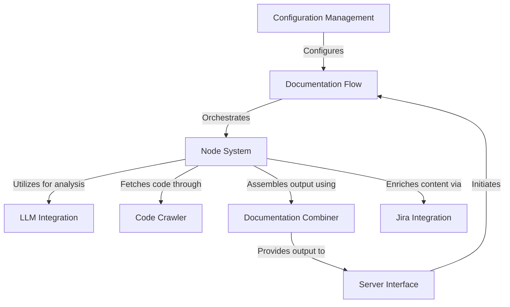
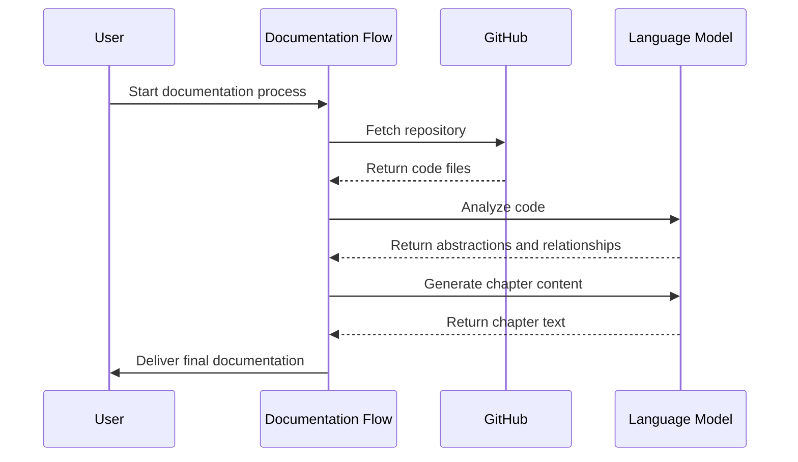
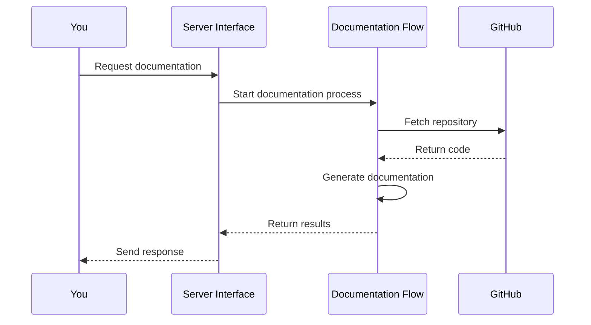
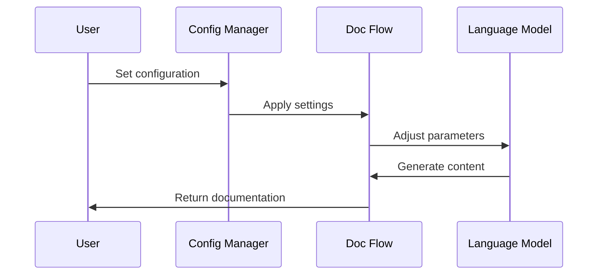
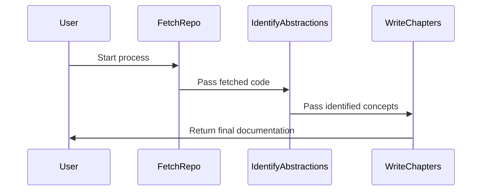
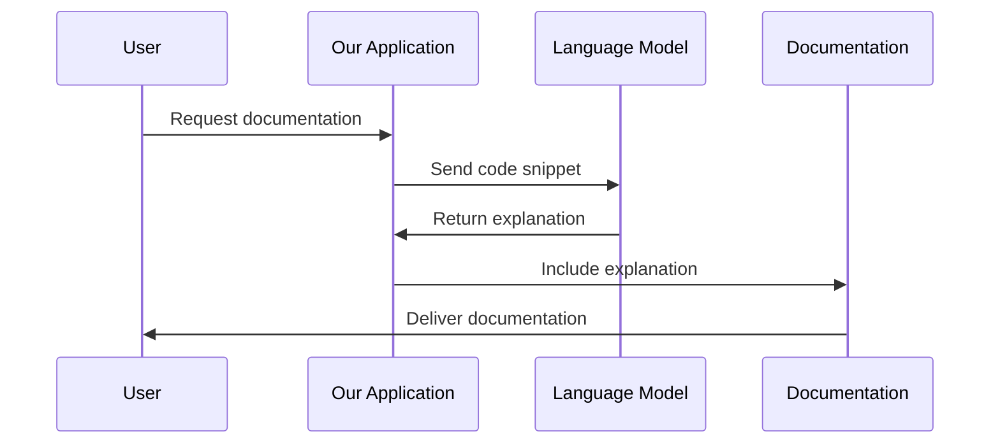
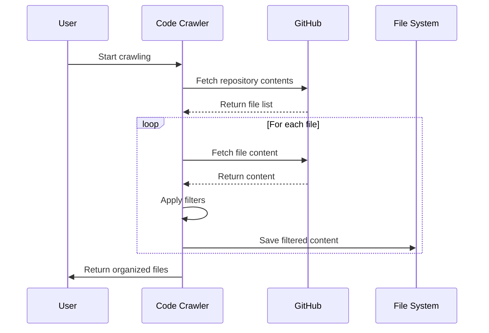
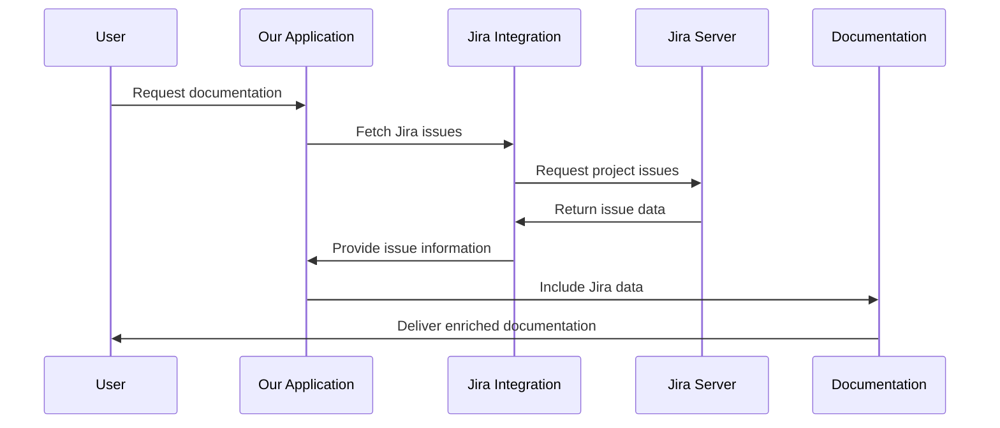
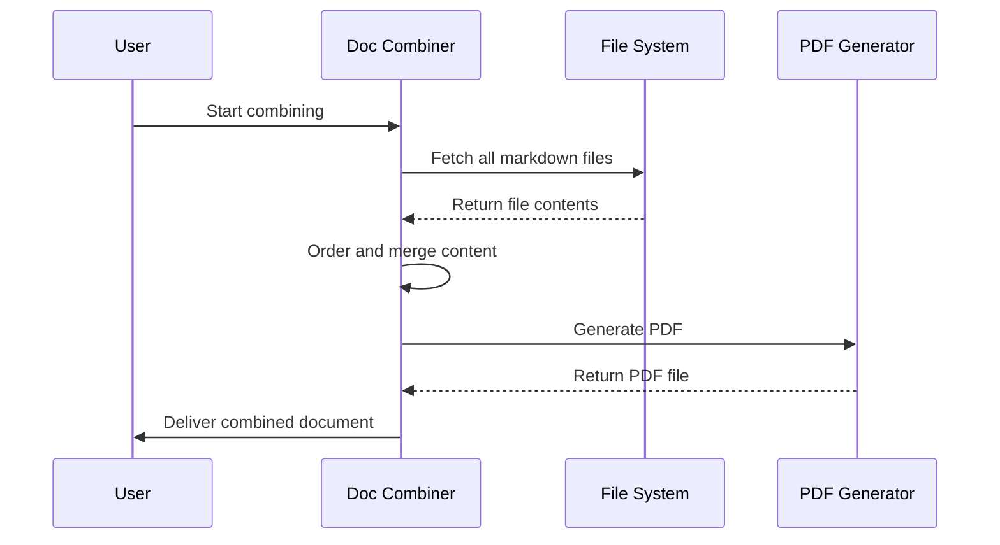

# github-agent Tutorial


# Documentation: github-agent

The **github-agent** project is an automated documentation generator that creates comprehensive tutorials from GitHub repositories or local codebases. It uses **Large Language Models** (LLMs) to analyze code, identify key abstractions, and generate beginner-friendly explanations. The system follows a structured *flow* of operations, from fetching source code to producing a final, well-organized tutorial document. It can integrate with *Jira* for project context and supports uploading the generated documentation to *Google Drive* or *GitHub*.


**Source Repository:** [https://github.com/dygavieta/github-agent](https://github.com/dygavieta/github-agent)



## Chapters

1. [Documentation Flow
](01_documentation_flow_.md)
2. [Server Interface
](02_server_interface_.md)
3. [Configuration Management
](03_configuration_management_.md)
4. [Node System
](04_node_system_.md)
5. [LLM Integration
](05_llm_integration_.md)
6. [Code Crawler
](06_code_crawler_.md)
7. [Jira Integration
](07_jira_integration_.md)
8. [Documentation Combiner
](08_documentation_combiner_.md)


---


## 01_documentation_flow_


# Chapter 1: Documentation Flow

Welcome to the exciting world of `github-agent`! In this chapter, we'll explore the heart of our project: the Documentation Flow. Imagine you're building a complex Lego set without instructions. Wouldn't it be great if there was a magical system that could look at all your Lego pieces and create a step-by-step guide for you? That's exactly what our Documentation Flow does, but for code!

## What is the Documentation Flow?

The Documentation Flow is like a master chef in a kitchen, orchestrating the creation of a delicious meal (in our case, comprehensive documentation) from raw ingredients (your code). It defines a series of steps that transform your codebase into a beautifully structured tutorial.

Let's break it down with a simple analogy:

1. Gather ingredients (Fetch the code)
2. Identify key flavors (Find important concepts in the code)
3. Understand how flavors work together (Analyze relationships between concepts)
4. Plan the menu (Order the chapters)
5. Cook the dishes (Write the chapters)
6. Plate the meal (Combine the documentation)
7. Add final touches (Integrate with project management tools like Jira)
8. Serve the meal (Upload the finished documentation)

## How Does It Work?

The Documentation Flow uses a system of connected nodes, where each node represents a specific task in the documentation process. Let's look at a simplified version of how we create this flow:

```python
from pocketflow import Flow
from nodes import FetchRepo, IdentifyAbstractions, WriteChapters

def create_documentation_flow():
    fetch_repo = FetchRepo()
    identify_abstractions = IdentifyAbstractions()
    write_chapters = WriteChapters()

    fetch_repo >> identify_abstractions >> write_chapters

    return Flow(start=fetch_repo)
```

This code creates a simple flow where we fetch the repository, identify important abstractions, and then write chapters. The `>>` operator connects the nodes in sequence.

## Under the Hood

When you run the Documentation Flow, here's what happens behind the scenes:



1. The flow starts when a user initiates the process.
2. It fetches the code from GitHub or a local directory.
3. The code is analyzed to identify key concepts and their relationships.
4. Based on this analysis, it plans and writes the chapters.
5. Finally, it combines everything into a cohesive document and delivers it to the user.

## Customizing the Flow

You can customize the Documentation Flow to fit your needs. For example, you might want to add extra steps for specific project requirements:

```python
from nodes import JiraIntegration, UploadToGitHub

def create_custom_flow():
    # ... (previous nodes)
    jira_integration = JiraIntegration()
    upload_to_github = UploadToGitHub()

    # ... (connect previous nodes)
    write_chapters >> jira_integration >> upload_to_github

    return Flow(start=fetch_repo)
```

This customized flow adds steps to integrate with Jira for project management and upload the final documentation to GitHub.

## Conclusion

The Documentation Flow is the backbone of `github-agent`, orchestrating the entire process of turning your code into comprehensive, beginner-friendly documentation. It's flexible, powerful, and designed to make your life easier.

In the next chapter, we'll dive into the [Server Interface](02_server_interface_.md), which allows our Documentation Flow to communicate with external services and APIs. Get ready to explore how we connect our magical documentation kitchen to the outside world!


## 02_server_interface_


# Chapter 2: Server Interface

Welcome back, documentation explorers! In our [previous chapter](01_documentation_flow_.md), we learned about the magical Documentation Flow that transforms code into beautiful tutorials. Now, let's dive into the Server Interface, our friendly receptionist for the documentation factory!

## What's the Server Interface?

Imagine you have a lemonade stand. You're great at making lemonade, but you can't be there all the time. What if you could build a robot that could take orders and serve lemonade even when you're not around? That's basically what the Server Interface does for our documentation system!

The Server Interface is like a 24/7 receptionist for our documentation factory. It allows other programs or people to request documentation without needing to understand all the complex machinery inside. Let's see how it works!

## How to Use the Server Interface

Let's say you want to generate documentation for a GitHub project. Here's how you might do it:

```python
import requests

url = "http://our-doc-service.com/generate"
data = {
    "repo_url": "https://github.com/coolproject/awesome-code",
    "upload": "github"
}

response = requests.post(url, json=data)
result = response.json()
```

This code sends a request to our documentation service. It's like leaving a note for our robot receptionist saying, "Please make documentation for this GitHub project and upload it back to GitHub when you're done."

## Under the Hood

When you make a request, here's what happens behind the scenes:



1. You send a request to the Server Interface.
2. The Server Interface tells the [Documentation Flow](01_documentation_flow_.md) to start working.
3. The Documentation Flow does its magic (as we learned in the previous chapter).
4. When it's done, the Server Interface sends the results back to you.

## The Code Behind the Magic

Let's peek at how our Server Interface is set up:

```python
from fastmcp import FastMCP
from flow import create_documentation_flow

mcp = FastMCP("Document Generator")

@mcp.tool()
def generate_document(repo_url: str = None, upload: str = "github") -> dict:
    # Magic happens here!
    # ...
```

This code creates our Server Interface using something called FastMCP. The `generate_document` function is like a special button that starts the documentation process when pressed.

## Customizing the Server

You can customize how the Server Interface works. For example, you might want to add security:

```python
@mcp.tool(require_api_key=True)
def generate_document(repo_url: str, api_key: str):
    # Check if api_key is valid
    # Then generate document
```

This adds a special "key" that users need to provide to use the service, like a secret password for your lemonade-making robot.

## Conclusion

The Server Interface is our friendly robot receptionist, making it easy for anyone to request documentation without needing to understand all the complex parts inside. It connects our [Documentation Flow](01_documentation_flow_.md) to the outside world, allowing our system to be used as a service.

In the next chapter, we'll explore [Configuration Management](03_configuration_management_.md), where we'll learn how to customize our documentation robot to make different flavors of lemonade... I mean, documentation! Get ready to tweak and tune our system to perfection!


## 03_configuration_management_


# Chapter 3: Configuration Management

Welcome back, documentation adventurers! In our [previous chapter](02_server_interface_.md), we explored the Server Interface, our friendly receptionist for the documentation factory. Now, let's dive into the exciting world of Configuration Management – the control panel of our documentation machine!

## What is Configuration Management?

Imagine you're building a customizable robot. You want to be able to change its color, adjust its height, and even give it different abilities. Configuration Management is like the control panel that lets you make all these adjustments easily.

In our `github-agent` project, Configuration Management helps us customize how our documentation is generated. It's like having a magic wand that can change how our documentation looks and behaves!

## Why Do We Need Configuration Management?

Let's say you want to create documentation for different projects:

1. A Python project with lots of code comments
2. A JavaScript project with very few comments
3. A Go project that needs extra explanations for beginners

With Configuration Management, you can easily adjust our documentation generator to handle all these different scenarios without changing the core code. It's like having a Swiss Army knife for documentation!

## How to Use Configuration Management

Let's look at a simple example of how we might use Configuration Management:

```python
config = {
    "input_source": "github",
    "repo_url": "https://github.com/coolproject/awesome-code",
    "output_format": "markdown",
    "language": "english",
    "max_file_size": 100000
}

generate_docs(config)
```

In this code, we're creating a `config` dictionary that tells our documentation generator:
- Where to get the code from (GitHub)
- Which repository to use
- What format to use for the output (Markdown)
- What language to write the documentation in
- How big the files can be

Then we pass this configuration to our `generate_docs` function. It's like giving instructions to our documentation robot!

## Under the Hood

When you use Configuration Management, here's what happens behind the scenes:



1. You set the configuration.
2. The Configuration Manager applies these settings to the [Documentation Flow](01_documentation_flow_.md).
3. The Documentation Flow adjusts how it works based on these settings.
4. The [LLM Integration](05_llm_integration_.md) uses these settings to generate appropriate content.
5. You get back documentation tailored to your needs!

## The Code Behind the Magic

Let's peek at how our Configuration Management might be set up:

```python
class ConfigManager:
    def __init__(self):
        self.config = {}

    def set_config(self, key, value):
        self.config[key] = value

    def get_config(self, key):
        return self.config.get(key)
```

This `ConfigManager` class is like a magical box that stores all our settings. We can put settings in with `set_config` and take them out with `get_config`.

## Customizing Your Documentation

You can customize many aspects of your documentation generation. Here are some examples:

```python
config_manager = ConfigManager()

config_manager.set_config("code_language", "python")
config_manager.set_config("doc_style", "tutorial")
config_manager.set_config("include_diagrams", True)
```

With these settings, we're telling our documentation generator to expect Python code, create a tutorial-style document, and include diagrams. It's like telling a chef exactly how you want your meal prepared!

## Conclusion

Configuration Management is the magic wand that makes our documentation generator flexible and powerful. It allows us to adapt to different projects and needs without changing our core code.

In the next chapter, we'll explore the [Node System](04_node_system_.md), which forms the building blocks of our documentation generator. Get ready to see how we put together the pieces of our documentation puzzle!


## 04_node_system_


# Chapter 4: Node System

Welcome back, future documentation masters! In our [previous chapter](03_configuration_management_.md), we learned how to customize our documentation generator. Now, let's dive into the heart of our project: the Node System.

Imagine you're building a complex Lego structure. Each Lego piece has a specific role, and when combined, they create something amazing. That's exactly what the Node System does for our documentation generator!

## What is the Node System?

The Node System is like a team of specialized workers in a documentation factory. Each worker (or node) has a specific job to do, and when they work together, they transform raw code into beautiful, structured documentation.

Let's break it down with a simple analogy:

1. You have a recipe (your code)
2. You have different chefs (nodes) who each specialize in a part of the cooking process
3. When they work together, they create a delicious meal (your documentation)

## How Does the Node System Work?

Let's look at a simple example of how we might use the Node System:

```python
from pocketflow import Flow
from nodes import FetchRepo, IdentifyAbstractions, WriteChapters

def create_documentation_flow():
    fetch_repo = FetchRepo()
    identify_abstractions = IdentifyAbstractions()
    write_chapters = WriteChapters()

    fetch_repo >> identify_abstractions >> write_chapters

    return Flow(start=fetch_repo)
```

In this code, we're creating three nodes:
1. `FetchRepo`: This node fetches your code from a repository
2. `IdentifyAbstractions`: This node analyzes your code to find important concepts
3. `WriteChapters`: This node writes the actual documentation chapters

The `>>` operator connects these nodes in sequence, like a conveyor belt in our documentation factory.

## Under the Hood

When you run this Node System, here's what happens behind the scenes:



1. The user starts the process
2. `FetchRepo` fetches the code and passes it to `IdentifyAbstractions`
3. `IdentifyAbstractions` analyzes the code and passes the important concepts to `WriteChapters`
4. `WriteChapters` creates the final documentation and returns it to the user

## Customizing the Node System

The beauty of the Node System is that you can customize it to fit your needs. Let's say you want to add a step to upload your documentation to GitHub:

```python
from nodes import UploadToGitHub

def create_custom_flow():
    # ... (previous nodes)
    upload_to_github = UploadToGitHub()

    # ... (connect previous nodes)
    write_chapters >> upload_to_github

    return Flow(start=fetch_repo)
```

This customized flow adds a new node at the end to upload your documentation to GitHub.

## Why Use the Node System?

The Node System offers several advantages:

1. **Flexibility**: You can easily add, remove, or rearrange nodes to change how your documentation is generated.
2. **Reusability**: Each node can be used in different flows, like Lego pieces in different structures.
3. **Simplicity**: Each node focuses on one task, making the system easier to understand and maintain.

## Conclusion

The Node System is the engine that powers our documentation generator. It breaks down the complex task of documentation generation into smaller, manageable pieces that work together seamlessly.

In our next chapter, we'll explore [LLM Integration](05_llm_integration_.md), where we'll see how we use advanced language models to make our documentation even smarter. Get ready to add some AI magic to our documentation factory!


## 05_llm_integration_


# Chapter 5: LLM Integration

Welcome back, documentation wizards! In our [previous chapter](04_node_system_.md), we explored the Node System, the building blocks of our documentation generator. Now, let's dive into the exciting world of LLM Integration – our AI-powered writing assistant!

## What is LLM Integration?

Imagine you have a super-smart friend who's amazing at explaining complex topics in simple terms. Now, imagine that friend is always available to help you write documentation. That's essentially what LLM Integration does for our project!

LLM stands for Large Language Model. It's like a digital brain that understands and generates human-like text. In our `github-agent` project, we use LLM Integration to take complex code and turn it into easy-to-understand documentation.

## How Does LLM Integration Work?

Let's say you want to document a function that calculates the area of a circle. Here's how LLM Integration might help:

1. You show the code to the LLM:

```python
def calculate_circle_area(radius):
    return 3.14159 * radius * radius
```

2. You ask the LLM to explain it in simple terms.

3. The LLM might respond with:

"This function calculates the area of a circle. It takes the radius as input and multiplies it by itself and by pi (approximately 3.14159) to get the area."

## Using LLM Integration

Here's a simple example of how we might use LLM Integration in our project:

```python
from utils.call_llm import call_llm

code_snippet = "def greet(name):\n    return f'Hello, {name}!'"
prompt = f"Explain this code in simple terms:\n{code_snippet}"

explanation = call_llm(prompt)
print(explanation)
```

This code sends a prompt to our LLM, asking it to explain a simple Python function. The LLM then returns an explanation, which we can use in our documentation.

## Under the Hood

When you use LLM Integration, here's what happens behind the scenes:



1. You request documentation for some code.
2. Our application sends the code to the LLM.
3. The LLM analyzes the code and generates an explanation.
4. Our application includes this explanation in the documentation.
5. You receive the completed documentation with easy-to-understand explanations.

## The Code Behind the Magic

Let's take a closer look at how we interact with the LLM:

```python
def call_llm(prompt: str, use_cache: bool = True) -> str:
    # Check cache for existing response
    # If not in cache, call the LLM API
    # Log the prompt and response
    # Update cache with new response
    # Return the response
```

This function handles sending prompts to the LLM and receiving responses. It also includes caching to save time and resources by remembering previous responses.

## Why Use LLM Integration?

LLM Integration offers several benefits:

1. **Simplification**: It can explain complex code in simple terms.
2. **Consistency**: It maintains a consistent style across your documentation.
3. **Efficiency**: It can generate explanations much faster than a human in many cases.
4. **Adaptability**: It can adjust its explanations based on the context you provide.

## Conclusion

LLM Integration is like having a tireless, super-smart writing assistant that helps turn complex code into clear, beginner-friendly documentation. It's a powerful tool that enhances our [Documentation Flow](01_documentation_flow_.md) and makes our project more accessible to users of all levels.

In our next chapter, we'll explore the [Code Crawler](06_code_crawler_.md), which helps us navigate through your project's codebase. Get ready to see how we discover all the nooks and crannies of your code!


## 06_code_crawler_


# Chapter 6: Code Crawler

Welcome back, coding explorers! In our [previous chapter](05_llm_integration_.md), we discovered how AI can help us explain complex code. Now, let's embark on a new adventure with the Code Crawler!

Imagine you're a detective investigating a massive library. Your job is to find all the important books and read their contents. That's exactly what the Code Crawler does, but with code instead of books!

## What is the Code Crawler?

The Code Crawler is like a friendly robot that explores your code files, whether they're stored on GitHub or your local computer. It's designed to:

1. Find all the relevant code files
2. Read their contents
3. Organize everything neatly for our documentation generator

Let's say you have a big project with lots of Python files. You want to create documentation, but you don't want to include test files or files that are too large. The Code Crawler can help!

## How to Use the Code Crawler

Here's a simple example of how we might use the Code Crawler:

```python
from utils.crawl_github_files import crawl_github_files

repo_url = "https://github.com/your-username/your-project"
result = crawl_github_files(
    repo_url,
    include_patterns={"*.py"},
    exclude_patterns={"tests/*"},
    max_file_size=1_000_000  # 1 MB
)
```

This code tells our Code Crawler to:
1. Look at your GitHub project
2. Include all Python files (*.py)
3. Exclude anything in the "tests" folder
4. Skip any file larger than 1 MB

After running this, `result` will contain all the Python files from your project, except for tests and large files.

## Under the Hood

When you use the Code Crawler, here's what happens behind the scenes:



1. You tell the Code Crawler to start
2. It asks GitHub for a list of all files in your project
3. For each file, it:
   - Fetches the content
   - Checks if the file matches your include/exclude patterns
   - Saves the file if it passes all checks
4. Finally, it gives you a neat package of all the relevant files

## The Code Behind the Magic

Let's peek at how our Code Crawler works:

```python
def crawl_github_files(repo_url, include_patterns, exclude_patterns, max_file_size):
    # Fetch repository contents
    files = fetch_repo_contents(repo_url)
    
    filtered_files = {}
    for file_path, content in files.items():
        if should_include_file(file_path, include_patterns, exclude_patterns):
            if len(content) <= max_file_size:
                filtered_files[file_path] = content
    
    return filtered_files
```

This simplified version shows how the Code Crawler:
1. Fetches all files from the repository
2. Checks each file against the include and exclude patterns
3. Ensures the file isn't too large
4. Keeps only the files that pass all checks

## Why Use the Code Crawler?

The Code Crawler offers several benefits:

1. **Efficiency**: It quickly gathers all relevant code files
2. **Flexibility**: You can easily customize what files to include or exclude
3. **Organization**: It provides a clean, structured set of files for further processing

## Conclusion

The Code Crawler is your friendly neighborhood detective, exploring your codebase and bringing back all the important files for documentation. It works hand in hand with our [Documentation Flow](01_documentation_flow_.md) to ensure we have all the right ingredients for creating amazing documentation.

In our next chapter, we'll explore [Jira Integration](07_jira_integration_.md), where we'll see how we can connect our documentation to project management tools. Get ready to bridge the gap between code and project planning!


## 07_jira_integration_


# Chapter 7: Jira Integration

Welcome back, documentation champions! In our [previous chapter](06_code_crawler_.md), we explored how the Code Crawler helps us navigate through your project's codebase. Now, let's dive into the exciting world of Jira Integration – our bridge between code and project management!

Imagine you're writing a story about a magical castle, but you also need to keep track of which parts of the castle you've described and what still needs work. That's where Jira Integration comes in handy for our documentation project!

## What is Jira Integration?

Jira is like a digital whiteboard where teams keep track of their tasks and progress. Our Jira Integration is a friendly messenger that talks to Jira and brings back important information about your project. This helps us make our documentation even more useful by connecting it to your team's ongoing work.

Let's say you're working on a feature to add a dragon to your castle. In Jira, you might have a task that looks like this:

```
Task: Add fire-breathing dragon to the castle
Description: Create a friendly dragon named Sparky who guards the treasure room
Status: In Progress
Assigned to: Dragon Tamer Emma
```

Our Jira Integration can fetch this information and use it to enrich our documentation!

## How to Use Jira Integration

Here's a simple example of how we might use Jira Integration in our project:

```python
from utils.jira_client import get_shared_issues

issues = get_shared_issues()
for issue in issues:
    print(f"Issue: {issue['issue']}")
    print(f"Description: {issue['description']}")
    print("---")
```

This code fetches all the relevant issues from your Jira project and prints out their keys and descriptions. It's like asking our messenger to bring us a list of all the castle-building tasks!

## Under the Hood

When you use Jira Integration, here's what happens behind the scenes:



1. You request documentation for your project.
2. Our application asks the Jira Integration to fetch relevant issues.
3. The Jira Integration talks to your Jira server and gets the issue data.
4. Our application includes this Jira information in your documentation.
5. You receive documentation that's connected to your project's tasks!

## The Code Behind the Magic

Let's take a closer look at how we interact with Jira:

```python
def get_jira_client(server_url, email, api_token):
    return JIRA(server=server_url, basic_auth=(email, api_token))

def get_jira_issues(jira_client, project_key):
    issues = jira_client.search_issues(f"project = {project_key}")
    return [{"key": issue.key, "summary": issue.fields.summary} for issue in issues]
```

This simplified code shows how we connect to Jira and fetch issues. It's like giving our messenger the address of the Jira whiteboard and asking them to bring back a list of all the tasks.

## Why Use Jira Integration?

Jira Integration offers several benefits:

1. **Context**: It helps connect your code to your project tasks.
2. **Up-to-date Information**: Your documentation can reflect the current state of your project.
3. **Collaboration**: It bridges the gap between developers and project managers.

## Conclusion

Jira Integration is like having a helpful messenger that keeps your documentation in sync with your project management. It works seamlessly with our [Documentation Flow](01_documentation_flow_.md) to create documentation that's not just about code, but also about your team's goals and progress.

In our next chapter, we'll explore the [Documentation Combiner](08_documentation_combiner_.md), where we'll see how all these pieces come together to create your final, polished documentation. Get ready to see your documentation take its final form!


## 08_documentation_combiner_


# Chapter 8: Documentation Combiner

Welcome back, documentation champions! In our [previous chapter](07_jira_integration_.md), we explored how to connect our documentation with project management tools. Now, let's put on our librarian hats and dive into the exciting world of the Documentation Combiner!

Imagine you've written lots of little stories about different parts of a magical kingdom. Now you want to put them all together into one big, beautiful storybook. That's exactly what the Documentation Combiner does for our project!

## What is the Documentation Combiner?

The Documentation Combiner is like a friendly librarian who takes all the separate chapters we've created and binds them into a complete, well-organized book. It's the final step in our documentation journey, turning all our hard work into something that's easy for others to read and understand.

Let's say we've been documenting a project about building a treehouse. We might have separate files for:

1. Choosing the right tree
2. Designing the treehouse
3. Building the foundation
4. Adding walls and a roof
5. Decorating the interior

The Documentation Combiner takes all these separate pieces and puts them together in the right order, adds a table of contents, and makes sure everything looks nice and consistent.

## How to Use the Documentation Combiner

Here's a simple example of how we might use the Documentation Combiner:

```python
from utils.node_utility import combine_documentation

output_dir = "treehouse_project"
combined_doc = combine_documentation(output_dir, output_format="pdf")
print(f"Combined documentation created at: {combined_doc}")
```

This code tells our Documentation Combiner to:
1. Look in the "treehouse_project" folder for all our documentation files
2. Combine them into a single PDF document
3. Tell us where it saved the final document

## Under the Hood

When you use the Documentation Combiner, here's what happens behind the scenes:



1. You tell the Documentation Combiner to start
2. It looks for all the markdown files in your project folder
3. It reads the content of each file
4. It puts the content together in the right order
5. It creates a PDF (or markdown) file with all the combined content
6. Finally, it gives you the completed document

## The Code Behind the Magic

Let's peek at how our Documentation Combiner works:

```python
def combine_documentation(output_dir, output_format="pdf"):
    md_files = sorted(glob.glob(os.path.join(output_dir, "**/*.md")))
    combined_content = []
    
    for md_file in md_files:
        with open(md_file, "r") as f:
            content = f.read()
            combined_content.append(content)
    
    final_content = "\n\n---\n\n".join(combined_content)
    
    if output_format == "pdf":
        return create_pdf(final_content)
    else:
        return save_markdown(final_content)
```

This simplified version shows how the Documentation Combiner:
1. Finds all markdown files in your project
2. Reads the content of each file
3. Joins all the content together, adding separators between chapters
4. Creates either a PDF or a markdown file with the combined content

## Why Use the Documentation Combiner?

The Documentation Combiner offers several benefits:

1. **Organization**: It puts all your documentation in one place
2. **Consistency**: It ensures a uniform look across all chapters
3. **Convenience**: Readers can access all information in a single document
4. **Flexibility**: You can choose between PDF and markdown formats

## Conclusion

The Documentation Combiner is the final piece of our documentation puzzle. It takes all the hard work we've done throughout our [Documentation Flow](01_documentation_flow_.md) and presents it in a polished, professional format. It's like the ribbon on top of a beautifully wrapped gift – making our documentation not just informative, but also a joy to read!

Thank you for joining us on this documentation adventure. We hope you're now equipped to create amazing, user-friendly documentation for all your projects. Happy documenting!


## jira_branches


# Jira Branches


## SCRUM-4

**Description:** Task created and added to SCRUM sprint.


No branches found for this issue.

---


## SCRUM-3

**Description:** Task created for FRIDAY


No branches found for this issue.

---


## SCRUM-2

**Description:** you close the web


No branches found for this issue.

---


## SCRUM-1

**Description:** *Lorem Ipsum* is simply dummy text of the printing and typesetting industry. Lorem Ipsum has been the industry's standard dummy text ever since the 1500s, when an unknown printer took a galley of type and scrambled it to make a type specimen book. It has survived not only five centuries, but also the leap into electronic typesetting, remaining essentially unchanged. It was popularised in the 1960s with the release of Letraset sheets containing Lorem Ipsum passages, and more recently with desktop publishing software like Aldus PageMaker including versions of Lorem Ipsum.


**Branches:**

- `SCRUM-1-THURSDAY-v1`
- `SCRUM-1-THURSDAY`

---
