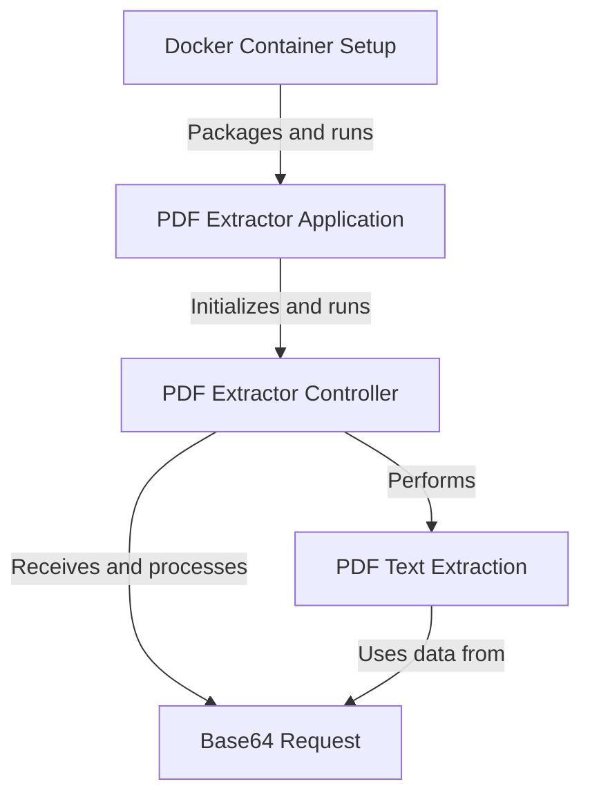
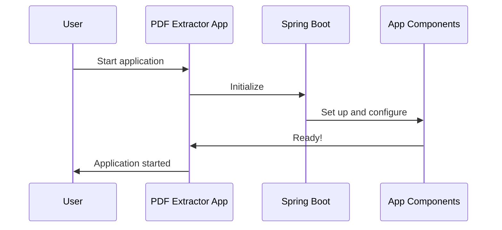
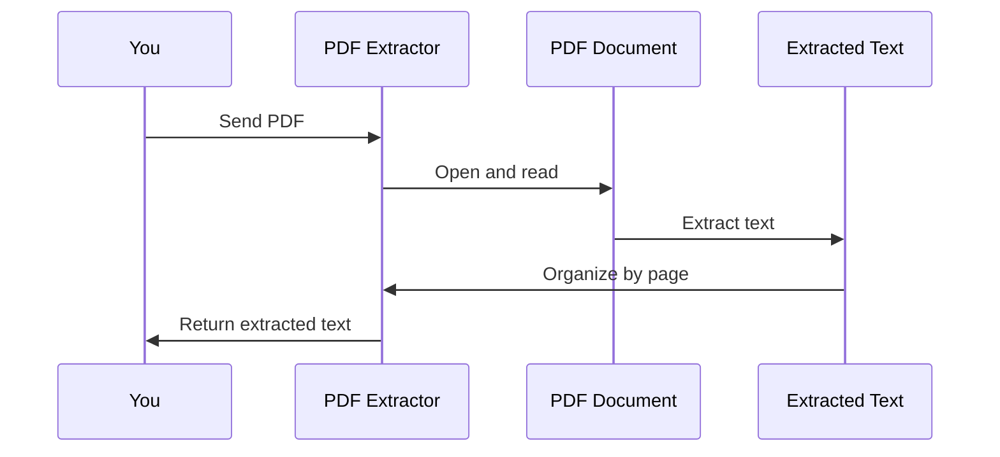
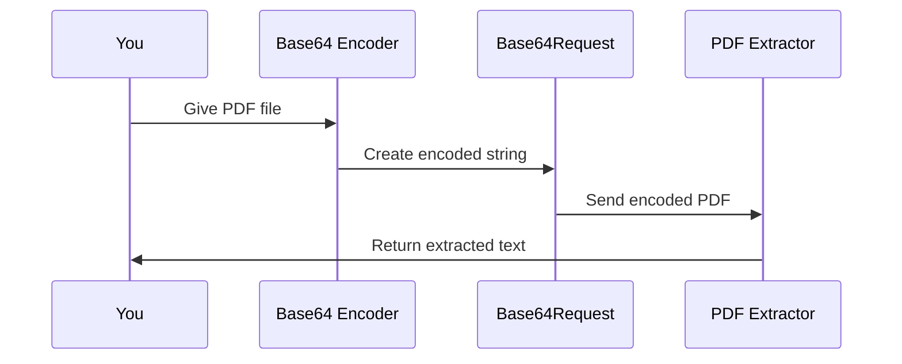
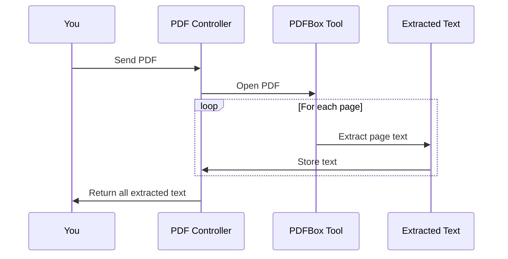
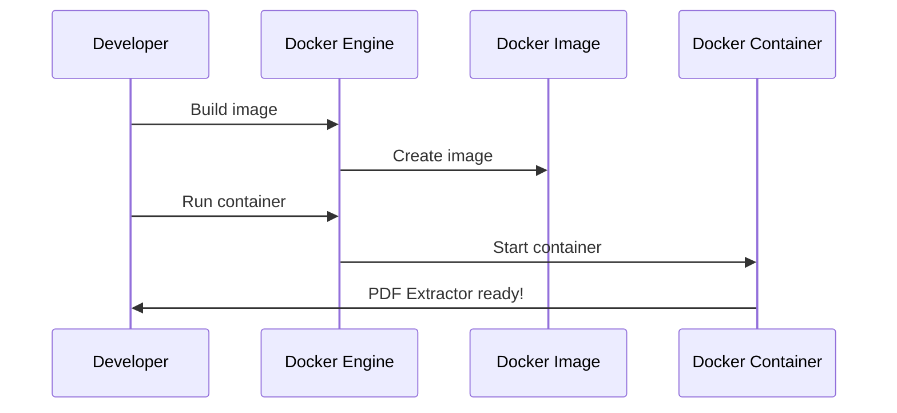

# pdf-extractor Tutorial


# Tutorial: pdf-extractor

This project is a **PDF text extraction application** built with Spring Boot. It allows users to *upload PDF files* (encoded in base64) and *extract text* from each page. The application is **containerized using Docker** for easy deployment. It provides a simple **REST API** that accepts PDF data and returns the extracted text organized by page numbers, making it easy to process and analyze PDF content programmatically.


**Source Repository:** [https://github.com/dygavieta/pdf-extractor](https://github.com/dygavieta/pdf-extractor)



## Chapters

1. [PDF Extractor Application
](01_pdf_extractor_application_.md)
2. [PDF Extractor Controller
](02_pdf_extractor_controller_.md)
3. [Base64 Request
](03_base64_request_.md)
4. [PDF Text Extraction
](04_pdf_text_extraction_.md)
5. [Docker Container Setup
](05_docker_container_setup_.md)


---

Generated by [AI Codebase Knowledge Builder](https://github.com/The-Pocket/Tutorial-Codebase-Knowledge)

---


## 01_pdf_extractor_application_


# Chapter 1: PDF Extractor Application

Welcome to the exciting world of PDF extraction! In this chapter, we'll explore the heart of our project: the PDF Extractor Application. Imagine you have a digital filing cabinet full of PDF documents, and you want to quickly find and use the text inside them. That's exactly what our PDF Extractor helps you do!

## What Problem Does This Solve?

Let's say you're a student with dozens of PDF textbooks. You need to find all mentions of "photosynthesis" across these books. Instead of opening each PDF and searching manually, our PDF Extractor can help you extract all the text, making it easy to search and use the information.

## The PDF Extractor Application: Your Digital Assistant

Think of the PDF Extractor Application as a helpful robot. You give it a PDF, and it reads through the entire document, pulling out all the text for you. It's like having a super-fast reader who can instantly tell you everything written in a book!

Let's look at the main piece of code that starts our application:

```java
@SpringBootApplication
public class PdfExtractorApplication {
    public static void main(String[] args) {
        SpringApplication.run(PdfExtractorApplication.class, args);
    }
}
```

This small but powerful code snippet is like turning on the engine of a car. When you run this, it starts up the entire PDF Extractor system, making it ready to receive PDFs and extract text.

## What's Happening Under the Hood?

When you start the application, here's what happens:



1. You (the user) start the application.
2. The PDF Extractor App wakes up and tells Spring Boot to get everything ready.
3. Spring Boot, like a helpful assistant, sets up all the necessary parts of the application.
4. Once everything is set up, the application tells you it's ready to use.

## The Magic of Spring Boot

You might wonder, "What's this Spring Boot thing?" Well, Spring Boot is like a Swiss Army knife for Java developers. It does a lot of the hard work for us, setting up a web server, managing how different parts of our application talk to each other, and much more. It's like having a team of helpers that make building our PDF Extractor much easier and faster!

## Conclusion

In this chapter, we've learned about the PDF Extractor Application - the starting point of our project. It's a simple yet powerful way to kick off our text extraction journey. We've seen how just a few lines of code can start up a complex system, thanks to the magic of Spring Boot.

Next, we'll dive into how we actually handle requests to extract text from PDFs in the [PDF Extractor Controller](02_pdf_extractor_controller_.md). Get ready to see our PDF Extractor in action!

---

Generated by [AI Codebase Knowledge Builder](https://github.com/The-Pocket/Tutorial-Codebase-Knowledge)

## 02_pdf_extractor_controller_


# Chapter 2: PDF Extractor Controller

Welcome back to our PDF Extractor journey! In the [previous chapter](01_pdf_extractor_application_.md), we learned about the overall application. Now, let's dive into the heart of our project: the PDF Extractor Controller.

Imagine you're a librarian with a magical book scanner. When someone hands you a book, you can instantly extract all the text from it. That's exactly what our PDF Extractor Controller does, but with PDF files instead of physical books!

## What Does the PDF Extractor Controller Do?

Let's say you're a student with a big PDF textbook about animals. You need to find all mentions of "elephant" quickly. Instead of reading through the entire book, you can use our PDF Extractor Controller to pull out all the text, making it super easy to search!

## How Does It Work?

Our PDF Extractor Controller is like a helpful robot that follows these steps:

1. Receives a PDF file (in a special format called base64)
2. Opens the PDF
3. Reads the text from each page
4. Organizes the text by page number
5. Sends back all the extracted text

Let's look at the main part of our controller:

```java
@RestController
@RequestMapping("/extract")
public class PDFExtractorController {
    @PostMapping
    public Map<String, Object> extractPDFPerPage(@RequestBody Base64Request request) {
        // Magic happens here!
    }
}
```

This code is like setting up a special desk in our library where people can bring their PDFs for text extraction.

## The Extraction Process

When someone sends a PDF to our controller, here's what happens:



1. You send a PDF to the PDF Extractor.
2. The Extractor opens and reads the PDF.
3. It pulls out all the text from each page.
4. The text is organized by page number.
5. Finally, you receive all the extracted text!

## Looking Under the Hood

Now, let's peek at how our controller actually extracts the text:

```java
try (PDDocument document = PDDocument.load(new ByteArrayInputStream(pdfBytes))) {
    PDFTextStripper pdfStripper = new PDFTextStripper();
    for (int i = 1; i <= totalPages; i++) {
        pdfStripper.setStartPage(i);
        pdfStripper.setEndPage(i);
        String pageText = pdfStripper.getText(document).trim();
        // Store the extracted text
    }
}
```

This code is like our librarian carefully going through each page of the book, copying down all the text, and organizing it by page number.

## Handling the Request

Before we can extract text, we need to receive the PDF. We do this using something called a [Base64 Request](03_base64_request_.md). It's a way of sending the PDF file over the internet, kind of like putting our book into a special envelope.

```java
@PostMapping
public Map<String, Object> extractPDFPerPage(@RequestBody Base64Request request) {
    String cleanBase64 = request.getPdfBase64().replaceAll("\\s+", "").trim();
    byte[] pdfBytes = Base64.getDecoder().decode(cleanBase64);
    // Now we can use pdfBytes to open the PDF
}
```

This code takes the PDF out of its special envelope (Base64) so we can start reading it.

## Conclusion

And there you have it! Our PDF Extractor Controller is like a super-smart librarian that can quickly read any PDF book you give it and write down all the text for you. It receives PDFs, extracts text from each page, and gives you back all the content neatly organized.

In the next chapter, we'll look closer at how we receive PDFs using [Base64 Request](03_base64_request_.md). Get ready to learn about the special envelope we use for our digital books!

---

Generated by [AI Codebase Knowledge Builder](https://github.com/The-Pocket/Tutorial-Codebase-Knowledge)

## 03_base64_request_


# Chapter 3: Base64 Request

Welcome back to our PDF Extractor journey! In the [previous chapter](02_pdf_extractor_controller_.md), we learned about the PDF Extractor Controller. Now, let's explore an important concept that helps us send PDFs to our application: the Base64 Request.

Imagine you want to send a book to a friend, but instead of mailing the physical book, you could somehow turn it into a long string of letters and numbers. That's essentially what Base64 encoding does for our PDFs!

## Why Do We Need Base64 Request?

Let's say you're a student who wants to use our PDF Extractor to help with your homework. You have a PDF of your textbook on your computer, but you can't just email the PDF file directly to our application. Instead, we use something called Base64 encoding to turn the PDF into a special text format that can be easily sent over the internet.

## What is Base64 Encoding?

Base64 encoding is like a secret code that turns any type of file (including PDFs) into a long string of letters, numbers, and a few special characters. It's a way to represent binary data (like your PDF file) using only text characters.

Here's a simple example:

```
Original: Hello
Base64 encoded: SGVsbG8=
```

The word "Hello" becomes "SGVsbG8=" when Base64 encoded. It looks different, but it contains the same information!

## How Do We Use Base64 Request?

In our PDF Extractor, we use a simple Java class called `Base64Request` to hold our encoded PDF data. Here's what it looks like:

```java
class Base64Request {
    private String pdfBase64;

    public String getPdfBase64() {
        return pdfBase64;
    }

    public void setPdfBase64(String pdfBase64) {
        this.pdfBase64 = pdfBase64;
    }
}
```

This class is like an envelope for our encoded PDF. It has one job: to hold the Base64 encoded string of our PDF.

## The Journey of a PDF through Base64 Request

When you use our PDF Extractor, here's what happens:



1. You have a PDF file on your computer.
2. Your computer encodes the PDF into a Base64 string.
3. This string is put into a `Base64Request` object.
4. The `Base64Request` is sent to our PDF Extractor.
5. The Extractor decodes the Base64 string back into a PDF and extracts the text.

## Using Base64Request in Our Controller

Now, let's see how our [PDF Extractor Controller](02_pdf_extractor_controller_.md) uses the `Base64Request`:

```java
@PostMapping
public Map<String, Object> extractPDFPerPage(@RequestBody Base64Request request) {
    String cleanBase64 = request.getPdfBase64().replaceAll("\\s+", "").trim();
    byte[] pdfBytes = Base64.getDecoder().decode(cleanBase64);
    // Now we can use pdfBytes to open the PDF
}
```

This code does three important things:
1. It receives the `Base64Request` containing our encoded PDF.
2. It cleans up the Base64 string, removing any extra spaces.
3. It decodes the Base64 string back into the original PDF data.

## Conclusion

And there you have it! The Base64 Request is like a special envelope that allows us to send PDFs to our PDF Extractor over the internet. It turns our PDFs into a text format that's easy to transmit, and then our application turns it back into a PDF to extract the text.

In the next chapter, we'll dive into the exciting process of [PDF Text Extraction](04_pdf_text_extraction_.md), where we'll see how we actually pull the text out of these PDFs. Get ready to unlock the secrets hidden in your documents!

---

Generated by [AI Codebase Knowledge Builder](https://github.com/The-Pocket/Tutorial-Codebase-Knowledge)

## 04_pdf_text_extraction_


# Chapter 4: PDF Text Extraction

Welcome back to our PDF Extractor journey! In the [previous chapter](03_base64_request_.md), we learned about Base64 Request and how it helps us send PDFs to our application. Now, let's dive into the heart of our project: PDF Text Extraction.

Imagine you have a magical pair of glasses that can look at any book and instantly write down all the words on each page. That's essentially what our PDF Text Extraction does, but for digital PDF documents!

## Why Do We Need PDF Text Extraction?

Let's say you're a student with a 200-page PDF textbook about space. You need to find all mentions of "black holes" for your homework. Instead of reading through the entire book, our PDF Text Extraction can quickly pull out all the text, making it super easy to search and find what you need!

## How Does PDF Text Extraction Work?

Our PDF Text Extraction is like a careful reader who goes through each page of the PDF, writing down all the words they see. Here's a simple breakdown of what happens:

1. Open the PDF file
2. Go to the first page
3. Read all the text on that page
4. Write down the text, keeping track of which page it came from
5. Move to the next page and repeat steps 3-4 until we reach the end of the PDF

Let's look at a simplified version of our extraction code:

```java
PDDocument document = PDDocument.load(pdfBytes);
PDFTextStripper pdfStripper = new PDFTextStripper();
for (int i = 1; i <= document.getNumberOfPages(); i++) {
    pdfStripper.setStartPage(i);
    pdfStripper.setEndPage(i);
    String pageText = pdfStripper.getText(document);
    // Store pageText for this page number
}
```

This code is like our magical glasses, reading each page of the PDF and storing the text it finds.

## The Journey of Text Through Our Extractor

When you use our PDF Extractor, here's what happens behind the scenes:



1. You send a PDF to our PDF Extractor Controller.
2. The Controller uses a tool called PDFBox to open the PDF.
3. For each page in the PDF, PDFBox reads all the text.
4. The Controller stores the text from each page.
5. Finally, you receive all the extracted text, organized by page number.

## Looking Closer at the Extraction Process

Now, let's dive a bit deeper into how we extract text from each page:

```java
PDFTextStripper pdfStripper = new PDFTextStripper();
pdfStripper.setStartPage(pageNumber);
pdfStripper.setEndPage(pageNumber);
String pageText = pdfStripper.getText(document);
```

This code is like telling our magical glasses, "Please read page 5 of the book and write down all the words you see." The `PDFTextStripper` is our magical glasses, and we're telling it exactly which page to read.

## Organizing the Extracted Text

After we extract the text, we need to organize it nicely. We use a `Map` to store the text from each page:

```java
Map<String, Object> pageTextMap = new HashMap<>();
pageTextMap.put("page" + pageNumber, pageText);
```

This is like putting each page's text into a labeled box. The label (like "page1", "page2") helps us remember which text came from which page.

## Conclusion

And there you have it! PDF Text Extraction is the core magic of our PDF Extractor. It's like having a super-fast, tireless reader who can go through any PDF and write down all the text for you, keeping track of which words were on which pages.

In the next chapter, we'll explore how we package all this amazing functionality into a [Docker Container Setup](05_docker_container_setup_.md). Get ready to learn how we make our PDF Extractor easy to use on any computer!

---

Generated by [AI Codebase Knowledge Builder](https://github.com/The-Pocket/Tutorial-Codebase-Knowledge)

## 05_docker_container_setup_


# Chapter 5: Docker Container Setup

Welcome back to our PDF Extractor journey! In the [previous chapter](04_pdf_text_extraction_.md), we learned how to extract text from PDFs. Now, let's explore how we can package our entire application into something called a Docker container.

Imagine you're moving to a new house. Instead of packing all your belongings into separate boxes, what if you could pack your entire house, with everything inside, into one big, portable container? That's essentially what Docker does for our PDF Extractor application!

## Why Do We Need Docker Container Setup?

Let's say you've created this amazing PDF Extractor on your computer, and now you want to share it with your friend who uses a different type of computer. Normally, this could be tricky because your friend's computer might not have the same setup as yours. But with Docker, it's like wrapping up your entire application, along with everything it needs to run, into a neat package that can work on any computer!

## How Does Docker Container Setup Work?

Our Docker Container Setup is like a set of instructions for building this portable package. We write these instructions in a special file called a Dockerfile. Let's break it down into simple steps:

1. Start with a base: Think of this as choosing the type of moving truck for our house.
2. Set up the workspace: This is like deciding where to put things in the truck.
3. Copy our application: This is putting our PDF Extractor into the truck.
4. Build the application: This is like making sure everything is properly packed.
5. Create a lightweight container: This is transferring everything to a smaller, more efficient truck for the final journey.

Let's look at a simplified version of our Dockerfile:

```dockerfile
FROM maven:3.9-amazoncorretto-21 AS build
WORKDIR /app
COPY pom.xml .
COPY src ./src
RUN mvn clean package -DskipTests
```

This part is like packing our PDF Extractor and all its tools into a big moving truck.

## The Journey of Our Application into a Docker Container

When we create our Docker container, here's what happens:



1. You (the developer) tell Docker to build an image of your application.
2. Docker creates this image, which is like a snapshot of your application.
3. You tell Docker to run a container based on this image.
4. Docker starts up a container, which is like a lightweight, portable version of your application.
5. Your PDF Extractor is now ready to use, packaged neatly in a container!

## Looking Closer at the Dockerfile

Now, let's look at the second part of our Dockerfile:

```dockerfile
FROM amazoncorretto:21-alpine-jdk
WORKDIR /app
COPY --from=build /app/target/*.jar app.jar
ENTRYPOINT ["java",  "-jar", "app.jar"]
```

This part is like moving everything from our big truck into a smaller, more efficient vehicle for the final delivery. We're taking just what we need to run our application.

## Why Two Stages?

You might wonder why we have two `FROM` instructions in our Dockerfile. This is called a multi-stage build, and it's like using two different trucks in our moving process:

1. The first stage (big truck) has all the tools we need to build our application.
2. The second stage (small truck) only takes the finished application, leaving behind all the building tools.

This makes our final Docker container much smaller and faster!

## Conclusion

And there you have it! Docker Container Setup is like creating a magical, portable package for our PDF Extractor. It allows us to easily share and run our application on any computer, without worrying about differences in setup or environment.

With this, we've completed our journey through the PDF Extractor project. We've learned how to create an application, handle PDF extraction, and package it all up for easy distribution. You're now equipped with the knowledge to extract text from PDFs and share your creation with the world!

---

Generated by [AI Codebase Knowledge Builder](https://github.com/The-Pocket/Tutorial-Codebase-Knowledge)