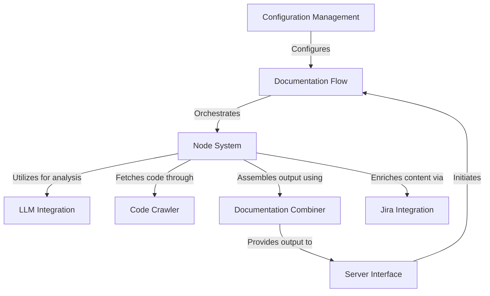
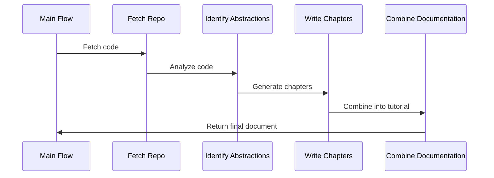
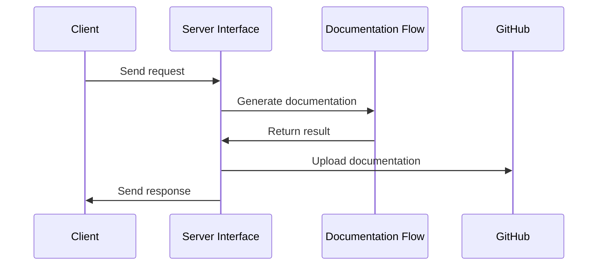
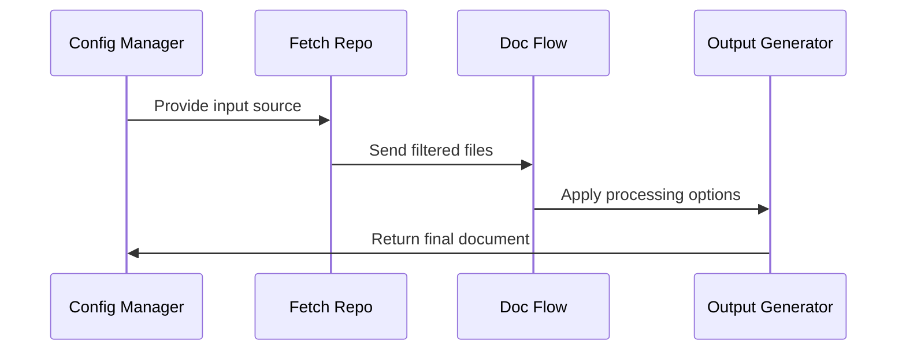
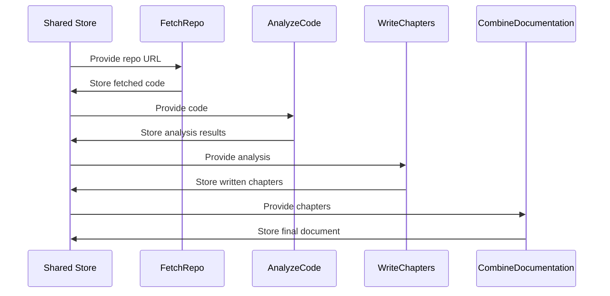
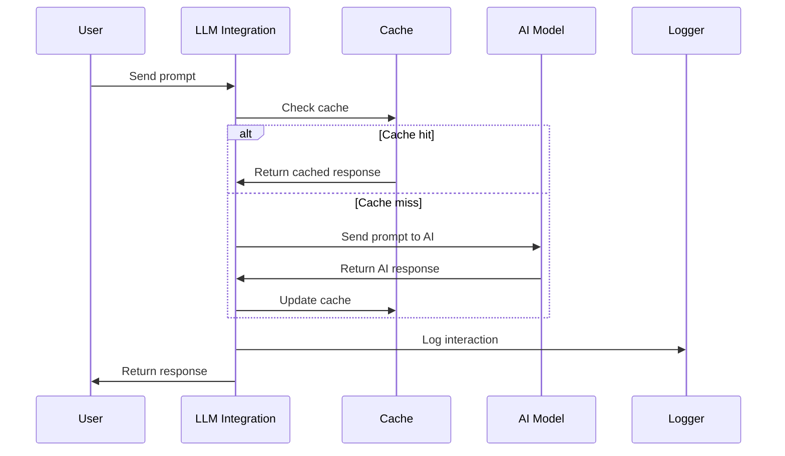
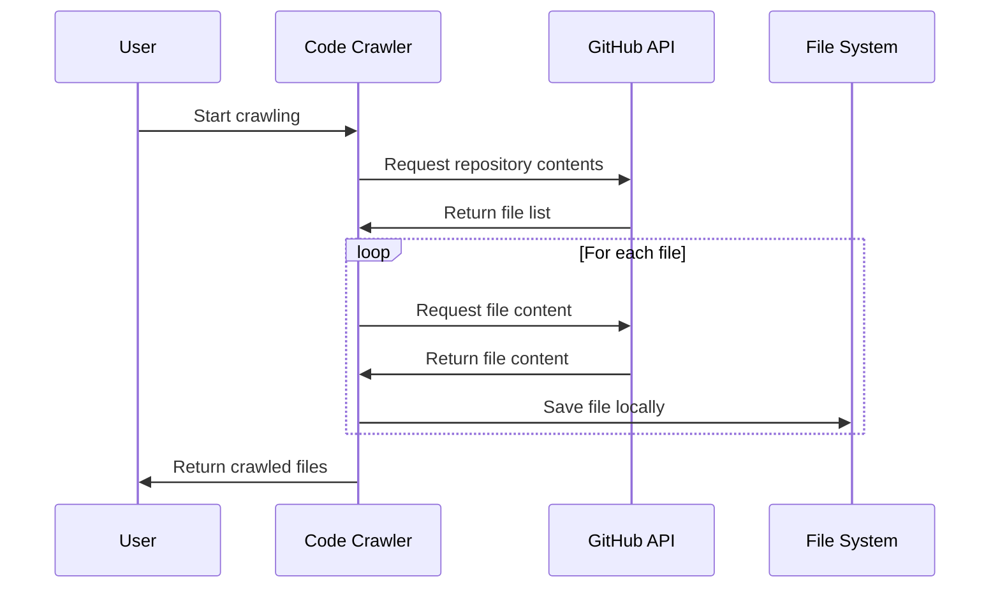
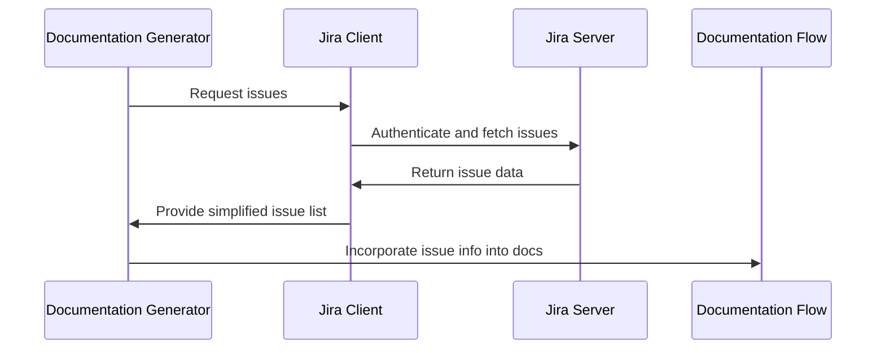
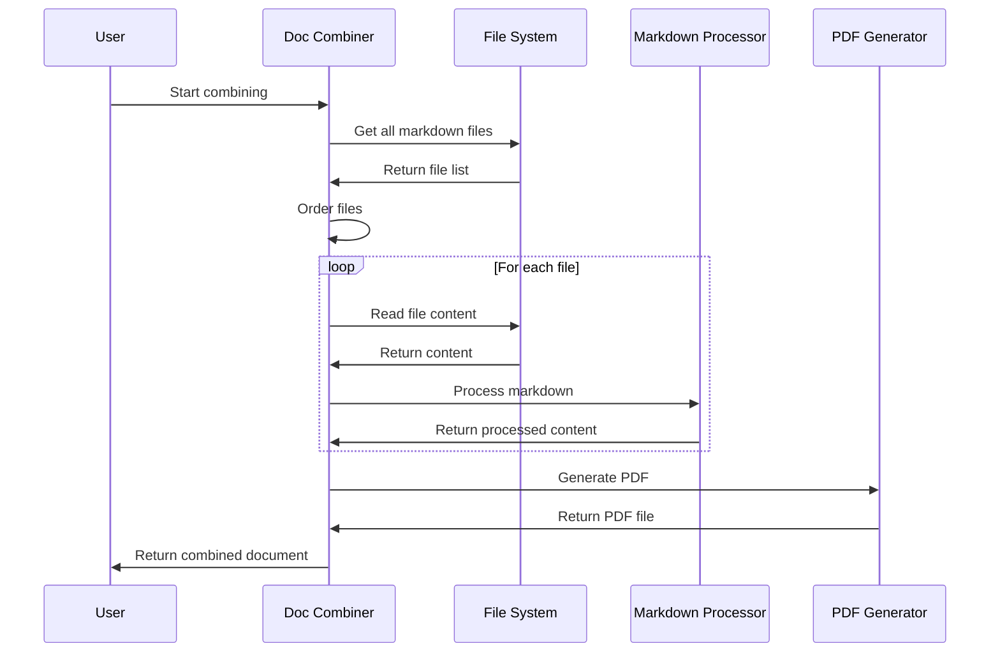

# github-agent Tutorial


# Documentation: github-agent

The **github-agent** project is an automated documentation generator that creates comprehensive tutorials from GitHub repositories or local codebases. It uses **Large Language Models** (LLMs) to analyze code, identify key abstractions, and generate beginner-friendly explanations. The system follows a structured *flow* of operations, from fetching source code to producing a final, well-organized tutorial document. It can integrate with *Jira* for project context and supports uploading the generated documentation to *Google Drive* or *GitHub*.


**Source Repository:** [https://github.com/dygavieta/github-agent](https://github.com/dygavieta/github-agent)



## Chapters

1. [Documentation Flow
](01_documentation_flow_.md)
2. [Server Interface
](02_server_interface_.md)
3. [Configuration Management
](03_configuration_management_.md)
4. [Node System
](04_node_system_.md)
5. [LLM Integration
](05_llm_integration_.md)
6. [Code Crawler
](06_code_crawler_.md)
7. [Jira Integration
](07_jira_integration_.md)
8. [Documentation Combiner
](08_documentation_combiner_.md)


---


## 01_documentation_flow_


# Chapter 1: Documentation Flow

Welcome to the exciting world of `github-agent`! In this chapter, we'll explore the heart of our project: the Documentation Flow. Think of it as the master chef in a bustling kitchen, orchestrating the creation of a delicious documentation feast.

## What Problem Does Documentation Flow Solve?

Imagine you're tasked with explaining a complex codebase to a newcomer. Where do you start? How do you organize the information? This is where Documentation Flow comes to the rescue! It automates the process of turning a jumble of code files into a clear, well-structured tutorial.

Let's say we have a simple weather app project. Our Documentation Flow will help us create a tutorial that explains how the app works, from fetching weather data to displaying it on the screen.

## Key Concepts

1. **Flow**: A sequence of steps that work together to achieve a goal.
2. **Nodes**: Individual tasks in our flow, like "analyze code" or "write chapter".
3. **Connections**: The order in which nodes are executed.

## Using Documentation Flow

To use the Documentation Flow, we start by creating it:

```python
from flow import create_documentation_flow

documentation_flow = create_documentation_flow()
```

This sets up our flow with all the necessary steps. Now, let's run it:

```python
shared = {
    "repo_url": "https://github.com/weather-app/cool-forecasts",
    "output_dir": "./tutorial_output"
}
documentation_flow.run(shared)
```

This will start the documentation process for our weather app. The `shared` dictionary contains important information that our flow will use and update as it progresses.

## Under the Hood

When we run our Documentation Flow, here's what happens behind the scenes:



Let's break this down:

1. We fetch the code from the repository.
2. The code is analyzed to identify key concepts and structures.
3. Individual chapters are written based on these concepts.
4. Finally, all chapters are combined into a cohesive tutorial.

## Implementation Details

The Documentation Flow is created in the `flow.py` file. Here's a simplified version of how it's set up:

```python
def create_documentation_flow():
    fetch_repo = FetchRepo()
    identify_abstractions = IdentifyAbstractions()
    write_chapters = WriteChapters()
    combine_documentation = CombineDocumentation()

    fetch_repo >> identify_abstractions >> write_chapters >> combine_documentation

    return Flow(start=fetch_repo)
```

Each line creates a node, and the `>>` operator connects them in sequence. This tells our flow the order in which to execute these tasks.

## Conclusion

The Documentation Flow is the backbone of `github-agent`, turning code into clear, readable tutorials. It breaks down the complex task of documentation into manageable steps, ensuring nothing is missed.

In the next chapter, we'll dive into the [Server Interface](02_server_interface_.md), which helps our Documentation Flow communicate with the outside world. Get ready to explore how we send and receive information to make our documentation process even smoother!


## 02_server_interface_


# Chapter 2: Server Interface

Welcome back, aspiring documentation wizards! In our [previous chapter](01_documentation_flow_.md), we explored how the Documentation Flow works its magic to transform code into beautiful tutorials. Now, let's dive into the Server Interface, which acts as the friendly receptionist for our documentation factory.

## What's the Server Interface All About?

Imagine you're running a bustling restaurant. You need someone at the front desk to take orders, answer phone calls, and ensure everything runs smoothly. That's exactly what the Server Interface does for our `github-agent` project!

Let's say you want to create documentation for your awesome new weather app, but you're working on a different computer or even collaborating with a team. How do you access the documentation generator? Enter the Server Interface!

## Key Concepts

1. **Server**: A computer program that provides services to other programs or devices.
2. **Interface**: A point where two systems meet and interact.
3. **Network**: A group of connected computers that can communicate with each other.

## Using the Server Interface

To use the Server Interface, we first need to start it up. It's like opening our restaurant for business:

```python
from server import mcp

if __name__ == "__main__":
    mcp.run()
```

This code snippet starts our server, making it ready to accept requests.

Now, let's say we want to generate documentation for our weather app. We can send a request to our server like this:

```python
result = generate_document(
    repo_url="https://github.com/weather-app/cool-forecasts",
    upload="github"
)
```

This tells our server to generate documentation for the specified GitHub repository and upload the result to GitHub.

## Under the Hood

When we use the Server Interface, here's what happens behind the scenes:



1. A client (like your computer) sends a request to the Server Interface.
2. The Server Interface calls the [Documentation Flow](01_documentation_flow_.md) to generate the documentation.
3. Once the documentation is ready, it's uploaded to GitHub (or another specified location).
4. Finally, the Server Interface sends a response back to the client with the results.

## Implementation Details

The Server Interface is implemented in the `server.py` file. Let's look at a simplified version:

```python
from fastmcp import FastMCP
from flow import create_documentation_flow

mcp = FastMCP("Document Generator")

@mcp.tool()
def generate_document(repo_url: str, upload: str) -> dict:
    # Set up shared data
    shared = {
        "repo_url": repo_url,
        "upload": upload,
        # ... other settings ...
    }
    
    # Create and run the documentation flow
    tutorial_flow = create_documentation_flow()
    tutorial_flow.run(shared)
    
    # Return the results
    return {
        "status": "success",
        "output_dir": shared["final_output_dir"],
        # ... other results ...
    }
```

This code defines a `generate_document` function that our server can call when it receives a request. It sets up the necessary data, runs the documentation flow, and returns the results.

## Conclusion

The Server Interface is like a friendly robot assistant that helps you generate documentation from anywhere, anytime. It takes your requests, works with the Documentation Flow to create beautiful tutorials, and sends the results back to you or uploads them directly.

In our next chapter, we'll explore [Configuration Management](03_configuration_management_.md), which helps us customize how our documentation is generated. Get ready to fine-tune your documentation factory!


## 03_configuration_management_


# Chapter 3: Configuration Management

Welcome back, documentation adventurers! In our [previous chapter](02_server_interface_.md), we explored how the Server Interface acts as a friendly receptionist for our documentation factory. Now, let's dive into the exciting world of Configuration Management!

Imagine you're setting up a new smartphone. You get to choose your wallpaper, ringtone, and app layout. That's exactly what Configuration Management does for our `github-agent` project!

## What Problem Does Configuration Management Solve?

Let's say you're creating documentation for different projects: a weather app, a recipe book, and a fitness tracker. Each project might need different settings. For example, the weather app might need to include JavaScript files, while the recipe book focuses on Markdown files. Configuration Management helps us customize these settings easily!

## Key Concepts

1. **Configuration**: A set of settings that control how our documentation is generated.
2. **Input Sources**: Where we get our code from (like GitHub repositories or local folders).
3. **Output Formats**: How we want our final documentation to look (e.g., Markdown files, PDF, or HTML).
4. **Processing Options**: Special instructions for handling our code (like ignoring certain files or focusing on specific parts).

## Using Configuration Management

To use Configuration Management, we start by setting up our configuration:

```python
config = {
    "repo_url": "https://github.com/weather-app/cool-forecasts",
    "output_dir": "./docs",
    "include_patterns": ["*.js", "*.md"],
    "exclude_patterns": ["tests/*"],
    "language": "english"
}
```

This configuration tells our system to document a weather app from GitHub, save the output in a "docs" folder, include JavaScript and Markdown files, exclude test files, and generate the documentation in English.

Now, let's use this configuration:

```python
from documentation_generator import generate_docs

generate_docs(config)
```

This will start the documentation process using our custom settings!

## Under the Hood

When we use Configuration Management, here's what happens behind the scenes:



1. The Configuration Manager reads our settings.
2. It tells the [Code Crawler](06_code_crawler_.md) where to find our code.
3. The [Documentation Flow](01_documentation_flow_.md) uses our processing options.
4. Finally, the output is generated according to our chosen format.

## Implementation Details

The Configuration Management is implemented in the `config.py` file. Here's a simplified version:

```python
class ConfigManager:
    def __init__(self, config):
        self.config = config

    def get_input_source(self):
        return self.config.get("repo_url") or self.config.get("local_dir")

    def get_output_settings(self):
        return {
            "dir": self.config["output_dir"],
            "format": self.config.get("output_format", "markdown")
        }
```

This `ConfigManager` class helps us organize and access our configuration settings easily.

## Conclusion

Configuration Management is like a control panel for our documentation generator. It allows us to customize how we create documentation for different projects, making our `github-agent` flexible and powerful!

In our next chapter, we'll explore the [Node System](04_node_system_.md), which helps us break down the documentation process into manageable steps. Get ready to build your documentation like a pro!


## 04_node_system_


# Chapter 4: Node System

Welcome back to our journey through the `github-agent` project! In our [previous chapter](03_configuration_management_.md), we explored how Configuration Management allows us to customize our documentation generation process. Now, let's dive into the heart of our documentation factory: the Node System.

## What Problem Does the Node System Solve?

Imagine you're building a complex Lego structure. You don't create the entire thing at once; instead, you assemble small, manageable pieces that eventually come together to form the whole. That's exactly what the Node System does for our documentation generation process!

Let's say we want to create documentation for a weather app. We need to fetch the code, analyze it, write chapters, and combine everything into a final document. Each of these tasks is like a specialized Lego piece in our documentation building set.

## Key Concepts of the Node System

1. **Nodes**: These are our specialized Lego pieces. Each node performs a specific task in the documentation creation process.
2. **Data Flow**: This is how information moves from one node to another, like connecting Lego pieces.
3. **Shared Store**: Think of this as a magical Lego baseplate that all our pieces can access and modify.

## Using the Node System

Let's see how we might use the Node System to create documentation for our weather app:

```python
from nodes import FetchRepo, AnalyzeCode, WriteChapters, CombineDocumentation

# Create our nodes
fetch_node = FetchRepo()
analyze_node = AnalyzeCode()
write_node = WriteChapters()
combine_node = CombineDocumentation()

# Connect the nodes
fetch_node >> analyze_node >> write_node >> combine_node

# Run the process
shared_store = {"repo_url": "https://github.com/weather-app/cool-forecasts"}
result = combine_node.run(shared_store)
```

In this example, we create four nodes and connect them in a sequence. The `>>` operator shows how data flows from one node to the next. We start the process by running the last node, which automatically runs all the previous nodes in order.

## Under the Hood

Let's take a closer look at what happens when we run our Node System:



1. The Shared Store starts with the repository URL.
2. FetchRepo node fetches the code and stores it in the Shared Store.
3. AnalyzeCode node analyzes the code and stores the results.
4. WriteChapters node uses the analysis to write chapters.
5. CombineDocumentation node combines all chapters into the final document.

## Implementing a Simple Node

Let's create a simple node that greets the user:

```python
from pocketflow import Node

class GreetingNode(Node):
    def prep(self, shared):
        return shared.get("name", "User")

    def exec(self, name):
        return f"Hello, {name}!"

    def post(self, shared, prep_res, exec_res):
        shared["greeting"] = exec_res
```

This node has three methods:
- `prep`: Prepares data from the shared store.
- `exec`: Performs the main task (creating a greeting).
- `post`: Stores the result back in the shared store.

To use this node:

```python
greeting_node = GreetingNode()
shared = {"name": "Alice"}
greeting_node.run(shared)
print(shared["greeting"])  # Output: Hello, Alice!
```

## Conclusion

The Node System is like a set of specialized Lego pieces that work together to build our documentation. It breaks down the complex task of documentation generation into smaller, manageable steps, making the process more flexible and easier to understand.

In our [next chapter](05_llm_integration_.md), we'll explore how we integrate Large Language Models (LLMs) into our documentation process, adding even more intelligence to our documentation factory. Get ready to dive into the world of AI-powered documentation generation!


## 05_llm_integration_


# Chapter 5: LLM Integration

Welcome back, documentation explorers! In our [previous chapter](04_node_system_.md), we learned about the Node System, which helps us break down our documentation process into manageable steps. Now, let's dive into the exciting world of LLM Integration!

Imagine you have a super-smart friend who's an expert at explaining complex topics. That's exactly what LLM Integration brings to our `github-agent` project! LLM stands for Large Language Model, and it's like having an AI assistant that can understand code and explain it in simple terms.

## What Problem Does LLM Integration Solve?

Let's say you're documenting a weather app, and you come across a particularly tricky piece of code that calculates wind chill. Instead of scratching your head trying to figure out how to explain it, you can ask our AI friend to help!

## Key Concepts

1. **LLM**: A powerful AI that can understand and generate human-like text.
2. **Prompt**: The question or instruction we give to the LLM.
3. **Response**: The explanation or content the LLM generates for us.

## Using LLM Integration

To use LLM Integration, we start by importing the necessary function:

```python
from utils.call_llm import call_llm
```

Now, let's ask our AI friend to explain a piece of code:

```python
code_snippet = """
def calculate_wind_chill(temp, wind_speed):
    return 13.12 + 0.6215*temp - 11.37*wind_speed**0.16 + 0.3965*temp*wind_speed**0.16
"""

prompt = f"Explain this code in simple terms: {code_snippet}"
explanation = call_llm(prompt)
print(explanation)
```

This will send our code snippet to the LLM and print out a beginner-friendly explanation!

## Under the Hood

When we use LLM Integration, here's what happens behind the scenes:



1. We send a prompt to the LLM Integration.
2. It checks if we've asked this question before (using a cache).
3. If it's a new question, it asks the AI model.
4. The response is saved for future use and logged.
5. Finally, we get back our explanation!

## Implementation Details

The LLM Integration is implemented in the `utils/call_llm.py` file. Let's look at a simplified version:

```python
import os
from anthropic import Anthropic

def call_llm(prompt: str, use_cache: bool = True) -> str:
    # Check cache (simplified)
    if use_cache and prompt in cache:
        return cache[prompt]

    # Call Claude 3.5 Sonnet
    client = Anthropic(api_key=os.getenv("ANTHROPIC_API_KEY"))
    response = client.messages.create(
        model="claude-3-5-sonnet-20240620",
        max_tokens=4096,
        messages=[
            {"role": "user", "content": prompt}
        ]
    )
    response_text = response.content[0].text

    # Update cache and return
    if use_cache:
        cache[prompt] = response_text
    return response_text
```

This function sends our prompt to an AI model called Claude, gets the response, and handles caching to save time and resources.

## Conclusion

LLM Integration is like having a brilliant friend who can explain any code or concept in simple terms. It helps us create clearer, more beginner-friendly documentation by leveraging the power of AI!

In our [next chapter](06_code_crawler_.md), we'll explore the Code Crawler, which helps us navigate through the files and folders of our project. Get ready to become a code explorer!


## 06_code_crawler_


# Chapter 6: Code Crawler

Welcome back, code explorers! In our [previous chapter](05_llm_integration_.md), we discovered how to use AI to help explain complex code. Now, let's embark on a new adventure with the Code Crawler!

Imagine you're a detective investigating a huge mansion (your codebase). You need to find all the clues (important code files) hidden in different rooms (folders). That's exactly what the Code Crawler does for our `github-agent` project!

## What Problem Does the Code Crawler Solve?

Let's say you're documenting a weather app, but the code is spread across many files and folders. Instead of manually searching for each file, the Code Crawler acts like your trusty sidekick, automatically finding all the relevant code snippets for you.

## Key Concepts

1. **Repository**: The mansion (codebase) we're investigating.
2. **File Patterns**: Clues about what kind of files we're looking for (e.g., "*.py" for Python files).
3. **Exclusion Rules**: Areas of the mansion we don't need to search (like the attic or basement).

## Using the Code Crawler

To use the Code Crawler, we start by importing the necessary function:

```python
from utils.crawl_github_files import crawl_github_files
```

Now, let's search for Python files in our weather app repository:

```python
repo_url = "https://github.com/weather-app/cool-forecasts"
result = crawl_github_files(
    repo_url,
    include_patterns={"*.py"},
    exclude_patterns={"tests/*"}
)
```

This tells our Code Crawler to look for all Python files, but ignore anything in the "tests" folder.

## Under the Hood

When we use the Code Crawler, here's what happens behind the scenes:



1. We tell the Code Crawler which repository to investigate.
2. It asks GitHub for a list of all files in the repository.
3. For each file that matches our patterns, it downloads the content.
4. Finally, it gives us a neat collection of all the relevant files.

## Implementation Details

The Code Crawler is implemented in the `utils/crawl_github_files.py` file. Let's look at a simplified version:

```python
def crawl_github_files(repo_url, include_patterns, exclude_patterns):
    files = {}
    for file in get_repo_files(repo_url):
        if should_include_file(file, include_patterns, exclude_patterns):
            content = download_file_content(file)
            files[file.path] = content
    return files
```

This function gets all files from the repository, checks each one against our include and exclude patterns, and downloads the content of matching files.

## Conclusion

The Code Crawler is like a super-efficient detective that quickly gathers all the important code files for our documentation. It saves us time and ensures we don't miss any crucial pieces of our codebase.

In our [next chapter](07_jira_integration_.md), we'll explore how to integrate our documentation process with Jira, a popular project management tool. Get ready to connect your code documentation with your team's workflow!


## 07_jira_integration_


# Chapter 7: Jira Integration

Welcome back, documentation heroes! In our [previous chapter](06_code_crawler_.md), we explored how the Code Crawler helps us navigate through our project's files. Now, let's dive into an exciting new feature that connects our documentation process with the world of project management: Jira Integration!

Imagine you're writing a cookbook for your weather app, but you also want to know what recipes (features) your team is currently working on. That's where Jira Integration comes in handy! It's like having a magical cookbook that automatically updates with new recipes your team is creating.

## What Problem Does Jira Integration Solve?

Let's say you're documenting your weather app, and you want to include information about upcoming features or recent changes. Instead of constantly asking your team for updates, Jira Integration acts like a friendly messenger, bringing you the latest news from your project management tool right into your documentation!

## Key Concepts

1. **Jira**: A popular project management tool used by many development teams.
2. **Issues**: These are like recipe cards in Jira, representing tasks, features, or bugs.
3. **Project Key**: A unique identifier for your project in Jira (e.g., "WEATHER" for your weather app).

## Using Jira Integration

To use Jira Integration, we first need to set up our connection:

```python
from utils.jira_client import get_shared_issues

# This function will automatically use your Jira credentials
issues = get_shared_issues()
```

This code fetches all the relevant issues from your Jira project. It's like asking your magical cookbook to show you all the recipes currently being worked on!

Now, let's see what we got:

```python
for issue in issues:
    print(f"Issue: {issue['issue']}")
    print(f"Description: {issue['description']}\n")
```

This will print out a list of all the issues (recipes) and their descriptions. It's a great way to see what your team is working on at a glance!

## Under the Hood

When we use Jira Integration, here's what happens behind the scenes:



1. Our Documentation Generator asks the Jira Client for issues.
2. The Jira Client connects to the Jira Server and fetches the data.
3. The issue data is simplified and returned to our Documentation Generator.
4. Finally, this information is incorporated into our documentation.

## Implementation Details

The Jira Integration is implemented in the `utils/jira_client.py` file. Let's look at a simplified version of how we fetch issues:

```python
def get_shared_issues():
    # Set up Jira client (details omitted for simplicity)
    client = get_jira_client(server_url, email, api_token)
    
    # Fetch issues
    issues = get_jira_issues(client, project_key)
    
    # Simplify and return issue data
    return [
        {"issue": issue["key"], "description": issue.get("description", "")}
        for issue in issues
    ]
```

This function connects to Jira, fetches the issues, and simplifies them into a format that's easy for our documentation generator to use.

## Conclusion

Jira Integration is like having a direct line to your project's pulse. It allows you to automatically include up-to-date information about your project's progress right in your documentation. This keeps your docs fresh and relevant, just like a constantly updated cookbook!

In our [next chapter](08_documentation_combiner_.md), we'll explore the Documentation Combiner, which helps us put all our generated content together into a beautiful, cohesive document. Get ready to see your documentation come to life!


## 08_documentation_combiner_


# Chapter 8: Documentation Combiner

Welcome back, documentation wizards! In our [previous chapter](07_jira_integration_.md), we explored how to connect our documentation process with Jira for up-to-date project information. Now, let's put on our editor hats and dive into the exciting world of the Documentation Combiner!

Imagine you've written several chapters for your weather app tutorial, but they're all scattered in different files. The Documentation Combiner is like a magical book binder that takes all these separate chapters and turns them into one beautiful, cohesive book. It's the final step in creating your masterpiece!

## What Problem Does the Documentation Combiner Solve?

Let's say you've used the [Code Crawler](06_code_crawler_.md) to gather information about your weather app, the [LLM Integration](05_llm_integration_.md) to explain complex parts, and even included some Jira updates. Now you have multiple markdown files, each covering a different aspect of your app. But how do you turn these into a single, easy-to-read tutorial? That's where the Documentation Combiner comes to the rescue!

## Key Concepts

1. **Combining**: The process of merging multiple files into one.
2. **Ordering**: Arranging the chapters in a logical sequence.
3. **Formatting**: Ensuring the final document looks good and is consistent.

## Using the Documentation Combiner

To use the Documentation Combiner, we start by importing the necessary function:

```python
from utils.node_utility import combine_documentation
```

Now, let's combine our weather app tutorial chapters:

```python
output_dir = "./weather_app_docs"
combined_file = combine_documentation(output_dir, "pdf")
print(f"Combined tutorial: {combined_file}")
```

This code tells our Documentation Combiner to look in the "weather_app_docs" folder, find all the markdown files, and combine them into a single PDF file.

## Under the Hood

When we use the Documentation Combiner, here's what happens behind the scenes:



1. We tell the Documentation Combiner which folder to look in.
2. It finds all the markdown files in that folder.
3. The files are ordered (usually based on their names).
4. Each file is read and processed.
5. Finally, everything is combined into a single PDF document.

## Implementation Details

The Documentation Combiner is implemented in the `utils/node_utility.py` file. Let's look at a simplified version of how it works:

```python
def combine_documentation(output_dir, output_format="pdf"):
    md_files = sorted(glob.glob(os.path.join(output_dir, "*.md")))
    combined_content = []
    
    for md_file in md_files:
        with open(md_file, "r") as f:
            content = f.read()
            combined_content.append(content)
    
    final_content = "\n\n".join(combined_content)
    
    if output_format == "pdf":
        # Convert to PDF (simplified)
        return create_pdf(final_content)
    else:
        # Save as markdown
        return save_markdown(final_content)
```

This function finds all markdown files, reads their content, combines them, and then either creates a PDF or saves a single markdown file, depending on what we asked for.

## Conclusion

The Documentation Combiner is like the final piece of a puzzle, bringing together all the hard work you've done in creating your tutorial. It takes the individual chapters you've crafted and turns them into a polished, professional document that's ready to share with the world.

And with that, we've completed our journey through the `github-agent` project! You now have all the tools you need to create amazing, AI-assisted documentation for your projects. Remember, the key to great documentation is clear explanations, helpful examples, and a touch of creativity. Happy documenting!


## jira_branches


# Jira Branches


## SCRUM-4

**Description:** Task created and added to SCRUM sprint.


No branches found for this issue.

---


## SCRUM-3

**Description:** Task created for FRIDAY


No branches found for this issue.

---


## SCRUM-2

**Description:** you close the web


No branches found for this issue.

---


## SCRUM-1

**Description:** *Lorem Ipsum* is simply dummy text of the printing and typesetting industry. Lorem Ipsum has been the industry's standard dummy text ever since the 1500s, when an unknown printer took a galley of type and scrambled it to make a type specimen book. It has survived not only five centuries, but also the leap into electronic typesetting, remaining essentially unchanged. It was popularised in the 1960s with the release of Letraset sheets containing Lorem Ipsum passages, and more recently with desktop publishing software like Aldus PageMaker including versions of Lorem Ipsum.


**Branches:**

- `SCRUM-1-THURSDAY-v1`
- `SCRUM-1-THURSDAY`

---
