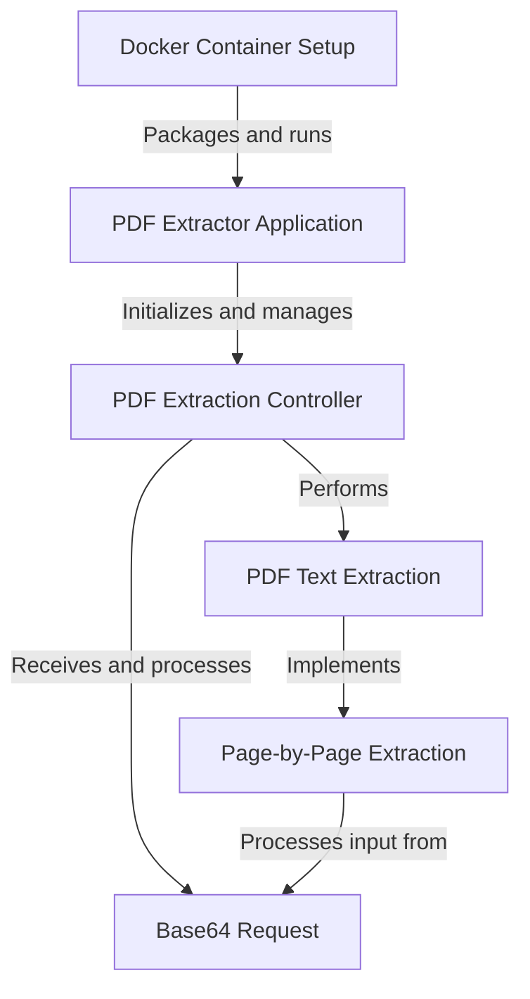
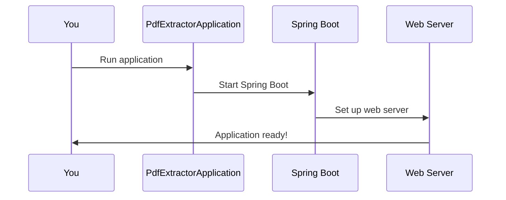
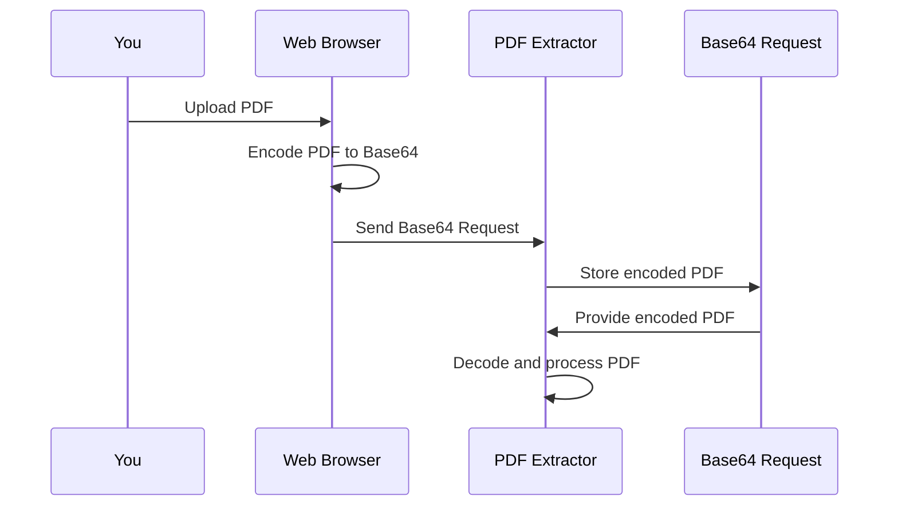
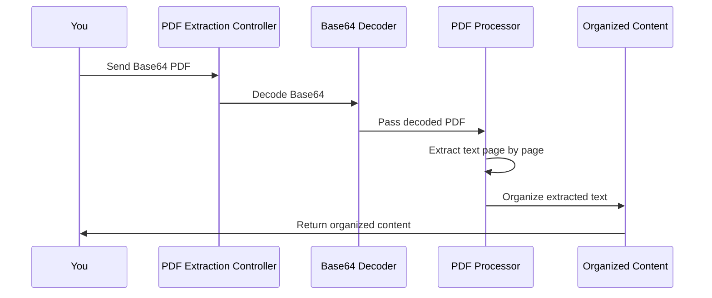
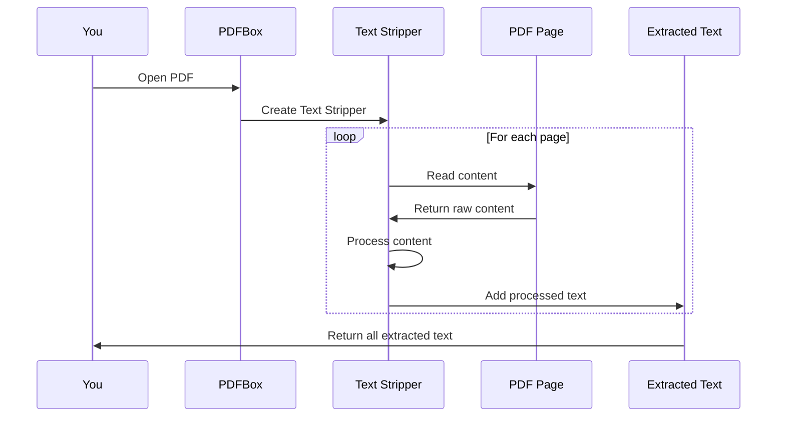
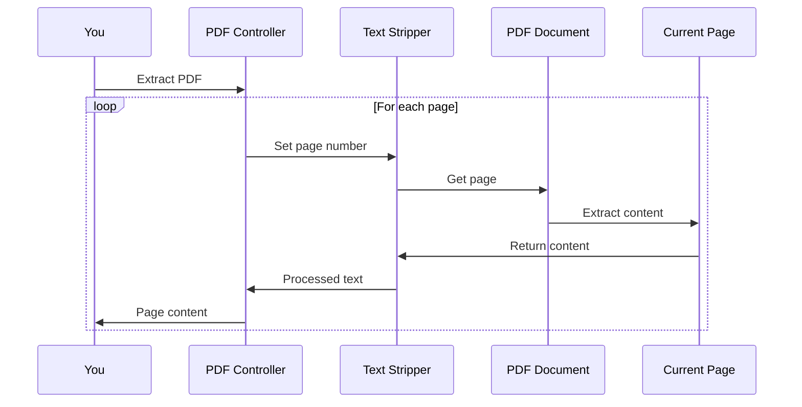
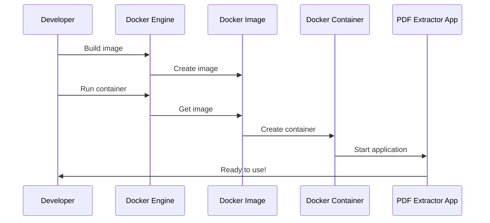

# pdf-extractor Tutorial


# Tutorial: pdf-extractor

This project is a **PDF text extraction** application built with Spring Boot. It allows users to upload **Base64-encoded PDF files** and receive the extracted text *page by page*. The application uses **PDFBox** for text extraction and can be easily deployed using **Docker**. It's designed to handle PDF processing efficiently, making it useful for tasks like document analysis or content indexing.


**Source Repository:** [https://github.com/dygavieta/pdf-extractor](https://github.com/dygavieta/pdf-extractor)



## Chapters

1. [PDF Extractor Application
](01_pdf_extractor_application_.md)
2. [Base64 Request
](02_base64_request_.md)
3. [PDF Extraction Controller
](03_pdf_extraction_controller_.md)
4. [PDF Text Extraction
](04_pdf_text_extraction_.md)
5. [Page-by-Page Extraction
](05_page_by_page_extraction_.md)
6. [Docker Container Setup
](06_docker_container_setup_.md)


---


## 01_pdf_extractor_application_


# Chapter 1: PDF Extractor Application

Welcome to the exciting world of PDF extraction! In this chapter, we'll explore the heart of our project: the PDF Extractor Application. Imagine you have a digital library full of PDF books, and you want to quickly find specific information without manually flipping through pages. That's where our PDF Extractor comes in handy!

## The Problem We're Solving

Have you ever needed to search for a particular word or phrase in a long PDF document? It can be time-consuming and frustrating. Our PDF Extractor Application aims to make this process quick and easy by allowing you to extract text from PDF files programmatically.

## Key Concepts

1. **Spring Boot Application**: Think of this as the foundation of our project. It's like the operating system of a computer, managing all the basic functions so we can focus on building our PDF extraction features.

2. **Main Application Class**: This is the starting point of our application, like the ignition key in a car.

## Getting Started

Let's look at the core of our application:

```java
@SpringBootApplication
public class PdfExtractorApplication {
    public static void main(String[] args) {
        SpringApplication.run(PdfExtractorApplication.class, args);
    }
}
```

This small piece of code is powerful! Here's what it does:

- `@SpringBootApplication`: This annotation tells Spring Boot to set up our application with default settings.
- `main` method: This is where our application starts running.
- `SpringApplication.run()`: This line actually starts our application.

## What Happens Under the Hood?

When you run this application, a lot happens behind the scenes. Let's break it down:



1. You start the application.
2. The `PdfExtractorApplication` class kicks in.
3. Spring Boot initializes, setting up necessary components.
4. A web server is started, allowing our application to handle web requests.
5. The application is ready to use!

## Why This Matters

This simple setup allows us to focus on building our PDF extraction features without worrying about the underlying infrastructure. It's like having a fully equipped kitchen ready for us to start cooking our PDF extraction recipes!

In the next chapters, we'll build upon this foundation to create our PDF extraction functionality. We'll explore how to handle requests, process PDFs, and return the extracted text.

Up next, we'll dive into how we can receive PDF files for processing in our application. Get ready to learn about [Base64 Request](02_base64_request_.md)!


## 02_base64_request_


# Chapter 2: Base64 Request

Welcome back! In our [previous chapter](01_pdf_extractor_application_.md), we set up the foundation for our PDF Extractor Application. Now, let's dive into how we can actually send PDF files to our application for processing.

Imagine you want to send a PDF file to a friend over the internet, but you can only use text messages. How would you do it? This is where Base64 encoding comes in handy!

## What is Base64 Request?

A Base64 Request is like a special envelope for our PDF file. It takes the binary data of our PDF and converts it into a string of text that can be easily sent over the internet. Think of it as translating our PDF into a secret code that our application can understand and decode back into a PDF.

Let's look at a simple example of how we use Base64 Request in our application:

```java
class Base64Request {
    private String pdfBase64;

    public String getPdfBase64() {
        return pdfBase64;
    }

    public void setPdfBase64(String pdfBase64) {
        this.pdfBase64 = pdfBase64;
    }
}
```

This small class is our Base64 Request. It has one important part:
- `pdfBase64`: This is where we store our encoded PDF file as a string.

## How does it work?

Let's walk through the process of using a Base64 Request:



1. You upload a PDF file in your web browser.
2. The browser converts the PDF to a Base64 string.
3. This Base64 string is sent to our PDF Extractor server.
4. The server receives the string and stores it in our Base64 Request object.
5. When needed, the server can get the encoded PDF from the Base64 Request.
6. Finally, the server decodes the Base64 string back into a PDF for processing.

## Using Base64 Request in our Application

Now, let's see how we use Base64 Request in our [PDF Extraction Controller](03_pdf_extraction_controller_.md):

```java
@PostMapping
public Map<String, Object> extractPDFPerPage(@RequestBody Base64Request request) {
    String cleanBase64 = request.getPdfBase64().replaceAll("\\s+", "").trim();
    // ... rest of the method
}
```

Here, we're receiving a Base64Request object. We get the encoded PDF string using `getPdfBase64()` and clean it up a bit by removing any extra spaces.

## Why Use Base64?

You might wonder, "Why go through all this trouble?" Well, Base64 encoding has several advantages:

1. **Text-friendly**: It converts binary data (like PDFs) into text, which is easier to handle in many systems.
2. **Safe for transfer**: It ensures that the data remains intact during transmission over networks.
3. **Widely supported**: Most programming languages and systems can work with Base64 encoded data.

## Conclusion

Base64 Request is our secret weapon for safely transporting PDFs over the internet to our application. It's like having a universal translator that converts our PDFs into a language that any part of our system can understand and work with.

In the next chapter, we'll explore how we use this Base64 Request in our [PDF Extraction Controller](03_pdf_extraction_controller_.md) to actually process the PDF and extract its contents. Get ready to see our PDF Extractor in action!


## 03_pdf_extraction_controller_


# Chapter 3: PDF Extraction Controller

Welcome back, PDF explorers! In our [previous chapter](02_base64_request_.md), we learned how to package our PDFs into a special Base64 envelope. Now, let's meet the skilled librarian of our PDF world: the PDF Extraction Controller!

Imagine you're running a digital library. People send you books (PDFs) in special envelopes (Base64), and they want you to tell them what's inside each page. That's exactly what our PDF Extraction Controller does!

## The PDF Extraction Controller: Our Digital Librarian

The PDF Extraction Controller is like a super-efficient librarian. It receives the encoded PDFs, opens them up, reads through each page, and organizes the content neatly for us. Let's see how it works:

```java
@RestController
@RequestMapping("/extract")
public class PDFExtractorController {
    @PostMapping
    public Map<String, Object> extractPDFPerPage(@RequestBody Base64Request request) {
        // Magic happens here!
    }
}
```

This small piece of code is powerful! Here's what it does:
- `@RestController`: This tells Spring that our class is ready to handle web requests.
- `@RequestMapping("/extract")`: This sets up our controller to listen at the "/extract" web address.
- `extractPDFPerPage`: This is our main method that does all the hard work.

## How Does Our Digital Librarian Work?

Let's walk through the process step-by-step:



1. You send a Base64-encoded PDF to our controller.
2. The controller decodes the Base64 back into a PDF.
3. It uses a tool called PDFBox to read the PDF.
4. PDFBox extracts text from each page.
5. The controller organizes this text into a neat response.
6. You receive the organized content!

## The Magic Inside Our Controller

Now, let's peek into the main part of our controller:

```java
public Map<String, Object> extractPDFPerPage(@RequestBody Base64Request request) {
    Map<String, Object> pageTextMap = new HashMap<>();
    String cleanBase64 = request.getPdfBase64().replaceAll("\\s+", "").trim();
    byte[] pdfBytes = Base64.getDecoder().decode(cleanBase64);
    // More processing happens here...
    return pageTextMap;
}
```

Here's what's happening:
1. We create a `pageTextMap` to store our results.
2. We clean up the Base64 string, removing any extra spaces.
3. We decode the Base64 string back into PDF bytes.
4. (In the part we didn't show) We process these bytes, extract text, and organize it.
5. Finally, we return our organized map of page contents.

## Why This Matters

The PDF Extraction Controller is the heart of our application. It brings together all the pieces we've learned about:
- It uses the [Base64 Request](02_base64_request_.md) to receive PDFs.
- It employs [PDF Text Extraction](04_pdf_text_extraction_.md) techniques to read the PDFs.
- It performs [Page-by-Page Extraction](05_page_by_page_extraction_.md) to organize content neatly.

By centralizing these operations, our controller makes it easy to extract text from PDFs with just a single web request!

## Conclusion

Congratulations! You've just met the hardworking librarian of our PDF world. The PDF Extraction Controller takes in our encoded PDFs, processes them, and returns neatly organized content. It's like having a super-fast reader who can summarize any book for you in seconds!

In our next chapter, we'll dive deeper into how we actually read the text from these PDFs. Get ready to explore the exciting world of [PDF Text Extraction](04_pdf_text_extraction_.md)!


## 04_pdf_text_extraction_


# Chapter 4: PDF Text Extraction

Welcome back, PDF adventurers! In our [previous chapter](03_pdf_extraction_controller_.md), we met our efficient digital librarian, the PDF Extraction Controller. Now, let's dive into the magical world of PDF Text Extraction!

Imagine you have a treasure map (your PDF) with hidden words, and you need special glasses to read them. That's exactly what PDF Text Extraction does! It's like a pair of magical glasses that can read and understand the contents of any PDF.

## The Problem We're Solving

Let's say you have a 100-page PDF book about dinosaurs, and you want to find all mentions of "T-Rex" without reading every page. Our PDF Text Extraction comes to the rescue!

## Key Concepts

1. **PDFBox**: This is our magical tool (a Java library) that helps us read PDFs.
2. **Text Stripper**: Think of this as a super-smart highlighter that can pick out all the words from a PDF.

## How to Use PDF Text Extraction

Let's look at a simple example of how we use PDF Text Extraction:

```java
PDDocument document = PDDocument.load(pdfFile);
PDFTextStripper textStripper = new PDFTextStripper();
String text = textStripper.getText(document);
```

Here's what's happening:
1. We open our PDF treasure map (`PDDocument.load`).
2. We create our magical highlighter (`PDFTextStripper`).
3. We use the highlighter to read all the text from our PDF.

## What Happens Under the Hood?

When we extract text from a PDF, a lot happens behind the scenes. Let's break it down:



1. You ask PDFBox to open your PDF.
2. PDFBox creates a Text Stripper to read the PDF.
3. The Text Stripper goes through each page, reading its content.
4. It processes the raw content, organizing it into readable text.
5. Finally, it returns all the extracted text to you!

## The Magic Inside Our Text Extraction

Now, let's peek into how we use this in our [PDF Extraction Controller](03_pdf_extraction_controller_.md):

```java
PDDocument document = PDDocument.load(new ByteArrayInputStream(pdfBytes));
PDFTextStripper pdfStripper = new PDFTextStripper();
pdfStripper.setStartPage(pageNumber);
pdfStripper.setEndPage(pageNumber);
String pageText = pdfStripper.getText(document);
```

Here's what's happening:
1. We open our PDF using the bytes we got from our Base64 decoder.
2. We create our magical Text Stripper.
3. We tell the Text Stripper which page to read.
4. The Text Stripper extracts all the text from that page.

## Why This Matters

PDF Text Extraction is the heart of our PDF Extractor. It allows us to:
- Read any PDF, no matter how it was created.
- Extract text accurately, preserving its structure.
- Process PDFs page by page, which we'll explore more in [Page-by-Page Extraction](05_page_by_page_extraction_.md).

By mastering PDF Text Extraction, we can unlock the content of any PDF, making it searchable and processable by our application!

## Conclusion

Congratulations! You've just learned about the magical glasses of our PDF world - PDF Text Extraction. With this power, we can read any PDF, extract its content, and make it useful for our users.

In our next chapter, we'll explore how we can use this extraction power to process PDFs page by page. Get ready for [Page-by-Page Extraction](05_page_by_page_extraction_.md)!


## 05_page_by_page_extraction_


# Chapter 5: Page-by-Page Extraction

Welcome back, PDF explorers! In our [previous chapter](04_pdf_text_extraction_.md), we learned how to extract text from PDFs using our magical glasses. Now, let's dive into the exciting world of Page-by-Page Extraction!

Imagine you're a detective examining a big book of clues. Instead of reading the whole book at once, you carefully go through each page, noting down important information. That's exactly what Page-by-Page Extraction does for our PDFs!

## The Problem We're Solving

Let's say you have a 100-page PDF recipe book, and you want to find all recipes that use chocolate. Reading the whole book at once would be overwhelming. With Page-by-Page Extraction, we can look at each page separately, making it easier to find what we need!

## How Page-by-Page Extraction Works

Let's see how we use Page-by-Page Extraction in our PDF Extractor:

```java
for (int i = 1; i <= totalPages; i++) {
    pdfStripper.setStartPage(i);
    pdfStripper.setEndPage(i);
    String pageText = pdfStripper.getText(document).trim();
    // Process pageText...
}
```

Here's what's happening:
1. We start a loop that goes through each page.
2. For each page, we tell our magical highlighter (PDFTextStripper) to focus on just that page.
3. We extract the text from that single page.
4. We can then process this text however we want!

## What Happens Under the Hood?

When we extract text page by page, it's like flipping through a book and taking notes. Let's see how it works:



1. You ask our PDF Controller to extract the PDF.
2. For each page, the Controller tells the Text Stripper which page to look at.
3. The Text Stripper asks the PDF for that specific page.
4. The page gives its content to the Text Stripper.
5. The Text Stripper processes the content and gives it back to the Controller.
6. The Controller gives you the content for that page.
7. This process repeats for each page in the PDF.

## The Magic Inside Our Page-by-Page Extraction

Now, let's look at how we use this in our [PDF Extraction Controller](03_pdf_extraction_controller_.md):

```java
Map<String, Object> pageTextMap = new HashMap<>();
for (int i = 1; i <= totalPages; i++) {
    pdfStripper.setStartPage(i);
    pdfStripper.setEndPage(i);
    String pageText = pdfStripper.getText(document).trim();
    List<String> lines = Arrays.stream(pageText.split("\n"))
            .map(String::trim)
            .filter(line -> !line.isEmpty())
            .collect(Collectors.toList());
    pageTextMap.put("page" + i, lines);
}
```

Here's what's happening:
1. We create a map to store the text from each page.
2. We go through each page one by one.
3. We extract the text from that single page.
4. We clean up the text, removing empty lines.
5. We store the cleaned text in our map, with the page number as the key.

## Why This Matters

Page-by-Page Extraction is super important because it allows us to:
- Process very large PDFs without using too much memory.
- Keep track of which page contains what information.
- Easily search for specific content within pages.

By mastering Page-by-Page Extraction, we can handle PDFs of any size and organize their content in a way that's easy to use and understand!

## Conclusion

Congratulations! You've just learned about the detective work of our PDF world - Page-by-Page Extraction. With this power, we can carefully examine each page of a PDF, making it easy to find and organize information.

In our next chapter, we'll explore how we can package all this PDF magic into a neat container for easy deployment. Get ready for [Docker Container Setup](06_docker_container_setup_.md)!


## 06_docker_container_setup_


# Chapter 6: Docker Container Setup

Welcome back, PDF wizards! In our [previous chapter](05_page_by_page_extraction_.md), we learned how to carefully examine each page of a PDF. Now, let's pack all our PDF magic into a neat, portable container!

Imagine you've created an amazing sandwich-making machine. You want to share it with friends, but it's tricky to move all the parts. What if you could put your entire machine in a magical lunchbox that works anywhere? That's exactly what Docker does for our PDF Extractor!

## The Problem We're Solving

Let's say you want to run your PDF Extractor on different computers - your laptop, your friend's desktop, or even a powerful server in the cloud. Each computer might have different settings, which could cause problems. Docker solves this by creating a consistent environment for our application.

## What is Docker?

Docker is like a magical lunchbox that can hold our entire PDF Extractor application, along with everything it needs to run. This lunchbox (called a container) can be easily moved and opened on any computer that understands Docker.

## Creating Our Docker Container

To create our Docker container, we need a special recipe called a Dockerfile. Let's look at a simplified version:

```dockerfile
FROM amazoncorretto:21-alpine-jdk
WORKDIR /app
COPY target/*.jar app.jar
ENTRYPOINT ["java", "-jar", "app.jar"]
```

Here's what this recipe does:
1. Start with a base image that includes Java (our PDF Extractor's main ingredient).
2. Set up a workspace in the container.
3. Copy our PDF Extractor application into the container.
4. Tell Docker how to start our application.

## How Docker Works

When we use Docker, it's like packing and unpacking our magical lunchbox. Let's see how it works:



1. We give Docker our recipe (Dockerfile).
2. Docker creates an image (like a blueprint of our lunchbox).
3. We ask Docker to start a container from this image.
4. Docker unpacks the lunchbox and starts our PDF Extractor inside.
5. Our PDF Extractor is now running and ready to use!

## Why This Matters

Using Docker for our PDF Extractor is super helpful because:
- It ensures our application runs the same way everywhere.
- It makes it easy to share and deploy our application.
- It isolates our application, keeping it safe and tidy.

By using Docker, we can focus on improving our PDF Extractor without worrying about different computer setups!

## Conclusion

Congratulations! You've just learned how to pack our PDF Extractor into a magical, portable lunchbox called a Docker container. This makes it super easy to share and run our application anywhere.

You've now completed all the chapters of our PDF Extractor tutorial. You've learned how to create a [PDF Extractor Application](01_pdf_extractor_application_.md), handle [Base64 Requests](02_base64_request_.md), build a [PDF Extraction Controller](03_pdf_extraction_controller_.md), perform [PDF Text Extraction](04_pdf_text_extraction_.md), do [Page-by-Page Extraction](05_page_by_page_extraction_.md), and finally, package it all up with Docker. You're now equipped to extract text from PDFs like a pro!


## jira_branches


# Jira Branches


## SCRUM-4

**Description:** Task created and added to SCRUM sprint.


No branches found for this issue.

---


## SCRUM-3

**Description:** Task created for FRIDAY


No branches found for this issue.

---


## SCRUM-2

**Description:** you close the web


No branches found for this issue.

---


## SCRUM-1

**Description:** *Lorem Ipsum* is simply dummy text of the printing and typesetting industry. Lorem Ipsum has been the industry's standard dummy text ever since the 1500s, when an unknown printer took a galley of type and scrambled it to make a type specimen book. It has survived not only five centuries, but also the leap into electronic typesetting, remaining essentially unchanged. It was popularised in the 1960s with the release of Letraset sheets containing Lorem Ipsum passages, and more recently with desktop publishing software like Aldus PageMaker including versions of Lorem Ipsum.


**Branches:**

- `SCRUM-1-THURSDAY-v1`
- `SCRUM-1-THURSDAY`

---
