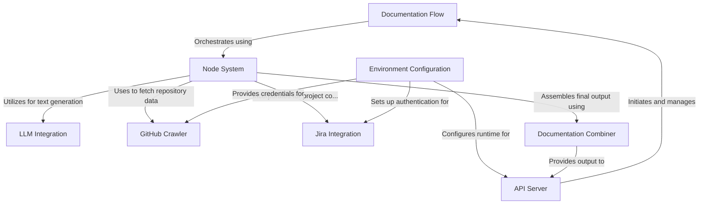
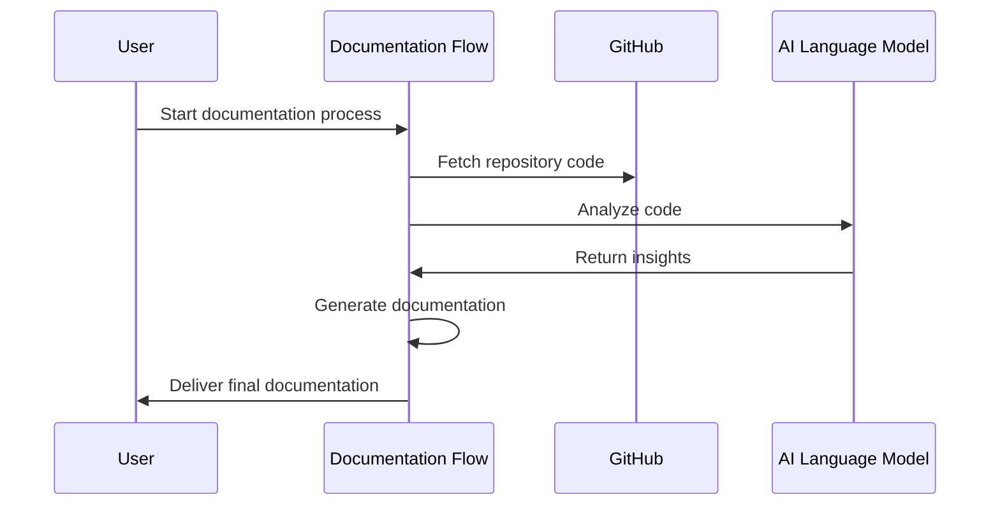
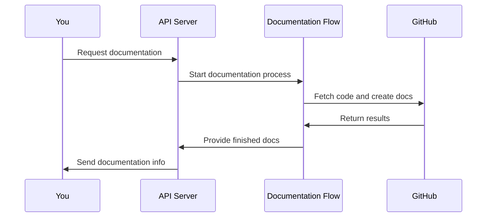
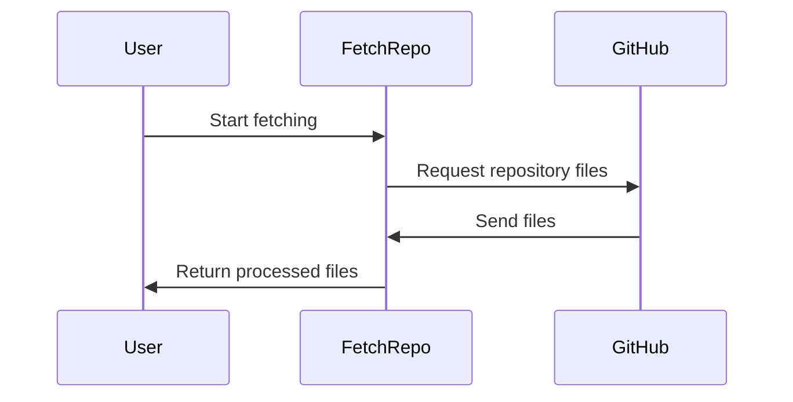
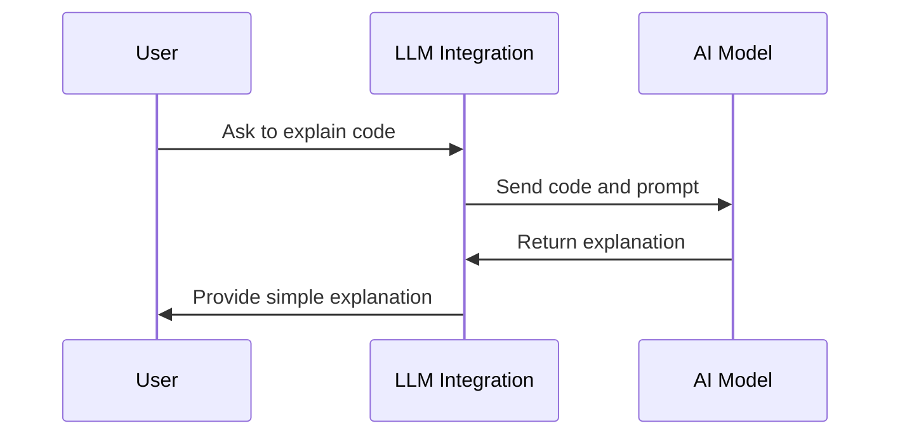
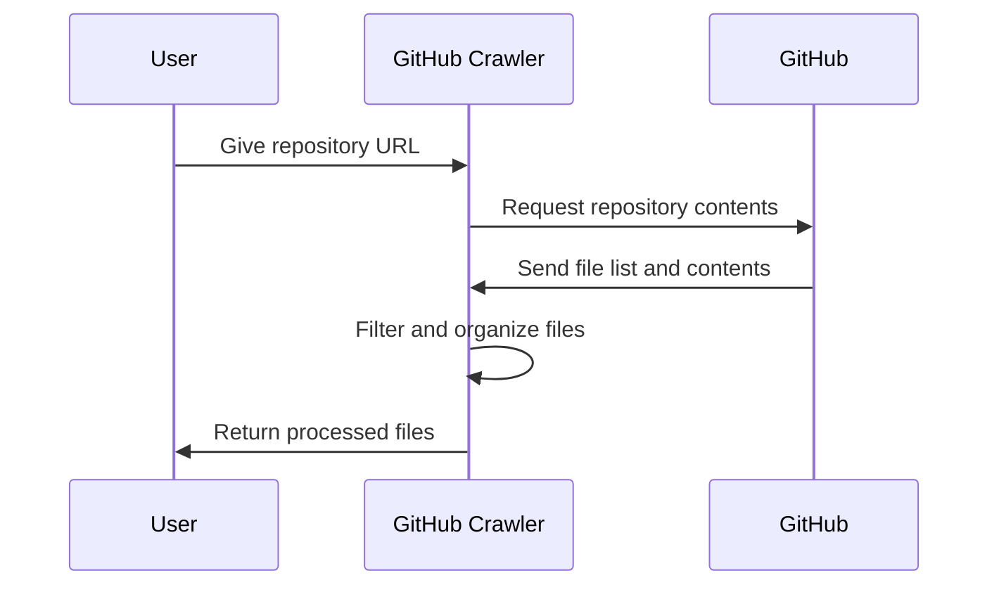
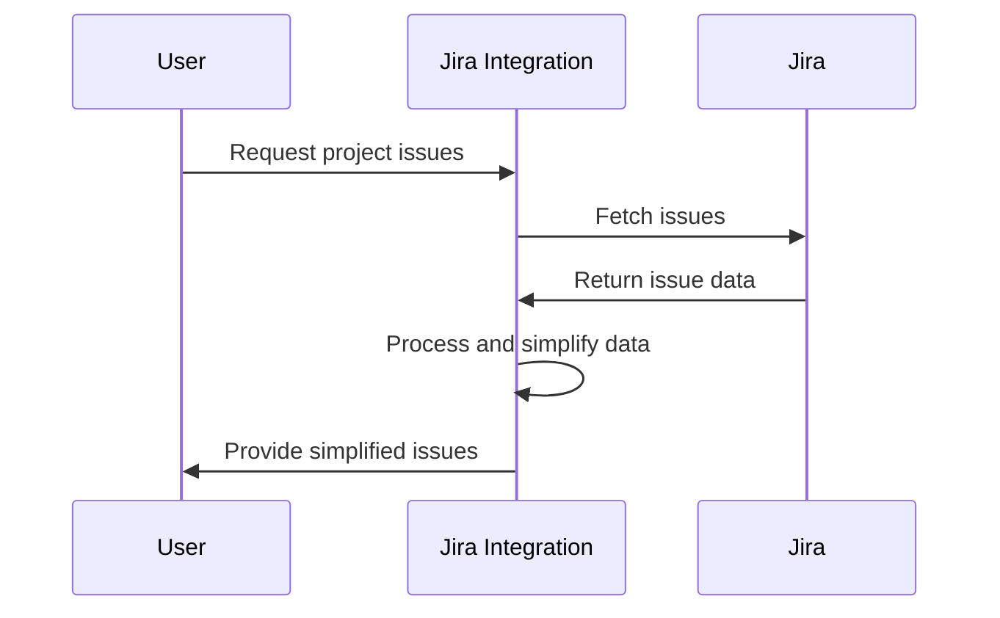
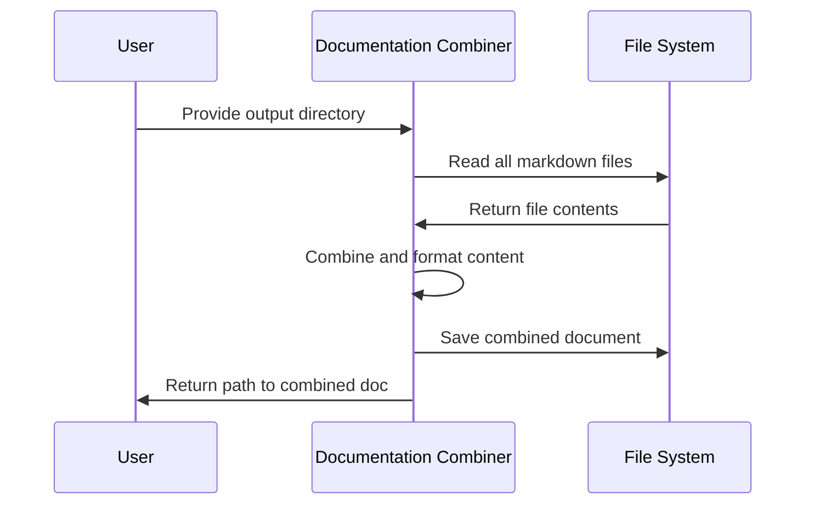
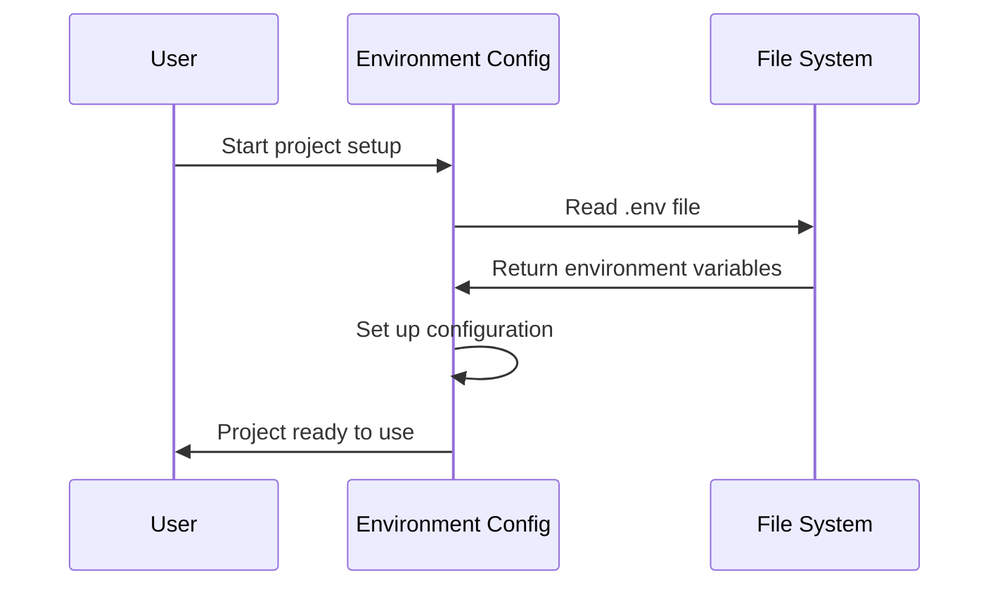

# GITHUB-AGENT DOCUMENTATION


# Documentation: github-agent

The **github-agent** project is an automated documentation generation system for GitHub repositories. It uses **Large Language Models (LLMs)** to analyze codebases, identify key abstractions, and generate comprehensive, beginner-friendly documentation. The system features a modular *Node System* for processing, integration with *GitHub* and *Jira* for fetching code and project information, and the ability to output documentation in various formats and upload to different platforms.


**Source Repository:** [https://github.com/dygavieta/github-agent](https://github.com/dygavieta/github-agent)



## Chapters

1. [Documentation Flow
](01_documentation_flow_.md)
2. [API Server
](02_api_server_.md)
3. [Node System
](03_node_system_.md)
4. [LLM Integration
](04_llm_integration_.md)
5. [GitHub Crawler
](05_github_crawler_.md)
6. [Jira Integration
](06_jira_integration_.md)
7. [Documentation Combiner
](07_documentation_combiner_.md)
8. [Environment Configuration
](08_environment_configuration_.md)


---


## 01_documentation_flow_


# Chapter 1: Documentation Flow

Welcome to the world of `github-agent`! In this chapter, we'll explore the heart of our project: the Documentation Flow. Imagine you're building a magical machine that can read through a complex codebase and create a beautiful, easy-to-understand guidebook. That's exactly what the Documentation Flow does!

## The Problem We're Solving

Have you ever looked at a big software project and felt overwhelmed? Maybe you've wondered, "Where do I even start?" The Documentation Flow is here to solve this problem. It takes a GitHub repository full of code and turns it into clear, organized documentation that anyone can understand.

## How the Documentation Flow Works

Let's break down the Documentation Flow into simple steps:

1. **Fetch the Code**: First, we grab all the code from a GitHub repository.
2. **Identify Important Parts**: We look through the code and find the most important pieces.
3. **Analyze Connections**: We figure out how different parts of the code work together.
4. **Organize Chapters**: We decide the best order to explain everything.
5. **Write the Documentation**: We create easy-to-read chapters explaining the code.
6. **Add Extra Information**: We include details about related tasks or issues.
7. **Put It All Together**: We combine everything into one complete document.
8. **Share the Results**: We save the documentation where everyone can see it.

## Using the Documentation Flow

Using the Documentation Flow is super easy! Here's a simple example:

```python
from flow import create_documentation_flow

documentation_flow = create_documentation_flow()
documentation_flow.run(shared_info)
```

This code creates the Documentation Flow and starts it running. The `shared_info` is like a backpack of information that the flow carries with it, containing things like the GitHub repository URL and where to save the final documentation.

## Behind the Scenes

Let's peek under the hood to see how the Documentation Flow works its magic:



This diagram shows how the Documentation Flow (DF) talks to GitHub (GH) to get the code, uses an AI Language Model (LLM) to understand the code, and then creates the documentation for you.

## The Code Behind the Magic

Let's look at a simplified version of how we create the Documentation Flow:

```python
def create_documentation_flow():
    fetch_repo = FetchRepo()
    identify_abstractions = IdentifyAbstractions()
    analyze_relationships = AnalyzeRelationships()
    # ... more steps ...
    
    fetch_repo >> identify_abstractions >> analyze_relationships
    # ... connect more steps ...
    
    return Flow(start=fetch_repo)
```

This code sets up each step of the process and connects them in order, like a chain. The `>>` symbol means "this step goes to the next step".

## Conclusion

The Documentation Flow is like a friendly tour guide for your code. It takes you on a journey from a complex GitHub repository to a clear, organized set of documentation. In the next chapter, we'll dive into the [API Server](02_api_server_.md), which helps our Documentation Flow communicate with the outside world.


## 02_api_server_


# Chapter 2: API Server

Welcome back to our journey through `github-agent`! In the [previous chapter](01_documentation_flow_.md), we learned about the Documentation Flow, which turns complex code into easy-to-read guides. Now, let's explore how we can interact with this magical documentation machine using the API Server.

## What's an API Server?

Imagine you're at a restaurant. The API Server is like the friendly waiter who takes your order, brings it to the kitchen, and then delivers your delicious meal back to you. In our case, the API Server takes requests for documentation, sends them to our Documentation Flow "kitchen," and then serves up the finished documentation.

## Why Do We Need an API Server?

The API Server solves a big problem: How can other programs or websites ask our `github-agent` to create documentation? It's like having a special phone number that anyone can call to order our documentation services.

## How to Use the API Server

Let's say you want to create documentation for a GitHub project. Here's how you might do that:

```python
import requests

url = "http://our-api-server.com/generate-document"
data = {
    "repo_url": "https://github.com/cool-project/awesome-code",
    "upload": "github"
}
response = requests.post(url, json=data)
result = response.json()
```

This code sends a request to our API Server, asking it to generate documentation for the "awesome-code" project and upload it to GitHub. The server will respond with information about where to find the finished documentation.

## Behind the Scenes

When you make a request, here's what happens inside our API Server:



1. You send a request to the API Server.
2. The API Server tells the [Documentation Flow](01_documentation_flow_.md) to start working.
3. The Documentation Flow does its magic with GitHub.
4. The API Server gets the finished documentation and sends you the info.

## The Code Behind the Magic

Let's peek at a simplified version of our API Server code:

```python
from fastmcp import FastMCP
from flow import create_documentation_flow

mcp = FastMCP("Document Generator")

@mcp.tool()
def generate_document(repo_url: str, upload: str) -> dict:
    # Set up shared information
    shared = {
        "repo_url": repo_url,
        "upload": upload,
        # ... other settings ...
    }
    
    # Create and run the documentation flow
    flow = create_documentation_flow()
    flow.run(shared)
    
    # Return the results
    return {
        "status": "success",
        "output_dir": shared["final_output_dir"],
        # ... other result info ...
    }

mcp.run()
```

This code sets up our API Server. The `generate_document` function is like our waiter, taking orders (requests) and serving results. It uses the [Documentation Flow](01_documentation_flow_.md) we learned about earlier to create the documentation.

## Conclusion

The API Server is our friendly interface to the world, making it easy for anyone to request documentation from our `github-agent`. It takes care of receiving requests, starting the documentation process, and delivering the results.

In the next chapter, we'll explore the [Node System](03_node_system_.md), which helps organize the different steps in our documentation creation process. Get ready to dive deeper into the inner workings of our documentation factory!


## 03_node_system_


# Chapter 3: Node System

Welcome back to our journey through `github-agent`! In the [previous chapter](02_api_server_.md), we learned about the API Server that helps our system communicate with the outside world. Now, let's dive into the heart of our documentation generation process: the Node System.

## What is the Node System?

Imagine you're building a complex Lego structure. Instead of trying to put everything together at once, you'd probably break it down into smaller, manageable pieces. That's exactly what the Node System does for our documentation generation process!

The Node System is like a team of specialized workers, each with a specific job to do. These workers (we call them "nodes") work together in a sequence to create our final documentation. Let's explore how this works with a simple example.

## A Day in the Life of the Node System

Let's say we want to create documentation for a GitHub project about a magical library. Here's how our Node System might tackle this task:

1. **FetchRepo Node**: This node is like a librarian who goes to fetch all the books (code files) from the magical library (GitHub repository).

2. **IdentifyAbstractions Node**: This node is like a wise wizard who reads through all the books and identifies the most important magical concepts.

3. **AnalyzeRelationships Node**: This node is like a detective who figures out how all these magical concepts are connected to each other.

4. **OrderChapters Node**: This node is like an editor who decides the best order to explain all these magical concepts in our documentation.

5. **WriteChapters Node**: This node is like a group of writers who actually write out the explanations for each magical concept.

6. **CombineDocumentation Node**: This node is like a book binder who puts all the chapters together into one complete magical guidebook.

## How to Use the Node System

Using the Node System is super easy! Here's a simple example:

```python
from nodes import FetchRepo, IdentifyAbstractions, AnalyzeRelationships

fetch_repo = FetchRepo()
identify_abstractions = IdentifyAbstractions()
analyze_relationships = AnalyzeRelationships()

fetch_repo >> identify_abstractions >> analyze_relationships
```

In this code, we're creating three of our specialized workers (nodes) and telling them to work in a specific order. The `>>` symbol is like saying "after you're done, pass your work to the next person".

## Behind the Scenes

Let's peek under the hood to see how a node works its magic. We'll use the `FetchRepo` node as an example:



1. The user tells the `FetchRepo` node to start working.
2. `FetchRepo` asks GitHub for all the files in the repository.
3. GitHub sends back the files.
4. `FetchRepo` processes these files and returns them to the user.

## The Code Behind the Magic

Let's look at a simplified version of our `FetchRepo` node:

```python
class FetchRepo(Node):
    def exec(self, prep_res):
        repo_url = prep_res["repo_url"]
        print(f"Crawling repository: {repo_url}...")
        result = crawl_github_files(repo_url)
        return list(result.get("files", {}).items())
```

This code defines our `FetchRepo` worker. When it's time to work (`exec`), it uses a special tool (`crawl_github_files`) to get all the files from the GitHub repository. Then it returns these files so the next worker can use them.

## Conclusion

The Node System is like a well-organized team of workers, each with a specific job, working together to turn a complex GitHub repository into clear, easy-to-understand documentation. By breaking down the big task into smaller, manageable steps, we can create documentation that's both comprehensive and beginner-friendly.

In the [next chapter](04_llm_integration_.md), we'll explore how we use advanced language models to make our documentation even smarter and more helpful. Get ready to add some AI magic to our documentation factory!


## 04_llm_integration_


# Chapter 4: LLM Integration

Welcome back to our exciting journey through `github-agent`! In our [previous chapter](03_node_system_.md), we explored how the Node System organizes our documentation process. Now, let's dive into the magical world of LLM Integration!

## What is LLM Integration?

Imagine you have a super-smart friend who can read any book and explain it in simple terms. That's exactly what LLM Integration does for our project! LLM stands for "Large Language Model," which is a fancy way of saying "really smart AI that understands and generates human-like text."

## Why Do We Need LLM Integration?

Have you ever tried to read a technical manual and felt like it was written in a different language? That's the problem we're solving! LLM Integration helps us turn complex code into easy-to-understand explanations. It's like having a friendly translator who speaks both "computer" and "human."

## How LLM Integration Works

Let's say we want to explain a piece of code that calculates the area of a circle. Here's how LLM Integration might help:

1. We show the code to our AI friend (the LLM).
2. We ask, "Can you explain this in simple terms?"
3. The AI reads the code and thinks about it.
4. The AI writes an explanation that's easy for beginners to understand.

## Using LLM Integration

Using LLM Integration is super easy! Here's a simple example:

```python
from utils.call_llm import call_llm

code = "def area_circle(radius): return 3.14 * radius * radius"
prompt = f"Explain this code in simple terms: {code}"
explanation = call_llm(prompt)
print(explanation)
```

This code asks our AI friend to explain the `area_circle` function. The AI might respond with something like:

"This code defines a function that calculates the area of a circle. It takes the radius as input and multiplies it by itself and by 3.14 (which is an approximation of pi) to get the area."

## Behind the Scenes

Let's peek under the hood to see how LLM Integration works its magic:



1. You ask the LLM Integration to explain some code.
2. LLM Integration sends the code and a special question (prompt) to the AI.
3. The AI thinks about it and sends back an explanation.
4. LLM Integration gives you the simple explanation.

## The Code Behind the Magic

Let's look at a simplified version of how we use LLM Integration:

```python
def call_llm(prompt: str) -> str:
    client = Anthropic(api_key=os.getenv("ANTHROPIC_API_KEY"))
    response = client.messages.create(
        model="claude-3-5-sonnet-20240620",
        messages=[{"role": "user", "content": prompt}]
    )
    return response.content[0].text
```

This code sends our question (prompt) to an AI called Claude. Claude thinks about it and sends back an answer, which we then return.

## Conclusion

LLM Integration is like having a super-smart, friendly translator in our `github-agent` team. It helps us turn complex code into clear, easy-to-understand explanations. This makes our documentation more accessible and helpful for everyone, from beginners to experts!

In our [next chapter](05_github_crawler_.md), we'll explore how we gather information from GitHub repositories. Get ready to become a code detective!


## 05_github_crawler_


# Chapter 5: GitHub Crawler

Welcome back to our exciting journey through `github-agent`! In our [previous chapter](04_llm_integration_.md), we explored how we use AI to make our documentation smarter. Now, let's dive into the world of the GitHub Crawler!

## What is the GitHub Crawler?

Imagine you're a librarian tasked with organizing a huge library of code. That's exactly what the GitHub Crawler does! It's like a digital librarian that goes through a GitHub repository, finds all the important files, and brings them back for us to use in our documentation.

## Why Do We Need a GitHub Crawler?

Have you ever tried to find a specific book in a big library without a catalog? It's pretty tough, right? The GitHub Crawler solves this problem for code repositories. It helps us:

1. Find all the important files in a project
2. Organize these files in a way that's easy to understand
3. Make sure we don't miss anything important when creating documentation

## How the GitHub Crawler Works

Let's say we want to create documentation for a cool project about space exploration on GitHub. Here's how our GitHub Crawler would help:

1. We give the Crawler the address (URL) of the space project on GitHub.
2. The Crawler visits the project and starts looking through all the folders and files.
3. It collects all the important files (like Python code, README files, etc.) and remembers where it found them.
4. The Crawler brings back all these files and organizes them for us to use in our documentation.

## Using the GitHub Crawler

Using the GitHub Crawler is super easy! Here's a simple example:

```python
from utils.crawl_github_files import crawl_github_files

repo_url = "https://github.com/cool-space-project/mars-rover"
result = crawl_github_files(repo_url)

print(f"Downloaded {result['stats']['downloaded_count']} files!")
```

This code tells our Crawler to visit the "mars-rover" project and bring back all the files. After it's done, it tells us how many files it found.

## Behind the Scenes

Let's peek under the hood to see how the GitHub Crawler works its magic:



1. You tell the Crawler which GitHub project to look at.
2. The Crawler asks GitHub for information about all the files in the project.
3. GitHub sends back a list of all the files and their contents.
4. The Crawler organizes these files and picks the ones we need.
5. The Crawler gives you back a neat package of all the important files.

## The Code Behind the Magic

Let's look at a simplified version of how our GitHub Crawler works:

```python
def crawl_github_files(repo_url, max_file_size=1024*1024):
    # Set up connection to GitHub
    github_connection = setup_github_connection(repo_url)
    
    files = {}
    for file in github_connection.get_files():
        if file.size <= max_file_size:
            files[file.path] = file.content
    
    return {"files": files, "stats": {"downloaded_count": len(files)}}
```

This code goes through each file in the GitHub project. If the file isn't too big, it saves the file's content. At the end, it tells us how many files it found.

## Conclusion

The GitHub Crawler is like a friendly robot librarian that helps us gather all the important code files from a GitHub project. It makes sure we have all the information we need to create great documentation, without having to manually search through hundreds of files and folders.

In our [next chapter](06_jira_integration_.md), we'll explore how we connect our documentation process with Jira, a popular tool for managing software projects. Get ready to learn how we keep our documentation in sync with project tasks and issues!


## 06_jira_integration_


# Chapter 6: Jira Integration

Welcome back to our exciting journey through `github-agent`! In our [previous chapter](05_github_crawler_.md), we explored how the GitHub Crawler helps us gather important code files. Now, let's dive into the world of Jira Integration and see how it makes our documentation even more powerful!

## What is Jira Integration?

Imagine you're writing a cookbook, but you also want to include notes about which recipes people are currently cooking and any challenges they're facing. That's kind of what Jira Integration does for our documentation!

Jira is a popular tool that helps teams manage their projects and track tasks. Our Jira Integration is like a friendly messenger that goes between our documentation system and Jira, bringing back important information about what's happening in the project right now.

## Why Do We Need Jira Integration?

Have you ever read a manual that felt outdated or disconnected from reality? That's the problem we're solving! Jira Integration helps us:

1. Keep our documentation up-to-date with current project activities
2. Include real-world context about how people are using the code
3. Highlight areas where developers might be facing challenges

## How Jira Integration Works

Let's say we're documenting a project about building a virtual pet app. Here's how Jira Integration might help:

1. We ask Jira Integration to check the project's Jira board.
2. It finds tasks like "Add feeding feature" or "Fix bug in pet animation".
3. We include this information in our documentation, so readers know what's currently being worked on.
4. This helps developers understand both the existing code and future plans!

## Using Jira Integration

Using Jira Integration is super easy! Here's a simple example:

```python
from utils.jira_utility import get_shared_issues

issues = get_shared_issues()
for issue in issues:
    print(f"Issue: {issue['issue']}")
    print(f"Description: {issue['description']}\n")
```

This code asks our Jira Integration to fetch all the current issues from our project's Jira board. It then prints out each issue's key and description.

## Behind the Scenes

Let's peek under the hood to see how Jira Integration works its magic:



1. You ask Jira Integration to get project issues.
2. Jira Integration connects to Jira and asks for the latest issues.
3. Jira sends back all the detailed issue information.
4. Jira Integration simplifies this information to make it easy to use.
5. You receive a neat list of simplified issues to use in your documentation.

## The Code Behind the Magic

Let's look at a simplified version of how our Jira Integration works:

```python
def get_shared_issues():
    # Set up connection to Jira
    client = get_jira_client(server_url, email, api_token)
    
    # Fetch issues
    issues = get_jira_issues(client, project_key)
    
    # Simplify issue information
    return [
        {
            "issue": issue["key"],
            "description": issue.get("description", "")
        }
        for issue in issues
    ]
```

This code connects to Jira, fetches all the issues for our project, and then simplifies each issue down to just its key and description. This makes it easy to include relevant project information in our documentation without overwhelming the reader.

## Conclusion

Jira Integration is like a bridge between our documentation and the ongoing work in our project. It helps us create documentation that's not just accurate, but also relevant and up-to-date with what's happening right now in the development process.

By including information from Jira, we make our documentation more useful for everyone - from new developers trying to understand the project, to experienced team members keeping track of current tasks and challenges.

In our [next chapter](07_documentation_combiner_.md), we'll explore how we bring all these pieces together to create our final, comprehensive documentation. Get ready to see how we combine code explanations, project context, and current development information into one awesome package!


## 07_documentation_combiner_


# Chapter 7: Documentation Combiner

Welcome back to our exciting journey through `github-agent`! In our [previous chapter](06_jira_integration_.md), we explored how Jira Integration helps us keep our documentation up-to-date with project activities. Now, let's dive into the world of the Documentation Combiner and see how it brings everything together!

## What is the Documentation Combiner?

Imagine you've been writing a really cool story, but each chapter is in a separate notebook. The Documentation Combiner is like a friendly helper who takes all those notebooks and puts them together into one awesome book! It takes all the individual pieces of documentation we've created and combines them into a single, easy-to-read document.

## Why Do We Need a Documentation Combiner?

Have you ever tried to read a book where the chapters were all mixed up? It's pretty confusing, right? That's the problem we're solving! The Documentation Combiner helps us:

1. Put all our documentation in the right order
2. Make sure everything looks nice and consistent
3. Create one big document that's easy for people to read or share

## How the Documentation Combiner Works

Let's say we've been documenting our cool space exploration project. Here's how the Documentation Combiner would help:

1. We give it all our separate documentation files (like "Rocket Engines.md", "Space Suits.md", etc.).
2. It reads through all these files and figures out the best order to put them in.
3. It combines all the content into one big file, making sure headings and formatting look good.
4. It creates a table of contents at the beginning to help readers find what they need.
5. Finally, it saves this combined document as a PDF or a single big Markdown file.

## Using the Documentation Combiner

Using the Documentation Combiner is super easy! Here's a simple example:

```python
from utils.node_utility import combine_documentation

output_dir = "space_project_docs"
combined_doc = combine_documentation(output_dir, output_format="pdf")
print(f"Combined documentation saved as: {combined_doc}")
```

This code tells our Documentation Combiner to look in the "space_project_docs" folder, combine all the markdown files it finds there, and create a PDF. It then tells us where it saved the combined document.

## Behind the Scenes

Let's peek under the hood to see how the Documentation Combiner works its magic:



1. You tell the Documentation Combiner which folder to look in.
2. It asks the computer to list all the markdown files in that folder.
3. The computer sends back the contents of all those files.
4. The Documentation Combiner puts all the content together and makes it look nice.
5. It saves the combined document as a new file.
6. It tells you where to find the new, combined document.

## The Code Behind the Magic

Let's look at a simplified version of how our Documentation Combiner works:

```python
def combine_documentation(output_dir, output_format="pdf"):
    md_files = find_all_markdown_files(output_dir)
    combined_content = []
    
    for md_file in md_files:
        with open(md_file, "r") as f:
            content = f.read()
            combined_content.append(content)
    
    final_content = "\n\n---\n\n".join(combined_content)
    
    if output_format == "pdf":
        return create_pdf(final_content)
    else:
        return save_as_markdown(final_content)
```

This code goes through each markdown file, reads its content, and adds it to a list. Then it joins all the content together, putting a nice separator between each part. Finally, it either creates a PDF or saves a big markdown file, depending on what you asked for.

## Conclusion

The Documentation Combiner is like a friendly librarian who takes all the separate chapters of our documentation and binds them into one beautiful book. It makes sure that all our hard work in creating documentation is presented in a way that's easy for anyone to read and understand.

By combining all our documentation into one cohesive document, we make it much easier for people to learn about our project. Whether they're new developers trying to understand the big picture, or experienced team members looking for specific details, everyone benefits from having a well-organized, complete set of documentation.

In our [next chapter](08_environment_configuration_.md), we'll explore how we set up the perfect environment for our `github-agent` to work its magic. Get ready to learn how we configure all the tools and settings that make our documentation process run smoothly!


## 08_environment_configuration_


# Chapter 8: Environment Configuration

Welcome back to our exciting journey through `github-agent`! In our [previous chapter](07_documentation_combiner_.md), we explored how the Documentation Combiner brings all our documentation pieces together. Now, let's dive into the world of Environment Configuration and see how it sets the stage for our entire project to work smoothly!

## What is Environment Configuration?

Imagine you're getting ready to bake a cake. Before you start mixing ingredients, you need to make sure you have all the right tools, the oven is preheated, and your workspace is clean. That's exactly what Environment Configuration does for our `github-agent` project!

Environment Configuration is like setting up our kitchen before we start cooking. It makes sure we have all the right ingredients (dependencies) and that our cooking tools (execution parameters) are ready to go.

## Why Do We Need Environment Configuration?

Have you ever tried to start a project and realized you're missing important tools or information? That's the problem we're solving! Environment Configuration helps us:

1. Make sure we have all the necessary tools and libraries installed
2. Set up important information like API keys and passwords
3. Configure our project to work correctly on different computers

## How Environment Configuration Works

Let's say we want to set up our `github-agent` project on a new computer. Here's how Environment Configuration might help:

1. We create a special file that lists all the tools and libraries we need.
2. We set up some secret information (like API keys) in a safe place.
3. We create instructions for how to set up the project environment.
4. When someone wants to use our project, they follow these instructions to get everything ready.

## Using Environment Configuration

Using Environment Configuration is super easy! Here's a simple example:

```python
import os
from dotenv import load_dotenv

# Load environment variables
load_dotenv()

# Use an environment variable
github_token = os.getenv("GITHUB_TOKEN")
print(f"GitHub Token: {github_token[:5]}...")  # Print first 5 chars for safety
```

This code loads our secret information (like API keys) from a special file and lets us use it in our project. It's a safe way to handle sensitive data!

## Behind the Scenes

Let's peek under the hood to see how Environment Configuration works its magic:



1. You ask to set up the project environment.
2. Environment Configuration reads a special file (usually called `.env`).
3. This file contains important settings and secret information.
4. Environment Configuration sets everything up based on this file.
5. Now your project is ready to use with all the right settings!

## The Code Behind the Magic

Let's look at a simplified version of how we set up our environment:

```python
# File: Dockerfile
FROM python:3.10-slim

RUN apt-get update && apt-get install -y git
WORKDIR /app
COPY requirements.txt .
RUN pip install --no-cache-dir -r requirements.txt
COPY . .
CMD ["python", "server.py"]
```

This code creates a special container (like a virtual computer) with everything our project needs. It installs Python, Git, and all our required libraries. Then it sets up our project files and tells the container how to start our server.

## Conclusion

Environment Configuration is like a friendly assistant who makes sure everything is perfectly set up before we start working on our project. It handles all the boring setup stuff so we can focus on the exciting parts of coding!

By taking care of things like dependencies, secret keys, and project settings, Environment Configuration makes it much easier for anyone to use our `github-agent` project. Whether you're a new developer just joining the team or an experienced coder setting up on a new machine, Environment Configuration ensures everyone has a smooth start.

With our environment all set up, we're ready to dive into the exciting world of coding and documentation! Remember, a well-configured environment is the foundation of any successful project. Happy coding!


## jira_branches


# Jira Branches


## SCRUM-4

**Description:** Task created and added to SCRUM sprint.


No branches found for this issue.

---


## SCRUM-3

**Description:** Task created for FRIDAY


No branches found for this issue.

---


## SCRUM-2

**Description:** you close the web


No branches found for this issue.

---


## SCRUM-1

**Description:** *Lorem Ipsum* is simply dummy text of the printing and typesetting industry. Lorem Ipsum has been the industry's standard dummy text ever since the 1500s, when an unknown printer took a galley of type and scrambled it to make a type specimen book. It has survived not only five centuries, but also the leap into electronic typesetting, remaining essentially unchanged. It was popularised in the 1960s with the release of Letraset sheets containing Lorem Ipsum passages, and more recently with desktop publishing software like Aldus PageMaker including versions of Lorem Ipsum.


**Branches:**

- `SCRUM-1-THURSDAY-v1`
- `SCRUM-1-THURSDAY`

---
