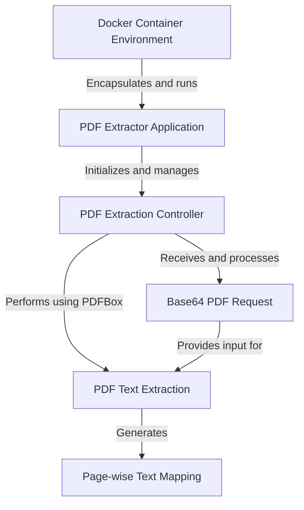
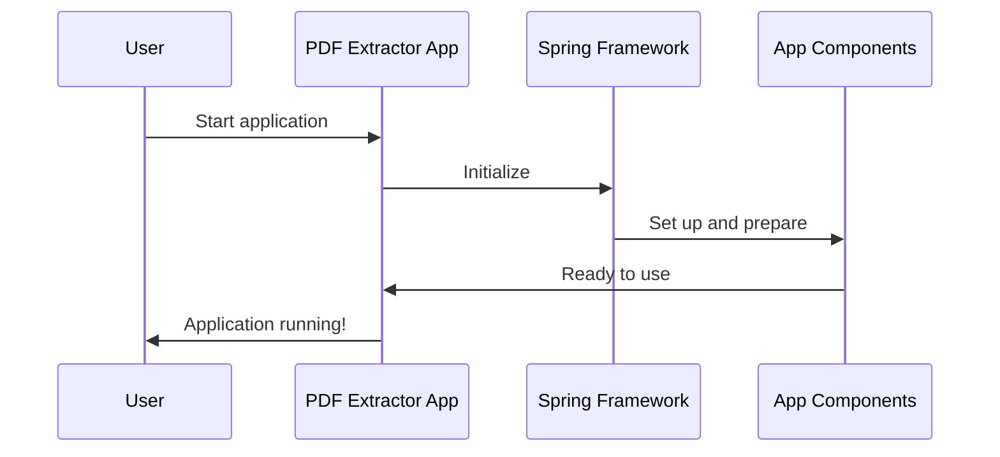
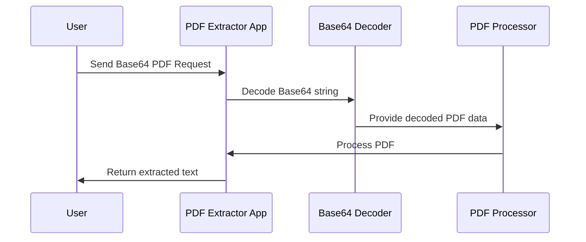
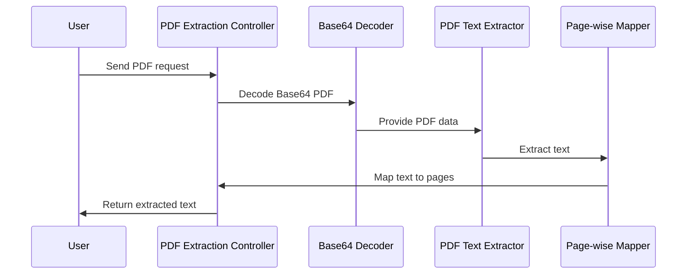
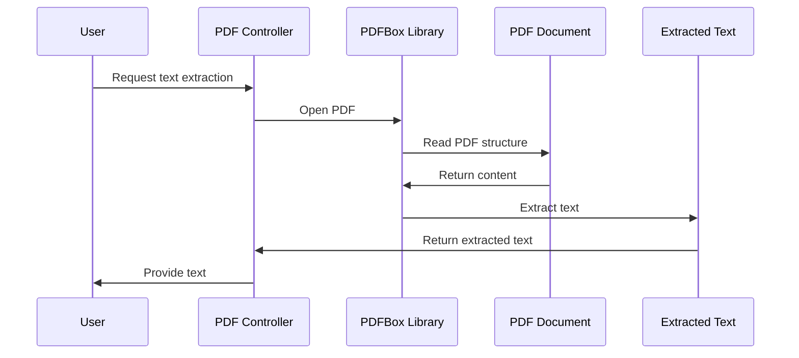
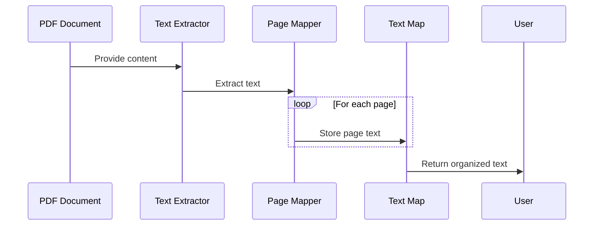
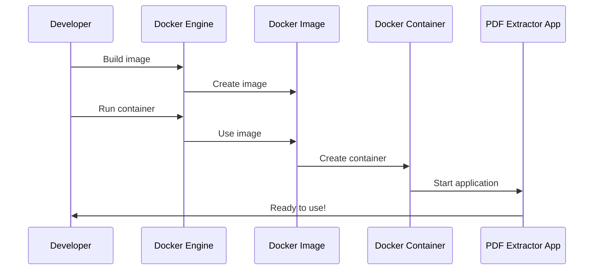

# pdf-extractor Tutorial


# Tutorial: pdf-extractor

This project is a **PDF Extractor Application** that allows users to extract text from PDF documents. It provides a *RESTful API* service that accepts **Base64-encoded PDF content** and returns the extracted text **organized by page**. The application is built using **Spring Boot** and can be easily deployed using **Docker**. It utilizes the **PDFBox library** to handle PDF processing and text extraction, making it a powerful tool for automating document analysis tasks.


**Source Repository:** [https://github.com/dygavieta/pdf-extractor](https://github.com/dygavieta/pdf-extractor)



## Chapters

1. [PDF Extractor Application
](01_pdf_extractor_application_.md)
2. [Base64 PDF Request
](02_base64_pdf_request_.md)
3. [PDF Extraction Controller
](03_pdf_extraction_controller_.md)
4. [PDF Text Extraction
](04_pdf_text_extraction_.md)
5. [Page-wise Text Mapping
](05_page_wise_text_mapping_.md)
6. [Docker Container Environment
](06_docker_container_environment_.md)


---

Generated by [AI Codebase Knowledge Builder](https://github.com/The-Pocket/Tutorial-Codebase-Knowledge)

---


## 01_pdf_extractor_application_


# Chapter 1: PDF Extractor Application

Welcome to the exciting world of PDF extraction! In this chapter, we'll explore the heart of our project: the PDF Extractor Application. This is where our journey begins, so let's dive in!

## What's the Big Deal?

Imagine you have a massive PDF document filled with important information, but you need to extract specific text from it. Maybe you're a researcher analyzing data, or a business professional trying to compile reports. Manually copying and pasting would take forever! That's where our PDF Extractor comes to the rescue.

## The PDF Extractor: Your New Best Friend

Think of the PDF Extractor Application as a smart assistant that can quickly read through PDFs and pull out the text you need. It's like having a super-fast reader who can instantly find and organize information for you.

## How Does It Work?

At its core, our PDF Extractor is a Spring Boot application. Don't worry if you're not familiar with Spring Boot – just think of it as a powerful tool that helps us build robust applications quickly and easily.

Let's take a look at the main piece of code that starts our application:

```java
@SpringBootApplication
public class PdfExtractorApplication {
    public static void main(String[] args) {
        SpringApplication.run(PdfExtractorApplication.class, args);
    }
}
```

This small but mighty chunk of code is the engine that starts our entire PDF extraction service. When you run this, it's like turning the key in your car's ignition – everything comes to life!

## Behind the Scenes

When you start the application, here's what happens:



1. You start the application.
2. Spring Boot initializes the framework.
3. All the necessary components for PDF extraction are set up.
4. The application is ready to receive and process PDF extraction requests.

## Why Spring Boot?

Spring Boot is like a Swiss Army knife for Java developers. It takes care of a lot of complex setup and configuration, allowing us to focus on building the cool PDF extraction features. It's perfect for beginners because it does a lot of the heavy lifting for us.

## Wrapping Up

In this chapter, we've taken our first step into the world of PDF extraction. We've learned about the main application that powers everything and how it springs to life (pun intended!) when we start it up.

As we move forward, we'll dive deeper into how we actually handle PDF files and extract text from them. Get ready for an exciting journey!

Next up, we'll explore how we receive PDF files in our application. Join me in the [Base64 PDF Request](02_base64_pdf_request_.md) chapter to learn more!

---

Generated by [AI Codebase Knowledge Builder](https://github.com/The-Pocket/Tutorial-Codebase-Knowledge)

## 02_base64_pdf_request_


# Chapter 2: Base64 PDF Request

Welcome back, PDF explorers! In our [previous chapter](01_pdf_extractor_application_.md), we learned about the core of our PDF Extractor Application. Now, let's dive into how we actually receive PDF files in our application. It's time to uncover the mystery of the Base64 PDF Request!

## The Problem: How to Send a PDF Over the Internet?

Imagine you want to send your friend a physical book. You could mail it, but what if you could somehow turn that book into a long string of text, send that text in an email, and then your friend could turn that text back into the original book? That's essentially what we're doing with PDFs in our application!

## Enter the Base64 PDF Request

A Base64 PDF Request is like a magic envelope for our PDF. It takes our PDF file and turns it into a long string of text that can be easily sent over the internet. This is super helpful because it allows us to send PDFs as plain text, which is much easier for computers to handle than binary files.

Let's break it down:

1. **Base64**: This is a way to represent binary data (like our PDF) using only text characters.
2. **Request**: This is the package we send to our application, containing our Base64-encoded PDF.

## How It Works

Here's a simple example of how we use a Base64 PDF Request:

```java
class Base64Request {
    private String pdfBase64;

    public String getPdfBase64() {
        return pdfBase64;
    }

    public void setPdfBase64(String pdfBase64) {
        this.pdfBase64 = pdfBase64;
    }
}
```

This small class is like a container for our Base64-encoded PDF. The `pdfBase64` string holds our entire PDF file, converted into text!

## Behind the Scenes

When you send a Base64 PDF Request to our application, here's what happens:



1. You send the Base64 PDF Request to our application.
2. Our application receives the request and extracts the Base64 string.
3. The Base64 string is decoded back into the original PDF data.
4. This PDF data is then processed to extract the text.
5. The extracted text is sent back to you!

## Using Base64 PDF Requests in Our Application

In our [PDF Extraction Controller](03_pdf_extraction_controller_.md), we use the Base64 PDF Request like this:

```java
@PostMapping
public Map<String, Object> extractPDFPerPage(@RequestBody Base64Request request) {
    String cleanBase64 = request.getPdfBase64().replaceAll("\\s+", "").trim();
    byte[] pdfBytes = Base64.getDecoder().decode(cleanBase64);
    // Process the PDF bytes...
}
```

This code snippet shows how we receive the Base64 Request, clean up the Base64 string (removing any extra spaces), and then decode it back into the original PDF data (as bytes).

## Why Use Base64?

Using Base64 encoding is like turning our PDF into a universal language that any computer can understand. It allows us to:

1. Easily send PDFs over the internet without worrying about file uploads.
2. Handle PDFs in a text-based format, which is often easier to work with.
3. Avoid issues with binary data transmission in certain systems.

## Wrapping Up

And there you have it! We've uncovered the mystery of the Base64 PDF Request. It's our magical way of turning PDFs into text for easy transmission and handling in our application.

In our next chapter, we'll explore how we actually process these PDFs and extract the text. Get ready to dive into the [PDF Extraction Controller](03_pdf_extraction_controller_.md)!

---

Generated by [AI Codebase Knowledge Builder](https://github.com/The-Pocket/Tutorial-Codebase-Knowledge)

## 03_pdf_extraction_controller_


# Chapter 3: PDF Extraction Controller

Welcome back, PDF enthusiasts! In our [previous chapter](02_base64_pdf_request_.md), we learned how to receive PDFs as Base64-encoded strings. Now, let's dive into the heart of our application: the PDF Extraction Controller!

## What's the Big Deal?

Imagine you're the manager of a bustling document processing center. People are constantly sending in PDFs, and you need to extract the text from them quickly and efficiently. That's exactly what our PDF Extraction Controller does! It's like a super-efficient manager that receives PDFs, coordinates their processing, and returns the extracted text.

## The PDF Extraction Controller: Your Document Processing Maestro

Think of the PDF Extraction Controller as the conductor of an orchestra. It doesn't play every instrument itself, but it coordinates all the parts to create beautiful music (or in our case, to extract text from PDFs).

Let's take a look at the basic structure of our controller:

```java
@RestController
@RequestMapping("/extract")
public class PDFExtractorController {
    @PostMapping
    public Map<String, Object> extractPDFPerPage(@RequestBody Base64Request request) {
        // Magic happens here!
    }
}
```

This small piece of code is the entry point for all our PDF extraction requests. It's like the front desk of our document processing center!

## How It Works

When someone wants to extract text from a PDF, here's what happens:



1. A user sends a PDF extraction request to our controller.
2. The controller decodes the Base64 PDF.
3. It passes the decoded PDF to our text extractor.
4. The extracted text is mapped to individual pages.
5. The controller sends the organized text back to the user.

## The Magic Inside

Let's break down the main method of our controller:

```java
public Map<String, Object> extractPDFPerPage(@RequestBody Base64Request request) {
    Map<String, Object> pageTextMap = new HashMap<>();
    String cleanBase64 = request.getPdfBase64().replaceAll("\\s+", "").trim();
    byte[] pdfBytes = Base64.getDecoder().decode(cleanBase64);
    // Process PDF and extract text...
    return pageTextMap;
}
```

This method is like a recipe for PDF text extraction:
1. We create a `pageTextMap` to store our results.
2. We clean up the Base64 string (removing extra spaces).
3. We decode the Base64 string back into PDF data.
4. We process the PDF and extract the text (more on this in the [PDF Text Extraction](04_pdf_text_extraction_.md) chapter).
5. Finally, we return the extracted text, organized by page.

## Why Use a Controller?

Using a controller gives us several benefits:
1. It provides a clear entry point for PDF extraction requests.
2. It separates the API logic from the PDF processing logic.
3. It allows us to easily add more features in the future, like different extraction methods.

## Wrapping Up

And there you have it! The PDF Extraction Controller is the maestro of our PDF processing orchestra. It takes in Base64 PDF requests, coordinates the extraction process, and returns neatly organized text.

In our next chapter, we'll dive deeper into how we actually extract text from PDFs. Get ready to explore the exciting world of [PDF Text Extraction](04_pdf_text_extraction_.md)!

---

Generated by [AI Codebase Knowledge Builder](https://github.com/The-Pocket/Tutorial-Codebase-Knowledge)

## 04_pdf_text_extraction_


# Chapter 4: PDF Text Extraction

Welcome back, PDF adventurers! In our [previous chapter](03_pdf_extraction_controller_.md), we learned about the PDF Extraction Controller, which acts as the maestro of our PDF processing orchestra. Now, let's dive into the heart of our text extraction process: PDF Text Extraction!

## The Magic of Turning PDFs into Text

Imagine you have a PDF cookbook full of delicious recipes. You want to create a digital version of these recipes that you can easily search and edit. That's where PDF Text Extraction comes in! It's like having a super-smart assistant who can read the PDF and type out all the text for you.

## How Does It Work?

At its core, PDF Text Extraction uses a powerful tool called PDFBox. Think of PDFBox as a pair of special glasses that can see through the complex structure of a PDF and read its contents.

Here's a simplified version of how we use PDFBox in our project:

```java
PDDocument document = PDDocument.load(pdfBytes);
PDFTextStripper pdfStripper = new PDFTextStripper();
String text = pdfStripper.getText(document);
```

This small piece of code is like a magic spell that turns our PDF into plain text. Let's break it down:

1. We open the PDF document with `PDDocument.load(pdfBytes)`.
2. We create a `PDFTextStripper`, our text extraction tool.
3. We use the stripper to get all the text from the document.

## Behind the Scenes

When you extract text from a PDF, here's what happens:



1. You ask our application to extract text from a PDF.
2. Our controller asks PDFBox to open the PDF.
3. PDFBox reads the PDF's structure and content.
4. PDFBox extracts the text from the PDF.
5. The extracted text is sent back to you!

## The Magic in Detail

Let's look at a more detailed version of our text extraction process:

```java
try (PDDocument document = PDDocument.load(pdfBytes)) {
    PDFTextStripper pdfStripper = new PDFTextStripper();
    for (int i = 1; i <= document.getNumberOfPages(); i++) {
        pdfStripper.setStartPage(i);
        pdfStripper.setEndPage(i);
        String pageText = pdfStripper.getText(document).trim();
        // Process pageText...
    }
}
```

This code is like a recipe for extracting text from each page of the PDF:
1. We open the PDF document.
2. We create our text extraction tool (PDFTextStripper).
3. For each page in the document:
   - We tell the stripper which page to look at.
   - We extract the text from that page.
   - We process the extracted text (more on this in the [Page-wise Text Mapping](05_page_wise_text_mapping_.md) chapter).

## Why Use PDFBox?

PDFBox is like a Swiss Army knife for working with PDFs. It gives us several benefits:
1. It can handle a wide variety of PDF formats.
2. It's open-source and well-maintained.
3. It provides a simple way to extract text from PDFs.

## Wrapping Up

And there you have it! PDF Text Extraction is the magic that allows us to turn complex PDF documents into simple, searchable text. It's the key that unlocks the content inside PDFs, making it accessible and useful for further processing.

In our next chapter, we'll explore how we organize this extracted text into a useful structure. Get ready to dive into the world of [Page-wise Text Mapping](05_page_wise_text_mapping_.md)!

---

Generated by [AI Codebase Knowledge Builder](https://github.com/The-Pocket/Tutorial-Codebase-Knowledge)

## 05_page_wise_text_mapping_


# Chapter 5: Page-wise Text Mapping

Welcome back, PDF explorers! In our [previous chapter](04_pdf_text_extraction_.md), we learned how to extract text from PDFs. Now, let's dive into the exciting world of Page-wise Text Mapping!

## Organizing Our PDF Treasure

Imagine you've just finished reading a thrilling mystery novel, and you want to create a summary of each chapter. You'd probably write down the main points from each chapter, keeping them organized and separate. That's exactly what Page-wise Text Mapping does for our extracted PDF text!

## What is Page-wise Text Mapping?

Page-wise Text Mapping is like creating a detailed table of contents for our extracted PDF text. It helps us keep the structure of the original PDF by organizing the extracted text page by page. This way, we know exactly which text came from which page of the PDF.

## How Does It Work?

Let's look at a simple example of how we create our page-wise text map:

```java
Map<String, Object> pageTextMap = new HashMap<>();
for (int i = 1; i <= totalPages; i++) {
    String pageText = extractTextFromPage(i);
    pageTextMap.put("page" + i, pageText);
}
```

This small piece of code is like a librarian carefully organizing books on shelves. Let's break it down:

1. We create a `pageTextMap` to store our organized text.
2. For each page in the PDF:
   - We extract the text from that page.
   - We store the text in our map, using "page1", "page2", etc. as keys.

## Behind the Scenes

When we map our extracted text to pages, here's what happens:



1. Our PDF provides its content to the Text Extractor.
2. The Text Extractor pulls out all the text.
3. For each page, our Page Mapper stores the text in our map.
4. Finally, we return the organized text to the user!

## The Magic in Detail

Let's look at a more detailed version of our mapping process:

```java
PDFTextStripper pdfStripper = new PDFTextStripper();
for (int i = 1; i <= totalPages; i++) {
    pdfStripper.setStartPage(i);
    pdfStripper.setEndPage(i);
    String pageText = pdfStripper.getText(document).trim();
    List<String> lines = Arrays.stream(pageText.split("\n"))
            .map(String::trim)
            .filter(line -> !line.isEmpty())
            .collect(Collectors.toList());
    pageTextMap.put("page" + i, lines);
}
```

This code is like a careful librarian organizing books:
1. We create our text extraction tool (PDFTextStripper).
2. For each page in the document:
   - We tell the stripper which page to look at.
   - We extract the text from that page.
   - We split the text into lines and clean them up.
   - We store the cleaned lines in our map.

## Why Use Page-wise Text Mapping?

Page-wise Text Mapping is like having a well-organized bookshelf. It gives us several benefits:
1. We maintain the structure of the original PDF.
2. We can easily access text from specific pages.
3. It's easier to process or analyze the text page by page.

## Wrapping Up

And there you have it! Page-wise Text Mapping helps us organize our extracted PDF text into a neat, page-by-page structure. It's like creating a detailed table of contents for our PDF, making it easy to navigate and use the extracted information.

In our next chapter, we'll explore how we set up our PDF extractor to run in any environment. Get ready to dive into the world of [Docker Container Environment](06_docker_container_environment_.md)!

---

Generated by [AI Codebase Knowledge Builder](https://github.com/The-Pocket/Tutorial-Codebase-Knowledge)

## 06_docker_container_environment_


# Chapter 6: Docker Container Environment

Welcome back, PDF pioneers! In our [previous chapter](05_page_wise_text_mapping_.md), we learned how to organize our extracted PDF text page by page. Now, let's explore how we can package our entire PDF extractor application into a neat, portable container using Docker!

## The Problem: Running Our App Anywhere

Imagine you've built an amazing treehouse in your backyard. It's perfect, but what if you want to take it to your friend's house or to the park? That's impossible with a regular treehouse, right? Well, that's where Docker comes in for our PDF extractor!

## Docker: Your Application's Portable Home

Docker is like a magical box that can hold our entire PDF extractor application, along with everything it needs to run. It's as if we could shrink our treehouse, put it in a box, and set it up anywhere we want!

## How Does It Work?

Let's look at a simplified version of our Dockerfile, which is like a recipe for creating our Docker container:

```dockerfile
FROM amazoncorretto:21-alpine-jdk
WORKDIR /app
COPY target/*.jar app.jar
ENTRYPOINT ["java", "-jar", "app.jar"]
```

This small file is like a set of instructions for packing our treehouse. Let's break it down:

1. We start with a base image that has Java (our treehouse foundation).
2. We set up a workspace in the container (clearing space for our treehouse).
3. We copy our application into the container (putting our treehouse parts in the box).
4. We specify how to start our application (instructions for setting up the treehouse).

## Behind the Scenes

When we create and run our Docker container, here's what happens:



1. We build a Docker image (pack our treehouse).
2. We create a container from this image (unpack our treehouse).
3. We start the container (set up our treehouse).
4. Our PDF extractor is now running and ready to use!

## The Magic in Detail

Let's look at a more detailed version of our Dockerfile:

```dockerfile
FROM maven:3.9-amazoncorretto-21 AS build
WORKDIR /app
COPY pom.xml .
COPY src ./src
RUN mvn clean package -DskipTests

FROM amazoncorretto:21-alpine-jdk
WORKDIR /app
COPY --from=build /app/target/*.jar app.jar
ENTRYPOINT ["java", "-jar", "app.jar"]
```

This Dockerfile is like a two-step recipe for our portable treehouse:
1. First, we build our application (construct treehouse parts).
2. Then, we create a lightweight container with just our application (pack the treehouse efficiently).

## Why Use Docker?

Using Docker is like having a magic treehouse that you can set up anywhere. It gives us several benefits:
1. Our application runs the same way everywhere (consistency).
2. It's easy to deploy and scale our application (portability).
3. We can manage our application's environment separately from our host system (isolation).

## Wrapping Up

And there you have it! Docker Container Environment allows us to package our PDF extractor into a portable, consistent environment. It's like having a magic box that can set up our application anywhere, anytime, exactly the way we want it.

This concludes our journey through the PDF Extractor project. We've learned how to receive PDFs, extract text, organize it, and package our application for easy deployment. You're now equipped with the knowledge to build and run your very own PDF extraction service!

---

Generated by [AI Codebase Knowledge Builder](https://github.com/The-Pocket/Tutorial-Codebase-Knowledge)

## pdf-extractor_tutorial


# pdf-extractor Tutorial


# Tutorial: pdf-extractor

This project is a **PDF Extractor Application** that allows users to extract text from PDF documents. It provides a *RESTful API* service that accepts **Base64-encoded PDF content** and returns the extracted text **organized by page**. The application is built using **Spring Boot** and can be easily deployed using **Docker**. It utilizes the **PDFBox library** to handle PDF processing and text extraction, making it a powerful tool for automating document analysis tasks.


**Source Repository:** [https://github.com/dygavieta/pdf-extractor](https://github.com/dygavieta/pdf-extractor)


## Chapters

1. [PDF Extractor Application
](01_pdf_extractor_application_.md)
2. [Base64 PDF Request
](02_base64_pdf_request_.md)
3. [PDF Extraction Controller
](03_pdf_extraction_controller_.md)
4. [PDF Text Extraction
](04_pdf_text_extraction_.md)
5. [Page-wise Text Mapping
](05_page_wise_text_mapping_.md)
6. [Docker Container Environment
](06_docker_container_environment_.md)


---

Generated by [AI Codebase Knowledge Builder](https://github.com/The-Pocket/Tutorial-Codebase-Knowledge)

---


## 01_pdf_extractor_application_


# Chapter 1: PDF Extractor Application

Welcome to the exciting world of PDF extraction! In this chapter, we'll explore the heart of our project: the PDF Extractor Application. This is where our journey begins, so let's dive in!

## What's the Big Deal?

Imagine you have a massive PDF document filled with important information, but you need to extract specific text from it. Maybe you're a researcher analyzing data, or a business professional trying to compile reports. Manually copying and pasting would take forever! That's where our PDF Extractor comes to the rescue.

## The PDF Extractor: Your New Best Friend

Think of the PDF Extractor Application as a smart assistant that can quickly read through PDFs and pull out the text you need. It's like having a super-fast reader who can instantly find and organize information for you.

## How Does It Work?

At its core, our PDF Extractor is a Spring Boot application. Don't worry if you're not familiar with Spring Boot – just think of it as a powerful tool that helps us build robust applications quickly and easily.

Let's take a look at the main piece of code that starts our application:

```java
@SpringBootApplication
public class PdfExtractorApplication {
    public static void main(String[] args) {
        SpringApplication.run(PdfExtractorApplication.class, args);
    }
}
```

This small but mighty chunk of code is the engine that starts our entire PDF extraction service. When you run this, it's like turning the key in your car's ignition – everything comes to life!

## Behind the Scenes

When you start the application, here's what happens:


1. You start the application.
2. Spring Boot initializes the framework.
3. All the necessary components for PDF extraction are set up.
4. The application is ready to receive and process PDF extraction requests.

## Why Spring Boot?

Spring Boot is like a Swiss Army knife for Java developers. It takes care of a lot of complex setup and configuration, allowing us to focus on building the cool PDF extraction features. It's perfect for beginners because it does a lot of the heavy lifting for us.

## Wrapping Up

In this chapter, we've taken our first step into the world of PDF extraction. We've learned about the main application that powers everything and how it springs to life (pun intended!) when we start it up.

As we move forward, we'll dive deeper into how we actually handle PDF files and extract text from them. Get ready for an exciting journey!

Next up, we'll explore how we receive PDF files in our application. Join me in the [Base64 PDF Request](02_base64_pdf_request_.md) chapter to learn more!

---

Generated by [AI Codebase Knowledge Builder](https://github.com/The-Pocket/Tutorial-Codebase-Knowledge)

## 02_base64_pdf_request_


# Chapter 2: Base64 PDF Request

Welcome back, PDF explorers! In our [previous chapter](01_pdf_extractor_application_.md), we learned about the core of our PDF Extractor Application. Now, let's dive into how we actually receive PDF files in our application. It's time to uncover the mystery of the Base64 PDF Request!

## The Problem: How to Send a PDF Over the Internet?

Imagine you want to send your friend a physical book. You could mail it, but what if you could somehow turn that book into a long string of text, send that text in an email, and then your friend could turn that text back into the original book? That's essentially what we're doing with PDFs in our application!

## Enter the Base64 PDF Request

A Base64 PDF Request is like a magic envelope for our PDF. It takes our PDF file and turns it into a long string of text that can be easily sent over the internet. This is super helpful because it allows us to send PDFs as plain text, which is much easier for computers to handle than binary files.

Let's break it down:

1. **Base64**: This is a way to represent binary data (like our PDF) using only text characters.
2. **Request**: This is the package we send to our application, containing our Base64-encoded PDF.

## How It Works

Here's a simple example of how we use a Base64 PDF Request:

```java
class Base64Request {
    private String pdfBase64;

    public String getPdfBase64() {
        return pdfBase64;
    }

    public void setPdfBase64(String pdfBase64) {
        this.pdfBase64 = pdfBase64;
    }
}
```

This small class is like a container for our Base64-encoded PDF. The `pdfBase64` string holds our entire PDF file, converted into text!

## Behind the Scenes

When you send a Base64 PDF Request to our application, here's what happens:


1. You send the Base64 PDF Request to our application.
2. Our application receives the request and extracts the Base64 string.
3. The Base64 string is decoded back into the original PDF data.
4. This PDF data is then processed to extract the text.
5. The extracted text is sent back to you!

## Using Base64 PDF Requests in Our Application

In our [PDF Extraction Controller](03_pdf_extraction_controller_.md), we use the Base64 PDF Request like this:

```java
@PostMapping
public Map<String, Object> extractPDFPerPage(@RequestBody Base64Request request) {
    String cleanBase64 = request.getPdfBase64().replaceAll("\\s+", "").trim();
    byte[] pdfBytes = Base64.getDecoder().decode(cleanBase64);
    // Process the PDF bytes...
}
```

This code snippet shows how we receive the Base64 Request, clean up the Base64 string (removing any extra spaces), and then decode it back into the original PDF data (as bytes).

## Why Use Base64?

Using Base64 encoding is like turning our PDF into a universal language that any computer can understand. It allows us to:

1. Easily send PDFs over the internet without worrying about file uploads.
2. Handle PDFs in a text-based format, which is often easier to work with.
3. Avoid issues with binary data transmission in certain systems.

## Wrapping Up

And there you have it! We've uncovered the mystery of the Base64 PDF Request. It's our magical way of turning PDFs into text for easy transmission and handling in our application.

In our next chapter, we'll explore how we actually process these PDFs and extract the text. Get ready to dive into the [PDF Extraction Controller](03_pdf_extraction_controller_.md)!

---

Generated by [AI Codebase Knowledge Builder](https://github.com/The-Pocket/Tutorial-Codebase-Knowledge)

## 03_pdf_extraction_controller_


# Chapter 3: PDF Extraction Controller

Welcome back, PDF enthusiasts! In our [previous chapter](02_base64_pdf_request_.md), we learned how to receive PDFs as Base64-encoded strings. Now, let's dive into the heart of our application: the PDF Extraction Controller!

## What's the Big Deal?

Imagine you're the manager of a bustling document processing center. People are constantly sending in PDFs, and you need to extract the text from them quickly and efficiently. That's exactly what our PDF Extraction Controller does! It's like a super-efficient manager that receives PDFs, coordinates their processing, and returns the extracted text.

## The PDF Extraction Controller: Your Document Processing Maestro

Think of the PDF Extraction Controller as the conductor of an orchestra. It doesn't play every instrument itself, but it coordinates all the parts to create beautiful music (or in our case, to extract text from PDFs).

Let's take a look at the basic structure of our controller:

```java
@RestController
@RequestMapping("/extract")
public class PDFExtractorController {
    @PostMapping
    public Map<String, Object> extractPDFPerPage(@RequestBody Base64Request request) {
        // Magic happens here!
    }
}
```

This small piece of code is the entry point for all our PDF extraction requests. It's like the front desk of our document processing center!

## How It Works

When someone wants to extract text from a PDF, here's what happens:


1. A user sends a PDF extraction request to our controller.
2. The controller decodes the Base64 PDF.
3. It passes the decoded PDF to our text extractor.
4. The extracted text is mapped to individual pages.
5. The controller sends the organized text back to the user.

## The Magic Inside

Let's break down the main method of our controller:

```java
public Map<String, Object> extractPDFPerPage(@RequestBody Base64Request request) {
    Map<String, Object> pageTextMap = new HashMap<>();
    String cleanBase64 = request.getPdfBase64().replaceAll("\\s+", "").trim();
    byte[] pdfBytes = Base64.getDecoder().decode(cleanBase64);
    // Process PDF and extract text...
    return pageTextMap;
}
```

This method is like a recipe for PDF text extraction:
1. We create a `pageTextMap` to store our results.
2. We clean up the Base64 string (removing extra spaces).
3. We decode the Base64 string back into PDF data.
4. We process the PDF and extract the text (more on this in the [PDF Text Extraction](04_pdf_text_extraction_.md) chapter).
5. Finally, we return the extracted text, organized by page.

## Why Use a Controller?

Using a controller gives us several benefits:
1. It provides a clear entry point for PDF extraction requests.
2. It separates the API logic from the PDF processing logic.
3. It allows us to easily add more features in the future, like different extraction methods.

## Wrapping Up

And there you have it! The PDF Extraction Controller is the maestro of our PDF processing orchestra. It takes in Base64 PDF requests, coordinates the extraction process, and returns neatly organized text.

In our next chapter, we'll dive deeper into how we actually extract text from PDFs. Get ready to explore the exciting world of [PDF Text Extraction](04_pdf_text_extraction_.md)!

---

Generated by [AI Codebase Knowledge Builder](https://github.com/The-Pocket/Tutorial-Codebase-Knowledge)

## 04_pdf_text_extraction_


# Chapter 4: PDF Text Extraction

Welcome back, PDF adventurers! In our [previous chapter](03_pdf_extraction_controller_.md), we learned about the PDF Extraction Controller, which acts as the maestro of our PDF processing orchestra. Now, let's dive into the heart of our text extraction process: PDF Text Extraction!

## The Magic of Turning PDFs into Text

Imagine you have a PDF cookbook full of delicious recipes. You want to create a digital version of these recipes that you can easily search and edit. That's where PDF Text Extraction comes in! It's like having a super-smart assistant who can read the PDF and type out all the text for you.

## How Does It Work?

At its core, PDF Text Extraction uses a powerful tool called PDFBox. Think of PDFBox as a pair of special glasses that can see through the complex structure of a PDF and read its contents.

Here's a simplified version of how we use PDFBox in our project:

```java
PDDocument document = PDDocument.load(pdfBytes);
PDFTextStripper pdfStripper = new PDFTextStripper();
String text = pdfStripper.getText(document);
```

This small piece of code is like a magic spell that turns our PDF into plain text. Let's break it down:

1. We open the PDF document with `PDDocument.load(pdfBytes)`.
2. We create a `PDFTextStripper`, our text extraction tool.
3. We use the stripper to get all the text from the document.

## Behind the Scenes

When you extract text from a PDF, here's what happens:


1. You ask our application to extract text from a PDF.
2. Our controller asks PDFBox to open the PDF.
3. PDFBox reads the PDF's structure and content.
4. PDFBox extracts the text from the PDF.
5. The extracted text is sent back to you!

## The Magic in Detail

Let's look at a more detailed version of our text extraction process:

```java
try (PDDocument document = PDDocument.load(pdfBytes)) {
    PDFTextStripper pdfStripper = new PDFTextStripper();
    for (int i = 1; i <= document.getNumberOfPages(); i++) {
        pdfStripper.setStartPage(i);
        pdfStripper.setEndPage(i);
        String pageText = pdfStripper.getText(document).trim();
        // Process pageText...
    }
}
```

This code is like a recipe for extracting text from each page of the PDF:
1. We open the PDF document.
2. We create our text extraction tool (PDFTextStripper).
3. For each page in the document:
   - We tell the stripper which page to look at.
   - We extract the text from that page.
   - We process the extracted text (more on this in the [Page-wise Text Mapping](05_page_wise_text_mapping_.md) chapter).

## Why Use PDFBox?

PDFBox is like a Swiss Army knife for working with PDFs. It gives us several benefits:
1. It can handle a wide variety of PDF formats.
2. It's open-source and well-maintained.
3. It provides a simple way to extract text from PDFs.

## Wrapping Up

And there you have it! PDF Text Extraction is the magic that allows us to turn complex PDF documents into simple, searchable text. It's the key that unlocks the content inside PDFs, making it accessible and useful for further processing.

In our next chapter, we'll explore how we organize this extracted text into a useful structure. Get ready to dive into the world of [Page-wise Text Mapping](05_page_wise_text_mapping_.md)!

---

Generated by [AI Codebase Knowledge Builder](https://github.com/The-Pocket/Tutorial-Codebase-Knowledge)

## 05_page_wise_text_mapping_


# Chapter 5: Page-wise Text Mapping

Welcome back, PDF explorers! In our [previous chapter](04_pdf_text_extraction_.md), we learned how to extract text from PDFs. Now, let's dive into the exciting world of Page-wise Text Mapping!

## Organizing Our PDF Treasure

Imagine you've just finished reading a thrilling mystery novel, and you want to create a summary of each chapter. You'd probably write down the main points from each chapter, keeping them organized and separate. That's exactly what Page-wise Text Mapping does for our extracted PDF text!

## What is Page-wise Text Mapping?

Page-wise Text Mapping is like creating a detailed table of contents for our extracted PDF text. It helps us keep the structure of the original PDF by organizing the extracted text page by page. This way, we know exactly which text came from which page of the PDF.

## How Does It Work?

Let's look at a simple example of how we create our page-wise text map:

```java
Map<String, Object> pageTextMap = new HashMap<>();
for (int i = 1; i <= totalPages; i++) {
    String pageText = extractTextFromPage(i);
    pageTextMap.put("page" + i, pageText);
}
```

This small piece of code is like a librarian carefully organizing books on shelves. Let's break it down:

1. We create a `pageTextMap` to store our organized text.
2. For each page in the PDF:
   - We extract the text from that page.
   - We store the text in our map, using "page1", "page2", etc. as keys.

## Behind the Scenes

When we map our extracted text to pages, here's what happens:


1. Our PDF provides its content to the Text Extractor.
2. The Text Extractor pulls out all the text.
3. For each page, our Page Mapper stores the text in our map.
4. Finally, we return the organized text to the user!

## The Magic in Detail

Let's look at a more detailed version of our mapping process:

```java
PDFTextStripper pdfStripper = new PDFTextStripper();
for (int i = 1; i <= totalPages; i++) {
    pdfStripper.setStartPage(i);
    pdfStripper.setEndPage(i);
    String pageText = pdfStripper.getText(document).trim();
    List<String> lines = Arrays.stream(pageText.split("\n"))
            .map(String::trim)
            .filter(line -> !line.isEmpty())
            .collect(Collectors.toList());
    pageTextMap.put("page" + i, lines);
}
```

This code is like a careful librarian organizing books:
1. We create our text extraction tool (PDFTextStripper).
2. For each page in the document:
   - We tell the stripper which page to look at.
   - We extract the text from that page.
   - We split the text into lines and clean them up.
   - We store the cleaned lines in our map.

## Why Use Page-wise Text Mapping?

Page-wise Text Mapping is like having a well-organized bookshelf. It gives us several benefits:
1. We maintain the structure of the original PDF.
2. We can easily access text from specific pages.
3. It's easier to process or analyze the text page by page.

## Wrapping Up

And there you have it! Page-wise Text Mapping helps us organize our extracted PDF text into a neat, page-by-page structure. It's like creating a detailed table of contents for our PDF, making it easy to navigate and use the extracted information.

In our next chapter, we'll explore how we set up our PDF extractor to run in any environment. Get ready to dive into the world of [Docker Container Environment](06_docker_container_environment_.md)!

---

Generated by [AI Codebase Knowledge Builder](https://github.com/The-Pocket/Tutorial-Codebase-Knowledge)

## 06_docker_container_environment_


# Chapter 6: Docker Container Environment

Welcome back, PDF pioneers! In our [previous chapter](05_page_wise_text_mapping_.md), we learned how to organize our extracted PDF text page by page. Now, let's explore how we can package our entire PDF extractor application into a neat, portable container using Docker!

## The Problem: Running Our App Anywhere

Imagine you've built an amazing treehouse in your backyard. It's perfect, but what if you want to take it to your friend's house or to the park? That's impossible with a regular treehouse, right? Well, that's where Docker comes in for our PDF extractor!

## Docker: Your Application's Portable Home

Docker is like a magical box that can hold our entire PDF extractor application, along with everything it needs to run. It's as if we could shrink our treehouse, put it in a box, and set it up anywhere we want!

## How Does It Work?

Let's look at a simplified version of our Dockerfile, which is like a recipe for creating our Docker container:

```dockerfile
FROM amazoncorretto:21-alpine-jdk
WORKDIR /app
COPY target/*.jar app.jar
ENTRYPOINT ["java", "-jar", "app.jar"]
```

This small file is like a set of instructions for packing our treehouse. Let's break it down:

1. We start with a base image that has Java (our treehouse foundation).
2. We set up a workspace in the container (clearing space for our treehouse).
3. We copy our application into the container (putting our treehouse parts in the box).
4. We specify how to start our application (instructions for setting up the treehouse).

## Behind the Scenes

When we create and run our Docker container, here's what happens:


1. We build a Docker image (pack our treehouse).
2. We create a container from this image (unpack our treehouse).
3. We start the container (set up our treehouse).
4. Our PDF extractor is now running and ready to use!

## The Magic in Detail

Let's look at a more detailed version of our Dockerfile:

```dockerfile
FROM maven:3.9-amazoncorretto-21 AS build
WORKDIR /app
COPY pom.xml .
COPY src ./src
RUN mvn clean package -DskipTests

FROM amazoncorretto:21-alpine-jdk
WORKDIR /app
COPY --from=build /app/target/*.jar app.jar
ENTRYPOINT ["java", "-jar", "app.jar"]
```

This Dockerfile is like a two-step recipe for our portable treehouse:
1. First, we build our application (construct treehouse parts).
2. Then, we create a lightweight container with just our application (pack the treehouse efficiently).

## Why Use Docker?

Using Docker is like having a magic treehouse that you can set up anywhere. It gives us several benefits:
1. Our application runs the same way everywhere (consistency).
2. It's easy to deploy and scale our application (portability).
3. We can manage our application's environment separately from our host system (isolation).

## Wrapping Up

And there you have it! Docker Container Environment allows us to package our PDF extractor into a portable, consistent environment. It's like having a magic box that can set up our application anywhere, anytime, exactly the way we want it.

This concludes our journey through the PDF Extractor project. We've learned how to receive PDFs, extract text, organize it, and package our application for easy deployment. You're now equipped with the knowledge to build and run your very own PDF extraction service!

---

Generated by [AI Codebase Knowledge Builder](https://github.com/The-Pocket/Tutorial-Codebase-Knowledge)

## pdf-extractor_tutorial


# pdf-extractor Tutorial


# Tutorial: pdf-extractor

This project is a **PDF Extractor Application** that allows users to extract text from PDF documents. It provides a *RESTful API* service that accepts **Base64-encoded PDF content** and returns the extracted text **organized by page**. The application is built using **Spring Boot** and can be easily deployed using **Docker**. It utilizes the **PDFBox library** to handle PDF processing and text extraction, making it a powerful tool for automating document analysis tasks.


**Source Repository:** [https://github.com/dygavieta/pdf-extractor](https://github.com/dygavieta/pdf-extractor)


## Chapters

1. [PDF Extractor Application
](01_pdf_extractor_application_.md)
2. [Base64 PDF Request
](02_base64_pdf_request_.md)
3. [PDF Extraction Controller
](03_pdf_extraction_controller_.md)
4. [PDF Text Extraction
](04_pdf_text_extraction_.md)
5. [Page-wise Text Mapping
](05_page_wise_text_mapping_.md)
6. [Docker Container Environment
](06_docker_container_environment_.md)


---

Generated by [AI Codebase Knowledge Builder](https://github.com/The-Pocket/Tutorial-Codebase-Knowledge)

---


## 01_pdf_extractor_application_


# Chapter 1: PDF Extractor Application

Welcome to the exciting world of PDF extraction! In this chapter, we'll explore the heart of our project: the PDF Extractor Application. This is where our journey begins, so let's dive in!

## What's the Big Deal?

Imagine you have a massive PDF document filled with important information, but you need to extract specific text from it. Maybe you're a researcher analyzing data, or a business professional trying to compile reports. Manually copying and pasting would take forever! That's where our PDF Extractor comes to the rescue.

## The PDF Extractor: Your New Best Friend

Think of the PDF Extractor Application as a smart assistant that can quickly read through PDFs and pull out the text you need. It's like having a super-fast reader who can instantly find and organize information for you.

## How Does It Work?

At its core, our PDF Extractor is a Spring Boot application. Don't worry if you're not familiar with Spring Boot – just think of it as a powerful tool that helps us build robust applications quickly and easily.

Let's take a look at the main piece of code that starts our application:

```java
@SpringBootApplication
public class PdfExtractorApplication {
    public static void main(String[] args) {
        SpringApplication.run(PdfExtractorApplication.class, args);
    }
}
```

This small but mighty chunk of code is the engine that starts our entire PDF extraction service. When you run this, it's like turning the key in your car's ignition – everything comes to life!

## Behind the Scenes

When you start the application, here's what happens:


1. You start the application.
2. Spring Boot initializes the framework.
3. All the necessary components for PDF extraction are set up.
4. The application is ready to receive and process PDF extraction requests.

## Why Spring Boot?

Spring Boot is like a Swiss Army knife for Java developers. It takes care of a lot of complex setup and configuration, allowing us to focus on building the cool PDF extraction features. It's perfect for beginners because it does a lot of the heavy lifting for us.

## Wrapping Up

In this chapter, we've taken our first step into the world of PDF extraction. We've learned about the main application that powers everything and how it springs to life (pun intended!) when we start it up.

As we move forward, we'll dive deeper into how we actually handle PDF files and extract text from them. Get ready for an exciting journey!

Next up, we'll explore how we receive PDF files in our application. Join me in the [Base64 PDF Request](02_base64_pdf_request_.md) chapter to learn more!

---

Generated by [AI Codebase Knowledge Builder](https://github.com/The-Pocket/Tutorial-Codebase-Knowledge)

## 02_base64_pdf_request_


# Chapter 2: Base64 PDF Request

Welcome back, PDF explorers! In our [previous chapter](01_pdf_extractor_application_.md), we learned about the core of our PDF Extractor Application. Now, let's dive into how we actually receive PDF files in our application. It's time to uncover the mystery of the Base64 PDF Request!

## The Problem: How to Send a PDF Over the Internet?

Imagine you want to send your friend a physical book. You could mail it, but what if you could somehow turn that book into a long string of text, send that text in an email, and then your friend could turn that text back into the original book? That's essentially what we're doing with PDFs in our application!

## Enter the Base64 PDF Request

A Base64 PDF Request is like a magic envelope for our PDF. It takes our PDF file and turns it into a long string of text that can be easily sent over the internet. This is super helpful because it allows us to send PDFs as plain text, which is much easier for computers to handle than binary files.

Let's break it down:

1. **Base64**: This is a way to represent binary data (like our PDF) using only text characters.
2. **Request**: This is the package we send to our application, containing our Base64-encoded PDF.

## How It Works

Here's a simple example of how we use a Base64 PDF Request:

```java
class Base64Request {
    private String pdfBase64;

    public String getPdfBase64() {
        return pdfBase64;
    }

    public void setPdfBase64(String pdfBase64) {
        this.pdfBase64 = pdfBase64;
    }
}
```

This small class is like a container for our Base64-encoded PDF. The `pdfBase64` string holds our entire PDF file, converted into text!

## Behind the Scenes

When you send a Base64 PDF Request to our application, here's what happens:


1. You send the Base64 PDF Request to our application.
2. Our application receives the request and extracts the Base64 string.
3. The Base64 string is decoded back into the original PDF data.
4. This PDF data is then processed to extract the text.
5. The extracted text is sent back to you!

## Using Base64 PDF Requests in Our Application

In our [PDF Extraction Controller](03_pdf_extraction_controller_.md), we use the Base64 PDF Request like this:

```java
@PostMapping
public Map<String, Object> extractPDFPerPage(@RequestBody Base64Request request) {
    String cleanBase64 = request.getPdfBase64().replaceAll("\\s+", "").trim();
    byte[] pdfBytes = Base64.getDecoder().decode(cleanBase64);
    // Process the PDF bytes...
}
```

This code snippet shows how we receive the Base64 Request, clean up the Base64 string (removing any extra spaces), and then decode it back into the original PDF data (as bytes).

## Why Use Base64?

Using Base64 encoding is like turning our PDF into a universal language that any computer can understand. It allows us to:

1. Easily send PDFs over the internet without worrying about file uploads.
2. Handle PDFs in a text-based format, which is often easier to work with.
3. Avoid issues with binary data transmission in certain systems.

## Wrapping Up

And there you have it! We've uncovered the mystery of the Base64 PDF Request. It's our magical way of turning PDFs into text for easy transmission and handling in our application.

In our next chapter, we'll explore how we actually process these PDFs and extract the text. Get ready to dive into the [PDF Extraction Controller](03_pdf_extraction_controller_.md)!

---

Generated by [AI Codebase Knowledge Builder](https://github.com/The-Pocket/Tutorial-Codebase-Knowledge)

## 03_pdf_extraction_controller_


# Chapter 3: PDF Extraction Controller

Welcome back, PDF enthusiasts! In our [previous chapter](02_base64_pdf_request_.md), we learned how to receive PDFs as Base64-encoded strings. Now, let's dive into the heart of our application: the PDF Extraction Controller!

## What's the Big Deal?

Imagine you're the manager of a bustling document processing center. People are constantly sending in PDFs, and you need to extract the text from them quickly and efficiently. That's exactly what our PDF Extraction Controller does! It's like a super-efficient manager that receives PDFs, coordinates their processing, and returns the extracted text.

## The PDF Extraction Controller: Your Document Processing Maestro

Think of the PDF Extraction Controller as the conductor of an orchestra. It doesn't play every instrument itself, but it coordinates all the parts to create beautiful music (or in our case, to extract text from PDFs).

Let's take a look at the basic structure of our controller:

```java
@RestController
@RequestMapping("/extract")
public class PDFExtractorController {
    @PostMapping
    public Map<String, Object> extractPDFPerPage(@RequestBody Base64Request request) {
        // Magic happens here!
    }
}
```

This small piece of code is the entry point for all our PDF extraction requests. It's like the front desk of our document processing center!

## How It Works

When someone wants to extract text from a PDF, here's what happens:


1. A user sends a PDF extraction request to our controller.
2. The controller decodes the Base64 PDF.
3. It passes the decoded PDF to our text extractor.
4. The extracted text is mapped to individual pages.
5. The controller sends the organized text back to the user.

## The Magic Inside

Let's break down the main method of our controller:

```java
public Map<String, Object> extractPDFPerPage(@RequestBody Base64Request request) {
    Map<String, Object> pageTextMap = new HashMap<>();
    String cleanBase64 = request.getPdfBase64().replaceAll("\\s+", "").trim();
    byte[] pdfBytes = Base64.getDecoder().decode(cleanBase64);
    // Process PDF and extract text...
    return pageTextMap;
}
```

This method is like a recipe for PDF text extraction:
1. We create a `pageTextMap` to store our results.
2. We clean up the Base64 string (removing extra spaces).
3. We decode the Base64 string back into PDF data.
4. We process the PDF and extract the text (more on this in the [PDF Text Extraction](04_pdf_text_extraction_.md) chapter).
5. Finally, we return the extracted text, organized by page.

## Why Use a Controller?

Using a controller gives us several benefits:
1. It provides a clear entry point for PDF extraction requests.
2. It separates the API logic from the PDF processing logic.
3. It allows us to easily add more features in the future, like different extraction methods.

## Wrapping Up

And there you have it! The PDF Extraction Controller is the maestro of our PDF processing orchestra. It takes in Base64 PDF requests, coordinates the extraction process, and returns neatly organized text.

In our next chapter, we'll dive deeper into how we actually extract text from PDFs. Get ready to explore the exciting world of [PDF Text Extraction](04_pdf_text_extraction_.md)!

---

Generated by [AI Codebase Knowledge Builder](https://github.com/The-Pocket/Tutorial-Codebase-Knowledge)

## 04_pdf_text_extraction_


# Chapter 4: PDF Text Extraction

Welcome back, PDF adventurers! In our [previous chapter](03_pdf_extraction_controller_.md), we learned about the PDF Extraction Controller, which acts as the maestro of our PDF processing orchestra. Now, let's dive into the heart of our text extraction process: PDF Text Extraction!

## The Magic of Turning PDFs into Text

Imagine you have a PDF cookbook full of delicious recipes. You want to create a digital version of these recipes that you can easily search and edit. That's where PDF Text Extraction comes in! It's like having a super-smart assistant who can read the PDF and type out all the text for you.

## How Does It Work?

At its core, PDF Text Extraction uses a powerful tool called PDFBox. Think of PDFBox as a pair of special glasses that can see through the complex structure of a PDF and read its contents.

Here's a simplified version of how we use PDFBox in our project:

```java
PDDocument document = PDDocument.load(pdfBytes);
PDFTextStripper pdfStripper = new PDFTextStripper();
String text = pdfStripper.getText(document);
```

This small piece of code is like a magic spell that turns our PDF into plain text. Let's break it down:

1. We open the PDF document with `PDDocument.load(pdfBytes)`.
2. We create a `PDFTextStripper`, our text extraction tool.
3. We use the stripper to get all the text from the document.

## Behind the Scenes

When you extract text from a PDF, here's what happens:


1. You ask our application to extract text from a PDF.
2. Our controller asks PDFBox to open the PDF.
3. PDFBox reads the PDF's structure and content.
4. PDFBox extracts the text from the PDF.
5. The extracted text is sent back to you!

## The Magic in Detail

Let's look at a more detailed version of our text extraction process:

```java
try (PDDocument document = PDDocument.load(pdfBytes)) {
    PDFTextStripper pdfStripper = new PDFTextStripper();
    for (int i = 1; i <= document.getNumberOfPages(); i++) {
        pdfStripper.setStartPage(i);
        pdfStripper.setEndPage(i);
        String pageText = pdfStripper.getText(document).trim();
        // Process pageText...
    }
}
```

This code is like a recipe for extracting text from each page of the PDF:
1. We open the PDF document.
2. We create our text extraction tool (PDFTextStripper).
3. For each page in the document:
   - We tell the stripper which page to look at.
   - We extract the text from that page.
   - We process the extracted text (more on this in the [Page-wise Text Mapping](05_page_wise_text_mapping_.md) chapter).

## Why Use PDFBox?

PDFBox is like a Swiss Army knife for working with PDFs. It gives us several benefits:
1. It can handle a wide variety of PDF formats.
2. It's open-source and well-maintained.
3. It provides a simple way to extract text from PDFs.

## Wrapping Up

And there you have it! PDF Text Extraction is the magic that allows us to turn complex PDF documents into simple, searchable text. It's the key that unlocks the content inside PDFs, making it accessible and useful for further processing.

In our next chapter, we'll explore how we organize this extracted text into a useful structure. Get ready to dive into the world of [Page-wise Text Mapping](05_page_wise_text_mapping_.md)!

---

Generated by [AI Codebase Knowledge Builder](https://github.com/The-Pocket/Tutorial-Codebase-Knowledge)

## 05_page_wise_text_mapping_


# Chapter 5: Page-wise Text Mapping

Welcome back, PDF explorers! In our [previous chapter](04_pdf_text_extraction_.md), we learned how to extract text from PDFs. Now, let's dive into the exciting world of Page-wise Text Mapping!

## Organizing Our PDF Treasure

Imagine you've just finished reading a thrilling mystery novel, and you want to create a summary of each chapter. You'd probably write down the main points from each chapter, keeping them organized and separate. That's exactly what Page-wise Text Mapping does for our extracted PDF text!

## What is Page-wise Text Mapping?

Page-wise Text Mapping is like creating a detailed table of contents for our extracted PDF text. It helps us keep the structure of the original PDF by organizing the extracted text page by page. This way, we know exactly which text came from which page of the PDF.

## How Does It Work?

Let's look at a simple example of how we create our page-wise text map:

```java
Map<String, Object> pageTextMap = new HashMap<>();
for (int i = 1; i <= totalPages; i++) {
    String pageText = extractTextFromPage(i);
    pageTextMap.put("page" + i, pageText);
}
```

This small piece of code is like a librarian carefully organizing books on shelves. Let's break it down:

1. We create a `pageTextMap` to store our organized text.
2. For each page in the PDF:
   - We extract the text from that page.
   - We store the text in our map, using "page1", "page2", etc. as keys.

## Behind the Scenes

When we map our extracted text to pages, here's what happens:


1. Our PDF provides its content to the Text Extractor.
2. The Text Extractor pulls out all the text.
3. For each page, our Page Mapper stores the text in our map.
4. Finally, we return the organized text to the user!

## The Magic in Detail

Let's look at a more detailed version of our mapping process:

```java
PDFTextStripper pdfStripper = new PDFTextStripper();
for (int i = 1; i <= totalPages; i++) {
    pdfStripper.setStartPage(i);
    pdfStripper.setEndPage(i);
    String pageText = pdfStripper.getText(document).trim();
    List<String> lines = Arrays.stream(pageText.split("\n"))
            .map(String::trim)
            .filter(line -> !line.isEmpty())
            .collect(Collectors.toList());
    pageTextMap.put("page" + i, lines);
}
```

This code is like a careful librarian organizing books:
1. We create our text extraction tool (PDFTextStripper).
2. For each page in the document:
   - We tell the stripper which page to look at.
   - We extract the text from that page.
   - We split the text into lines and clean them up.
   - We store the cleaned lines in our map.

## Why Use Page-wise Text Mapping?

Page-wise Text Mapping is like having a well-organized bookshelf. It gives us several benefits:
1. We maintain the structure of the original PDF.
2. We can easily access text from specific pages.
3. It's easier to process or analyze the text page by page.

## Wrapping Up

And there you have it! Page-wise Text Mapping helps us organize our extracted PDF text into a neat, page-by-page structure. It's like creating a detailed table of contents for our PDF, making it easy to navigate and use the extracted information.

In our next chapter, we'll explore how we set up our PDF extractor to run in any environment. Get ready to dive into the world of [Docker Container Environment](06_docker_container_environment_.md)!

---

Generated by [AI Codebase Knowledge Builder](https://github.com/The-Pocket/Tutorial-Codebase-Knowledge)

## 06_docker_container_environment_


# Chapter 6: Docker Container Environment

Welcome back, PDF pioneers! In our [previous chapter](05_page_wise_text_mapping_.md), we learned how to organize our extracted PDF text page by page. Now, let's explore how we can package our entire PDF extractor application into a neat, portable container using Docker!

## The Problem: Running Our App Anywhere

Imagine you've built an amazing treehouse in your backyard. It's perfect, but what if you want to take it to your friend's house or to the park? That's impossible with a regular treehouse, right? Well, that's where Docker comes in for our PDF extractor!

## Docker: Your Application's Portable Home

Docker is like a magical box that can hold our entire PDF extractor application, along with everything it needs to run. It's as if we could shrink our treehouse, put it in a box, and set it up anywhere we want!

## How Does It Work?

Let's look at a simplified version of our Dockerfile, which is like a recipe for creating our Docker container:

```dockerfile
FROM amazoncorretto:21-alpine-jdk
WORKDIR /app
COPY target/*.jar app.jar
ENTRYPOINT ["java", "-jar", "app.jar"]
```

This small file is like a set of instructions for packing our treehouse. Let's break it down:

1. We start with a base image that has Java (our treehouse foundation).
2. We set up a workspace in the container (clearing space for our treehouse).
3. We copy our application into the container (putting our treehouse parts in the box).
4. We specify how to start our application (instructions for setting up the treehouse).

## Behind the Scenes

When we create and run our Docker container, here's what happens:

```mermaid
sequenceDiagram
    participant Dev as Developer
    participant Docker as Docker Engine
    participant Image as Docker Image
    participant Container as Docker Container
    participant App as PDF Extractor App

    Dev->>Docker: Build image
    Docker->>Image: Create image
    Dev->>Docker: Run container
    Docker->>Image: Use image
    Image->>Container: Create container
    Container->>App: Start application
    App->>Dev: Ready to use!
```

1. We build a Docker image (pack our treehouse).
2. We create a container from this image (unpack our treehouse).
3. We start the container (set up our treehouse).
4. Our PDF extractor is now running and ready to use!

## The Magic in Detail

Let's look at a more detailed version of our Dockerfile:

```dockerfile
FROM maven:3.9-amazoncorretto-21 AS build
WORKDIR /app
COPY pom.xml .
COPY src ./src
RUN mvn clean package -DskipTests

FROM amazoncorretto:21-alpine-jdk
WORKDIR /app
COPY --from=build /app/target/*.jar app.jar
ENTRYPOINT ["java", "-jar", "app.jar"]
```

This Dockerfile is like a two-step recipe for our portable treehouse:
1. First, we build our application (construct treehouse parts).
2. Then, we create a lightweight container with just our application (pack the treehouse efficiently).

## Why Use Docker?

Using Docker is like having a magic treehouse that you can set up anywhere. It gives us several benefits:
1. Our application runs the same way everywhere (consistency).
2. It's easy to deploy and scale our application (portability).
3. We can manage our application's environment separately from our host system (isolation).

## Wrapping Up

And there you have it! Docker Container Environment allows us to package our PDF extractor into a portable, consistent environment. It's like having a magic box that can set up our application anywhere, anytime, exactly the way we want it.

This concludes our journey through the PDF Extractor project. We've learned how to receive PDFs, extract text, organize it, and package our application for easy deployment. You're now equipped with the knowledge to build and run your very own PDF extraction service!

---

Generated by [AI Codebase Knowledge Builder](https://github.com/The-Pocket/Tutorial-Codebase-Knowledge)

## pdf-extractor_tutorial


# pdf-extractor Tutorial


# Tutorial: pdf-extractor

This project is a **PDF Extractor Application** that allows users to extract text from PDF documents. It provides a *RESTful API* service that accepts **Base64-encoded PDF content** and returns the extracted text **organized by page**. The application is built using **Spring Boot** and can be easily deployed using **Docker**. It utilizes the **PDFBox library** to handle PDF processing and text extraction, making it a powerful tool for automating document analysis tasks.


**Source Repository:** [https://github.com/dygavieta/pdf-extractor](https://github.com/dygavieta/pdf-extractor)

```mermaid
flowchart TD
    A0["PDF Extractor Application
"]
    A1["PDF Extraction Controller
"]
    A2["Base64 PDF Request
"]
    A3["PDF Text Extraction
"]
    A4["Page-wise Text Mapping
"]
    A5["Docker Container Environment
"]
    A0 -- "Initializes and manages" --> A1
    A1 -- "Receives and processes" --> A2
    A1 -- "Performs using PDFBox" --> A3
    A3 -- "Generates" --> A4
    A5 -- "Encapsulates and runs" --> A0
    A2 -- "Provides input for" --> A3
```

## Chapters

1. [PDF Extractor Application
](01_pdf_extractor_application_.md)
2. [Base64 PDF Request
](02_base64_pdf_request_.md)
3. [PDF Extraction Controller
](03_pdf_extraction_controller_.md)
4. [PDF Text Extraction
](04_pdf_text_extraction_.md)
5. [Page-wise Text Mapping
](05_page_wise_text_mapping_.md)
6. [Docker Container Environment
](06_docker_container_environment_.md)


---

Generated by [AI Codebase Knowledge Builder](https://github.com/The-Pocket/Tutorial-Codebase-Knowledge)

---


## 01_pdf_extractor_application_


# Chapter 1: PDF Extractor Application

Welcome to the exciting world of PDF extraction! In this chapter, we'll explore the heart of our project: the PDF Extractor Application. This is where our journey begins, so let's dive in!

## What's the Big Deal?

Imagine you have a massive PDF document filled with important information, but you need to extract specific text from it. Maybe you're a researcher analyzing data, or a business professional trying to compile reports. Manually copying and pasting would take forever! That's where our PDF Extractor comes to the rescue.

## The PDF Extractor: Your New Best Friend

Think of the PDF Extractor Application as a smart assistant that can quickly read through PDFs and pull out the text you need. It's like having a super-fast reader who can instantly find and organize information for you.

## How Does It Work?

At its core, our PDF Extractor is a Spring Boot application. Don't worry if you're not familiar with Spring Boot – just think of it as a powerful tool that helps us build robust applications quickly and easily.

Let's take a look at the main piece of code that starts our application:

```java
@SpringBootApplication
public class PdfExtractorApplication {
    public static void main(String[] args) {
        SpringApplication.run(PdfExtractorApplication.class, args);
    }
}
```

This small but mighty chunk of code is the engine that starts our entire PDF extraction service. When you run this, it's like turning the key in your car's ignition – everything comes to life!

## Behind the Scenes

When you start the application, here's what happens:

```mermaid
sequenceDiagram
    participant User
    participant App as PDF Extractor App
    participant Spring as Spring Framework
    participant Components as App Components

    User->>App: Start application
    App->>Spring: Initialize
    Spring->>Components: Set up and prepare
    Components->>App: Ready to use
    App->>User: Application running!
```

1. You start the application.
2. Spring Boot initializes the framework.
3. All the necessary components for PDF extraction are set up.
4. The application is ready to receive and process PDF extraction requests.

## Why Spring Boot?

Spring Boot is like a Swiss Army knife for Java developers. It takes care of a lot of complex setup and configuration, allowing us to focus on building the cool PDF extraction features. It's perfect for beginners because it does a lot of the heavy lifting for us.

## Wrapping Up

In this chapter, we've taken our first step into the world of PDF extraction. We've learned about the main application that powers everything and how it springs to life (pun intended!) when we start it up.

As we move forward, we'll dive deeper into how we actually handle PDF files and extract text from them. Get ready for an exciting journey!

Next up, we'll explore how we receive PDF files in our application. Join me in the [Base64 PDF Request](02_base64_pdf_request_.md) chapter to learn more!

---

Generated by [AI Codebase Knowledge Builder](https://github.com/The-Pocket/Tutorial-Codebase-Knowledge)

## 02_base64_pdf_request_


# Chapter 2: Base64 PDF Request

Welcome back, PDF explorers! In our [previous chapter](01_pdf_extractor_application_.md), we learned about the core of our PDF Extractor Application. Now, let's dive into how we actually receive PDF files in our application. It's time to uncover the mystery of the Base64 PDF Request!

## The Problem: How to Send a PDF Over the Internet?

Imagine you want to send your friend a physical book. You could mail it, but what if you could somehow turn that book into a long string of text, send that text in an email, and then your friend could turn that text back into the original book? That's essentially what we're doing with PDFs in our application!

## Enter the Base64 PDF Request

A Base64 PDF Request is like a magic envelope for our PDF. It takes our PDF file and turns it into a long string of text that can be easily sent over the internet. This is super helpful because it allows us to send PDFs as plain text, which is much easier for computers to handle than binary files.

Let's break it down:

1. **Base64**: This is a way to represent binary data (like our PDF) using only text characters.
2. **Request**: This is the package we send to our application, containing our Base64-encoded PDF.

## How It Works

Here's a simple example of how we use a Base64 PDF Request:

```java
class Base64Request {
    private String pdfBase64;

    public String getPdfBase64() {
        return pdfBase64;
    }

    public void setPdfBase64(String pdfBase64) {
        this.pdfBase64 = pdfBase64;
    }
}
```

This small class is like a container for our Base64-encoded PDF. The `pdfBase64` string holds our entire PDF file, converted into text!

## Behind the Scenes

When you send a Base64 PDF Request to our application, here's what happens:

```mermaid
sequenceDiagram
    participant User
    participant App as PDF Extractor App
    participant Decoder as Base64 Decoder
    participant PDF as PDF Processor

    User->>App: Send Base64 PDF Request
    App->>Decoder: Decode Base64 string
    Decoder->>PDF: Provide decoded PDF data
    PDF->>App: Process PDF
    App->>User: Return extracted text
```

1. You send the Base64 PDF Request to our application.
2. Our application receives the request and extracts the Base64 string.
3. The Base64 string is decoded back into the original PDF data.
4. This PDF data is then processed to extract the text.
5. The extracted text is sent back to you!

## Using Base64 PDF Requests in Our Application

In our [PDF Extraction Controller](03_pdf_extraction_controller_.md), we use the Base64 PDF Request like this:

```java
@PostMapping
public Map<String, Object> extractPDFPerPage(@RequestBody Base64Request request) {
    String cleanBase64 = request.getPdfBase64().replaceAll("\\s+", "").trim();
    byte[] pdfBytes = Base64.getDecoder().decode(cleanBase64);
    // Process the PDF bytes...
}
```

This code snippet shows how we receive the Base64 Request, clean up the Base64 string (removing any extra spaces), and then decode it back into the original PDF data (as bytes).

## Why Use Base64?

Using Base64 encoding is like turning our PDF into a universal language that any computer can understand. It allows us to:

1. Easily send PDFs over the internet without worrying about file uploads.
2. Handle PDFs in a text-based format, which is often easier to work with.
3. Avoid issues with binary data transmission in certain systems.

## Wrapping Up

And there you have it! We've uncovered the mystery of the Base64 PDF Request. It's our magical way of turning PDFs into text for easy transmission and handling in our application.

In our next chapter, we'll explore how we actually process these PDFs and extract the text. Get ready to dive into the [PDF Extraction Controller](03_pdf_extraction_controller_.md)!

---

Generated by [AI Codebase Knowledge Builder](https://github.com/The-Pocket/Tutorial-Codebase-Knowledge)

## 03_pdf_extraction_controller_


# Chapter 3: PDF Extraction Controller

Welcome back, PDF enthusiasts! In our [previous chapter](02_base64_pdf_request_.md), we learned how to receive PDFs as Base64-encoded strings. Now, let's dive into the heart of our application: the PDF Extraction Controller!

## What's the Big Deal?

Imagine you're the manager of a bustling document processing center. People are constantly sending in PDFs, and you need to extract the text from them quickly and efficiently. That's exactly what our PDF Extraction Controller does! It's like a super-efficient manager that receives PDFs, coordinates their processing, and returns the extracted text.

## The PDF Extraction Controller: Your Document Processing Maestro

Think of the PDF Extraction Controller as the conductor of an orchestra. It doesn't play every instrument itself, but it coordinates all the parts to create beautiful music (or in our case, to extract text from PDFs).

Let's take a look at the basic structure of our controller:

```java
@RestController
@RequestMapping("/extract")
public class PDFExtractorController {
    @PostMapping
    public Map<String, Object> extractPDFPerPage(@RequestBody Base64Request request) {
        // Magic happens here!
    }
}
```

This small piece of code is the entry point for all our PDF extraction requests. It's like the front desk of our document processing center!

## How It Works

When someone wants to extract text from a PDF, here's what happens:

```mermaid
sequenceDiagram
    participant User
    participant Controller as PDF Extraction Controller
    participant Decoder as Base64 Decoder
    participant Extractor as PDF Text Extractor
    participant Mapper as Page-wise Mapper

    User->>Controller: Send PDF request
    Controller->>Decoder: Decode Base64 PDF
    Decoder->>Extractor: Provide PDF data
    Extractor->>Mapper: Extract text
    Mapper->>Controller: Map text to pages
    Controller->>User: Return extracted text
```

1. A user sends a PDF extraction request to our controller.
2. The controller decodes the Base64 PDF.
3. It passes the decoded PDF to our text extractor.
4. The extracted text is mapped to individual pages.
5. The controller sends the organized text back to the user.

## The Magic Inside

Let's break down the main method of our controller:

```java
public Map<String, Object> extractPDFPerPage(@RequestBody Base64Request request) {
    Map<String, Object> pageTextMap = new HashMap<>();
    String cleanBase64 = request.getPdfBase64().replaceAll("\\s+", "").trim();
    byte[] pdfBytes = Base64.getDecoder().decode(cleanBase64);
    // Process PDF and extract text...
    return pageTextMap;
}
```

This method is like a recipe for PDF text extraction:
1. We create a `pageTextMap` to store our results.
2. We clean up the Base64 string (removing extra spaces).
3. We decode the Base64 string back into PDF data.
4. We process the PDF and extract the text (more on this in the [PDF Text Extraction](04_pdf_text_extraction_.md) chapter).
5. Finally, we return the extracted text, organized by page.

## Why Use a Controller?

Using a controller gives us several benefits:
1. It provides a clear entry point for PDF extraction requests.
2. It separates the API logic from the PDF processing logic.
3. It allows us to easily add more features in the future, like different extraction methods.

## Wrapping Up

And there you have it! The PDF Extraction Controller is the maestro of our PDF processing orchestra. It takes in Base64 PDF requests, coordinates the extraction process, and returns neatly organized text.

In our next chapter, we'll dive deeper into how we actually extract text from PDFs. Get ready to explore the exciting world of [PDF Text Extraction](04_pdf_text_extraction_.md)!

---

Generated by [AI Codebase Knowledge Builder](https://github.com/The-Pocket/Tutorial-Codebase-Knowledge)

## 04_pdf_text_extraction_


# Chapter 4: PDF Text Extraction

Welcome back, PDF adventurers! In our [previous chapter](03_pdf_extraction_controller_.md), we learned about the PDF Extraction Controller, which acts as the maestro of our PDF processing orchestra. Now, let's dive into the heart of our text extraction process: PDF Text Extraction!

## The Magic of Turning PDFs into Text

Imagine you have a PDF cookbook full of delicious recipes. You want to create a digital version of these recipes that you can easily search and edit. That's where PDF Text Extraction comes in! It's like having a super-smart assistant who can read the PDF and type out all the text for you.

## How Does It Work?

At its core, PDF Text Extraction uses a powerful tool called PDFBox. Think of PDFBox as a pair of special glasses that can see through the complex structure of a PDF and read its contents.

Here's a simplified version of how we use PDFBox in our project:

```java
PDDocument document = PDDocument.load(pdfBytes);
PDFTextStripper pdfStripper = new PDFTextStripper();
String text = pdfStripper.getText(document);
```

This small piece of code is like a magic spell that turns our PDF into plain text. Let's break it down:

1. We open the PDF document with `PDDocument.load(pdfBytes)`.
2. We create a `PDFTextStripper`, our text extraction tool.
3. We use the stripper to get all the text from the document.

## Behind the Scenes

When you extract text from a PDF, here's what happens:

```mermaid
sequenceDiagram
    participant User
    participant Controller as PDF Controller
    participant PDFBox as PDFBox Library
    participant Document as PDF Document
    participant Text as Extracted Text

    User->>Controller: Request text extraction
    Controller->>PDFBox: Open PDF
    PDFBox->>Document: Read PDF structure
    Document->>PDFBox: Return content
    PDFBox->>Text: Extract text
    Text->>Controller: Return extracted text
    Controller->>User: Provide text
```

1. You ask our application to extract text from a PDF.
2. Our controller asks PDFBox to open the PDF.
3. PDFBox reads the PDF's structure and content.
4. PDFBox extracts the text from the PDF.
5. The extracted text is sent back to you!

## The Magic in Detail

Let's look at a more detailed version of our text extraction process:

```java
try (PDDocument document = PDDocument.load(pdfBytes)) {
    PDFTextStripper pdfStripper = new PDFTextStripper();
    for (int i = 1; i <= document.getNumberOfPages(); i++) {
        pdfStripper.setStartPage(i);
        pdfStripper.setEndPage(i);
        String pageText = pdfStripper.getText(document).trim();
        // Process pageText...
    }
}
```

This code is like a recipe for extracting text from each page of the PDF:
1. We open the PDF document.
2. We create our text extraction tool (PDFTextStripper).
3. For each page in the document:
   - We tell the stripper which page to look at.
   - We extract the text from that page.
   - We process the extracted text (more on this in the [Page-wise Text Mapping](05_page_wise_text_mapping_.md) chapter).

## Why Use PDFBox?

PDFBox is like a Swiss Army knife for working with PDFs. It gives us several benefits:
1. It can handle a wide variety of PDF formats.
2. It's open-source and well-maintained.
3. It provides a simple way to extract text from PDFs.

## Wrapping Up

And there you have it! PDF Text Extraction is the magic that allows us to turn complex PDF documents into simple, searchable text. It's the key that unlocks the content inside PDFs, making it accessible and useful for further processing.

In our next chapter, we'll explore how we organize this extracted text into a useful structure. Get ready to dive into the world of [Page-wise Text Mapping](05_page_wise_text_mapping_.md)!

---

Generated by [AI Codebase Knowledge Builder](https://github.com/The-Pocket/Tutorial-Codebase-Knowledge)

## 05_page_wise_text_mapping_


# Chapter 5: Page-wise Text Mapping

Welcome back, PDF explorers! In our [previous chapter](04_pdf_text_extraction_.md), we learned how to extract text from PDFs. Now, let's dive into the exciting world of Page-wise Text Mapping!

## Organizing Our PDF Treasure

Imagine you've just finished reading a thrilling mystery novel, and you want to create a summary of each chapter. You'd probably write down the main points from each chapter, keeping them organized and separate. That's exactly what Page-wise Text Mapping does for our extracted PDF text!

## What is Page-wise Text Mapping?

Page-wise Text Mapping is like creating a detailed table of contents for our extracted PDF text. It helps us keep the structure of the original PDF by organizing the extracted text page by page. This way, we know exactly which text came from which page of the PDF.

## How Does It Work?

Let's look at a simple example of how we create our page-wise text map:

```java
Map<String, Object> pageTextMap = new HashMap<>();
for (int i = 1; i <= totalPages; i++) {
    String pageText = extractTextFromPage(i);
    pageTextMap.put("page" + i, pageText);
}
```

This small piece of code is like a librarian carefully organizing books on shelves. Let's break it down:

1. We create a `pageTextMap` to store our organized text.
2. For each page in the PDF:
   - We extract the text from that page.
   - We store the text in our map, using "page1", "page2", etc. as keys.

## Behind the Scenes

When we map our extracted text to pages, here's what happens:

```mermaid
sequenceDiagram
    participant PDF as PDF Document
    participant Extractor as Text Extractor
    participant Mapper as Page Mapper
    participant Map as Text Map

    PDF->>Extractor: Provide content
    Extractor->>Mapper: Extract text
    loop For each page
        Mapper->>Map: Store page text
    end
    Map->>User: Return organized text
```

1. Our PDF provides its content to the Text Extractor.
2. The Text Extractor pulls out all the text.
3. For each page, our Page Mapper stores the text in our map.
4. Finally, we return the organized text to the user!

## The Magic in Detail

Let's look at a more detailed version of our mapping process:

```java
PDFTextStripper pdfStripper = new PDFTextStripper();
for (int i = 1; i <= totalPages; i++) {
    pdfStripper.setStartPage(i);
    pdfStripper.setEndPage(i);
    String pageText = pdfStripper.getText(document).trim();
    List<String> lines = Arrays.stream(pageText.split("\n"))
            .map(String::trim)
            .filter(line -> !line.isEmpty())
            .collect(Collectors.toList());
    pageTextMap.put("page" + i, lines);
}
```

This code is like a careful librarian organizing books:
1. We create our text extraction tool (PDFTextStripper).
2. For each page in the document:
   - We tell the stripper which page to look at.
   - We extract the text from that page.
   - We split the text into lines and clean them up.
   - We store the cleaned lines in our map.

## Why Use Page-wise Text Mapping?

Page-wise Text Mapping is like having a well-organized bookshelf. It gives us several benefits:
1. We maintain the structure of the original PDF.
2. We can easily access text from specific pages.
3. It's easier to process or analyze the text page by page.

## Wrapping Up

And there you have it! Page-wise Text Mapping helps us organize our extracted PDF text into a neat, page-by-page structure. It's like creating a detailed table of contents for our PDF, making it easy to navigate and use the extracted information.

In our next chapter, we'll explore how we set up our PDF extractor to run in any environment. Get ready to dive into the world of [Docker Container Environment](06_docker_container_environment_.md)!

---

Generated by [AI Codebase Knowledge Builder](https://github.com/The-Pocket/Tutorial-Codebase-Knowledge)

## 06_docker_container_environment_


# Chapter 6: Docker Container Environment

Welcome back, PDF pioneers! In our [previous chapter](05_page_wise_text_mapping_.md), we learned how to organize our extracted PDF text page by page. Now, let's explore how we can package our entire PDF extractor application into a neat, portable container using Docker!

## The Problem: Running Our App Anywhere

Imagine you've built an amazing treehouse in your backyard. It's perfect, but what if you want to take it to your friend's house or to the park? That's impossible with a regular treehouse, right? Well, that's where Docker comes in for our PDF extractor!

## Docker: Your Application's Portable Home

Docker is like a magical box that can hold our entire PDF extractor application, along with everything it needs to run. It's as if we could shrink our treehouse, put it in a box, and set it up anywhere we want!

## How Does It Work?

Let's look at a simplified version of our Dockerfile, which is like a recipe for creating our Docker container:

```dockerfile
FROM amazoncorretto:21-alpine-jdk
WORKDIR /app
COPY target/*.jar app.jar
ENTRYPOINT ["java", "-jar", "app.jar"]
```

This small file is like a set of instructions for packing our treehouse. Let's break it down:

1. We start with a base image that has Java (our treehouse foundation).
2. We set up a workspace in the container (clearing space for our treehouse).
3. We copy our application into the container (putting our treehouse parts in the box).
4. We specify how to start our application (instructions for setting up the treehouse).

## Behind the Scenes

When we create and run our Docker container, here's what happens:

```mermaid
sequenceDiagram
    participant Dev as Developer
    participant Docker as Docker Engine
    participant Image as Docker Image
    participant Container as Docker Container
    participant App as PDF Extractor App

    Dev->>Docker: Build image
    Docker->>Image: Create image
    Dev->>Docker: Run container
    Docker->>Image: Use image
    Image->>Container: Create container
    Container->>App: Start application
    App->>Dev: Ready to use!
```

1. We build a Docker image (pack our treehouse).
2. We create a container from this image (unpack our treehouse).
3. We start the container (set up our treehouse).
4. Our PDF extractor is now running and ready to use!

## The Magic in Detail

Let's look at a more detailed version of our Dockerfile:

```dockerfile
FROM maven:3.9-amazoncorretto-21 AS build
WORKDIR /app
COPY pom.xml .
COPY src ./src
RUN mvn clean package -DskipTests

FROM amazoncorretto:21-alpine-jdk
WORKDIR /app
COPY --from=build /app/target/*.jar app.jar
ENTRYPOINT ["java", "-jar", "app.jar"]
```

This Dockerfile is like a two-step recipe for our portable treehouse:
1. First, we build our application (construct treehouse parts).
2. Then, we create a lightweight container with just our application (pack the treehouse efficiently).

## Why Use Docker?

Using Docker is like having a magic treehouse that you can set up anywhere. It gives us several benefits:
1. Our application runs the same way everywhere (consistency).
2. It's easy to deploy and scale our application (portability).
3. We can manage our application's environment separately from our host system (isolation).

## Wrapping Up

And there you have it! Docker Container Environment allows us to package our PDF extractor into a portable, consistent environment. It's like having a magic box that can set up our application anywhere, anytime, exactly the way we want it.

This concludes our journey through the PDF Extractor project. We've learned how to receive PDFs, extract text, organize it, and package our application for easy deployment. You're now equipped with the knowledge to build and run your very own PDF extraction service!

---

Generated by [AI Codebase Knowledge Builder](https://github.com/The-Pocket/Tutorial-Codebase-Knowledge)

## pdf-extractor_tutorial


# pdf-extractor Tutorial


# Tutorial: pdf-extractor

This project is a **PDF Extractor Application** that allows users to extract text from PDF documents. It provides a *RESTful API* service that accepts **Base64-encoded PDF content** and returns the extracted text **organized by page**. The application is built using **Spring Boot** and can be easily deployed using **Docker**. It utilizes the **PDFBox library** to handle PDF processing and text extraction, making it a powerful tool for automating document analysis tasks.


**Source Repository:** [https://github.com/dygavieta/pdf-extractor](https://github.com/dygavieta/pdf-extractor)

```mermaid
flowchart TD
    A0["PDF Extractor Application
"]
    A1["PDF Extraction Controller
"]
    A2["Base64 PDF Request
"]
    A3["PDF Text Extraction
"]
    A4["Page-wise Text Mapping
"]
    A5["Docker Container Environment
"]
    A0 -- "Initializes and manages" --> A1
    A1 -- "Receives and processes" --> A2
    A1 -- "Performs using PDFBox" --> A3
    A3 -- "Generates" --> A4
    A5 -- "Encapsulates and runs" --> A0
    A2 -- "Provides input for" --> A3
```

## Chapters

1. [PDF Extractor Application
](01_pdf_extractor_application_.md)
2. [Base64 PDF Request
](02_base64_pdf_request_.md)
3. [PDF Extraction Controller
](03_pdf_extraction_controller_.md)
4. [PDF Text Extraction
](04_pdf_text_extraction_.md)
5. [Page-wise Text Mapping
](05_page_wise_text_mapping_.md)
6. [Docker Container Environment
](06_docker_container_environment_.md)


---

Generated by [AI Codebase Knowledge Builder](https://github.com/The-Pocket/Tutorial-Codebase-Knowledge)

---


## 01_pdf_extractor_application_


# Chapter 1: PDF Extractor Application

Welcome to the exciting world of PDF extraction! In this chapter, we'll explore the heart of our project: the PDF Extractor Application. This is where our journey begins, so let's dive in!

## What's the Big Deal?

Imagine you have a massive PDF document filled with important information, but you need to extract specific text from it. Maybe you're a researcher analyzing data, or a business professional trying to compile reports. Manually copying and pasting would take forever! That's where our PDF Extractor comes to the rescue.

## The PDF Extractor: Your New Best Friend

Think of the PDF Extractor Application as a smart assistant that can quickly read through PDFs and pull out the text you need. It's like having a super-fast reader who can instantly find and organize information for you.

## How Does It Work?

At its core, our PDF Extractor is a Spring Boot application. Don't worry if you're not familiar with Spring Boot – just think of it as a powerful tool that helps us build robust applications quickly and easily.

Let's take a look at the main piece of code that starts our application:

```java
@SpringBootApplication
public class PdfExtractorApplication {
    public static void main(String[] args) {
        SpringApplication.run(PdfExtractorApplication.class, args);
    }
}
```

This small but mighty chunk of code is the engine that starts our entire PDF extraction service. When you run this, it's like turning the key in your car's ignition – everything comes to life!

## Behind the Scenes

When you start the application, here's what happens:

```mermaid
sequenceDiagram
    participant User
    participant App as PDF Extractor App
    participant Spring as Spring Framework
    participant Components as App Components

    User->>App: Start application
    App->>Spring: Initialize
    Spring->>Components: Set up and prepare
    Components->>App: Ready to use
    App->>User: Application running!
```

1. You start the application.
2. Spring Boot initializes the framework.
3. All the necessary components for PDF extraction are set up.
4. The application is ready to receive and process PDF extraction requests.

## Why Spring Boot?

Spring Boot is like a Swiss Army knife for Java developers. It takes care of a lot of complex setup and configuration, allowing us to focus on building the cool PDF extraction features. It's perfect for beginners because it does a lot of the heavy lifting for us.

## Wrapping Up

In this chapter, we've taken our first step into the world of PDF extraction. We've learned about the main application that powers everything and how it springs to life (pun intended!) when we start it up.

As we move forward, we'll dive deeper into how we actually handle PDF files and extract text from them. Get ready for an exciting journey!

Next up, we'll explore how we receive PDF files in our application. Join me in the [Base64 PDF Request](02_base64_pdf_request_.md) chapter to learn more!

---

Generated by [AI Codebase Knowledge Builder](https://github.com/The-Pocket/Tutorial-Codebase-Knowledge)

## 02_base64_pdf_request_


# Chapter 2: Base64 PDF Request

Welcome back, PDF explorers! In our [previous chapter](01_pdf_extractor_application_.md), we learned about the core of our PDF Extractor Application. Now, let's dive into how we actually receive PDF files in our application. It's time to uncover the mystery of the Base64 PDF Request!

## The Problem: How to Send a PDF Over the Internet?

Imagine you want to send your friend a physical book. You could mail it, but what if you could somehow turn that book into a long string of text, send that text in an email, and then your friend could turn that text back into the original book? That's essentially what we're doing with PDFs in our application!

## Enter the Base64 PDF Request

A Base64 PDF Request is like a magic envelope for our PDF. It takes our PDF file and turns it into a long string of text that can be easily sent over the internet. This is super helpful because it allows us to send PDFs as plain text, which is much easier for computers to handle than binary files.

Let's break it down:

1. **Base64**: This is a way to represent binary data (like our PDF) using only text characters.
2. **Request**: This is the package we send to our application, containing our Base64-encoded PDF.

## How It Works

Here's a simple example of how we use a Base64 PDF Request:

```java
class Base64Request {
    private String pdfBase64;

    public String getPdfBase64() {
        return pdfBase64;
    }

    public void setPdfBase64(String pdfBase64) {
        this.pdfBase64 = pdfBase64;
    }
}
```

This small class is like a container for our Base64-encoded PDF. The `pdfBase64` string holds our entire PDF file, converted into text!

## Behind the Scenes

When you send a Base64 PDF Request to our application, here's what happens:

```mermaid
sequenceDiagram
    participant User
    participant App as PDF Extractor App
    participant Decoder as Base64 Decoder
    participant PDF as PDF Processor

    User->>App: Send Base64 PDF Request
    App->>Decoder: Decode Base64 string
    Decoder->>PDF: Provide decoded PDF data
    PDF->>App: Process PDF
    App->>User: Return extracted text
```

1. You send the Base64 PDF Request to our application.
2. Our application receives the request and extracts the Base64 string.
3. The Base64 string is decoded back into the original PDF data.
4. This PDF data is then processed to extract the text.
5. The extracted text is sent back to you!

## Using Base64 PDF Requests in Our Application

In our [PDF Extraction Controller](03_pdf_extraction_controller_.md), we use the Base64 PDF Request like this:

```java
@PostMapping
public Map<String, Object> extractPDFPerPage(@RequestBody Base64Request request) {
    String cleanBase64 = request.getPdfBase64().replaceAll("\\s+", "").trim();
    byte[] pdfBytes = Base64.getDecoder().decode(cleanBase64);
    // Process the PDF bytes...
}
```

This code snippet shows how we receive the Base64 Request, clean up the Base64 string (removing any extra spaces), and then decode it back into the original PDF data (as bytes).

## Why Use Base64?

Using Base64 encoding is like turning our PDF into a universal language that any computer can understand. It allows us to:

1. Easily send PDFs over the internet without worrying about file uploads.
2. Handle PDFs in a text-based format, which is often easier to work with.
3. Avoid issues with binary data transmission in certain systems.

## Wrapping Up

And there you have it! We've uncovered the mystery of the Base64 PDF Request. It's our magical way of turning PDFs into text for easy transmission and handling in our application.

In our next chapter, we'll explore how we actually process these PDFs and extract the text. Get ready to dive into the [PDF Extraction Controller](03_pdf_extraction_controller_.md)!

---

Generated by [AI Codebase Knowledge Builder](https://github.com/The-Pocket/Tutorial-Codebase-Knowledge)

## 03_pdf_extraction_controller_


# Chapter 3: PDF Extraction Controller

Welcome back, PDF enthusiasts! In our [previous chapter](02_base64_pdf_request_.md), we learned how to receive PDFs as Base64-encoded strings. Now, let's dive into the heart of our application: the PDF Extraction Controller!

## What's the Big Deal?

Imagine you're the manager of a bustling document processing center. People are constantly sending in PDFs, and you need to extract the text from them quickly and efficiently. That's exactly what our PDF Extraction Controller does! It's like a super-efficient manager that receives PDFs, coordinates their processing, and returns the extracted text.

## The PDF Extraction Controller: Your Document Processing Maestro

Think of the PDF Extraction Controller as the conductor of an orchestra. It doesn't play every instrument itself, but it coordinates all the parts to create beautiful music (or in our case, to extract text from PDFs).

Let's take a look at the basic structure of our controller:

```java
@RestController
@RequestMapping("/extract")
public class PDFExtractorController {
    @PostMapping
    public Map<String, Object> extractPDFPerPage(@RequestBody Base64Request request) {
        // Magic happens here!
    }
}
```

This small piece of code is the entry point for all our PDF extraction requests. It's like the front desk of our document processing center!

## How It Works

When someone wants to extract text from a PDF, here's what happens:

```mermaid
sequenceDiagram
    participant User
    participant Controller as PDF Extraction Controller
    participant Decoder as Base64 Decoder
    participant Extractor as PDF Text Extractor
    participant Mapper as Page-wise Mapper

    User->>Controller: Send PDF request
    Controller->>Decoder: Decode Base64 PDF
    Decoder->>Extractor: Provide PDF data
    Extractor->>Mapper: Extract text
    Mapper->>Controller: Map text to pages
    Controller->>User: Return extracted text
```

1. A user sends a PDF extraction request to our controller.
2. The controller decodes the Base64 PDF.
3. It passes the decoded PDF to our text extractor.
4. The extracted text is mapped to individual pages.
5. The controller sends the organized text back to the user.

## The Magic Inside

Let's break down the main method of our controller:

```java
public Map<String, Object> extractPDFPerPage(@RequestBody Base64Request request) {
    Map<String, Object> pageTextMap = new HashMap<>();
    String cleanBase64 = request.getPdfBase64().replaceAll("\\s+", "").trim();
    byte[] pdfBytes = Base64.getDecoder().decode(cleanBase64);
    // Process PDF and extract text...
    return pageTextMap;
}
```

This method is like a recipe for PDF text extraction:
1. We create a `pageTextMap` to store our results.
2. We clean up the Base64 string (removing extra spaces).
3. We decode the Base64 string back into PDF data.
4. We process the PDF and extract the text (more on this in the [PDF Text Extraction](04_pdf_text_extraction_.md) chapter).
5. Finally, we return the extracted text, organized by page.

## Why Use a Controller?

Using a controller gives us several benefits:
1. It provides a clear entry point for PDF extraction requests.
2. It separates the API logic from the PDF processing logic.
3. It allows us to easily add more features in the future, like different extraction methods.

## Wrapping Up

And there you have it! The PDF Extraction Controller is the maestro of our PDF processing orchestra. It takes in Base64 PDF requests, coordinates the extraction process, and returns neatly organized text.

In our next chapter, we'll dive deeper into how we actually extract text from PDFs. Get ready to explore the exciting world of [PDF Text Extraction](04_pdf_text_extraction_.md)!

---

Generated by [AI Codebase Knowledge Builder](https://github.com/The-Pocket/Tutorial-Codebase-Knowledge)

## 04_pdf_text_extraction_


# Chapter 4: PDF Text Extraction

Welcome back, PDF adventurers! In our [previous chapter](03_pdf_extraction_controller_.md), we learned about the PDF Extraction Controller, which acts as the maestro of our PDF processing orchestra. Now, let's dive into the heart of our text extraction process: PDF Text Extraction!

## The Magic of Turning PDFs into Text

Imagine you have a PDF cookbook full of delicious recipes. You want to create a digital version of these recipes that you can easily search and edit. That's where PDF Text Extraction comes in! It's like having a super-smart assistant who can read the PDF and type out all the text for you.

## How Does It Work?

At its core, PDF Text Extraction uses a powerful tool called PDFBox. Think of PDFBox as a pair of special glasses that can see through the complex structure of a PDF and read its contents.

Here's a simplified version of how we use PDFBox in our project:

```java
PDDocument document = PDDocument.load(pdfBytes);
PDFTextStripper pdfStripper = new PDFTextStripper();
String text = pdfStripper.getText(document);
```

This small piece of code is like a magic spell that turns our PDF into plain text. Let's break it down:

1. We open the PDF document with `PDDocument.load(pdfBytes)`.
2. We create a `PDFTextStripper`, our text extraction tool.
3. We use the stripper to get all the text from the document.

## Behind the Scenes

When you extract text from a PDF, here's what happens:

```mermaid
sequenceDiagram
    participant User
    participant Controller as PDF Controller
    participant PDFBox as PDFBox Library
    participant Document as PDF Document
    participant Text as Extracted Text

    User->>Controller: Request text extraction
    Controller->>PDFBox: Open PDF
    PDFBox->>Document: Read PDF structure
    Document->>PDFBox: Return content
    PDFBox->>Text: Extract text
    Text->>Controller: Return extracted text
    Controller->>User: Provide text
```

1. You ask our application to extract text from a PDF.
2. Our controller asks PDFBox to open the PDF.
3. PDFBox reads the PDF's structure and content.
4. PDFBox extracts the text from the PDF.
5. The extracted text is sent back to you!

## The Magic in Detail

Let's look at a more detailed version of our text extraction process:

```java
try (PDDocument document = PDDocument.load(pdfBytes)) {
    PDFTextStripper pdfStripper = new PDFTextStripper();
    for (int i = 1; i <= document.getNumberOfPages(); i++) {
        pdfStripper.setStartPage(i);
        pdfStripper.setEndPage(i);
        String pageText = pdfStripper.getText(document).trim();
        // Process pageText...
    }
}
```

This code is like a recipe for extracting text from each page of the PDF:
1. We open the PDF document.
2. We create our text extraction tool (PDFTextStripper).
3. For each page in the document:
   - We tell the stripper which page to look at.
   - We extract the text from that page.
   - We process the extracted text (more on this in the [Page-wise Text Mapping](05_page_wise_text_mapping_.md) chapter).

## Why Use PDFBox?

PDFBox is like a Swiss Army knife for working with PDFs. It gives us several benefits:
1. It can handle a wide variety of PDF formats.
2. It's open-source and well-maintained.
3. It provides a simple way to extract text from PDFs.

## Wrapping Up

And there you have it! PDF Text Extraction is the magic that allows us to turn complex PDF documents into simple, searchable text. It's the key that unlocks the content inside PDFs, making it accessible and useful for further processing.

In our next chapter, we'll explore how we organize this extracted text into a useful structure. Get ready to dive into the world of [Page-wise Text Mapping](05_page_wise_text_mapping_.md)!

---

Generated by [AI Codebase Knowledge Builder](https://github.com/The-Pocket/Tutorial-Codebase-Knowledge)

## 05_page_wise_text_mapping_


# Chapter 5: Page-wise Text Mapping

Welcome back, PDF explorers! In our [previous chapter](04_pdf_text_extraction_.md), we learned how to extract text from PDFs. Now, let's dive into the exciting world of Page-wise Text Mapping!

## Organizing Our PDF Treasure

Imagine you've just finished reading a thrilling mystery novel, and you want to create a summary of each chapter. You'd probably write down the main points from each chapter, keeping them organized and separate. That's exactly what Page-wise Text Mapping does for our extracted PDF text!

## What is Page-wise Text Mapping?

Page-wise Text Mapping is like creating a detailed table of contents for our extracted PDF text. It helps us keep the structure of the original PDF by organizing the extracted text page by page. This way, we know exactly which text came from which page of the PDF.

## How Does It Work?

Let's look at a simple example of how we create our page-wise text map:

```java
Map<String, Object> pageTextMap = new HashMap<>();
for (int i = 1; i <= totalPages; i++) {
    String pageText = extractTextFromPage(i);
    pageTextMap.put("page" + i, pageText);
}
```

This small piece of code is like a librarian carefully organizing books on shelves. Let's break it down:

1. We create a `pageTextMap` to store our organized text.
2. For each page in the PDF:
   - We extract the text from that page.
   - We store the text in our map, using "page1", "page2", etc. as keys.

## Behind the Scenes

When we map our extracted text to pages, here's what happens:

```mermaid
sequenceDiagram
    participant PDF as PDF Document
    participant Extractor as Text Extractor
    participant Mapper as Page Mapper
    participant Map as Text Map

    PDF->>Extractor: Provide content
    Extractor->>Mapper: Extract text
    loop For each page
        Mapper->>Map: Store page text
    end
    Map->>User: Return organized text
```

1. Our PDF provides its content to the Text Extractor.
2. The Text Extractor pulls out all the text.
3. For each page, our Page Mapper stores the text in our map.
4. Finally, we return the organized text to the user!

## The Magic in Detail

Let's look at a more detailed version of our mapping process:

```java
PDFTextStripper pdfStripper = new PDFTextStripper();
for (int i = 1; i <= totalPages; i++) {
    pdfStripper.setStartPage(i);
    pdfStripper.setEndPage(i);
    String pageText = pdfStripper.getText(document).trim();
    List<String> lines = Arrays.stream(pageText.split("\n"))
            .map(String::trim)
            .filter(line -> !line.isEmpty())
            .collect(Collectors.toList());
    pageTextMap.put("page" + i, lines);
}
```

This code is like a careful librarian organizing books:
1. We create our text extraction tool (PDFTextStripper).
2. For each page in the document:
   - We tell the stripper which page to look at.
   - We extract the text from that page.
   - We split the text into lines and clean them up.
   - We store the cleaned lines in our map.

## Why Use Page-wise Text Mapping?

Page-wise Text Mapping is like having a well-organized bookshelf. It gives us several benefits:
1. We maintain the structure of the original PDF.
2. We can easily access text from specific pages.
3. It's easier to process or analyze the text page by page.

## Wrapping Up

And there you have it! Page-wise Text Mapping helps us organize our extracted PDF text into a neat, page-by-page structure. It's like creating a detailed table of contents for our PDF, making it easy to navigate and use the extracted information.

In our next chapter, we'll explore how we set up our PDF extractor to run in any environment. Get ready to dive into the world of [Docker Container Environment](06_docker_container_environment_.md)!

---

Generated by [AI Codebase Knowledge Builder](https://github.com/The-Pocket/Tutorial-Codebase-Knowledge)

## 06_docker_container_environment_


# Chapter 6: Docker Container Environment

Welcome back, PDF pioneers! In our [previous chapter](05_page_wise_text_mapping_.md), we learned how to organize our extracted PDF text page by page. Now, let's explore how we can package our entire PDF extractor application into a neat, portable container using Docker!

## The Problem: Running Our App Anywhere

Imagine you've built an amazing treehouse in your backyard. It's perfect, but what if you want to take it to your friend's house or to the park? That's impossible with a regular treehouse, right? Well, that's where Docker comes in for our PDF extractor!

## Docker: Your Application's Portable Home

Docker is like a magical box that can hold our entire PDF extractor application, along with everything it needs to run. It's as if we could shrink our treehouse, put it in a box, and set it up anywhere we want!

## How Does It Work?

Let's look at a simplified version of our Dockerfile, which is like a recipe for creating our Docker container:

```dockerfile
FROM amazoncorretto:21-alpine-jdk
WORKDIR /app
COPY target/*.jar app.jar
ENTRYPOINT ["java", "-jar", "app.jar"]
```

This small file is like a set of instructions for packing our treehouse. Let's break it down:

1. We start with a base image that has Java (our treehouse foundation).
2. We set up a workspace in the container (clearing space for our treehouse).
3. We copy our application into the container (putting our treehouse parts in the box).
4. We specify how to start our application (instructions for setting up the treehouse).

## Behind the Scenes

When we create and run our Docker container, here's what happens:

```mermaid
sequenceDiagram
    participant Dev as Developer
    participant Docker as Docker Engine
    participant Image as Docker Image
    participant Container as Docker Container
    participant App as PDF Extractor App

    Dev->>Docker: Build image
    Docker->>Image: Create image
    Dev->>Docker: Run container
    Docker->>Image: Use image
    Image->>Container: Create container
    Container->>App: Start application
    App->>Dev: Ready to use!
```

1. We build a Docker image (pack our treehouse).
2. We create a container from this image (unpack our treehouse).
3. We start the container (set up our treehouse).
4. Our PDF extractor is now running and ready to use!

## The Magic in Detail

Let's look at a more detailed version of our Dockerfile:

```dockerfile
FROM maven:3.9-amazoncorretto-21 AS build
WORKDIR /app
COPY pom.xml .
COPY src ./src
RUN mvn clean package -DskipTests

FROM amazoncorretto:21-alpine-jdk
WORKDIR /app
COPY --from=build /app/target/*.jar app.jar
ENTRYPOINT ["java", "-jar", "app.jar"]
```

This Dockerfile is like a two-step recipe for our portable treehouse:
1. First, we build our application (construct treehouse parts).
2. Then, we create a lightweight container with just our application (pack the treehouse efficiently).

## Why Use Docker?

Using Docker is like having a magic treehouse that you can set up anywhere. It gives us several benefits:
1. Our application runs the same way everywhere (consistency).
2. It's easy to deploy and scale our application (portability).
3. We can manage our application's environment separately from our host system (isolation).

## Wrapping Up

And there you have it! Docker Container Environment allows us to package our PDF extractor into a portable, consistent environment. It's like having a magic box that can set up our application anywhere, anytime, exactly the way we want it.

This concludes our journey through the PDF Extractor project. We've learned how to receive PDFs, extract text, organize it, and package our application for easy deployment. You're now equipped with the knowledge to build and run your very own PDF extraction service!

---

Generated by [AI Codebase Knowledge Builder](https://github.com/The-Pocket/Tutorial-Codebase-Knowledge)

## pdf-extractor_tutorial


# pdf-extractor Tutorial


# Tutorial: pdf-extractor

This project is a **PDF Extractor Application** that allows users to extract text from PDF documents. It provides a *RESTful API* service that accepts **Base64-encoded PDF content** and returns the extracted text **organized by page**. The application is built using **Spring Boot** and can be easily deployed using **Docker**. It utilizes the **PDFBox library** to handle PDF processing and text extraction, making it a powerful tool for automating document analysis tasks.


**Source Repository:** [https://github.com/dygavieta/pdf-extractor](https://github.com/dygavieta/pdf-extractor)

```mermaid
flowchart TD
    A0["PDF Extractor Application
"]
    A1["PDF Extraction Controller
"]
    A2["Base64 PDF Request
"]
    A3["PDF Text Extraction
"]
    A4["Page-wise Text Mapping
"]
    A5["Docker Container Environment
"]
    A0 -- "Initializes and manages" --> A1
    A1 -- "Receives and processes" --> A2
    A1 -- "Performs using PDFBox" --> A3
    A3 -- "Generates" --> A4
    A5 -- "Encapsulates and runs" --> A0
    A2 -- "Provides input for" --> A3
```

## Chapters

1. [PDF Extractor Application
](01_pdf_extractor_application_.md)
2. [Base64 PDF Request
](02_base64_pdf_request_.md)
3. [PDF Extraction Controller
](03_pdf_extraction_controller_.md)
4. [PDF Text Extraction
](04_pdf_text_extraction_.md)
5. [Page-wise Text Mapping
](05_page_wise_text_mapping_.md)
6. [Docker Container Environment
](06_docker_container_environment_.md)


---

Generated by [AI Codebase Knowledge Builder](https://github.com/The-Pocket/Tutorial-Codebase-Knowledge)

---


## 01_pdf_extractor_application_


# Chapter 1: PDF Extractor Application

Welcome to the exciting world of PDF extraction! In this chapter, we'll explore the heart of our project: the PDF Extractor Application. This is where our journey begins, so let's dive in!

## What's the Big Deal?

Imagine you have a massive PDF document filled with important information, but you need to extract specific text from it. Maybe you're a researcher analyzing data, or a business professional trying to compile reports. Manually copying and pasting would take forever! That's where our PDF Extractor comes to the rescue.

## The PDF Extractor: Your New Best Friend

Think of the PDF Extractor Application as a smart assistant that can quickly read through PDFs and pull out the text you need. It's like having a super-fast reader who can instantly find and organize information for you.

## How Does It Work?

At its core, our PDF Extractor is a Spring Boot application. Don't worry if you're not familiar with Spring Boot – just think of it as a powerful tool that helps us build robust applications quickly and easily.

Let's take a look at the main piece of code that starts our application:

```java
@SpringBootApplication
public class PdfExtractorApplication {
    public static void main(String[] args) {
        SpringApplication.run(PdfExtractorApplication.class, args);
    }
}
```

This small but mighty chunk of code is the engine that starts our entire PDF extraction service. When you run this, it's like turning the key in your car's ignition – everything comes to life!

## Behind the Scenes

When you start the application, here's what happens:

```mermaid
sequenceDiagram
    participant User
    participant App as PDF Extractor App
    participant Spring as Spring Framework
    participant Components as App Components

    User->>App: Start application
    App->>Spring: Initialize
    Spring->>Components: Set up and prepare
    Components->>App: Ready to use
    App->>User: Application running!
```

1. You start the application.
2. Spring Boot initializes the framework.
3. All the necessary components for PDF extraction are set up.
4. The application is ready to receive and process PDF extraction requests.

## Why Spring Boot?

Spring Boot is like a Swiss Army knife for Java developers. It takes care of a lot of complex setup and configuration, allowing us to focus on building the cool PDF extraction features. It's perfect for beginners because it does a lot of the heavy lifting for us.

## Wrapping Up

In this chapter, we've taken our first step into the world of PDF extraction. We've learned about the main application that powers everything and how it springs to life (pun intended!) when we start it up.

As we move forward, we'll dive deeper into how we actually handle PDF files and extract text from them. Get ready for an exciting journey!

Next up, we'll explore how we receive PDF files in our application. Join me in the [Base64 PDF Request](02_base64_pdf_request_.md) chapter to learn more!

---

Generated by [AI Codebase Knowledge Builder](https://github.com/The-Pocket/Tutorial-Codebase-Knowledge)

## 02_base64_pdf_request_


# Chapter 2: Base64 PDF Request

Welcome back, PDF explorers! In our [previous chapter](01_pdf_extractor_application_.md), we learned about the core of our PDF Extractor Application. Now, let's dive into how we actually receive PDF files in our application. It's time to uncover the mystery of the Base64 PDF Request!

## The Problem: How to Send a PDF Over the Internet?

Imagine you want to send your friend a physical book. You could mail it, but what if you could somehow turn that book into a long string of text, send that text in an email, and then your friend could turn that text back into the original book? That's essentially what we're doing with PDFs in our application!

## Enter the Base64 PDF Request

A Base64 PDF Request is like a magic envelope for our PDF. It takes our PDF file and turns it into a long string of text that can be easily sent over the internet. This is super helpful because it allows us to send PDFs as plain text, which is much easier for computers to handle than binary files.

Let's break it down:

1. **Base64**: This is a way to represent binary data (like our PDF) using only text characters.
2. **Request**: This is the package we send to our application, containing our Base64-encoded PDF.

## How It Works

Here's a simple example of how we use a Base64 PDF Request:

```java
class Base64Request {
    private String pdfBase64;

    public String getPdfBase64() {
        return pdfBase64;
    }

    public void setPdfBase64(String pdfBase64) {
        this.pdfBase64 = pdfBase64;
    }
}
```

This small class is like a container for our Base64-encoded PDF. The `pdfBase64` string holds our entire PDF file, converted into text!

## Behind the Scenes

When you send a Base64 PDF Request to our application, here's what happens:

```mermaid
sequenceDiagram
    participant User
    participant App as PDF Extractor App
    participant Decoder as Base64 Decoder
    participant PDF as PDF Processor

    User->>App: Send Base64 PDF Request
    App->>Decoder: Decode Base64 string
    Decoder->>PDF: Provide decoded PDF data
    PDF->>App: Process PDF
    App->>User: Return extracted text
```

1. You send the Base64 PDF Request to our application.
2. Our application receives the request and extracts the Base64 string.
3. The Base64 string is decoded back into the original PDF data.
4. This PDF data is then processed to extract the text.
5. The extracted text is sent back to you!

## Using Base64 PDF Requests in Our Application

In our [PDF Extraction Controller](03_pdf_extraction_controller_.md), we use the Base64 PDF Request like this:

```java
@PostMapping
public Map<String, Object> extractPDFPerPage(@RequestBody Base64Request request) {
    String cleanBase64 = request.getPdfBase64().replaceAll("\\s+", "").trim();
    byte[] pdfBytes = Base64.getDecoder().decode(cleanBase64);
    // Process the PDF bytes...
}
```

This code snippet shows how we receive the Base64 Request, clean up the Base64 string (removing any extra spaces), and then decode it back into the original PDF data (as bytes).

## Why Use Base64?

Using Base64 encoding is like turning our PDF into a universal language that any computer can understand. It allows us to:

1. Easily send PDFs over the internet without worrying about file uploads.
2. Handle PDFs in a text-based format, which is often easier to work with.
3. Avoid issues with binary data transmission in certain systems.

## Wrapping Up

And there you have it! We've uncovered the mystery of the Base64 PDF Request. It's our magical way of turning PDFs into text for easy transmission and handling in our application.

In our next chapter, we'll explore how we actually process these PDFs and extract the text. Get ready to dive into the [PDF Extraction Controller](03_pdf_extraction_controller_.md)!

---

Generated by [AI Codebase Knowledge Builder](https://github.com/The-Pocket/Tutorial-Codebase-Knowledge)

## 03_pdf_extraction_controller_


# Chapter 3: PDF Extraction Controller

Welcome back, PDF enthusiasts! In our [previous chapter](02_base64_pdf_request_.md), we learned how to receive PDFs as Base64-encoded strings. Now, let's dive into the heart of our application: the PDF Extraction Controller!

## What's the Big Deal?

Imagine you're the manager of a bustling document processing center. People are constantly sending in PDFs, and you need to extract the text from them quickly and efficiently. That's exactly what our PDF Extraction Controller does! It's like a super-efficient manager that receives PDFs, coordinates their processing, and returns the extracted text.

## The PDF Extraction Controller: Your Document Processing Maestro

Think of the PDF Extraction Controller as the conductor of an orchestra. It doesn't play every instrument itself, but it coordinates all the parts to create beautiful music (or in our case, to extract text from PDFs).

Let's take a look at the basic structure of our controller:

```java
@RestController
@RequestMapping("/extract")
public class PDFExtractorController {
    @PostMapping
    public Map<String, Object> extractPDFPerPage(@RequestBody Base64Request request) {
        // Magic happens here!
    }
}
```

This small piece of code is the entry point for all our PDF extraction requests. It's like the front desk of our document processing center!

## How It Works

When someone wants to extract text from a PDF, here's what happens:

```mermaid
sequenceDiagram
    participant User
    participant Controller as PDF Extraction Controller
    participant Decoder as Base64 Decoder
    participant Extractor as PDF Text Extractor
    participant Mapper as Page-wise Mapper

    User->>Controller: Send PDF request
    Controller->>Decoder: Decode Base64 PDF
    Decoder->>Extractor: Provide PDF data
    Extractor->>Mapper: Extract text
    Mapper->>Controller: Map text to pages
    Controller->>User: Return extracted text
```

1. A user sends a PDF extraction request to our controller.
2. The controller decodes the Base64 PDF.
3. It passes the decoded PDF to our text extractor.
4. The extracted text is mapped to individual pages.
5. The controller sends the organized text back to the user.

## The Magic Inside

Let's break down the main method of our controller:

```java
public Map<String, Object> extractPDFPerPage(@RequestBody Base64Request request) {
    Map<String, Object> pageTextMap = new HashMap<>();
    String cleanBase64 = request.getPdfBase64().replaceAll("\\s+", "").trim();
    byte[] pdfBytes = Base64.getDecoder().decode(cleanBase64);
    // Process PDF and extract text...
    return pageTextMap;
}
```

This method is like a recipe for PDF text extraction:
1. We create a `pageTextMap` to store our results.
2. We clean up the Base64 string (removing extra spaces).
3. We decode the Base64 string back into PDF data.
4. We process the PDF and extract the text (more on this in the [PDF Text Extraction](04_pdf_text_extraction_.md) chapter).
5. Finally, we return the extracted text, organized by page.

## Why Use a Controller?

Using a controller gives us several benefits:
1. It provides a clear entry point for PDF extraction requests.
2. It separates the API logic from the PDF processing logic.
3. It allows us to easily add more features in the future, like different extraction methods.

## Wrapping Up

And there you have it! The PDF Extraction Controller is the maestro of our PDF processing orchestra. It takes in Base64 PDF requests, coordinates the extraction process, and returns neatly organized text.

In our next chapter, we'll dive deeper into how we actually extract text from PDFs. Get ready to explore the exciting world of [PDF Text Extraction](04_pdf_text_extraction_.md)!

---

Generated by [AI Codebase Knowledge Builder](https://github.com/The-Pocket/Tutorial-Codebase-Knowledge)

## 04_pdf_text_extraction_


# Chapter 4: PDF Text Extraction

Welcome back, PDF adventurers! In our [previous chapter](03_pdf_extraction_controller_.md), we learned about the PDF Extraction Controller, which acts as the maestro of our PDF processing orchestra. Now, let's dive into the heart of our text extraction process: PDF Text Extraction!

## The Magic of Turning PDFs into Text

Imagine you have a PDF cookbook full of delicious recipes. You want to create a digital version of these recipes that you can easily search and edit. That's where PDF Text Extraction comes in! It's like having a super-smart assistant who can read the PDF and type out all the text for you.

## How Does It Work?

At its core, PDF Text Extraction uses a powerful tool called PDFBox. Think of PDFBox as a pair of special glasses that can see through the complex structure of a PDF and read its contents.

Here's a simplified version of how we use PDFBox in our project:

```java
PDDocument document = PDDocument.load(pdfBytes);
PDFTextStripper pdfStripper = new PDFTextStripper();
String text = pdfStripper.getText(document);
```

This small piece of code is like a magic spell that turns our PDF into plain text. Let's break it down:

1. We open the PDF document with `PDDocument.load(pdfBytes)`.
2. We create a `PDFTextStripper`, our text extraction tool.
3. We use the stripper to get all the text from the document.

## Behind the Scenes

When you extract text from a PDF, here's what happens:

```mermaid
sequenceDiagram
    participant User
    participant Controller as PDF Controller
    participant PDFBox as PDFBox Library
    participant Document as PDF Document
    participant Text as Extracted Text

    User->>Controller: Request text extraction
    Controller->>PDFBox: Open PDF
    PDFBox->>Document: Read PDF structure
    Document->>PDFBox: Return content
    PDFBox->>Text: Extract text
    Text->>Controller: Return extracted text
    Controller->>User: Provide text
```

1. You ask our application to extract text from a PDF.
2. Our controller asks PDFBox to open the PDF.
3. PDFBox reads the PDF's structure and content.
4. PDFBox extracts the text from the PDF.
5. The extracted text is sent back to you!

## The Magic in Detail

Let's look at a more detailed version of our text extraction process:

```java
try (PDDocument document = PDDocument.load(pdfBytes)) {
    PDFTextStripper pdfStripper = new PDFTextStripper();
    for (int i = 1; i <= document.getNumberOfPages(); i++) {
        pdfStripper.setStartPage(i);
        pdfStripper.setEndPage(i);
        String pageText = pdfStripper.getText(document).trim();
        // Process pageText...
    }
}
```

This code is like a recipe for extracting text from each page of the PDF:
1. We open the PDF document.
2. We create our text extraction tool (PDFTextStripper).
3. For each page in the document:
   - We tell the stripper which page to look at.
   - We extract the text from that page.
   - We process the extracted text (more on this in the [Page-wise Text Mapping](05_page_wise_text_mapping_.md) chapter).

## Why Use PDFBox?

PDFBox is like a Swiss Army knife for working with PDFs. It gives us several benefits:
1. It can handle a wide variety of PDF formats.
2. It's open-source and well-maintained.
3. It provides a simple way to extract text from PDFs.

## Wrapping Up

And there you have it! PDF Text Extraction is the magic that allows us to turn complex PDF documents into simple, searchable text. It's the key that unlocks the content inside PDFs, making it accessible and useful for further processing.

In our next chapter, we'll explore how we organize this extracted text into a useful structure. Get ready to dive into the world of [Page-wise Text Mapping](05_page_wise_text_mapping_.md)!

---

Generated by [AI Codebase Knowledge Builder](https://github.com/The-Pocket/Tutorial-Codebase-Knowledge)

## 05_page_wise_text_mapping_


# Chapter 5: Page-wise Text Mapping

Welcome back, PDF explorers! In our [previous chapter](04_pdf_text_extraction_.md), we learned how to extract text from PDFs. Now, let's dive into the exciting world of Page-wise Text Mapping!

## Organizing Our PDF Treasure

Imagine you've just finished reading a thrilling mystery novel, and you want to create a summary of each chapter. You'd probably write down the main points from each chapter, keeping them organized and separate. That's exactly what Page-wise Text Mapping does for our extracted PDF text!

## What is Page-wise Text Mapping?

Page-wise Text Mapping is like creating a detailed table of contents for our extracted PDF text. It helps us keep the structure of the original PDF by organizing the extracted text page by page. This way, we know exactly which text came from which page of the PDF.

## How Does It Work?

Let's look at a simple example of how we create our page-wise text map:

```java
Map<String, Object> pageTextMap = new HashMap<>();
for (int i = 1; i <= totalPages; i++) {
    String pageText = extractTextFromPage(i);
    pageTextMap.put("page" + i, pageText);
}
```

This small piece of code is like a librarian carefully organizing books on shelves. Let's break it down:

1. We create a `pageTextMap` to store our organized text.
2. For each page in the PDF:
   - We extract the text from that page.
   - We store the text in our map, using "page1", "page2", etc. as keys.

## Behind the Scenes

When we map our extracted text to pages, here's what happens:

```mermaid
sequenceDiagram
    participant PDF as PDF Document
    participant Extractor as Text Extractor
    participant Mapper as Page Mapper
    participant Map as Text Map

    PDF->>Extractor: Provide content
    Extractor->>Mapper: Extract text
    loop For each page
        Mapper->>Map: Store page text
    end
    Map->>User: Return organized text
```

1. Our PDF provides its content to the Text Extractor.
2. The Text Extractor pulls out all the text.
3. For each page, our Page Mapper stores the text in our map.
4. Finally, we return the organized text to the user!

## The Magic in Detail

Let's look at a more detailed version of our mapping process:

```java
PDFTextStripper pdfStripper = new PDFTextStripper();
for (int i = 1; i <= totalPages; i++) {
    pdfStripper.setStartPage(i);
    pdfStripper.setEndPage(i);
    String pageText = pdfStripper.getText(document).trim();
    List<String> lines = Arrays.stream(pageText.split("\n"))
            .map(String::trim)
            .filter(line -> !line.isEmpty())
            .collect(Collectors.toList());
    pageTextMap.put("page" + i, lines);
}
```

This code is like a careful librarian organizing books:
1. We create our text extraction tool (PDFTextStripper).
2. For each page in the document:
   - We tell the stripper which page to look at.
   - We extract the text from that page.
   - We split the text into lines and clean them up.
   - We store the cleaned lines in our map.

## Why Use Page-wise Text Mapping?

Page-wise Text Mapping is like having a well-organized bookshelf. It gives us several benefits:
1. We maintain the structure of the original PDF.
2. We can easily access text from specific pages.
3. It's easier to process or analyze the text page by page.

## Wrapping Up

And there you have it! Page-wise Text Mapping helps us organize our extracted PDF text into a neat, page-by-page structure. It's like creating a detailed table of contents for our PDF, making it easy to navigate and use the extracted information.

In our next chapter, we'll explore how we set up our PDF extractor to run in any environment. Get ready to dive into the world of [Docker Container Environment](06_docker_container_environment_.md)!

---

Generated by [AI Codebase Knowledge Builder](https://github.com/The-Pocket/Tutorial-Codebase-Knowledge)

## 06_docker_container_environment_


# Chapter 6: Docker Container Environment

Welcome back, PDF pioneers! In our [previous chapter](05_page_wise_text_mapping_.md), we learned how to organize our extracted PDF text page by page. Now, let's explore how we can package our entire PDF extractor application into a neat, portable container using Docker!

## The Problem: Running Our App Anywhere

Imagine you've built an amazing treehouse in your backyard. It's perfect, but what if you want to take it to your friend's house or to the park? That's impossible with a regular treehouse, right? Well, that's where Docker comes in for our PDF extractor!

## Docker: Your Application's Portable Home

Docker is like a magical box that can hold our entire PDF extractor application, along with everything it needs to run. It's as if we could shrink our treehouse, put it in a box, and set it up anywhere we want!

## How Does It Work?

Let's look at a simplified version of our Dockerfile, which is like a recipe for creating our Docker container:

```dockerfile
FROM amazoncorretto:21-alpine-jdk
WORKDIR /app
COPY target/*.jar app.jar
ENTRYPOINT ["java", "-jar", "app.jar"]
```

This small file is like a set of instructions for packing our treehouse. Let's break it down:

1. We start with a base image that has Java (our treehouse foundation).
2. We set up a workspace in the container (clearing space for our treehouse).
3. We copy our application into the container (putting our treehouse parts in the box).
4. We specify how to start our application (instructions for setting up the treehouse).

## Behind the Scenes

When we create and run our Docker container, here's what happens:

```mermaid
sequenceDiagram
    participant Dev as Developer
    participant Docker as Docker Engine
    participant Image as Docker Image
    participant Container as Docker Container
    participant App as PDF Extractor App

    Dev->>Docker: Build image
    Docker->>Image: Create image
    Dev->>Docker: Run container
    Docker->>Image: Use image
    Image->>Container: Create container
    Container->>App: Start application
    App->>Dev: Ready to use!
```

1. We build a Docker image (pack our treehouse).
2. We create a container from this image (unpack our treehouse).
3. We start the container (set up our treehouse).
4. Our PDF extractor is now running and ready to use!

## The Magic in Detail

Let's look at a more detailed version of our Dockerfile:

```dockerfile
FROM maven:3.9-amazoncorretto-21 AS build
WORKDIR /app
COPY pom.xml .
COPY src ./src
RUN mvn clean package -DskipTests

FROM amazoncorretto:21-alpine-jdk
WORKDIR /app
COPY --from=build /app/target/*.jar app.jar
ENTRYPOINT ["java", "-jar", "app.jar"]
```

This Dockerfile is like a two-step recipe for our portable treehouse:
1. First, we build our application (construct treehouse parts).
2. Then, we create a lightweight container with just our application (pack the treehouse efficiently).

## Why Use Docker?

Using Docker is like having a magic treehouse that you can set up anywhere. It gives us several benefits:
1. Our application runs the same way everywhere (consistency).
2. It's easy to deploy and scale our application (portability).
3. We can manage our application's environment separately from our host system (isolation).

## Wrapping Up

And there you have it! Docker Container Environment allows us to package our PDF extractor into a portable, consistent environment. It's like having a magic box that can set up our application anywhere, anytime, exactly the way we want it.

This concludes our journey through the PDF Extractor project. We've learned how to receive PDFs, extract text, organize it, and package our application for easy deployment. You're now equipped with the knowledge to build and run your very own PDF extraction service!

---

Generated by [AI Codebase Knowledge Builder](https://github.com/The-Pocket/Tutorial-Codebase-Knowledge)

## pdf-extractor_tutorial


# pdf-extractor Tutorial


# Tutorial: pdf-extractor

This project is a **PDF Extractor Application** that allows users to extract text from PDF documents. It provides a *RESTful API* service that accepts **Base64-encoded PDF content** and returns the extracted text **organized by page**. The application is built using **Spring Boot** and can be easily deployed using **Docker**. It utilizes the **PDFBox library** to handle PDF processing and text extraction, making it a powerful tool for automating document analysis tasks.


**Source Repository:** [https://github.com/dygavieta/pdf-extractor](https://github.com/dygavieta/pdf-extractor)

```mermaid
flowchart TD
    A0["PDF Extractor Application
"]
    A1["PDF Extraction Controller
"]
    A2["Base64 PDF Request
"]
    A3["PDF Text Extraction
"]
    A4["Page-wise Text Mapping
"]
    A5["Docker Container Environment
"]
    A0 -- "Initializes and manages" --> A1
    A1 -- "Receives and processes" --> A2
    A1 -- "Performs using PDFBox" --> A3
    A3 -- "Generates" --> A4
    A5 -- "Encapsulates and runs" --> A0
    A2 -- "Provides input for" --> A3
```

## Chapters

1. [PDF Extractor Application
](01_pdf_extractor_application_.md)
2. [Base64 PDF Request
](02_base64_pdf_request_.md)
3. [PDF Extraction Controller
](03_pdf_extraction_controller_.md)
4. [PDF Text Extraction
](04_pdf_text_extraction_.md)
5. [Page-wise Text Mapping
](05_page_wise_text_mapping_.md)
6. [Docker Container Environment
](06_docker_container_environment_.md)


---

Generated by [AI Codebase Knowledge Builder](https://github.com/The-Pocket/Tutorial-Codebase-Knowledge)

---


## 01_pdf_extractor_application_


# Chapter 1: PDF Extractor Application

Welcome to the exciting world of PDF extraction! In this chapter, we'll explore the heart of our project: the PDF Extractor Application. This is where our journey begins, so let's dive in!

## What's the Big Deal?

Imagine you have a massive PDF document filled with important information, but you need to extract specific text from it. Maybe you're a researcher analyzing data, or a business professional trying to compile reports. Manually copying and pasting would take forever! That's where our PDF Extractor comes to the rescue.

## The PDF Extractor: Your New Best Friend

Think of the PDF Extractor Application as a smart assistant that can quickly read through PDFs and pull out the text you need. It's like having a super-fast reader who can instantly find and organize information for you.

## How Does It Work?

At its core, our PDF Extractor is a Spring Boot application. Don't worry if you're not familiar with Spring Boot – just think of it as a powerful tool that helps us build robust applications quickly and easily.

Let's take a look at the main piece of code that starts our application:

```java
@SpringBootApplication
public class PdfExtractorApplication {
    public static void main(String[] args) {
        SpringApplication.run(PdfExtractorApplication.class, args);
    }
}
```

This small but mighty chunk of code is the engine that starts our entire PDF extraction service. When you run this, it's like turning the key in your car's ignition – everything comes to life!

## Behind the Scenes

When you start the application, here's what happens:

```mermaid
sequenceDiagram
    participant User
    participant App as PDF Extractor App
    participant Spring as Spring Framework
    participant Components as App Components

    User->>App: Start application
    App->>Spring: Initialize
    Spring->>Components: Set up and prepare
    Components->>App: Ready to use
    App->>User: Application running!
```

1. You start the application.
2. Spring Boot initializes the framework.
3. All the necessary components for PDF extraction are set up.
4. The application is ready to receive and process PDF extraction requests.

## Why Spring Boot?

Spring Boot is like a Swiss Army knife for Java developers. It takes care of a lot of complex setup and configuration, allowing us to focus on building the cool PDF extraction features. It's perfect for beginners because it does a lot of the heavy lifting for us.

## Wrapping Up

In this chapter, we've taken our first step into the world of PDF extraction. We've learned about the main application that powers everything and how it springs to life (pun intended!) when we start it up.

As we move forward, we'll dive deeper into how we actually handle PDF files and extract text from them. Get ready for an exciting journey!

Next up, we'll explore how we receive PDF files in our application. Join me in the [Base64 PDF Request](02_base64_pdf_request_.md) chapter to learn more!

---

Generated by [AI Codebase Knowledge Builder](https://github.com/The-Pocket/Tutorial-Codebase-Knowledge)

## 02_base64_pdf_request_


# Chapter 2: Base64 PDF Request

Welcome back, PDF explorers! In our [previous chapter](01_pdf_extractor_application_.md), we learned about the core of our PDF Extractor Application. Now, let's dive into how we actually receive PDF files in our application. It's time to uncover the mystery of the Base64 PDF Request!

## The Problem: How to Send a PDF Over the Internet?

Imagine you want to send your friend a physical book. You could mail it, but what if you could somehow turn that book into a long string of text, send that text in an email, and then your friend could turn that text back into the original book? That's essentially what we're doing with PDFs in our application!

## Enter the Base64 PDF Request

A Base64 PDF Request is like a magic envelope for our PDF. It takes our PDF file and turns it into a long string of text that can be easily sent over the internet. This is super helpful because it allows us to send PDFs as plain text, which is much easier for computers to handle than binary files.

Let's break it down:

1. **Base64**: This is a way to represent binary data (like our PDF) using only text characters.
2. **Request**: This is the package we send to our application, containing our Base64-encoded PDF.

## How It Works

Here's a simple example of how we use a Base64 PDF Request:

```java
class Base64Request {
    private String pdfBase64;

    public String getPdfBase64() {
        return pdfBase64;
    }

    public void setPdfBase64(String pdfBase64) {
        this.pdfBase64 = pdfBase64;
    }
}
```

This small class is like a container for our Base64-encoded PDF. The `pdfBase64` string holds our entire PDF file, converted into text!

## Behind the Scenes

When you send a Base64 PDF Request to our application, here's what happens:

```mermaid
sequenceDiagram
    participant User
    participant App as PDF Extractor App
    participant Decoder as Base64 Decoder
    participant PDF as PDF Processor

    User->>App: Send Base64 PDF Request
    App->>Decoder: Decode Base64 string
    Decoder->>PDF: Provide decoded PDF data
    PDF->>App: Process PDF
    App->>User: Return extracted text
```

1. You send the Base64 PDF Request to our application.
2. Our application receives the request and extracts the Base64 string.
3. The Base64 string is decoded back into the original PDF data.
4. This PDF data is then processed to extract the text.
5. The extracted text is sent back to you!

## Using Base64 PDF Requests in Our Application

In our [PDF Extraction Controller](03_pdf_extraction_controller_.md), we use the Base64 PDF Request like this:

```java
@PostMapping
public Map<String, Object> extractPDFPerPage(@RequestBody Base64Request request) {
    String cleanBase64 = request.getPdfBase64().replaceAll("\\s+", "").trim();
    byte[] pdfBytes = Base64.getDecoder().decode(cleanBase64);
    // Process the PDF bytes...
}
```

This code snippet shows how we receive the Base64 Request, clean up the Base64 string (removing any extra spaces), and then decode it back into the original PDF data (as bytes).

## Why Use Base64?

Using Base64 encoding is like turning our PDF into a universal language that any computer can understand. It allows us to:

1. Easily send PDFs over the internet without worrying about file uploads.
2. Handle PDFs in a text-based format, which is often easier to work with.
3. Avoid issues with binary data transmission in certain systems.

## Wrapping Up

And there you have it! We've uncovered the mystery of the Base64 PDF Request. It's our magical way of turning PDFs into text for easy transmission and handling in our application.

In our next chapter, we'll explore how we actually process these PDFs and extract the text. Get ready to dive into the [PDF Extraction Controller](03_pdf_extraction_controller_.md)!

---

Generated by [AI Codebase Knowledge Builder](https://github.com/The-Pocket/Tutorial-Codebase-Knowledge)

## 03_pdf_extraction_controller_


# Chapter 3: PDF Extraction Controller

Welcome back, PDF enthusiasts! In our [previous chapter](02_base64_pdf_request_.md), we learned how to receive PDFs as Base64-encoded strings. Now, let's dive into the heart of our application: the PDF Extraction Controller!

## What's the Big Deal?

Imagine you're the manager of a bustling document processing center. People are constantly sending in PDFs, and you need to extract the text from them quickly and efficiently. That's exactly what our PDF Extraction Controller does! It's like a super-efficient manager that receives PDFs, coordinates their processing, and returns the extracted text.

## The PDF Extraction Controller: Your Document Processing Maestro

Think of the PDF Extraction Controller as the conductor of an orchestra. It doesn't play every instrument itself, but it coordinates all the parts to create beautiful music (or in our case, to extract text from PDFs).

Let's take a look at the basic structure of our controller:

```java
@RestController
@RequestMapping("/extract")
public class PDFExtractorController {
    @PostMapping
    public Map<String, Object> extractPDFPerPage(@RequestBody Base64Request request) {
        // Magic happens here!
    }
}
```

This small piece of code is the entry point for all our PDF extraction requests. It's like the front desk of our document processing center!

## How It Works

When someone wants to extract text from a PDF, here's what happens:

```mermaid
sequenceDiagram
    participant User
    participant Controller as PDF Extraction Controller
    participant Decoder as Base64 Decoder
    participant Extractor as PDF Text Extractor
    participant Mapper as Page-wise Mapper

    User->>Controller: Send PDF request
    Controller->>Decoder: Decode Base64 PDF
    Decoder->>Extractor: Provide PDF data
    Extractor->>Mapper: Extract text
    Mapper->>Controller: Map text to pages
    Controller->>User: Return extracted text
```

1. A user sends a PDF extraction request to our controller.
2. The controller decodes the Base64 PDF.
3. It passes the decoded PDF to our text extractor.
4. The extracted text is mapped to individual pages.
5. The controller sends the organized text back to the user.

## The Magic Inside

Let's break down the main method of our controller:

```java
public Map<String, Object> extractPDFPerPage(@RequestBody Base64Request request) {
    Map<String, Object> pageTextMap = new HashMap<>();
    String cleanBase64 = request.getPdfBase64().replaceAll("\\s+", "").trim();
    byte[] pdfBytes = Base64.getDecoder().decode(cleanBase64);
    // Process PDF and extract text...
    return pageTextMap;
}
```

This method is like a recipe for PDF text extraction:
1. We create a `pageTextMap` to store our results.
2. We clean up the Base64 string (removing extra spaces).
3. We decode the Base64 string back into PDF data.
4. We process the PDF and extract the text (more on this in the [PDF Text Extraction](04_pdf_text_extraction_.md) chapter).
5. Finally, we return the extracted text, organized by page.

## Why Use a Controller?

Using a controller gives us several benefits:
1. It provides a clear entry point for PDF extraction requests.
2. It separates the API logic from the PDF processing logic.
3. It allows us to easily add more features in the future, like different extraction methods.

## Wrapping Up

And there you have it! The PDF Extraction Controller is the maestro of our PDF processing orchestra. It takes in Base64 PDF requests, coordinates the extraction process, and returns neatly organized text.

In our next chapter, we'll dive deeper into how we actually extract text from PDFs. Get ready to explore the exciting world of [PDF Text Extraction](04_pdf_text_extraction_.md)!

---

Generated by [AI Codebase Knowledge Builder](https://github.com/The-Pocket/Tutorial-Codebase-Knowledge)

## 04_pdf_text_extraction_


# Chapter 4: PDF Text Extraction

Welcome back, PDF adventurers! In our [previous chapter](03_pdf_extraction_controller_.md), we learned about the PDF Extraction Controller, which acts as the maestro of our PDF processing orchestra. Now, let's dive into the heart of our text extraction process: PDF Text Extraction!

## The Magic of Turning PDFs into Text

Imagine you have a PDF cookbook full of delicious recipes. You want to create a digital version of these recipes that you can easily search and edit. That's where PDF Text Extraction comes in! It's like having a super-smart assistant who can read the PDF and type out all the text for you.

## How Does It Work?

At its core, PDF Text Extraction uses a powerful tool called PDFBox. Think of PDFBox as a pair of special glasses that can see through the complex structure of a PDF and read its contents.

Here's a simplified version of how we use PDFBox in our project:

```java
PDDocument document = PDDocument.load(pdfBytes);
PDFTextStripper pdfStripper = new PDFTextStripper();
String text = pdfStripper.getText(document);
```

This small piece of code is like a magic spell that turns our PDF into plain text. Let's break it down:

1. We open the PDF document with `PDDocument.load(pdfBytes)`.
2. We create a `PDFTextStripper`, our text extraction tool.
3. We use the stripper to get all the text from the document.

## Behind the Scenes

When you extract text from a PDF, here's what happens:

```mermaid
sequenceDiagram
    participant User
    participant Controller as PDF Controller
    participant PDFBox as PDFBox Library
    participant Document as PDF Document
    participant Text as Extracted Text

    User->>Controller: Request text extraction
    Controller->>PDFBox: Open PDF
    PDFBox->>Document: Read PDF structure
    Document->>PDFBox: Return content
    PDFBox->>Text: Extract text
    Text->>Controller: Return extracted text
    Controller->>User: Provide text
```

1. You ask our application to extract text from a PDF.
2. Our controller asks PDFBox to open the PDF.
3. PDFBox reads the PDF's structure and content.
4. PDFBox extracts the text from the PDF.
5. The extracted text is sent back to you!

## The Magic in Detail

Let's look at a more detailed version of our text extraction process:

```java
try (PDDocument document = PDDocument.load(pdfBytes)) {
    PDFTextStripper pdfStripper = new PDFTextStripper();
    for (int i = 1; i <= document.getNumberOfPages(); i++) {
        pdfStripper.setStartPage(i);
        pdfStripper.setEndPage(i);
        String pageText = pdfStripper.getText(document).trim();
        // Process pageText...
    }
}
```

This code is like a recipe for extracting text from each page of the PDF:
1. We open the PDF document.
2. We create our text extraction tool (PDFTextStripper).
3. For each page in the document:
   - We tell the stripper which page to look at.
   - We extract the text from that page.
   - We process the extracted text (more on this in the [Page-wise Text Mapping](05_page_wise_text_mapping_.md) chapter).

## Why Use PDFBox?

PDFBox is like a Swiss Army knife for working with PDFs. It gives us several benefits:
1. It can handle a wide variety of PDF formats.
2. It's open-source and well-maintained.
3. It provides a simple way to extract text from PDFs.

## Wrapping Up

And there you have it! PDF Text Extraction is the magic that allows us to turn complex PDF documents into simple, searchable text. It's the key that unlocks the content inside PDFs, making it accessible and useful for further processing.

In our next chapter, we'll explore how we organize this extracted text into a useful structure. Get ready to dive into the world of [Page-wise Text Mapping](05_page_wise_text_mapping_.md)!

---

Generated by [AI Codebase Knowledge Builder](https://github.com/The-Pocket/Tutorial-Codebase-Knowledge)

## 05_page_wise_text_mapping_


# Chapter 5: Page-wise Text Mapping

Welcome back, PDF explorers! In our [previous chapter](04_pdf_text_extraction_.md), we learned how to extract text from PDFs. Now, let's dive into the exciting world of Page-wise Text Mapping!

## Organizing Our PDF Treasure

Imagine you've just finished reading a thrilling mystery novel, and you want to create a summary of each chapter. You'd probably write down the main points from each chapter, keeping them organized and separate. That's exactly what Page-wise Text Mapping does for our extracted PDF text!

## What is Page-wise Text Mapping?

Page-wise Text Mapping is like creating a detailed table of contents for our extracted PDF text. It helps us keep the structure of the original PDF by organizing the extracted text page by page. This way, we know exactly which text came from which page of the PDF.

## How Does It Work?

Let's look at a simple example of how we create our page-wise text map:

```java
Map<String, Object> pageTextMap = new HashMap<>();
for (int i = 1; i <= totalPages; i++) {
    String pageText = extractTextFromPage(i);
    pageTextMap.put("page" + i, pageText);
}
```

This small piece of code is like a librarian carefully organizing books on shelves. Let's break it down:

1. We create a `pageTextMap` to store our organized text.
2. For each page in the PDF:
   - We extract the text from that page.
   - We store the text in our map, using "page1", "page2", etc. as keys.

## Behind the Scenes

When we map our extracted text to pages, here's what happens:

```mermaid
sequenceDiagram
    participant PDF as PDF Document
    participant Extractor as Text Extractor
    participant Mapper as Page Mapper
    participant Map as Text Map

    PDF->>Extractor: Provide content
    Extractor->>Mapper: Extract text
    loop For each page
        Mapper->>Map: Store page text
    end
    Map->>User: Return organized text
```

1. Our PDF provides its content to the Text Extractor.
2. The Text Extractor pulls out all the text.
3. For each page, our Page Mapper stores the text in our map.
4. Finally, we return the organized text to the user!

## The Magic in Detail

Let's look at a more detailed version of our mapping process:

```java
PDFTextStripper pdfStripper = new PDFTextStripper();
for (int i = 1; i <= totalPages; i++) {
    pdfStripper.setStartPage(i);
    pdfStripper.setEndPage(i);
    String pageText = pdfStripper.getText(document).trim();
    List<String> lines = Arrays.stream(pageText.split("\n"))
            .map(String::trim)
            .filter(line -> !line.isEmpty())
            .collect(Collectors.toList());
    pageTextMap.put("page" + i, lines);
}
```

This code is like a careful librarian organizing books:
1. We create our text extraction tool (PDFTextStripper).
2. For each page in the document:
   - We tell the stripper which page to look at.
   - We extract the text from that page.
   - We split the text into lines and clean them up.
   - We store the cleaned lines in our map.

## Why Use Page-wise Text Mapping?

Page-wise Text Mapping is like having a well-organized bookshelf. It gives us several benefits:
1. We maintain the structure of the original PDF.
2. We can easily access text from specific pages.
3. It's easier to process or analyze the text page by page.

## Wrapping Up

And there you have it! Page-wise Text Mapping helps us organize our extracted PDF text into a neat, page-by-page structure. It's like creating a detailed table of contents for our PDF, making it easy to navigate and use the extracted information.

In our next chapter, we'll explore how we set up our PDF extractor to run in any environment. Get ready to dive into the world of [Docker Container Environment](06_docker_container_environment_.md)!

---

Generated by [AI Codebase Knowledge Builder](https://github.com/The-Pocket/Tutorial-Codebase-Knowledge)

## 06_docker_container_environment_


# Chapter 6: Docker Container Environment

Welcome back, PDF pioneers! In our [previous chapter](05_page_wise_text_mapping_.md), we learned how to organize our extracted PDF text page by page. Now, let's explore how we can package our entire PDF extractor application into a neat, portable container using Docker!

## The Problem: Running Our App Anywhere

Imagine you've built an amazing treehouse in your backyard. It's perfect, but what if you want to take it to your friend's house or to the park? That's impossible with a regular treehouse, right? Well, that's where Docker comes in for our PDF extractor!

## Docker: Your Application's Portable Home

Docker is like a magical box that can hold our entire PDF extractor application, along with everything it needs to run. It's as if we could shrink our treehouse, put it in a box, and set it up anywhere we want!

## How Does It Work?

Let's look at a simplified version of our Dockerfile, which is like a recipe for creating our Docker container:

```dockerfile
FROM amazoncorretto:21-alpine-jdk
WORKDIR /app
COPY target/*.jar app.jar
ENTRYPOINT ["java", "-jar", "app.jar"]
```

This small file is like a set of instructions for packing our treehouse. Let's break it down:

1. We start with a base image that has Java (our treehouse foundation).
2. We set up a workspace in the container (clearing space for our treehouse).
3. We copy our application into the container (putting our treehouse parts in the box).
4. We specify how to start our application (instructions for setting up the treehouse).

## Behind the Scenes

When we create and run our Docker container, here's what happens:

```mermaid
sequenceDiagram
    participant Dev as Developer
    participant Docker as Docker Engine
    participant Image as Docker Image
    participant Container as Docker Container
    participant App as PDF Extractor App

    Dev->>Docker: Build image
    Docker->>Image: Create image
    Dev->>Docker: Run container
    Docker->>Image: Use image
    Image->>Container: Create container
    Container->>App: Start application
    App->>Dev: Ready to use!
```

1. We build a Docker image (pack our treehouse).
2. We create a container from this image (unpack our treehouse).
3. We start the container (set up our treehouse).
4. Our PDF extractor is now running and ready to use!

## The Magic in Detail

Let's look at a more detailed version of our Dockerfile:

```dockerfile
FROM maven:3.9-amazoncorretto-21 AS build
WORKDIR /app
COPY pom.xml .
COPY src ./src
RUN mvn clean package -DskipTests

FROM amazoncorretto:21-alpine-jdk
WORKDIR /app
COPY --from=build /app/target/*.jar app.jar
ENTRYPOINT ["java", "-jar", "app.jar"]
```

This Dockerfile is like a two-step recipe for our portable treehouse:
1. First, we build our application (construct treehouse parts).
2. Then, we create a lightweight container with just our application (pack the treehouse efficiently).

## Why Use Docker?

Using Docker is like having a magic treehouse that you can set up anywhere. It gives us several benefits:
1. Our application runs the same way everywhere (consistency).
2. It's easy to deploy and scale our application (portability).
3. We can manage our application's environment separately from our host system (isolation).

## Wrapping Up

And there you have it! Docker Container Environment allows us to package our PDF extractor into a portable, consistent environment. It's like having a magic box that can set up our application anywhere, anytime, exactly the way we want it.

This concludes our journey through the PDF Extractor project. We've learned how to receive PDFs, extract text, organize it, and package our application for easy deployment. You're now equipped with the knowledge to build and run your very own PDF extraction service!

---

Generated by [AI Codebase Knowledge Builder](https://github.com/The-Pocket/Tutorial-Codebase-Knowledge)

## pdf-extractor_tutorial


# pdf-extractor Tutorial


# Tutorial: pdf-extractor

This project is a **PDF Extractor Application** that allows users to extract text from PDF documents. It provides a *RESTful API* service that accepts **Base64-encoded PDF content** and returns the extracted text **organized by page**. The application is built using **Spring Boot** and can be easily deployed using **Docker**. It utilizes the **PDFBox library** to handle PDF processing and text extraction, making it a powerful tool for automating document analysis tasks.


**Source Repository:** [https://github.com/dygavieta/pdf-extractor](https://github.com/dygavieta/pdf-extractor)

```mermaid
flowchart TD
    A0["PDF Extractor Application
"]
    A1["PDF Extraction Controller
"]
    A2["Base64 PDF Request
"]
    A3["PDF Text Extraction
"]
    A4["Page-wise Text Mapping
"]
    A5["Docker Container Environment
"]
    A0 -- "Initializes and manages" --> A1
    A1 -- "Receives and processes" --> A2
    A1 -- "Performs using PDFBox" --> A3
    A3 -- "Generates" --> A4
    A5 -- "Encapsulates and runs" --> A0
    A2 -- "Provides input for" --> A3
```

## Chapters

1. [PDF Extractor Application
](01_pdf_extractor_application_.md)
2. [Base64 PDF Request
](02_base64_pdf_request_.md)
3. [PDF Extraction Controller
](03_pdf_extraction_controller_.md)
4. [PDF Text Extraction
](04_pdf_text_extraction_.md)
5. [Page-wise Text Mapping
](05_page_wise_text_mapping_.md)
6. [Docker Container Environment
](06_docker_container_environment_.md)


---

Generated by [AI Codebase Knowledge Builder](https://github.com/The-Pocket/Tutorial-Codebase-Knowledge)

---


## 01_pdf_extractor_application_


# Chapter 1: PDF Extractor Application

Welcome to the exciting world of PDF extraction! In this chapter, we'll explore the heart of our project: the PDF Extractor Application. This is where our journey begins, so let's dive in!

## What's the Big Deal?

Imagine you have a massive PDF document filled with important information, but you need to extract specific text from it. Maybe you're a researcher analyzing data, or a business professional trying to compile reports. Manually copying and pasting would take forever! That's where our PDF Extractor comes to the rescue.

## The PDF Extractor: Your New Best Friend

Think of the PDF Extractor Application as a smart assistant that can quickly read through PDFs and pull out the text you need. It's like having a super-fast reader who can instantly find and organize information for you.

## How Does It Work?

At its core, our PDF Extractor is a Spring Boot application. Don't worry if you're not familiar with Spring Boot – just think of it as a powerful tool that helps us build robust applications quickly and easily.

Let's take a look at the main piece of code that starts our application:

```java
@SpringBootApplication
public class PdfExtractorApplication {
    public static void main(String[] args) {
        SpringApplication.run(PdfExtractorApplication.class, args);
    }
}
```

This small but mighty chunk of code is the engine that starts our entire PDF extraction service. When you run this, it's like turning the key in your car's ignition – everything comes to life!

## Behind the Scenes

When you start the application, here's what happens:

```mermaid
sequenceDiagram
    participant User
    participant App as PDF Extractor App
    participant Spring as Spring Framework
    participant Components as App Components

    User->>App: Start application
    App->>Spring: Initialize
    Spring->>Components: Set up and prepare
    Components->>App: Ready to use
    App->>User: Application running!
```

1. You start the application.
2. Spring Boot initializes the framework.
3. All the necessary components for PDF extraction are set up.
4. The application is ready to receive and process PDF extraction requests.

## Why Spring Boot?

Spring Boot is like a Swiss Army knife for Java developers. It takes care of a lot of complex setup and configuration, allowing us to focus on building the cool PDF extraction features. It's perfect for beginners because it does a lot of the heavy lifting for us.

## Wrapping Up

In this chapter, we've taken our first step into the world of PDF extraction. We've learned about the main application that powers everything and how it springs to life (pun intended!) when we start it up.

As we move forward, we'll dive deeper into how we actually handle PDF files and extract text from them. Get ready for an exciting journey!

Next up, we'll explore how we receive PDF files in our application. Join me in the [Base64 PDF Request](02_base64_pdf_request_.md) chapter to learn more!

---

Generated by [AI Codebase Knowledge Builder](https://github.com/The-Pocket/Tutorial-Codebase-Knowledge)

## 02_base64_pdf_request_


# Chapter 2: Base64 PDF Request

Welcome back, PDF explorers! In our [previous chapter](01_pdf_extractor_application_.md), we learned about the core of our PDF Extractor Application. Now, let's dive into how we actually receive PDF files in our application. It's time to uncover the mystery of the Base64 PDF Request!

## The Problem: How to Send a PDF Over the Internet?

Imagine you want to send your friend a physical book. You could mail it, but what if you could somehow turn that book into a long string of text, send that text in an email, and then your friend could turn that text back into the original book? That's essentially what we're doing with PDFs in our application!

## Enter the Base64 PDF Request

A Base64 PDF Request is like a magic envelope for our PDF. It takes our PDF file and turns it into a long string of text that can be easily sent over the internet. This is super helpful because it allows us to send PDFs as plain text, which is much easier for computers to handle than binary files.

Let's break it down:

1. **Base64**: This is a way to represent binary data (like our PDF) using only text characters.
2. **Request**: This is the package we send to our application, containing our Base64-encoded PDF.

## How It Works

Here's a simple example of how we use a Base64 PDF Request:

```java
class Base64Request {
    private String pdfBase64;

    public String getPdfBase64() {
        return pdfBase64;
    }

    public void setPdfBase64(String pdfBase64) {
        this.pdfBase64 = pdfBase64;
    }
}
```

This small class is like a container for our Base64-encoded PDF. The `pdfBase64` string holds our entire PDF file, converted into text!

## Behind the Scenes

When you send a Base64 PDF Request to our application, here's what happens:

```mermaid
sequenceDiagram
    participant User
    participant App as PDF Extractor App
    participant Decoder as Base64 Decoder
    participant PDF as PDF Processor

    User->>App: Send Base64 PDF Request
    App->>Decoder: Decode Base64 string
    Decoder->>PDF: Provide decoded PDF data
    PDF->>App: Process PDF
    App->>User: Return extracted text
```

1. You send the Base64 PDF Request to our application.
2. Our application receives the request and extracts the Base64 string.
3. The Base64 string is decoded back into the original PDF data.
4. This PDF data is then processed to extract the text.
5. The extracted text is sent back to you!

## Using Base64 PDF Requests in Our Application

In our [PDF Extraction Controller](03_pdf_extraction_controller_.md), we use the Base64 PDF Request like this:

```java
@PostMapping
public Map<String, Object> extractPDFPerPage(@RequestBody Base64Request request) {
    String cleanBase64 = request.getPdfBase64().replaceAll("\\s+", "").trim();
    byte[] pdfBytes = Base64.getDecoder().decode(cleanBase64);
    // Process the PDF bytes...
}
```

This code snippet shows how we receive the Base64 Request, clean up the Base64 string (removing any extra spaces), and then decode it back into the original PDF data (as bytes).

## Why Use Base64?

Using Base64 encoding is like turning our PDF into a universal language that any computer can understand. It allows us to:

1. Easily send PDFs over the internet without worrying about file uploads.
2. Handle PDFs in a text-based format, which is often easier to work with.
3. Avoid issues with binary data transmission in certain systems.

## Wrapping Up

And there you have it! We've uncovered the mystery of the Base64 PDF Request. It's our magical way of turning PDFs into text for easy transmission and handling in our application.

In our next chapter, we'll explore how we actually process these PDFs and extract the text. Get ready to dive into the [PDF Extraction Controller](03_pdf_extraction_controller_.md)!

---

Generated by [AI Codebase Knowledge Builder](https://github.com/The-Pocket/Tutorial-Codebase-Knowledge)

## 03_pdf_extraction_controller_


# Chapter 3: PDF Extraction Controller

Welcome back, PDF enthusiasts! In our [previous chapter](02_base64_pdf_request_.md), we learned how to receive PDFs as Base64-encoded strings. Now, let's dive into the heart of our application: the PDF Extraction Controller!

## What's the Big Deal?

Imagine you're the manager of a bustling document processing center. People are constantly sending in PDFs, and you need to extract the text from them quickly and efficiently. That's exactly what our PDF Extraction Controller does! It's like a super-efficient manager that receives PDFs, coordinates their processing, and returns the extracted text.

## The PDF Extraction Controller: Your Document Processing Maestro

Think of the PDF Extraction Controller as the conductor of an orchestra. It doesn't play every instrument itself, but it coordinates all the parts to create beautiful music (or in our case, to extract text from PDFs).

Let's take a look at the basic structure of our controller:

```java
@RestController
@RequestMapping("/extract")
public class PDFExtractorController {
    @PostMapping
    public Map<String, Object> extractPDFPerPage(@RequestBody Base64Request request) {
        // Magic happens here!
    }
}
```

This small piece of code is the entry point for all our PDF extraction requests. It's like the front desk of our document processing center!

## How It Works

When someone wants to extract text from a PDF, here's what happens:

```mermaid
sequenceDiagram
    participant User
    participant Controller as PDF Extraction Controller
    participant Decoder as Base64 Decoder
    participant Extractor as PDF Text Extractor
    participant Mapper as Page-wise Mapper

    User->>Controller: Send PDF request
    Controller->>Decoder: Decode Base64 PDF
    Decoder->>Extractor: Provide PDF data
    Extractor->>Mapper: Extract text
    Mapper->>Controller: Map text to pages
    Controller->>User: Return extracted text
```

1. A user sends a PDF extraction request to our controller.
2. The controller decodes the Base64 PDF.
3. It passes the decoded PDF to our text extractor.
4. The extracted text is mapped to individual pages.
5. The controller sends the organized text back to the user.

## The Magic Inside

Let's break down the main method of our controller:

```java
public Map<String, Object> extractPDFPerPage(@RequestBody Base64Request request) {
    Map<String, Object> pageTextMap = new HashMap<>();
    String cleanBase64 = request.getPdfBase64().replaceAll("\\s+", "").trim();
    byte[] pdfBytes = Base64.getDecoder().decode(cleanBase64);
    // Process PDF and extract text...
    return pageTextMap;
}
```

This method is like a recipe for PDF text extraction:
1. We create a `pageTextMap` to store our results.
2. We clean up the Base64 string (removing extra spaces).
3. We decode the Base64 string back into PDF data.
4. We process the PDF and extract the text (more on this in the [PDF Text Extraction](04_pdf_text_extraction_.md) chapter).
5. Finally, we return the extracted text, organized by page.

## Why Use a Controller?

Using a controller gives us several benefits:
1. It provides a clear entry point for PDF extraction requests.
2. It separates the API logic from the PDF processing logic.
3. It allows us to easily add more features in the future, like different extraction methods.

## Wrapping Up

And there you have it! The PDF Extraction Controller is the maestro of our PDF processing orchestra. It takes in Base64 PDF requests, coordinates the extraction process, and returns neatly organized text.

In our next chapter, we'll dive deeper into how we actually extract text from PDFs. Get ready to explore the exciting world of [PDF Text Extraction](04_pdf_text_extraction_.md)!

---

Generated by [AI Codebase Knowledge Builder](https://github.com/The-Pocket/Tutorial-Codebase-Knowledge)

## 04_pdf_text_extraction_


# Chapter 4: PDF Text Extraction

Welcome back, PDF adventurers! In our [previous chapter](03_pdf_extraction_controller_.md), we learned about the PDF Extraction Controller, which acts as the maestro of our PDF processing orchestra. Now, let's dive into the heart of our text extraction process: PDF Text Extraction!

## The Magic of Turning PDFs into Text

Imagine you have a PDF cookbook full of delicious recipes. You want to create a digital version of these recipes that you can easily search and edit. That's where PDF Text Extraction comes in! It's like having a super-smart assistant who can read the PDF and type out all the text for you.

## How Does It Work?

At its core, PDF Text Extraction uses a powerful tool called PDFBox. Think of PDFBox as a pair of special glasses that can see through the complex structure of a PDF and read its contents.

Here's a simplified version of how we use PDFBox in our project:

```java
PDDocument document = PDDocument.load(pdfBytes);
PDFTextStripper pdfStripper = new PDFTextStripper();
String text = pdfStripper.getText(document);
```

This small piece of code is like a magic spell that turns our PDF into plain text. Let's break it down:

1. We open the PDF document with `PDDocument.load(pdfBytes)`.
2. We create a `PDFTextStripper`, our text extraction tool.
3. We use the stripper to get all the text from the document.

## Behind the Scenes

When you extract text from a PDF, here's what happens:

```mermaid
sequenceDiagram
    participant User
    participant Controller as PDF Controller
    participant PDFBox as PDFBox Library
    participant Document as PDF Document
    participant Text as Extracted Text

    User->>Controller: Request text extraction
    Controller->>PDFBox: Open PDF
    PDFBox->>Document: Read PDF structure
    Document->>PDFBox: Return content
    PDFBox->>Text: Extract text
    Text->>Controller: Return extracted text
    Controller->>User: Provide text
```

1. You ask our application to extract text from a PDF.
2. Our controller asks PDFBox to open the PDF.
3. PDFBox reads the PDF's structure and content.
4. PDFBox extracts the text from the PDF.
5. The extracted text is sent back to you!

## The Magic in Detail

Let's look at a more detailed version of our text extraction process:

```java
try (PDDocument document = PDDocument.load(pdfBytes)) {
    PDFTextStripper pdfStripper = new PDFTextStripper();
    for (int i = 1; i <= document.getNumberOfPages(); i++) {
        pdfStripper.setStartPage(i);
        pdfStripper.setEndPage(i);
        String pageText = pdfStripper.getText(document).trim();
        // Process pageText...
    }
}
```

This code is like a recipe for extracting text from each page of the PDF:
1. We open the PDF document.
2. We create our text extraction tool (PDFTextStripper).
3. For each page in the document:
   - We tell the stripper which page to look at.
   - We extract the text from that page.
   - We process the extracted text (more on this in the [Page-wise Text Mapping](05_page_wise_text_mapping_.md) chapter).

## Why Use PDFBox?

PDFBox is like a Swiss Army knife for working with PDFs. It gives us several benefits:
1. It can handle a wide variety of PDF formats.
2. It's open-source and well-maintained.
3. It provides a simple way to extract text from PDFs.

## Wrapping Up

And there you have it! PDF Text Extraction is the magic that allows us to turn complex PDF documents into simple, searchable text. It's the key that unlocks the content inside PDFs, making it accessible and useful for further processing.

In our next chapter, we'll explore how we organize this extracted text into a useful structure. Get ready to dive into the world of [Page-wise Text Mapping](05_page_wise_text_mapping_.md)!

---

Generated by [AI Codebase Knowledge Builder](https://github.com/The-Pocket/Tutorial-Codebase-Knowledge)

## 05_page_wise_text_mapping_


# Chapter 5: Page-wise Text Mapping

Welcome back, PDF explorers! In our [previous chapter](04_pdf_text_extraction_.md), we learned how to extract text from PDFs. Now, let's dive into the exciting world of Page-wise Text Mapping!

## Organizing Our PDF Treasure

Imagine you've just finished reading a thrilling mystery novel, and you want to create a summary of each chapter. You'd probably write down the main points from each chapter, keeping them organized and separate. That's exactly what Page-wise Text Mapping does for our extracted PDF text!

## What is Page-wise Text Mapping?

Page-wise Text Mapping is like creating a detailed table of contents for our extracted PDF text. It helps us keep the structure of the original PDF by organizing the extracted text page by page. This way, we know exactly which text came from which page of the PDF.

## How Does It Work?

Let's look at a simple example of how we create our page-wise text map:

```java
Map<String, Object> pageTextMap = new HashMap<>();
for (int i = 1; i <= totalPages; i++) {
    String pageText = extractTextFromPage(i);
    pageTextMap.put("page" + i, pageText);
}
```

This small piece of code is like a librarian carefully organizing books on shelves. Let's break it down:

1. We create a `pageTextMap` to store our organized text.
2. For each page in the PDF:
   - We extract the text from that page.
   - We store the text in our map, using "page1", "page2", etc. as keys.

## Behind the Scenes

When we map our extracted text to pages, here's what happens:

```mermaid
sequenceDiagram
    participant PDF as PDF Document
    participant Extractor as Text Extractor
    participant Mapper as Page Mapper
    participant Map as Text Map

    PDF->>Extractor: Provide content
    Extractor->>Mapper: Extract text
    loop For each page
        Mapper->>Map: Store page text
    end
    Map->>User: Return organized text
```

1. Our PDF provides its content to the Text Extractor.
2. The Text Extractor pulls out all the text.
3. For each page, our Page Mapper stores the text in our map.
4. Finally, we return the organized text to the user!

## The Magic in Detail

Let's look at a more detailed version of our mapping process:

```java
PDFTextStripper pdfStripper = new PDFTextStripper();
for (int i = 1; i <= totalPages; i++) {
    pdfStripper.setStartPage(i);
    pdfStripper.setEndPage(i);
    String pageText = pdfStripper.getText(document).trim();
    List<String> lines = Arrays.stream(pageText.split("\n"))
            .map(String::trim)
            .filter(line -> !line.isEmpty())
            .collect(Collectors.toList());
    pageTextMap.put("page" + i, lines);
}
```

This code is like a careful librarian organizing books:
1. We create our text extraction tool (PDFTextStripper).
2. For each page in the document:
   - We tell the stripper which page to look at.
   - We extract the text from that page.
   - We split the text into lines and clean them up.
   - We store the cleaned lines in our map.

## Why Use Page-wise Text Mapping?

Page-wise Text Mapping is like having a well-organized bookshelf. It gives us several benefits:
1. We maintain the structure of the original PDF.
2. We can easily access text from specific pages.
3. It's easier to process or analyze the text page by page.

## Wrapping Up

And there you have it! Page-wise Text Mapping helps us organize our extracted PDF text into a neat, page-by-page structure. It's like creating a detailed table of contents for our PDF, making it easy to navigate and use the extracted information.

In our next chapter, we'll explore how we set up our PDF extractor to run in any environment. Get ready to dive into the world of [Docker Container Environment](06_docker_container_environment_.md)!

---

Generated by [AI Codebase Knowledge Builder](https://github.com/The-Pocket/Tutorial-Codebase-Knowledge)

## 06_docker_container_environment_


# Chapter 6: Docker Container Environment

Welcome back, PDF pioneers! In our [previous chapter](05_page_wise_text_mapping_.md), we learned how to organize our extracted PDF text page by page. Now, let's explore how we can package our entire PDF extractor application into a neat, portable container using Docker!

## The Problem: Running Our App Anywhere

Imagine you've built an amazing treehouse in your backyard. It's perfect, but what if you want to take it to your friend's house or to the park? That's impossible with a regular treehouse, right? Well, that's where Docker comes in for our PDF extractor!

## Docker: Your Application's Portable Home

Docker is like a magical box that can hold our entire PDF extractor application, along with everything it needs to run. It's as if we could shrink our treehouse, put it in a box, and set it up anywhere we want!

## How Does It Work?

Let's look at a simplified version of our Dockerfile, which is like a recipe for creating our Docker container:

```dockerfile
FROM amazoncorretto:21-alpine-jdk
WORKDIR /app
COPY target/*.jar app.jar
ENTRYPOINT ["java", "-jar", "app.jar"]
```

This small file is like a set of instructions for packing our treehouse. Let's break it down:

1. We start with a base image that has Java (our treehouse foundation).
2. We set up a workspace in the container (clearing space for our treehouse).
3. We copy our application into the container (putting our treehouse parts in the box).
4. We specify how to start our application (instructions for setting up the treehouse).

## Behind the Scenes

When we create and run our Docker container, here's what happens:

```mermaid
sequenceDiagram
    participant Dev as Developer
    participant Docker as Docker Engine
    participant Image as Docker Image
    participant Container as Docker Container
    participant App as PDF Extractor App

    Dev->>Docker: Build image
    Docker->>Image: Create image
    Dev->>Docker: Run container
    Docker->>Image: Use image
    Image->>Container: Create container
    Container->>App: Start application
    App->>Dev: Ready to use!
```

1. We build a Docker image (pack our treehouse).
2. We create a container from this image (unpack our treehouse).
3. We start the container (set up our treehouse).
4. Our PDF extractor is now running and ready to use!

## The Magic in Detail

Let's look at a more detailed version of our Dockerfile:

```dockerfile
FROM maven:3.9-amazoncorretto-21 AS build
WORKDIR /app
COPY pom.xml .
COPY src ./src
RUN mvn clean package -DskipTests

FROM amazoncorretto:21-alpine-jdk
WORKDIR /app
COPY --from=build /app/target/*.jar app.jar
ENTRYPOINT ["java", "-jar", "app.jar"]
```

This Dockerfile is like a two-step recipe for our portable treehouse:
1. First, we build our application (construct treehouse parts).
2. Then, we create a lightweight container with just our application (pack the treehouse efficiently).

## Why Use Docker?

Using Docker is like having a magic treehouse that you can set up anywhere. It gives us several benefits:
1. Our application runs the same way everywhere (consistency).
2. It's easy to deploy and scale our application (portability).
3. We can manage our application's environment separately from our host system (isolation).

## Wrapping Up

And there you have it! Docker Container Environment allows us to package our PDF extractor into a portable, consistent environment. It's like having a magic box that can set up our application anywhere, anytime, exactly the way we want it.

This concludes our journey through the PDF Extractor project. We've learned how to receive PDFs, extract text, organize it, and package our application for easy deployment. You're now equipped with the knowledge to build and run your very own PDF extraction service!

---

Generated by [AI Codebase Knowledge Builder](https://github.com/The-Pocket/Tutorial-Codebase-Knowledge)

## pdf-extractor_tutorial


# pdf-extractor Tutorial


# Tutorial: pdf-extractor

This project is a **PDF Extractor Application** that allows users to extract text from PDF documents. It provides a *RESTful API* service that accepts **Base64-encoded PDF content** and returns the extracted text **organized by page**. The application is built using **Spring Boot** and can be easily deployed using **Docker**. It utilizes the **PDFBox library** to handle PDF processing and text extraction, making it a powerful tool for automating document analysis tasks.


**Source Repository:** [https://github.com/dygavieta/pdf-extractor](https://github.com/dygavieta/pdf-extractor)

```mermaid
flowchart TD
    A0["PDF Extractor Application
"]
    A1["PDF Extraction Controller
"]
    A2["Base64 PDF Request
"]
    A3["PDF Text Extraction
"]
    A4["Page-wise Text Mapping
"]
    A5["Docker Container Environment
"]
    A0 -- "Initializes and manages" --> A1
    A1 -- "Receives and processes" --> A2
    A1 -- "Performs using PDFBox" --> A3
    A3 -- "Generates" --> A4
    A5 -- "Encapsulates and runs" --> A0
    A2 -- "Provides input for" --> A3
```

## Chapters

1. [PDF Extractor Application
](01_pdf_extractor_application_.md)
2. [Base64 PDF Request
](02_base64_pdf_request_.md)
3. [PDF Extraction Controller
](03_pdf_extraction_controller_.md)
4. [PDF Text Extraction
](04_pdf_text_extraction_.md)
5. [Page-wise Text Mapping
](05_page_wise_text_mapping_.md)
6. [Docker Container Environment
](06_docker_container_environment_.md)


---

Generated by [AI Codebase Knowledge Builder](https://github.com/The-Pocket/Tutorial-Codebase-Knowledge)

---


## 01_pdf_extractor_application_


# Chapter 1: PDF Extractor Application

Welcome to the exciting world of PDF extraction! In this chapter, we'll explore the heart of our project: the PDF Extractor Application. This is where our journey begins, so let's dive in!

## What's the Big Deal?

Imagine you have a massive PDF document filled with important information, but you need to extract specific text from it. Maybe you're a researcher analyzing data, or a business professional trying to compile reports. Manually copying and pasting would take forever! That's where our PDF Extractor comes to the rescue.

## The PDF Extractor: Your New Best Friend

Think of the PDF Extractor Application as a smart assistant that can quickly read through PDFs and pull out the text you need. It's like having a super-fast reader who can instantly find and organize information for you.

## How Does It Work?

At its core, our PDF Extractor is a Spring Boot application. Don't worry if you're not familiar with Spring Boot – just think of it as a powerful tool that helps us build robust applications quickly and easily.

Let's take a look at the main piece of code that starts our application:

```java
@SpringBootApplication
public class PdfExtractorApplication {
    public static void main(String[] args) {
        SpringApplication.run(PdfExtractorApplication.class, args);
    }
}
```

This small but mighty chunk of code is the engine that starts our entire PDF extraction service. When you run this, it's like turning the key in your car's ignition – everything comes to life!

## Behind the Scenes

When you start the application, here's what happens:

```mermaid
sequenceDiagram
    participant User
    participant App as PDF Extractor App
    participant Spring as Spring Framework
    participant Components as App Components

    User->>App: Start application
    App->>Spring: Initialize
    Spring->>Components: Set up and prepare
    Components->>App: Ready to use
    App->>User: Application running!
```

1. You start the application.
2. Spring Boot initializes the framework.
3. All the necessary components for PDF extraction are set up.
4. The application is ready to receive and process PDF extraction requests.

## Why Spring Boot?

Spring Boot is like a Swiss Army knife for Java developers. It takes care of a lot of complex setup and configuration, allowing us to focus on building the cool PDF extraction features. It's perfect for beginners because it does a lot of the heavy lifting for us.

## Wrapping Up

In this chapter, we've taken our first step into the world of PDF extraction. We've learned about the main application that powers everything and how it springs to life (pun intended!) when we start it up.

As we move forward, we'll dive deeper into how we actually handle PDF files and extract text from them. Get ready for an exciting journey!

Next up, we'll explore how we receive PDF files in our application. Join me in the [Base64 PDF Request](02_base64_pdf_request_.md) chapter to learn more!

---

Generated by [AI Codebase Knowledge Builder](https://github.com/The-Pocket/Tutorial-Codebase-Knowledge)

## 02_base64_pdf_request_


# Chapter 2: Base64 PDF Request

Welcome back, PDF explorers! In our [previous chapter](01_pdf_extractor_application_.md), we learned about the core of our PDF Extractor Application. Now, let's dive into how we actually receive PDF files in our application. It's time to uncover the mystery of the Base64 PDF Request!

## The Problem: How to Send a PDF Over the Internet?

Imagine you want to send your friend a physical book. You could mail it, but what if you could somehow turn that book into a long string of text, send that text in an email, and then your friend could turn that text back into the original book? That's essentially what we're doing with PDFs in our application!

## Enter the Base64 PDF Request

A Base64 PDF Request is like a magic envelope for our PDF. It takes our PDF file and turns it into a long string of text that can be easily sent over the internet. This is super helpful because it allows us to send PDFs as plain text, which is much easier for computers to handle than binary files.

Let's break it down:

1. **Base64**: This is a way to represent binary data (like our PDF) using only text characters.
2. **Request**: This is the package we send to our application, containing our Base64-encoded PDF.

## How It Works

Here's a simple example of how we use a Base64 PDF Request:

```java
class Base64Request {
    private String pdfBase64;

    public String getPdfBase64() {
        return pdfBase64;
    }

    public void setPdfBase64(String pdfBase64) {
        this.pdfBase64 = pdfBase64;
    }
}
```

This small class is like a container for our Base64-encoded PDF. The `pdfBase64` string holds our entire PDF file, converted into text!

## Behind the Scenes

When you send a Base64 PDF Request to our application, here's what happens:

```mermaid
sequenceDiagram
    participant User
    participant App as PDF Extractor App
    participant Decoder as Base64 Decoder
    participant PDF as PDF Processor

    User->>App: Send Base64 PDF Request
    App->>Decoder: Decode Base64 string
    Decoder->>PDF: Provide decoded PDF data
    PDF->>App: Process PDF
    App->>User: Return extracted text
```

1. You send the Base64 PDF Request to our application.
2. Our application receives the request and extracts the Base64 string.
3. The Base64 string is decoded back into the original PDF data.
4. This PDF data is then processed to extract the text.
5. The extracted text is sent back to you!

## Using Base64 PDF Requests in Our Application

In our [PDF Extraction Controller](03_pdf_extraction_controller_.md), we use the Base64 PDF Request like this:

```java
@PostMapping
public Map<String, Object> extractPDFPerPage(@RequestBody Base64Request request) {
    String cleanBase64 = request.getPdfBase64().replaceAll("\\s+", "").trim();
    byte[] pdfBytes = Base64.getDecoder().decode(cleanBase64);
    // Process the PDF bytes...
}
```

This code snippet shows how we receive the Base64 Request, clean up the Base64 string (removing any extra spaces), and then decode it back into the original PDF data (as bytes).

## Why Use Base64?

Using Base64 encoding is like turning our PDF into a universal language that any computer can understand. It allows us to:

1. Easily send PDFs over the internet without worrying about file uploads.
2. Handle PDFs in a text-based format, which is often easier to work with.
3. Avoid issues with binary data transmission in certain systems.

## Wrapping Up

And there you have it! We've uncovered the mystery of the Base64 PDF Request. It's our magical way of turning PDFs into text for easy transmission and handling in our application.

In our next chapter, we'll explore how we actually process these PDFs and extract the text. Get ready to dive into the [PDF Extraction Controller](03_pdf_extraction_controller_.md)!

---

Generated by [AI Codebase Knowledge Builder](https://github.com/The-Pocket/Tutorial-Codebase-Knowledge)

## 03_pdf_extraction_controller_


# Chapter 3: PDF Extraction Controller

Welcome back, PDF enthusiasts! In our [previous chapter](02_base64_pdf_request_.md), we learned how to receive PDFs as Base64-encoded strings. Now, let's dive into the heart of our application: the PDF Extraction Controller!

## What's the Big Deal?

Imagine you're the manager of a bustling document processing center. People are constantly sending in PDFs, and you need to extract the text from them quickly and efficiently. That's exactly what our PDF Extraction Controller does! It's like a super-efficient manager that receives PDFs, coordinates their processing, and returns the extracted text.

## The PDF Extraction Controller: Your Document Processing Maestro

Think of the PDF Extraction Controller as the conductor of an orchestra. It doesn't play every instrument itself, but it coordinates all the parts to create beautiful music (or in our case, to extract text from PDFs).

Let's take a look at the basic structure of our controller:

```java
@RestController
@RequestMapping("/extract")
public class PDFExtractorController {
    @PostMapping
    public Map<String, Object> extractPDFPerPage(@RequestBody Base64Request request) {
        // Magic happens here!
    }
}
```

This small piece of code is the entry point for all our PDF extraction requests. It's like the front desk of our document processing center!

## How It Works

When someone wants to extract text from a PDF, here's what happens:

```mermaid
sequenceDiagram
    participant User
    participant Controller as PDF Extraction Controller
    participant Decoder as Base64 Decoder
    participant Extractor as PDF Text Extractor
    participant Mapper as Page-wise Mapper

    User->>Controller: Send PDF request
    Controller->>Decoder: Decode Base64 PDF
    Decoder->>Extractor: Provide PDF data
    Extractor->>Mapper: Extract text
    Mapper->>Controller: Map text to pages
    Controller->>User: Return extracted text
```

1. A user sends a PDF extraction request to our controller.
2. The controller decodes the Base64 PDF.
3. It passes the decoded PDF to our text extractor.
4. The extracted text is mapped to individual pages.
5. The controller sends the organized text back to the user.

## The Magic Inside

Let's break down the main method of our controller:

```java
public Map<String, Object> extractPDFPerPage(@RequestBody Base64Request request) {
    Map<String, Object> pageTextMap = new HashMap<>();
    String cleanBase64 = request.getPdfBase64().replaceAll("\\s+", "").trim();
    byte[] pdfBytes = Base64.getDecoder().decode(cleanBase64);
    // Process PDF and extract text...
    return pageTextMap;
}
```

This method is like a recipe for PDF text extraction:
1. We create a `pageTextMap` to store our results.
2. We clean up the Base64 string (removing extra spaces).
3. We decode the Base64 string back into PDF data.
4. We process the PDF and extract the text (more on this in the [PDF Text Extraction](04_pdf_text_extraction_.md) chapter).
5. Finally, we return the extracted text, organized by page.

## Why Use a Controller?

Using a controller gives us several benefits:
1. It provides a clear entry point for PDF extraction requests.
2. It separates the API logic from the PDF processing logic.
3. It allows us to easily add more features in the future, like different extraction methods.

## Wrapping Up

And there you have it! The PDF Extraction Controller is the maestro of our PDF processing orchestra. It takes in Base64 PDF requests, coordinates the extraction process, and returns neatly organized text.

In our next chapter, we'll dive deeper into how we actually extract text from PDFs. Get ready to explore the exciting world of [PDF Text Extraction](04_pdf_text_extraction_.md)!

---

Generated by [AI Codebase Knowledge Builder](https://github.com/The-Pocket/Tutorial-Codebase-Knowledge)

## 04_pdf_text_extraction_


# Chapter 4: PDF Text Extraction

Welcome back, PDF adventurers! In our [previous chapter](03_pdf_extraction_controller_.md), we learned about the PDF Extraction Controller, which acts as the maestro of our PDF processing orchestra. Now, let's dive into the heart of our text extraction process: PDF Text Extraction!

## The Magic of Turning PDFs into Text

Imagine you have a PDF cookbook full of delicious recipes. You want to create a digital version of these recipes that you can easily search and edit. That's where PDF Text Extraction comes in! It's like having a super-smart assistant who can read the PDF and type out all the text for you.

## How Does It Work?

At its core, PDF Text Extraction uses a powerful tool called PDFBox. Think of PDFBox as a pair of special glasses that can see through the complex structure of a PDF and read its contents.

Here's a simplified version of how we use PDFBox in our project:

```java
PDDocument document = PDDocument.load(pdfBytes);
PDFTextStripper pdfStripper = new PDFTextStripper();
String text = pdfStripper.getText(document);
```

This small piece of code is like a magic spell that turns our PDF into plain text. Let's break it down:

1. We open the PDF document with `PDDocument.load(pdfBytes)`.
2. We create a `PDFTextStripper`, our text extraction tool.
3. We use the stripper to get all the text from the document.

## Behind the Scenes

When you extract text from a PDF, here's what happens:

```mermaid
sequenceDiagram
    participant User
    participant Controller as PDF Controller
    participant PDFBox as PDFBox Library
    participant Document as PDF Document
    participant Text as Extracted Text

    User->>Controller: Request text extraction
    Controller->>PDFBox: Open PDF
    PDFBox->>Document: Read PDF structure
    Document->>PDFBox: Return content
    PDFBox->>Text: Extract text
    Text->>Controller: Return extracted text
    Controller->>User: Provide text
```

1. You ask our application to extract text from a PDF.
2. Our controller asks PDFBox to open the PDF.
3. PDFBox reads the PDF's structure and content.
4. PDFBox extracts the text from the PDF.
5. The extracted text is sent back to you!

## The Magic in Detail

Let's look at a more detailed version of our text extraction process:

```java
try (PDDocument document = PDDocument.load(pdfBytes)) {
    PDFTextStripper pdfStripper = new PDFTextStripper();
    for (int i = 1; i <= document.getNumberOfPages(); i++) {
        pdfStripper.setStartPage(i);
        pdfStripper.setEndPage(i);
        String pageText = pdfStripper.getText(document).trim();
        // Process pageText...
    }
}
```

This code is like a recipe for extracting text from each page of the PDF:
1. We open the PDF document.
2. We create our text extraction tool (PDFTextStripper).
3. For each page in the document:
   - We tell the stripper which page to look at.
   - We extract the text from that page.
   - We process the extracted text (more on this in the [Page-wise Text Mapping](05_page_wise_text_mapping_.md) chapter).

## Why Use PDFBox?

PDFBox is like a Swiss Army knife for working with PDFs. It gives us several benefits:
1. It can handle a wide variety of PDF formats.
2. It's open-source and well-maintained.
3. It provides a simple way to extract text from PDFs.

## Wrapping Up

And there you have it! PDF Text Extraction is the magic that allows us to turn complex PDF documents into simple, searchable text. It's the key that unlocks the content inside PDFs, making it accessible and useful for further processing.

In our next chapter, we'll explore how we organize this extracted text into a useful structure. Get ready to dive into the world of [Page-wise Text Mapping](05_page_wise_text_mapping_.md)!

---

Generated by [AI Codebase Knowledge Builder](https://github.com/The-Pocket/Tutorial-Codebase-Knowledge)

## 05_page_wise_text_mapping_


# Chapter 5: Page-wise Text Mapping

Welcome back, PDF explorers! In our [previous chapter](04_pdf_text_extraction_.md), we learned how to extract text from PDFs. Now, let's dive into the exciting world of Page-wise Text Mapping!

## Organizing Our PDF Treasure

Imagine you've just finished reading a thrilling mystery novel, and you want to create a summary of each chapter. You'd probably write down the main points from each chapter, keeping them organized and separate. That's exactly what Page-wise Text Mapping does for our extracted PDF text!

## What is Page-wise Text Mapping?

Page-wise Text Mapping is like creating a detailed table of contents for our extracted PDF text. It helps us keep the structure of the original PDF by organizing the extracted text page by page. This way, we know exactly which text came from which page of the PDF.

## How Does It Work?

Let's look at a simple example of how we create our page-wise text map:

```java
Map<String, Object> pageTextMap = new HashMap<>();
for (int i = 1; i <= totalPages; i++) {
    String pageText = extractTextFromPage(i);
    pageTextMap.put("page" + i, pageText);
}
```

This small piece of code is like a librarian carefully organizing books on shelves. Let's break it down:

1. We create a `pageTextMap` to store our organized text.
2. For each page in the PDF:
   - We extract the text from that page.
   - We store the text in our map, using "page1", "page2", etc. as keys.

## Behind the Scenes

When we map our extracted text to pages, here's what happens:

```mermaid
sequenceDiagram
    participant PDF as PDF Document
    participant Extractor as Text Extractor
    participant Mapper as Page Mapper
    participant Map as Text Map

    PDF->>Extractor: Provide content
    Extractor->>Mapper: Extract text
    loop For each page
        Mapper->>Map: Store page text
    end
    Map->>User: Return organized text
```

1. Our PDF provides its content to the Text Extractor.
2. The Text Extractor pulls out all the text.
3. For each page, our Page Mapper stores the text in our map.
4. Finally, we return the organized text to the user!

## The Magic in Detail

Let's look at a more detailed version of our mapping process:

```java
PDFTextStripper pdfStripper = new PDFTextStripper();
for (int i = 1; i <= totalPages; i++) {
    pdfStripper.setStartPage(i);
    pdfStripper.setEndPage(i);
    String pageText = pdfStripper.getText(document).trim();
    List<String> lines = Arrays.stream(pageText.split("\n"))
            .map(String::trim)
            .filter(line -> !line.isEmpty())
            .collect(Collectors.toList());
    pageTextMap.put("page" + i, lines);
}
```

This code is like a careful librarian organizing books:
1. We create our text extraction tool (PDFTextStripper).
2. For each page in the document:
   - We tell the stripper which page to look at.
   - We extract the text from that page.
   - We split the text into lines and clean them up.
   - We store the cleaned lines in our map.

## Why Use Page-wise Text Mapping?

Page-wise Text Mapping is like having a well-organized bookshelf. It gives us several benefits:
1. We maintain the structure of the original PDF.
2. We can easily access text from specific pages.
3. It's easier to process or analyze the text page by page.

## Wrapping Up

And there you have it! Page-wise Text Mapping helps us organize our extracted PDF text into a neat, page-by-page structure. It's like creating a detailed table of contents for our PDF, making it easy to navigate and use the extracted information.

In our next chapter, we'll explore how we set up our PDF extractor to run in any environment. Get ready to dive into the world of [Docker Container Environment](06_docker_container_environment_.md)!

---

Generated by [AI Codebase Knowledge Builder](https://github.com/The-Pocket/Tutorial-Codebase-Knowledge)

## 06_docker_container_environment_


# Chapter 6: Docker Container Environment

Welcome back, PDF pioneers! In our [previous chapter](05_page_wise_text_mapping_.md), we learned how to organize our extracted PDF text page by page. Now, let's explore how we can package our entire PDF extractor application into a neat, portable container using Docker!

## The Problem: Running Our App Anywhere

Imagine you've built an amazing treehouse in your backyard. It's perfect, but what if you want to take it to your friend's house or to the park? That's impossible with a regular treehouse, right? Well, that's where Docker comes in for our PDF extractor!

## Docker: Your Application's Portable Home

Docker is like a magical box that can hold our entire PDF extractor application, along with everything it needs to run. It's as if we could shrink our treehouse, put it in a box, and set it up anywhere we want!

## How Does It Work?

Let's look at a simplified version of our Dockerfile, which is like a recipe for creating our Docker container:

```dockerfile
FROM amazoncorretto:21-alpine-jdk
WORKDIR /app
COPY target/*.jar app.jar
ENTRYPOINT ["java", "-jar", "app.jar"]
```

This small file is like a set of instructions for packing our treehouse. Let's break it down:

1. We start with a base image that has Java (our treehouse foundation).
2. We set up a workspace in the container (clearing space for our treehouse).
3. We copy our application into the container (putting our treehouse parts in the box).
4. We specify how to start our application (instructions for setting up the treehouse).

## Behind the Scenes

When we create and run our Docker container, here's what happens:

```mermaid
sequenceDiagram
    participant Dev as Developer
    participant Docker as Docker Engine
    participant Image as Docker Image
    participant Container as Docker Container
    participant App as PDF Extractor App

    Dev->>Docker: Build image
    Docker->>Image: Create image
    Dev->>Docker: Run container
    Docker->>Image: Use image
    Image->>Container: Create container
    Container->>App: Start application
    App->>Dev: Ready to use!
```

1. We build a Docker image (pack our treehouse).
2. We create a container from this image (unpack our treehouse).
3. We start the container (set up our treehouse).
4. Our PDF extractor is now running and ready to use!

## The Magic in Detail

Let's look at a more detailed version of our Dockerfile:

```dockerfile
FROM maven:3.9-amazoncorretto-21 AS build
WORKDIR /app
COPY pom.xml .
COPY src ./src
RUN mvn clean package -DskipTests

FROM amazoncorretto:21-alpine-jdk
WORKDIR /app
COPY --from=build /app/target/*.jar app.jar
ENTRYPOINT ["java", "-jar", "app.jar"]
```

This Dockerfile is like a two-step recipe for our portable treehouse:
1. First, we build our application (construct treehouse parts).
2. Then, we create a lightweight container with just our application (pack the treehouse efficiently).

## Why Use Docker?

Using Docker is like having a magic treehouse that you can set up anywhere. It gives us several benefits:
1. Our application runs the same way everywhere (consistency).
2. It's easy to deploy and scale our application (portability).
3. We can manage our application's environment separately from our host system (isolation).

## Wrapping Up

And there you have it! Docker Container Environment allows us to package our PDF extractor into a portable, consistent environment. It's like having a magic box that can set up our application anywhere, anytime, exactly the way we want it.

This concludes our journey through the PDF Extractor project. We've learned how to receive PDFs, extract text, organize it, and package our application for easy deployment. You're now equipped with the knowledge to build and run your very own PDF extraction service!

---

Generated by [AI Codebase Knowledge Builder](https://github.com/The-Pocket/Tutorial-Codebase-Knowledge)

## pdf-extractor_tutorial


# pdf-extractor Tutorial


# Tutorial: pdf-extractor

This project is a **PDF Extractor Application** that allows users to extract text from PDF documents. It provides a *RESTful API* service that accepts **Base64-encoded PDF content** and returns the extracted text **organized by page**. The application is built using **Spring Boot** and can be easily deployed using **Docker**. It utilizes the **PDFBox library** to handle PDF processing and text extraction, making it a powerful tool for automating document analysis tasks.


**Source Repository:** [https://github.com/dygavieta/pdf-extractor](https://github.com/dygavieta/pdf-extractor)

```mermaid
flowchart TD
    A0["PDF Extractor Application
"]
    A1["PDF Extraction Controller
"]
    A2["Base64 PDF Request
"]
    A3["PDF Text Extraction
"]
    A4["Page-wise Text Mapping
"]
    A5["Docker Container Environment
"]
    A0 -- "Initializes and manages" --> A1
    A1 -- "Receives and processes" --> A2
    A1 -- "Performs using PDFBox" --> A3
    A3 -- "Generates" --> A4
    A5 -- "Encapsulates and runs" --> A0
    A2 -- "Provides input for" --> A3
```

## Chapters

1. [PDF Extractor Application
](01_pdf_extractor_application_.md)
2. [Base64 PDF Request
](02_base64_pdf_request_.md)
3. [PDF Extraction Controller
](03_pdf_extraction_controller_.md)
4. [PDF Text Extraction
](04_pdf_text_extraction_.md)
5. [Page-wise Text Mapping
](05_page_wise_text_mapping_.md)
6. [Docker Container Environment
](06_docker_container_environment_.md)


---

Generated by [AI Codebase Knowledge Builder](https://github.com/The-Pocket/Tutorial-Codebase-Knowledge)

---


## 01_pdf_extractor_application_


# Chapter 1: PDF Extractor Application

Welcome to the exciting world of PDF extraction! In this chapter, we'll explore the heart of our project: the PDF Extractor Application. This is where our journey begins, so let's dive in!

## What's the Big Deal?

Imagine you have a massive PDF document filled with important information, but you need to extract specific text from it. Maybe you're a researcher analyzing data, or a business professional trying to compile reports. Manually copying and pasting would take forever! That's where our PDF Extractor comes to the rescue.

## The PDF Extractor: Your New Best Friend

Think of the PDF Extractor Application as a smart assistant that can quickly read through PDFs and pull out the text you need. It's like having a super-fast reader who can instantly find and organize information for you.

## How Does It Work?

At its core, our PDF Extractor is a Spring Boot application. Don't worry if you're not familiar with Spring Boot – just think of it as a powerful tool that helps us build robust applications quickly and easily.

Let's take a look at the main piece of code that starts our application:

```java
@SpringBootApplication
public class PdfExtractorApplication {
    public static void main(String[] args) {
        SpringApplication.run(PdfExtractorApplication.class, args);
    }
}
```

This small but mighty chunk of code is the engine that starts our entire PDF extraction service. When you run this, it's like turning the key in your car's ignition – everything comes to life!

## Behind the Scenes

When you start the application, here's what happens:

```mermaid
sequenceDiagram
    participant User
    participant App as PDF Extractor App
    participant Spring as Spring Framework
    participant Components as App Components

    User->>App: Start application
    App->>Spring: Initialize
    Spring->>Components: Set up and prepare
    Components->>App: Ready to use
    App->>User: Application running!
```

1. You start the application.
2. Spring Boot initializes the framework.
3. All the necessary components for PDF extraction are set up.
4. The application is ready to receive and process PDF extraction requests.

## Why Spring Boot?

Spring Boot is like a Swiss Army knife for Java developers. It takes care of a lot of complex setup and configuration, allowing us to focus on building the cool PDF extraction features. It's perfect for beginners because it does a lot of the heavy lifting for us.

## Wrapping Up

In this chapter, we've taken our first step into the world of PDF extraction. We've learned about the main application that powers everything and how it springs to life (pun intended!) when we start it up.

As we move forward, we'll dive deeper into how we actually handle PDF files and extract text from them. Get ready for an exciting journey!

Next up, we'll explore how we receive PDF files in our application. Join me in the [Base64 PDF Request](02_base64_pdf_request_.md) chapter to learn more!

---

Generated by [AI Codebase Knowledge Builder](https://github.com/The-Pocket/Tutorial-Codebase-Knowledge)

## 02_base64_pdf_request_


# Chapter 2: Base64 PDF Request

Welcome back, PDF explorers! In our [previous chapter](01_pdf_extractor_application_.md), we learned about the core of our PDF Extractor Application. Now, let's dive into how we actually receive PDF files in our application. It's time to uncover the mystery of the Base64 PDF Request!

## The Problem: How to Send a PDF Over the Internet?

Imagine you want to send your friend a physical book. You could mail it, but what if you could somehow turn that book into a long string of text, send that text in an email, and then your friend could turn that text back into the original book? That's essentially what we're doing with PDFs in our application!

## Enter the Base64 PDF Request

A Base64 PDF Request is like a magic envelope for our PDF. It takes our PDF file and turns it into a long string of text that can be easily sent over the internet. This is super helpful because it allows us to send PDFs as plain text, which is much easier for computers to handle than binary files.

Let's break it down:

1. **Base64**: This is a way to represent binary data (like our PDF) using only text characters.
2. **Request**: This is the package we send to our application, containing our Base64-encoded PDF.

## How It Works

Here's a simple example of how we use a Base64 PDF Request:

```java
class Base64Request {
    private String pdfBase64;

    public String getPdfBase64() {
        return pdfBase64;
    }

    public void setPdfBase64(String pdfBase64) {
        this.pdfBase64 = pdfBase64;
    }
}
```

This small class is like a container for our Base64-encoded PDF. The `pdfBase64` string holds our entire PDF file, converted into text!

## Behind the Scenes

When you send a Base64 PDF Request to our application, here's what happens:

```mermaid
sequenceDiagram
    participant User
    participant App as PDF Extractor App
    participant Decoder as Base64 Decoder
    participant PDF as PDF Processor

    User->>App: Send Base64 PDF Request
    App->>Decoder: Decode Base64 string
    Decoder->>PDF: Provide decoded PDF data
    PDF->>App: Process PDF
    App->>User: Return extracted text
```

1. You send the Base64 PDF Request to our application.
2. Our application receives the request and extracts the Base64 string.
3. The Base64 string is decoded back into the original PDF data.
4. This PDF data is then processed to extract the text.
5. The extracted text is sent back to you!

## Using Base64 PDF Requests in Our Application

In our [PDF Extraction Controller](03_pdf_extraction_controller_.md), we use the Base64 PDF Request like this:

```java
@PostMapping
public Map<String, Object> extractPDFPerPage(@RequestBody Base64Request request) {
    String cleanBase64 = request.getPdfBase64().replaceAll("\\s+", "").trim();
    byte[] pdfBytes = Base64.getDecoder().decode(cleanBase64);
    // Process the PDF bytes...
}
```

This code snippet shows how we receive the Base64 Request, clean up the Base64 string (removing any extra spaces), and then decode it back into the original PDF data (as bytes).

## Why Use Base64?

Using Base64 encoding is like turning our PDF into a universal language that any computer can understand. It allows us to:

1. Easily send PDFs over the internet without worrying about file uploads.
2. Handle PDFs in a text-based format, which is often easier to work with.
3. Avoid issues with binary data transmission in certain systems.

## Wrapping Up

And there you have it! We've uncovered the mystery of the Base64 PDF Request. It's our magical way of turning PDFs into text for easy transmission and handling in our application.

In our next chapter, we'll explore how we actually process these PDFs and extract the text. Get ready to dive into the [PDF Extraction Controller](03_pdf_extraction_controller_.md)!

---

Generated by [AI Codebase Knowledge Builder](https://github.com/The-Pocket/Tutorial-Codebase-Knowledge)

## 03_pdf_extraction_controller_


# Chapter 3: PDF Extraction Controller

Welcome back, PDF enthusiasts! In our [previous chapter](02_base64_pdf_request_.md), we learned how to receive PDFs as Base64-encoded strings. Now, let's dive into the heart of our application: the PDF Extraction Controller!

## What's the Big Deal?

Imagine you're the manager of a bustling document processing center. People are constantly sending in PDFs, and you need to extract the text from them quickly and efficiently. That's exactly what our PDF Extraction Controller does! It's like a super-efficient manager that receives PDFs, coordinates their processing, and returns the extracted text.

## The PDF Extraction Controller: Your Document Processing Maestro

Think of the PDF Extraction Controller as the conductor of an orchestra. It doesn't play every instrument itself, but it coordinates all the parts to create beautiful music (or in our case, to extract text from PDFs).

Let's take a look at the basic structure of our controller:

```java
@RestController
@RequestMapping("/extract")
public class PDFExtractorController {
    @PostMapping
    public Map<String, Object> extractPDFPerPage(@RequestBody Base64Request request) {
        // Magic happens here!
    }
}
```

This small piece of code is the entry point for all our PDF extraction requests. It's like the front desk of our document processing center!

## How It Works

When someone wants to extract text from a PDF, here's what happens:

```mermaid
sequenceDiagram
    participant User
    participant Controller as PDF Extraction Controller
    participant Decoder as Base64 Decoder
    participant Extractor as PDF Text Extractor
    participant Mapper as Page-wise Mapper

    User->>Controller: Send PDF request
    Controller->>Decoder: Decode Base64 PDF
    Decoder->>Extractor: Provide PDF data
    Extractor->>Mapper: Extract text
    Mapper->>Controller: Map text to pages
    Controller->>User: Return extracted text
```

1. A user sends a PDF extraction request to our controller.
2. The controller decodes the Base64 PDF.
3. It passes the decoded PDF to our text extractor.
4. The extracted text is mapped to individual pages.
5. The controller sends the organized text back to the user.

## The Magic Inside

Let's break down the main method of our controller:

```java
public Map<String, Object> extractPDFPerPage(@RequestBody Base64Request request) {
    Map<String, Object> pageTextMap = new HashMap<>();
    String cleanBase64 = request.getPdfBase64().replaceAll("\\s+", "").trim();
    byte[] pdfBytes = Base64.getDecoder().decode(cleanBase64);
    // Process PDF and extract text...
    return pageTextMap;
}
```

This method is like a recipe for PDF text extraction:
1. We create a `pageTextMap` to store our results.
2. We clean up the Base64 string (removing extra spaces).
3. We decode the Base64 string back into PDF data.
4. We process the PDF and extract the text (more on this in the [PDF Text Extraction](04_pdf_text_extraction_.md) chapter).
5. Finally, we return the extracted text, organized by page.

## Why Use a Controller?

Using a controller gives us several benefits:
1. It provides a clear entry point for PDF extraction requests.
2. It separates the API logic from the PDF processing logic.
3. It allows us to easily add more features in the future, like different extraction methods.

## Wrapping Up

And there you have it! The PDF Extraction Controller is the maestro of our PDF processing orchestra. It takes in Base64 PDF requests, coordinates the extraction process, and returns neatly organized text.

In our next chapter, we'll dive deeper into how we actually extract text from PDFs. Get ready to explore the exciting world of [PDF Text Extraction](04_pdf_text_extraction_.md)!

---

Generated by [AI Codebase Knowledge Builder](https://github.com/The-Pocket/Tutorial-Codebase-Knowledge)

## 04_pdf_text_extraction_


# Chapter 4: PDF Text Extraction

Welcome back, PDF adventurers! In our [previous chapter](03_pdf_extraction_controller_.md), we learned about the PDF Extraction Controller, which acts as the maestro of our PDF processing orchestra. Now, let's dive into the heart of our text extraction process: PDF Text Extraction!

## The Magic of Turning PDFs into Text

Imagine you have a PDF cookbook full of delicious recipes. You want to create a digital version of these recipes that you can easily search and edit. That's where PDF Text Extraction comes in! It's like having a super-smart assistant who can read the PDF and type out all the text for you.

## How Does It Work?

At its core, PDF Text Extraction uses a powerful tool called PDFBox. Think of PDFBox as a pair of special glasses that can see through the complex structure of a PDF and read its contents.

Here's a simplified version of how we use PDFBox in our project:

```java
PDDocument document = PDDocument.load(pdfBytes);
PDFTextStripper pdfStripper = new PDFTextStripper();
String text = pdfStripper.getText(document);
```

This small piece of code is like a magic spell that turns our PDF into plain text. Let's break it down:

1. We open the PDF document with `PDDocument.load(pdfBytes)`.
2. We create a `PDFTextStripper`, our text extraction tool.
3. We use the stripper to get all the text from the document.

## Behind the Scenes

When you extract text from a PDF, here's what happens:

```mermaid
sequenceDiagram
    participant User
    participant Controller as PDF Controller
    participant PDFBox as PDFBox Library
    participant Document as PDF Document
    participant Text as Extracted Text

    User->>Controller: Request text extraction
    Controller->>PDFBox: Open PDF
    PDFBox->>Document: Read PDF structure
    Document->>PDFBox: Return content
    PDFBox->>Text: Extract text
    Text->>Controller: Return extracted text
    Controller->>User: Provide text
```

1. You ask our application to extract text from a PDF.
2. Our controller asks PDFBox to open the PDF.
3. PDFBox reads the PDF's structure and content.
4. PDFBox extracts the text from the PDF.
5. The extracted text is sent back to you!

## The Magic in Detail

Let's look at a more detailed version of our text extraction process:

```java
try (PDDocument document = PDDocument.load(pdfBytes)) {
    PDFTextStripper pdfStripper = new PDFTextStripper();
    for (int i = 1; i <= document.getNumberOfPages(); i++) {
        pdfStripper.setStartPage(i);
        pdfStripper.setEndPage(i);
        String pageText = pdfStripper.getText(document).trim();
        // Process pageText...
    }
}
```

This code is like a recipe for extracting text from each page of the PDF:
1. We open the PDF document.
2. We create our text extraction tool (PDFTextStripper).
3. For each page in the document:
   - We tell the stripper which page to look at.
   - We extract the text from that page.
   - We process the extracted text (more on this in the [Page-wise Text Mapping](05_page_wise_text_mapping_.md) chapter).

## Why Use PDFBox?

PDFBox is like a Swiss Army knife for working with PDFs. It gives us several benefits:
1. It can handle a wide variety of PDF formats.
2. It's open-source and well-maintained.
3. It provides a simple way to extract text from PDFs.

## Wrapping Up

And there you have it! PDF Text Extraction is the magic that allows us to turn complex PDF documents into simple, searchable text. It's the key that unlocks the content inside PDFs, making it accessible and useful for further processing.

In our next chapter, we'll explore how we organize this extracted text into a useful structure. Get ready to dive into the world of [Page-wise Text Mapping](05_page_wise_text_mapping_.md)!

---

Generated by [AI Codebase Knowledge Builder](https://github.com/The-Pocket/Tutorial-Codebase-Knowledge)

## 05_page_wise_text_mapping_


# Chapter 5: Page-wise Text Mapping

Welcome back, PDF explorers! In our [previous chapter](04_pdf_text_extraction_.md), we learned how to extract text from PDFs. Now, let's dive into the exciting world of Page-wise Text Mapping!

## Organizing Our PDF Treasure

Imagine you've just finished reading a thrilling mystery novel, and you want to create a summary of each chapter. You'd probably write down the main points from each chapter, keeping them organized and separate. That's exactly what Page-wise Text Mapping does for our extracted PDF text!

## What is Page-wise Text Mapping?

Page-wise Text Mapping is like creating a detailed table of contents for our extracted PDF text. It helps us keep the structure of the original PDF by organizing the extracted text page by page. This way, we know exactly which text came from which page of the PDF.

## How Does It Work?

Let's look at a simple example of how we create our page-wise text map:

```java
Map<String, Object> pageTextMap = new HashMap<>();
for (int i = 1; i <= totalPages; i++) {
    String pageText = extractTextFromPage(i);
    pageTextMap.put("page" + i, pageText);
}
```

This small piece of code is like a librarian carefully organizing books on shelves. Let's break it down:

1. We create a `pageTextMap` to store our organized text.
2. For each page in the PDF:
   - We extract the text from that page.
   - We store the text in our map, using "page1", "page2", etc. as keys.

## Behind the Scenes

When we map our extracted text to pages, here's what happens:

```mermaid
sequenceDiagram
    participant PDF as PDF Document
    participant Extractor as Text Extractor
    participant Mapper as Page Mapper
    participant Map as Text Map

    PDF->>Extractor: Provide content
    Extractor->>Mapper: Extract text
    loop For each page
        Mapper->>Map: Store page text
    end
    Map->>User: Return organized text
```

1. Our PDF provides its content to the Text Extractor.
2. The Text Extractor pulls out all the text.
3. For each page, our Page Mapper stores the text in our map.
4. Finally, we return the organized text to the user!

## The Magic in Detail

Let's look at a more detailed version of our mapping process:

```java
PDFTextStripper pdfStripper = new PDFTextStripper();
for (int i = 1; i <= totalPages; i++) {
    pdfStripper.setStartPage(i);
    pdfStripper.setEndPage(i);
    String pageText = pdfStripper.getText(document).trim();
    List<String> lines = Arrays.stream(pageText.split("\n"))
            .map(String::trim)
            .filter(line -> !line.isEmpty())
            .collect(Collectors.toList());
    pageTextMap.put("page" + i, lines);
}
```

This code is like a careful librarian organizing books:
1. We create our text extraction tool (PDFTextStripper).
2. For each page in the document:
   - We tell the stripper which page to look at.
   - We extract the text from that page.
   - We split the text into lines and clean them up.
   - We store the cleaned lines in our map.

## Why Use Page-wise Text Mapping?

Page-wise Text Mapping is like having a well-organized bookshelf. It gives us several benefits:
1. We maintain the structure of the original PDF.
2. We can easily access text from specific pages.
3. It's easier to process or analyze the text page by page.

## Wrapping Up

And there you have it! Page-wise Text Mapping helps us organize our extracted PDF text into a neat, page-by-page structure. It's like creating a detailed table of contents for our PDF, making it easy to navigate and use the extracted information.

In our next chapter, we'll explore how we set up our PDF extractor to run in any environment. Get ready to dive into the world of [Docker Container Environment](06_docker_container_environment_.md)!

---

Generated by [AI Codebase Knowledge Builder](https://github.com/The-Pocket/Tutorial-Codebase-Knowledge)

## 06_docker_container_environment_


# Chapter 6: Docker Container Environment

Welcome back, PDF pioneers! In our [previous chapter](05_page_wise_text_mapping_.md), we learned how to organize our extracted PDF text page by page. Now, let's explore how we can package our entire PDF extractor application into a neat, portable container using Docker!

## The Problem: Running Our App Anywhere

Imagine you've built an amazing treehouse in your backyard. It's perfect, but what if you want to take it to your friend's house or to the park? That's impossible with a regular treehouse, right? Well, that's where Docker comes in for our PDF extractor!

## Docker: Your Application's Portable Home

Docker is like a magical box that can hold our entire PDF extractor application, along with everything it needs to run. It's as if we could shrink our treehouse, put it in a box, and set it up anywhere we want!

## How Does It Work?

Let's look at a simplified version of our Dockerfile, which is like a recipe for creating our Docker container:

```dockerfile
FROM amazoncorretto:21-alpine-jdk
WORKDIR /app
COPY target/*.jar app.jar
ENTRYPOINT ["java", "-jar", "app.jar"]
```

This small file is like a set of instructions for packing our treehouse. Let's break it down:

1. We start with a base image that has Java (our treehouse foundation).
2. We set up a workspace in the container (clearing space for our treehouse).
3. We copy our application into the container (putting our treehouse parts in the box).
4. We specify how to start our application (instructions for setting up the treehouse).

## Behind the Scenes

When we create and run our Docker container, here's what happens:

```mermaid
sequenceDiagram
    participant Dev as Developer
    participant Docker as Docker Engine
    participant Image as Docker Image
    participant Container as Docker Container
    participant App as PDF Extractor App

    Dev->>Docker: Build image
    Docker->>Image: Create image
    Dev->>Docker: Run container
    Docker->>Image: Use image
    Image->>Container: Create container
    Container->>App: Start application
    App->>Dev: Ready to use!
```

1. We build a Docker image (pack our treehouse).
2. We create a container from this image (unpack our treehouse).
3. We start the container (set up our treehouse).
4. Our PDF extractor is now running and ready to use!

## The Magic in Detail

Let's look at a more detailed version of our Dockerfile:

```dockerfile
FROM maven:3.9-amazoncorretto-21 AS build
WORKDIR /app
COPY pom.xml .
COPY src ./src
RUN mvn clean package -DskipTests

FROM amazoncorretto:21-alpine-jdk
WORKDIR /app
COPY --from=build /app/target/*.jar app.jar
ENTRYPOINT ["java", "-jar", "app.jar"]
```

This Dockerfile is like a two-step recipe for our portable treehouse:
1. First, we build our application (construct treehouse parts).
2. Then, we create a lightweight container with just our application (pack the treehouse efficiently).

## Why Use Docker?

Using Docker is like having a magic treehouse that you can set up anywhere. It gives us several benefits:
1. Our application runs the same way everywhere (consistency).
2. It's easy to deploy and scale our application (portability).
3. We can manage our application's environment separately from our host system (isolation).

## Wrapping Up

And there you have it! Docker Container Environment allows us to package our PDF extractor into a portable, consistent environment. It's like having a magic box that can set up our application anywhere, anytime, exactly the way we want it.

This concludes our journey through the PDF Extractor project. We've learned how to receive PDFs, extract text, organize it, and package our application for easy deployment. You're now equipped with the knowledge to build and run your very own PDF extraction service!

---

Generated by [AI Codebase Knowledge Builder](https://github.com/The-Pocket/Tutorial-Codebase-Knowledge)

## pdf-extractor_tutorial


# pdf-extractor Tutorial


# Tutorial: pdf-extractor

This project is a **PDF Extractor Application** that allows users to extract text from PDF documents. It provides a *RESTful API* service that accepts **Base64-encoded PDF content** and returns the extracted text **organized by page**. The application is built using **Spring Boot** and can be easily deployed using **Docker**. It utilizes the **PDFBox library** to handle PDF processing and text extraction, making it a powerful tool for automating document analysis tasks.


**Source Repository:** [https://github.com/dygavieta/pdf-extractor](https://github.com/dygavieta/pdf-extractor)

```mermaid
flowchart TD
    A0["PDF Extractor Application
"]
    A1["PDF Extraction Controller
"]
    A2["Base64 PDF Request
"]
    A3["PDF Text Extraction
"]
    A4["Page-wise Text Mapping
"]
    A5["Docker Container Environment
"]
    A0 -- "Initializes and manages" --> A1
    A1 -- "Receives and processes" --> A2
    A1 -- "Performs using PDFBox" --> A3
    A3 -- "Generates" --> A4
    A5 -- "Encapsulates and runs" --> A0
    A2 -- "Provides input for" --> A3
```

## Chapters

1. [PDF Extractor Application
](01_pdf_extractor_application_.md)
2. [Base64 PDF Request
](02_base64_pdf_request_.md)
3. [PDF Extraction Controller
](03_pdf_extraction_controller_.md)
4. [PDF Text Extraction
](04_pdf_text_extraction_.md)
5. [Page-wise Text Mapping
](05_page_wise_text_mapping_.md)
6. [Docker Container Environment
](06_docker_container_environment_.md)


---

Generated by [AI Codebase Knowledge Builder](https://github.com/The-Pocket/Tutorial-Codebase-Knowledge)

---


## 01_pdf_extractor_application_


# Chapter 1: PDF Extractor Application

Welcome to the exciting world of PDF extraction! In this chapter, we'll explore the heart of our project: the PDF Extractor Application. This is where our journey begins, so let's dive in!

## What's the Big Deal?

Imagine you have a massive PDF document filled with important information, but you need to extract specific text from it. Maybe you're a researcher analyzing data, or a business professional trying to compile reports. Manually copying and pasting would take forever! That's where our PDF Extractor comes to the rescue.

## The PDF Extractor: Your New Best Friend

Think of the PDF Extractor Application as a smart assistant that can quickly read through PDFs and pull out the text you need. It's like having a super-fast reader who can instantly find and organize information for you.

## How Does It Work?

At its core, our PDF Extractor is a Spring Boot application. Don't worry if you're not familiar with Spring Boot – just think of it as a powerful tool that helps us build robust applications quickly and easily.

Let's take a look at the main piece of code that starts our application:

```java
@SpringBootApplication
public class PdfExtractorApplication {
    public static void main(String[] args) {
        SpringApplication.run(PdfExtractorApplication.class, args);
    }
}
```

This small but mighty chunk of code is the engine that starts our entire PDF extraction service. When you run this, it's like turning the key in your car's ignition – everything comes to life!

## Behind the Scenes

When you start the application, here's what happens:

```mermaid
sequenceDiagram
    participant User
    participant App as PDF Extractor App
    participant Spring as Spring Framework
    participant Components as App Components

    User->>App: Start application
    App->>Spring: Initialize
    Spring->>Components: Set up and prepare
    Components->>App: Ready to use
    App->>User: Application running!
```

1. You start the application.
2. Spring Boot initializes the framework.
3. All the necessary components for PDF extraction are set up.
4. The application is ready to receive and process PDF extraction requests.

## Why Spring Boot?

Spring Boot is like a Swiss Army knife for Java developers. It takes care of a lot of complex setup and configuration, allowing us to focus on building the cool PDF extraction features. It's perfect for beginners because it does a lot of the heavy lifting for us.

## Wrapping Up

In this chapter, we've taken our first step into the world of PDF extraction. We've learned about the main application that powers everything and how it springs to life (pun intended!) when we start it up.

As we move forward, we'll dive deeper into how we actually handle PDF files and extract text from them. Get ready for an exciting journey!

Next up, we'll explore how we receive PDF files in our application. Join me in the [Base64 PDF Request](02_base64_pdf_request_.md) chapter to learn more!

---

Generated by [AI Codebase Knowledge Builder](https://github.com/The-Pocket/Tutorial-Codebase-Knowledge)

## 02_base64_pdf_request_


# Chapter 2: Base64 PDF Request

Welcome back, PDF explorers! In our [previous chapter](01_pdf_extractor_application_.md), we learned about the core of our PDF Extractor Application. Now, let's dive into how we actually receive PDF files in our application. It's time to uncover the mystery of the Base64 PDF Request!

## The Problem: How to Send a PDF Over the Internet?

Imagine you want to send your friend a physical book. You could mail it, but what if you could somehow turn that book into a long string of text, send that text in an email, and then your friend could turn that text back into the original book? That's essentially what we're doing with PDFs in our application!

## Enter the Base64 PDF Request

A Base64 PDF Request is like a magic envelope for our PDF. It takes our PDF file and turns it into a long string of text that can be easily sent over the internet. This is super helpful because it allows us to send PDFs as plain text, which is much easier for computers to handle than binary files.

Let's break it down:

1. **Base64**: This is a way to represent binary data (like our PDF) using only text characters.
2. **Request**: This is the package we send to our application, containing our Base64-encoded PDF.

## How It Works

Here's a simple example of how we use a Base64 PDF Request:

```java
class Base64Request {
    private String pdfBase64;

    public String getPdfBase64() {
        return pdfBase64;
    }

    public void setPdfBase64(String pdfBase64) {
        this.pdfBase64 = pdfBase64;
    }
}
```

This small class is like a container for our Base64-encoded PDF. The `pdfBase64` string holds our entire PDF file, converted into text!

## Behind the Scenes

When you send a Base64 PDF Request to our application, here's what happens:

```mermaid
sequenceDiagram
    participant User
    participant App as PDF Extractor App
    participant Decoder as Base64 Decoder
    participant PDF as PDF Processor

    User->>App: Send Base64 PDF Request
    App->>Decoder: Decode Base64 string
    Decoder->>PDF: Provide decoded PDF data
    PDF->>App: Process PDF
    App->>User: Return extracted text
```

1. You send the Base64 PDF Request to our application.
2. Our application receives the request and extracts the Base64 string.
3. The Base64 string is decoded back into the original PDF data.
4. This PDF data is then processed to extract the text.
5. The extracted text is sent back to you!

## Using Base64 PDF Requests in Our Application

In our [PDF Extraction Controller](03_pdf_extraction_controller_.md), we use the Base64 PDF Request like this:

```java
@PostMapping
public Map<String, Object> extractPDFPerPage(@RequestBody Base64Request request) {
    String cleanBase64 = request.getPdfBase64().replaceAll("\\s+", "").trim();
    byte[] pdfBytes = Base64.getDecoder().decode(cleanBase64);
    // Process the PDF bytes...
}
```

This code snippet shows how we receive the Base64 Request, clean up the Base64 string (removing any extra spaces), and then decode it back into the original PDF data (as bytes).

## Why Use Base64?

Using Base64 encoding is like turning our PDF into a universal language that any computer can understand. It allows us to:

1. Easily send PDFs over the internet without worrying about file uploads.
2. Handle PDFs in a text-based format, which is often easier to work with.
3. Avoid issues with binary data transmission in certain systems.

## Wrapping Up

And there you have it! We've uncovered the mystery of the Base64 PDF Request. It's our magical way of turning PDFs into text for easy transmission and handling in our application.

In our next chapter, we'll explore how we actually process these PDFs and extract the text. Get ready to dive into the [PDF Extraction Controller](03_pdf_extraction_controller_.md)!

---

Generated by [AI Codebase Knowledge Builder](https://github.com/The-Pocket/Tutorial-Codebase-Knowledge)

## 03_pdf_extraction_controller_


# Chapter 3: PDF Extraction Controller

Welcome back, PDF enthusiasts! In our [previous chapter](02_base64_pdf_request_.md), we learned how to receive PDFs as Base64-encoded strings. Now, let's dive into the heart of our application: the PDF Extraction Controller!

## What's the Big Deal?

Imagine you're the manager of a bustling document processing center. People are constantly sending in PDFs, and you need to extract the text from them quickly and efficiently. That's exactly what our PDF Extraction Controller does! It's like a super-efficient manager that receives PDFs, coordinates their processing, and returns the extracted text.

## The PDF Extraction Controller: Your Document Processing Maestro

Think of the PDF Extraction Controller as the conductor of an orchestra. It doesn't play every instrument itself, but it coordinates all the parts to create beautiful music (or in our case, to extract text from PDFs).

Let's take a look at the basic structure of our controller:

```java
@RestController
@RequestMapping("/extract")
public class PDFExtractorController {
    @PostMapping
    public Map<String, Object> extractPDFPerPage(@RequestBody Base64Request request) {
        // Magic happens here!
    }
}
```

This small piece of code is the entry point for all our PDF extraction requests. It's like the front desk of our document processing center!

## How It Works

When someone wants to extract text from a PDF, here's what happens:

```mermaid
sequenceDiagram
    participant User
    participant Controller as PDF Extraction Controller
    participant Decoder as Base64 Decoder
    participant Extractor as PDF Text Extractor
    participant Mapper as Page-wise Mapper

    User->>Controller: Send PDF request
    Controller->>Decoder: Decode Base64 PDF
    Decoder->>Extractor: Provide PDF data
    Extractor->>Mapper: Extract text
    Mapper->>Controller: Map text to pages
    Controller->>User: Return extracted text
```

1. A user sends a PDF extraction request to our controller.
2. The controller decodes the Base64 PDF.
3. It passes the decoded PDF to our text extractor.
4. The extracted text is mapped to individual pages.
5. The controller sends the organized text back to the user.

## The Magic Inside

Let's break down the main method of our controller:

```java
public Map<String, Object> extractPDFPerPage(@RequestBody Base64Request request) {
    Map<String, Object> pageTextMap = new HashMap<>();
    String cleanBase64 = request.getPdfBase64().replaceAll("\\s+", "").trim();
    byte[] pdfBytes = Base64.getDecoder().decode(cleanBase64);
    // Process PDF and extract text...
    return pageTextMap;
}
```

This method is like a recipe for PDF text extraction:
1. We create a `pageTextMap` to store our results.
2. We clean up the Base64 string (removing extra spaces).
3. We decode the Base64 string back into PDF data.
4. We process the PDF and extract the text (more on this in the [PDF Text Extraction](04_pdf_text_extraction_.md) chapter).
5. Finally, we return the extracted text, organized by page.

## Why Use a Controller?

Using a controller gives us several benefits:
1. It provides a clear entry point for PDF extraction requests.
2. It separates the API logic from the PDF processing logic.
3. It allows us to easily add more features in the future, like different extraction methods.

## Wrapping Up

And there you have it! The PDF Extraction Controller is the maestro of our PDF processing orchestra. It takes in Base64 PDF requests, coordinates the extraction process, and returns neatly organized text.

In our next chapter, we'll dive deeper into how we actually extract text from PDFs. Get ready to explore the exciting world of [PDF Text Extraction](04_pdf_text_extraction_.md)!

---

Generated by [AI Codebase Knowledge Builder](https://github.com/The-Pocket/Tutorial-Codebase-Knowledge)

## 04_pdf_text_extraction_


# Chapter 4: PDF Text Extraction

Welcome back, PDF adventurers! In our [previous chapter](03_pdf_extraction_controller_.md), we learned about the PDF Extraction Controller, which acts as the maestro of our PDF processing orchestra. Now, let's dive into the heart of our text extraction process: PDF Text Extraction!

## The Magic of Turning PDFs into Text

Imagine you have a PDF cookbook full of delicious recipes. You want to create a digital version of these recipes that you can easily search and edit. That's where PDF Text Extraction comes in! It's like having a super-smart assistant who can read the PDF and type out all the text for you.

## How Does It Work?

At its core, PDF Text Extraction uses a powerful tool called PDFBox. Think of PDFBox as a pair of special glasses that can see through the complex structure of a PDF and read its contents.

Here's a simplified version of how we use PDFBox in our project:

```java
PDDocument document = PDDocument.load(pdfBytes);
PDFTextStripper pdfStripper = new PDFTextStripper();
String text = pdfStripper.getText(document);
```

This small piece of code is like a magic spell that turns our PDF into plain text. Let's break it down:

1. We open the PDF document with `PDDocument.load(pdfBytes)`.
2. We create a `PDFTextStripper`, our text extraction tool.
3. We use the stripper to get all the text from the document.

## Behind the Scenes

When you extract text from a PDF, here's what happens:

```mermaid
sequenceDiagram
    participant User
    participant Controller as PDF Controller
    participant PDFBox as PDFBox Library
    participant Document as PDF Document
    participant Text as Extracted Text

    User->>Controller: Request text extraction
    Controller->>PDFBox: Open PDF
    PDFBox->>Document: Read PDF structure
    Document->>PDFBox: Return content
    PDFBox->>Text: Extract text
    Text->>Controller: Return extracted text
    Controller->>User: Provide text
```

1. You ask our application to extract text from a PDF.
2. Our controller asks PDFBox to open the PDF.
3. PDFBox reads the PDF's structure and content.
4. PDFBox extracts the text from the PDF.
5. The extracted text is sent back to you!

## The Magic in Detail

Let's look at a more detailed version of our text extraction process:

```java
try (PDDocument document = PDDocument.load(pdfBytes)) {
    PDFTextStripper pdfStripper = new PDFTextStripper();
    for (int i = 1; i <= document.getNumberOfPages(); i++) {
        pdfStripper.setStartPage(i);
        pdfStripper.setEndPage(i);
        String pageText = pdfStripper.getText(document).trim();
        // Process pageText...
    }
}
```

This code is like a recipe for extracting text from each page of the PDF:
1. We open the PDF document.
2. We create our text extraction tool (PDFTextStripper).
3. For each page in the document:
   - We tell the stripper which page to look at.
   - We extract the text from that page.
   - We process the extracted text (more on this in the [Page-wise Text Mapping](05_page_wise_text_mapping_.md) chapter).

## Why Use PDFBox?

PDFBox is like a Swiss Army knife for working with PDFs. It gives us several benefits:
1. It can handle a wide variety of PDF formats.
2. It's open-source and well-maintained.
3. It provides a simple way to extract text from PDFs.

## Wrapping Up

And there you have it! PDF Text Extraction is the magic that allows us to turn complex PDF documents into simple, searchable text. It's the key that unlocks the content inside PDFs, making it accessible and useful for further processing.

In our next chapter, we'll explore how we organize this extracted text into a useful structure. Get ready to dive into the world of [Page-wise Text Mapping](05_page_wise_text_mapping_.md)!

---

Generated by [AI Codebase Knowledge Builder](https://github.com/The-Pocket/Tutorial-Codebase-Knowledge)

## 05_page_wise_text_mapping_


# Chapter 5: Page-wise Text Mapping

Welcome back, PDF explorers! In our [previous chapter](04_pdf_text_extraction_.md), we learned how to extract text from PDFs. Now, let's dive into the exciting world of Page-wise Text Mapping!

## Organizing Our PDF Treasure

Imagine you've just finished reading a thrilling mystery novel, and you want to create a summary of each chapter. You'd probably write down the main points from each chapter, keeping them organized and separate. That's exactly what Page-wise Text Mapping does for our extracted PDF text!

## What is Page-wise Text Mapping?

Page-wise Text Mapping is like creating a detailed table of contents for our extracted PDF text. It helps us keep the structure of the original PDF by organizing the extracted text page by page. This way, we know exactly which text came from which page of the PDF.

## How Does It Work?

Let's look at a simple example of how we create our page-wise text map:

```java
Map<String, Object> pageTextMap = new HashMap<>();
for (int i = 1; i <= totalPages; i++) {
    String pageText = extractTextFromPage(i);
    pageTextMap.put("page" + i, pageText);
}
```

This small piece of code is like a librarian carefully organizing books on shelves. Let's break it down:

1. We create a `pageTextMap` to store our organized text.
2. For each page in the PDF:
   - We extract the text from that page.
   - We store the text in our map, using "page1", "page2", etc. as keys.

## Behind the Scenes

When we map our extracted text to pages, here's what happens:

```mermaid
sequenceDiagram
    participant PDF as PDF Document
    participant Extractor as Text Extractor
    participant Mapper as Page Mapper
    participant Map as Text Map

    PDF->>Extractor: Provide content
    Extractor->>Mapper: Extract text
    loop For each page
        Mapper->>Map: Store page text
    end
    Map->>User: Return organized text
```

1. Our PDF provides its content to the Text Extractor.
2. The Text Extractor pulls out all the text.
3. For each page, our Page Mapper stores the text in our map.
4. Finally, we return the organized text to the user!

## The Magic in Detail

Let's look at a more detailed version of our mapping process:

```java
PDFTextStripper pdfStripper = new PDFTextStripper();
for (int i = 1; i <= totalPages; i++) {
    pdfStripper.setStartPage(i);
    pdfStripper.setEndPage(i);
    String pageText = pdfStripper.getText(document).trim();
    List<String> lines = Arrays.stream(pageText.split("\n"))
            .map(String::trim)
            .filter(line -> !line.isEmpty())
            .collect(Collectors.toList());
    pageTextMap.put("page" + i, lines);
}
```

This code is like a careful librarian organizing books:
1. We create our text extraction tool (PDFTextStripper).
2. For each page in the document:
   - We tell the stripper which page to look at.
   - We extract the text from that page.
   - We split the text into lines and clean them up.
   - We store the cleaned lines in our map.

## Why Use Page-wise Text Mapping?

Page-wise Text Mapping is like having a well-organized bookshelf. It gives us several benefits:
1. We maintain the structure of the original PDF.
2. We can easily access text from specific pages.
3. It's easier to process or analyze the text page by page.

## Wrapping Up

And there you have it! Page-wise Text Mapping helps us organize our extracted PDF text into a neat, page-by-page structure. It's like creating a detailed table of contents for our PDF, making it easy to navigate and use the extracted information.

In our next chapter, we'll explore how we set up our PDF extractor to run in any environment. Get ready to dive into the world of [Docker Container Environment](06_docker_container_environment_.md)!

---

Generated by [AI Codebase Knowledge Builder](https://github.com/The-Pocket/Tutorial-Codebase-Knowledge)

## 06_docker_container_environment_


# Chapter 6: Docker Container Environment

Welcome back, PDF pioneers! In our [previous chapter](05_page_wise_text_mapping_.md), we learned how to organize our extracted PDF text page by page. Now, let's explore how we can package our entire PDF extractor application into a neat, portable container using Docker!

## The Problem: Running Our App Anywhere

Imagine you've built an amazing treehouse in your backyard. It's perfect, but what if you want to take it to your friend's house or to the park? That's impossible with a regular treehouse, right? Well, that's where Docker comes in for our PDF extractor!

## Docker: Your Application's Portable Home

Docker is like a magical box that can hold our entire PDF extractor application, along with everything it needs to run. It's as if we could shrink our treehouse, put it in a box, and set it up anywhere we want!

## How Does It Work?

Let's look at a simplified version of our Dockerfile, which is like a recipe for creating our Docker container:

```dockerfile
FROM amazoncorretto:21-alpine-jdk
WORKDIR /app
COPY target/*.jar app.jar
ENTRYPOINT ["java", "-jar", "app.jar"]
```

This small file is like a set of instructions for packing our treehouse. Let's break it down:

1. We start with a base image that has Java (our treehouse foundation).
2. We set up a workspace in the container (clearing space for our treehouse).
3. We copy our application into the container (putting our treehouse parts in the box).
4. We specify how to start our application (instructions for setting up the treehouse).

## Behind the Scenes

When we create and run our Docker container, here's what happens:

```mermaid
sequenceDiagram
    participant Dev as Developer
    participant Docker as Docker Engine
    participant Image as Docker Image
    participant Container as Docker Container
    participant App as PDF Extractor App

    Dev->>Docker: Build image
    Docker->>Image: Create image
    Dev->>Docker: Run container
    Docker->>Image: Use image
    Image->>Container: Create container
    Container->>App: Start application
    App->>Dev: Ready to use!
```

1. We build a Docker image (pack our treehouse).
2. We create a container from this image (unpack our treehouse).
3. We start the container (set up our treehouse).
4. Our PDF extractor is now running and ready to use!

## The Magic in Detail

Let's look at a more detailed version of our Dockerfile:

```dockerfile
FROM maven:3.9-amazoncorretto-21 AS build
WORKDIR /app
COPY pom.xml .
COPY src ./src
RUN mvn clean package -DskipTests

FROM amazoncorretto:21-alpine-jdk
WORKDIR /app
COPY --from=build /app/target/*.jar app.jar
ENTRYPOINT ["java", "-jar", "app.jar"]
```

This Dockerfile is like a two-step recipe for our portable treehouse:
1. First, we build our application (construct treehouse parts).
2. Then, we create a lightweight container with just our application (pack the treehouse efficiently).

## Why Use Docker?

Using Docker is like having a magic treehouse that you can set up anywhere. It gives us several benefits:
1. Our application runs the same way everywhere (consistency).
2. It's easy to deploy and scale our application (portability).
3. We can manage our application's environment separately from our host system (isolation).

## Wrapping Up

And there you have it! Docker Container Environment allows us to package our PDF extractor into a portable, consistent environment. It's like having a magic box that can set up our application anywhere, anytime, exactly the way we want it.

This concludes our journey through the PDF Extractor project. We've learned how to receive PDFs, extract text, organize it, and package our application for easy deployment. You're now equipped with the knowledge to build and run your very own PDF extraction service!

---

Generated by [AI Codebase Knowledge Builder](https://github.com/The-Pocket/Tutorial-Codebase-Knowledge)

## pdf-extractor_tutorial


# pdf-extractor Tutorial


# Tutorial: pdf-extractor

This project is a **PDF Extractor Application** that allows users to extract text from PDF documents. It provides a *RESTful API* service that accepts **Base64-encoded PDF content** and returns the extracted text **organized by page**. The application is built using **Spring Boot** and can be easily deployed using **Docker**. It utilizes the **PDFBox library** to handle PDF processing and text extraction, making it a powerful tool for automating document analysis tasks.


**Source Repository:** [https://github.com/dygavieta/pdf-extractor](https://github.com/dygavieta/pdf-extractor)

```mermaid
flowchart TD
    A0["PDF Extractor Application
"]
    A1["PDF Extraction Controller
"]
    A2["Base64 PDF Request
"]
    A3["PDF Text Extraction
"]
    A4["Page-wise Text Mapping
"]
    A5["Docker Container Environment
"]
    A0 -- "Initializes and manages" --> A1
    A1 -- "Receives and processes" --> A2
    A1 -- "Performs using PDFBox" --> A3
    A3 -- "Generates" --> A4
    A5 -- "Encapsulates and runs" --> A0
    A2 -- "Provides input for" --> A3
```

## Chapters

1. [PDF Extractor Application
](01_pdf_extractor_application_.md)
2. [Base64 PDF Request
](02_base64_pdf_request_.md)
3. [PDF Extraction Controller
](03_pdf_extraction_controller_.md)
4. [PDF Text Extraction
](04_pdf_text_extraction_.md)
5. [Page-wise Text Mapping
](05_page_wise_text_mapping_.md)
6. [Docker Container Environment
](06_docker_container_environment_.md)


---

Generated by [AI Codebase Knowledge Builder](https://github.com/The-Pocket/Tutorial-Codebase-Knowledge)

---


## 01_pdf_extractor_application_


# Chapter 1: PDF Extractor Application

Welcome to the exciting world of PDF extraction! In this chapter, we'll explore the heart of our project: the PDF Extractor Application. This is where our journey begins, so let's dive in!

## What's the Big Deal?

Imagine you have a massive PDF document filled with important information, but you need to extract specific text from it. Maybe you're a researcher analyzing data, or a business professional trying to compile reports. Manually copying and pasting would take forever! That's where our PDF Extractor comes to the rescue.

## The PDF Extractor: Your New Best Friend

Think of the PDF Extractor Application as a smart assistant that can quickly read through PDFs and pull out the text you need. It's like having a super-fast reader who can instantly find and organize information for you.

## How Does It Work?

At its core, our PDF Extractor is a Spring Boot application. Don't worry if you're not familiar with Spring Boot – just think of it as a powerful tool that helps us build robust applications quickly and easily.

Let's take a look at the main piece of code that starts our application:

```java
@SpringBootApplication
public class PdfExtractorApplication {
    public static void main(String[] args) {
        SpringApplication.run(PdfExtractorApplication.class, args);
    }
}
```

This small but mighty chunk of code is the engine that starts our entire PDF extraction service. When you run this, it's like turning the key in your car's ignition – everything comes to life!

## Behind the Scenes

When you start the application, here's what happens:

```mermaid
sequenceDiagram
    participant User
    participant App as PDF Extractor App
    participant Spring as Spring Framework
    participant Components as App Components

    User->>App: Start application
    App->>Spring: Initialize
    Spring->>Components: Set up and prepare
    Components->>App: Ready to use
    App->>User: Application running!
```

1. You start the application.
2. Spring Boot initializes the framework.
3. All the necessary components for PDF extraction are set up.
4. The application is ready to receive and process PDF extraction requests.

## Why Spring Boot?

Spring Boot is like a Swiss Army knife for Java developers. It takes care of a lot of complex setup and configuration, allowing us to focus on building the cool PDF extraction features. It's perfect for beginners because it does a lot of the heavy lifting for us.

## Wrapping Up

In this chapter, we've taken our first step into the world of PDF extraction. We've learned about the main application that powers everything and how it springs to life (pun intended!) when we start it up.

As we move forward, we'll dive deeper into how we actually handle PDF files and extract text from them. Get ready for an exciting journey!

Next up, we'll explore how we receive PDF files in our application. Join me in the [Base64 PDF Request](02_base64_pdf_request_.md) chapter to learn more!

---

Generated by [AI Codebase Knowledge Builder](https://github.com/The-Pocket/Tutorial-Codebase-Knowledge)

## 02_base64_pdf_request_


# Chapter 2: Base64 PDF Request

Welcome back, PDF explorers! In our [previous chapter](01_pdf_extractor_application_.md), we learned about the core of our PDF Extractor Application. Now, let's dive into how we actually receive PDF files in our application. It's time to uncover the mystery of the Base64 PDF Request!

## The Problem: How to Send a PDF Over the Internet?

Imagine you want to send your friend a physical book. You could mail it, but what if you could somehow turn that book into a long string of text, send that text in an email, and then your friend could turn that text back into the original book? That's essentially what we're doing with PDFs in our application!

## Enter the Base64 PDF Request

A Base64 PDF Request is like a magic envelope for our PDF. It takes our PDF file and turns it into a long string of text that can be easily sent over the internet. This is super helpful because it allows us to send PDFs as plain text, which is much easier for computers to handle than binary files.

Let's break it down:

1. **Base64**: This is a way to represent binary data (like our PDF) using only text characters.
2. **Request**: This is the package we send to our application, containing our Base64-encoded PDF.

## How It Works

Here's a simple example of how we use a Base64 PDF Request:

```java
class Base64Request {
    private String pdfBase64;

    public String getPdfBase64() {
        return pdfBase64;
    }

    public void setPdfBase64(String pdfBase64) {
        this.pdfBase64 = pdfBase64;
    }
}
```

This small class is like a container for our Base64-encoded PDF. The `pdfBase64` string holds our entire PDF file, converted into text!

## Behind the Scenes

When you send a Base64 PDF Request to our application, here's what happens:

```mermaid
sequenceDiagram
    participant User
    participant App as PDF Extractor App
    participant Decoder as Base64 Decoder
    participant PDF as PDF Processor

    User->>App: Send Base64 PDF Request
    App->>Decoder: Decode Base64 string
    Decoder->>PDF: Provide decoded PDF data
    PDF->>App: Process PDF
    App->>User: Return extracted text
```

1. You send the Base64 PDF Request to our application.
2. Our application receives the request and extracts the Base64 string.
3. The Base64 string is decoded back into the original PDF data.
4. This PDF data is then processed to extract the text.
5. The extracted text is sent back to you!

## Using Base64 PDF Requests in Our Application

In our [PDF Extraction Controller](03_pdf_extraction_controller_.md), we use the Base64 PDF Request like this:

```java
@PostMapping
public Map<String, Object> extractPDFPerPage(@RequestBody Base64Request request) {
    String cleanBase64 = request.getPdfBase64().replaceAll("\\s+", "").trim();
    byte[] pdfBytes = Base64.getDecoder().decode(cleanBase64);
    // Process the PDF bytes...
}
```

This code snippet shows how we receive the Base64 Request, clean up the Base64 string (removing any extra spaces), and then decode it back into the original PDF data (as bytes).

## Why Use Base64?

Using Base64 encoding is like turning our PDF into a universal language that any computer can understand. It allows us to:

1. Easily send PDFs over the internet without worrying about file uploads.
2. Handle PDFs in a text-based format, which is often easier to work with.
3. Avoid issues with binary data transmission in certain systems.

## Wrapping Up

And there you have it! We've uncovered the mystery of the Base64 PDF Request. It's our magical way of turning PDFs into text for easy transmission and handling in our application.

In our next chapter, we'll explore how we actually process these PDFs and extract the text. Get ready to dive into the [PDF Extraction Controller](03_pdf_extraction_controller_.md)!

---

Generated by [AI Codebase Knowledge Builder](https://github.com/The-Pocket/Tutorial-Codebase-Knowledge)

## 03_pdf_extraction_controller_


# Chapter 3: PDF Extraction Controller

Welcome back, PDF enthusiasts! In our [previous chapter](02_base64_pdf_request_.md), we learned how to receive PDFs as Base64-encoded strings. Now, let's dive into the heart of our application: the PDF Extraction Controller!

## What's the Big Deal?

Imagine you're the manager of a bustling document processing center. People are constantly sending in PDFs, and you need to extract the text from them quickly and efficiently. That's exactly what our PDF Extraction Controller does! It's like a super-efficient manager that receives PDFs, coordinates their processing, and returns the extracted text.

## The PDF Extraction Controller: Your Document Processing Maestro

Think of the PDF Extraction Controller as the conductor of an orchestra. It doesn't play every instrument itself, but it coordinates all the parts to create beautiful music (or in our case, to extract text from PDFs).

Let's take a look at the basic structure of our controller:

```java
@RestController
@RequestMapping("/extract")
public class PDFExtractorController {
    @PostMapping
    public Map<String, Object> extractPDFPerPage(@RequestBody Base64Request request) {
        // Magic happens here!
    }
}
```

This small piece of code is the entry point for all our PDF extraction requests. It's like the front desk of our document processing center!

## How It Works

When someone wants to extract text from a PDF, here's what happens:

```mermaid
sequenceDiagram
    participant User
    participant Controller as PDF Extraction Controller
    participant Decoder as Base64 Decoder
    participant Extractor as PDF Text Extractor
    participant Mapper as Page-wise Mapper

    User->>Controller: Send PDF request
    Controller->>Decoder: Decode Base64 PDF
    Decoder->>Extractor: Provide PDF data
    Extractor->>Mapper: Extract text
    Mapper->>Controller: Map text to pages
    Controller->>User: Return extracted text
```

1. A user sends a PDF extraction request to our controller.
2. The controller decodes the Base64 PDF.
3. It passes the decoded PDF to our text extractor.
4. The extracted text is mapped to individual pages.
5. The controller sends the organized text back to the user.

## The Magic Inside

Let's break down the main method of our controller:

```java
public Map<String, Object> extractPDFPerPage(@RequestBody Base64Request request) {
    Map<String, Object> pageTextMap = new HashMap<>();
    String cleanBase64 = request.getPdfBase64().replaceAll("\\s+", "").trim();
    byte[] pdfBytes = Base64.getDecoder().decode(cleanBase64);
    // Process PDF and extract text...
    return pageTextMap;
}
```

This method is like a recipe for PDF text extraction:
1. We create a `pageTextMap` to store our results.
2. We clean up the Base64 string (removing extra spaces).
3. We decode the Base64 string back into PDF data.
4. We process the PDF and extract the text (more on this in the [PDF Text Extraction](04_pdf_text_extraction_.md) chapter).
5. Finally, we return the extracted text, organized by page.

## Why Use a Controller?

Using a controller gives us several benefits:
1. It provides a clear entry point for PDF extraction requests.
2. It separates the API logic from the PDF processing logic.
3. It allows us to easily add more features in the future, like different extraction methods.

## Wrapping Up

And there you have it! The PDF Extraction Controller is the maestro of our PDF processing orchestra. It takes in Base64 PDF requests, coordinates the extraction process, and returns neatly organized text.

In our next chapter, we'll dive deeper into how we actually extract text from PDFs. Get ready to explore the exciting world of [PDF Text Extraction](04_pdf_text_extraction_.md)!

---

Generated by [AI Codebase Knowledge Builder](https://github.com/The-Pocket/Tutorial-Codebase-Knowledge)

## 04_pdf_text_extraction_


# Chapter 4: PDF Text Extraction

Welcome back, PDF adventurers! In our [previous chapter](03_pdf_extraction_controller_.md), we learned about the PDF Extraction Controller, which acts as the maestro of our PDF processing orchestra. Now, let's dive into the heart of our text extraction process: PDF Text Extraction!

## The Magic of Turning PDFs into Text

Imagine you have a PDF cookbook full of delicious recipes. You want to create a digital version of these recipes that you can easily search and edit. That's where PDF Text Extraction comes in! It's like having a super-smart assistant who can read the PDF and type out all the text for you.

## How Does It Work?

At its core, PDF Text Extraction uses a powerful tool called PDFBox. Think of PDFBox as a pair of special glasses that can see through the complex structure of a PDF and read its contents.

Here's a simplified version of how we use PDFBox in our project:

```java
PDDocument document = PDDocument.load(pdfBytes);
PDFTextStripper pdfStripper = new PDFTextStripper();
String text = pdfStripper.getText(document);
```

This small piece of code is like a magic spell that turns our PDF into plain text. Let's break it down:

1. We open the PDF document with `PDDocument.load(pdfBytes)`.
2. We create a `PDFTextStripper`, our text extraction tool.
3. We use the stripper to get all the text from the document.

## Behind the Scenes

When you extract text from a PDF, here's what happens:

```mermaid
sequenceDiagram
    participant User
    participant Controller as PDF Controller
    participant PDFBox as PDFBox Library
    participant Document as PDF Document
    participant Text as Extracted Text

    User->>Controller: Request text extraction
    Controller->>PDFBox: Open PDF
    PDFBox->>Document: Read PDF structure
    Document->>PDFBox: Return content
    PDFBox->>Text: Extract text
    Text->>Controller: Return extracted text
    Controller->>User: Provide text
```

1. You ask our application to extract text from a PDF.
2. Our controller asks PDFBox to open the PDF.
3. PDFBox reads the PDF's structure and content.
4. PDFBox extracts the text from the PDF.
5. The extracted text is sent back to you!

## The Magic in Detail

Let's look at a more detailed version of our text extraction process:

```java
try (PDDocument document = PDDocument.load(pdfBytes)) {
    PDFTextStripper pdfStripper = new PDFTextStripper();
    for (int i = 1; i <= document.getNumberOfPages(); i++) {
        pdfStripper.setStartPage(i);
        pdfStripper.setEndPage(i);
        String pageText = pdfStripper.getText(document).trim();
        // Process pageText...
    }
}
```

This code is like a recipe for extracting text from each page of the PDF:
1. We open the PDF document.
2. We create our text extraction tool (PDFTextStripper).
3. For each page in the document:
   - We tell the stripper which page to look at.
   - We extract the text from that page.
   - We process the extracted text (more on this in the [Page-wise Text Mapping](05_page_wise_text_mapping_.md) chapter).

## Why Use PDFBox?

PDFBox is like a Swiss Army knife for working with PDFs. It gives us several benefits:
1. It can handle a wide variety of PDF formats.
2. It's open-source and well-maintained.
3. It provides a simple way to extract text from PDFs.

## Wrapping Up

And there you have it! PDF Text Extraction is the magic that allows us to turn complex PDF documents into simple, searchable text. It's the key that unlocks the content inside PDFs, making it accessible and useful for further processing.

In our next chapter, we'll explore how we organize this extracted text into a useful structure. Get ready to dive into the world of [Page-wise Text Mapping](05_page_wise_text_mapping_.md)!

---

Generated by [AI Codebase Knowledge Builder](https://github.com/The-Pocket/Tutorial-Codebase-Knowledge)

## 05_page_wise_text_mapping_


# Chapter 5: Page-wise Text Mapping

Welcome back, PDF explorers! In our [previous chapter](04_pdf_text_extraction_.md), we learned how to extract text from PDFs. Now, let's dive into the exciting world of Page-wise Text Mapping!

## Organizing Our PDF Treasure

Imagine you've just finished reading a thrilling mystery novel, and you want to create a summary of each chapter. You'd probably write down the main points from each chapter, keeping them organized and separate. That's exactly what Page-wise Text Mapping does for our extracted PDF text!

## What is Page-wise Text Mapping?

Page-wise Text Mapping is like creating a detailed table of contents for our extracted PDF text. It helps us keep the structure of the original PDF by organizing the extracted text page by page. This way, we know exactly which text came from which page of the PDF.

## How Does It Work?

Let's look at a simple example of how we create our page-wise text map:

```java
Map<String, Object> pageTextMap = new HashMap<>();
for (int i = 1; i <= totalPages; i++) {
    String pageText = extractTextFromPage(i);
    pageTextMap.put("page" + i, pageText);
}
```

This small piece of code is like a librarian carefully organizing books on shelves. Let's break it down:

1. We create a `pageTextMap` to store our organized text.
2. For each page in the PDF:
   - We extract the text from that page.
   - We store the text in our map, using "page1", "page2", etc. as keys.

## Behind the Scenes

When we map our extracted text to pages, here's what happens:

```mermaid
sequenceDiagram
    participant PDF as PDF Document
    participant Extractor as Text Extractor
    participant Mapper as Page Mapper
    participant Map as Text Map

    PDF->>Extractor: Provide content
    Extractor->>Mapper: Extract text
    loop For each page
        Mapper->>Map: Store page text
    end
    Map->>User: Return organized text
```

1. Our PDF provides its content to the Text Extractor.
2. The Text Extractor pulls out all the text.
3. For each page, our Page Mapper stores the text in our map.
4. Finally, we return the organized text to the user!

## The Magic in Detail

Let's look at a more detailed version of our mapping process:

```java
PDFTextStripper pdfStripper = new PDFTextStripper();
for (int i = 1; i <= totalPages; i++) {
    pdfStripper.setStartPage(i);
    pdfStripper.setEndPage(i);
    String pageText = pdfStripper.getText(document).trim();
    List<String> lines = Arrays.stream(pageText.split("\n"))
            .map(String::trim)
            .filter(line -> !line.isEmpty())
            .collect(Collectors.toList());
    pageTextMap.put("page" + i, lines);
}
```

This code is like a careful librarian organizing books:
1. We create our text extraction tool (PDFTextStripper).
2. For each page in the document:
   - We tell the stripper which page to look at.
   - We extract the text from that page.
   - We split the text into lines and clean them up.
   - We store the cleaned lines in our map.

## Why Use Page-wise Text Mapping?

Page-wise Text Mapping is like having a well-organized bookshelf. It gives us several benefits:
1. We maintain the structure of the original PDF.
2. We can easily access text from specific pages.
3. It's easier to process or analyze the text page by page.

## Wrapping Up

And there you have it! Page-wise Text Mapping helps us organize our extracted PDF text into a neat, page-by-page structure. It's like creating a detailed table of contents for our PDF, making it easy to navigate and use the extracted information.

In our next chapter, we'll explore how we set up our PDF extractor to run in any environment. Get ready to dive into the world of [Docker Container Environment](06_docker_container_environment_.md)!

---

Generated by [AI Codebase Knowledge Builder](https://github.com/The-Pocket/Tutorial-Codebase-Knowledge)

## 06_docker_container_environment_


# Chapter 6: Docker Container Environment

Welcome back, PDF pioneers! In our [previous chapter](05_page_wise_text_mapping_.md), we learned how to organize our extracted PDF text page by page. Now, let's explore how we can package our entire PDF extractor application into a neat, portable container using Docker!

## The Problem: Running Our App Anywhere

Imagine you've built an amazing treehouse in your backyard. It's perfect, but what if you want to take it to your friend's house or to the park? That's impossible with a regular treehouse, right? Well, that's where Docker comes in for our PDF extractor!

## Docker: Your Application's Portable Home

Docker is like a magical box that can hold our entire PDF extractor application, along with everything it needs to run. It's as if we could shrink our treehouse, put it in a box, and set it up anywhere we want!

## How Does It Work?

Let's look at a simplified version of our Dockerfile, which is like a recipe for creating our Docker container:

```dockerfile
FROM amazoncorretto:21-alpine-jdk
WORKDIR /app
COPY target/*.jar app.jar
ENTRYPOINT ["java", "-jar", "app.jar"]
```

This small file is like a set of instructions for packing our treehouse. Let's break it down:

1. We start with a base image that has Java (our treehouse foundation).
2. We set up a workspace in the container (clearing space for our treehouse).
3. We copy our application into the container (putting our treehouse parts in the box).
4. We specify how to start our application (instructions for setting up the treehouse).

## Behind the Scenes

When we create and run our Docker container, here's what happens:

```mermaid
sequenceDiagram
    participant Dev as Developer
    participant Docker as Docker Engine
    participant Image as Docker Image
    participant Container as Docker Container
    participant App as PDF Extractor App

    Dev->>Docker: Build image
    Docker->>Image: Create image
    Dev->>Docker: Run container
    Docker->>Image: Use image
    Image->>Container: Create container
    Container->>App: Start application
    App->>Dev: Ready to use!
```

1. We build a Docker image (pack our treehouse).
2. We create a container from this image (unpack our treehouse).
3. We start the container (set up our treehouse).
4. Our PDF extractor is now running and ready to use!

## The Magic in Detail

Let's look at a more detailed version of our Dockerfile:

```dockerfile
FROM maven:3.9-amazoncorretto-21 AS build
WORKDIR /app
COPY pom.xml .
COPY src ./src
RUN mvn clean package -DskipTests

FROM amazoncorretto:21-alpine-jdk
WORKDIR /app
COPY --from=build /app/target/*.jar app.jar
ENTRYPOINT ["java", "-jar", "app.jar"]
```

This Dockerfile is like a two-step recipe for our portable treehouse:
1. First, we build our application (construct treehouse parts).
2. Then, we create a lightweight container with just our application (pack the treehouse efficiently).

## Why Use Docker?

Using Docker is like having a magic treehouse that you can set up anywhere. It gives us several benefits:
1. Our application runs the same way everywhere (consistency).
2. It's easy to deploy and scale our application (portability).
3. We can manage our application's environment separately from our host system (isolation).

## Wrapping Up

And there you have it! Docker Container Environment allows us to package our PDF extractor into a portable, consistent environment. It's like having a magic box that can set up our application anywhere, anytime, exactly the way we want it.

This concludes our journey through the PDF Extractor project. We've learned how to receive PDFs, extract text, organize it, and package our application for easy deployment. You're now equipped with the knowledge to build and run your very own PDF extraction service!

---

Generated by [AI Codebase Knowledge Builder](https://github.com/The-Pocket/Tutorial-Codebase-Knowledge)